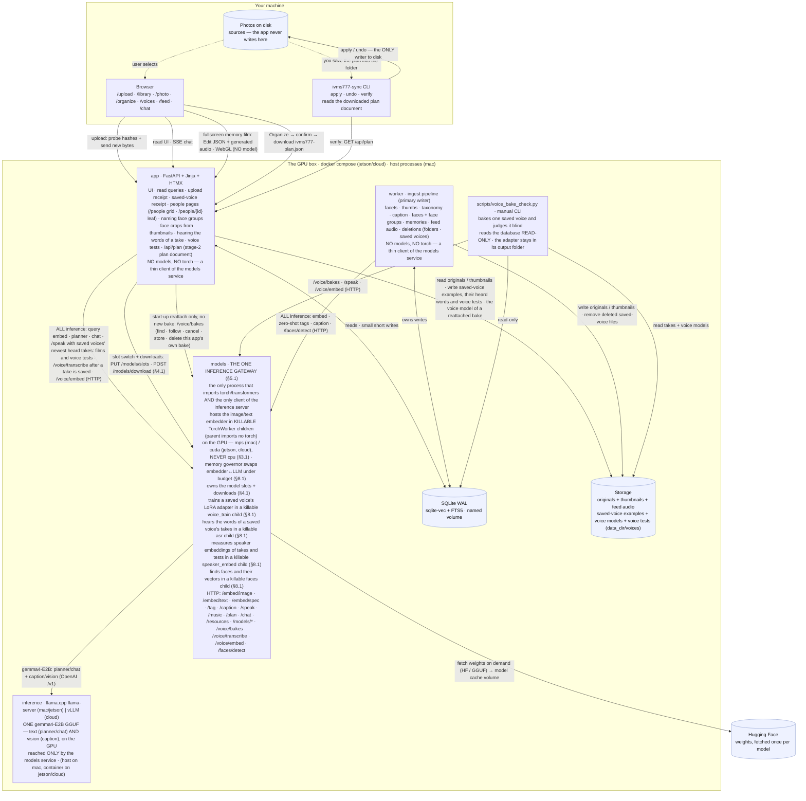
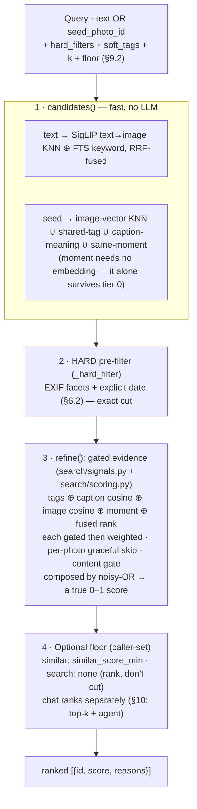
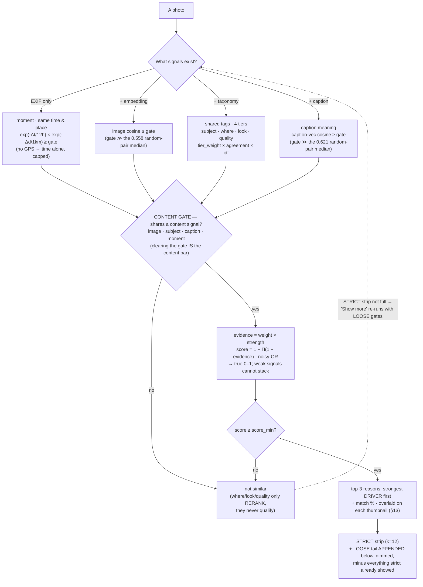
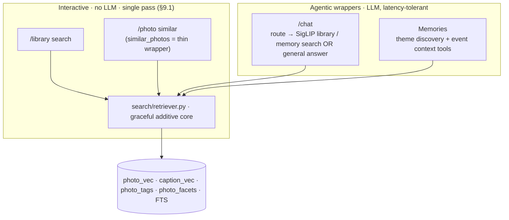
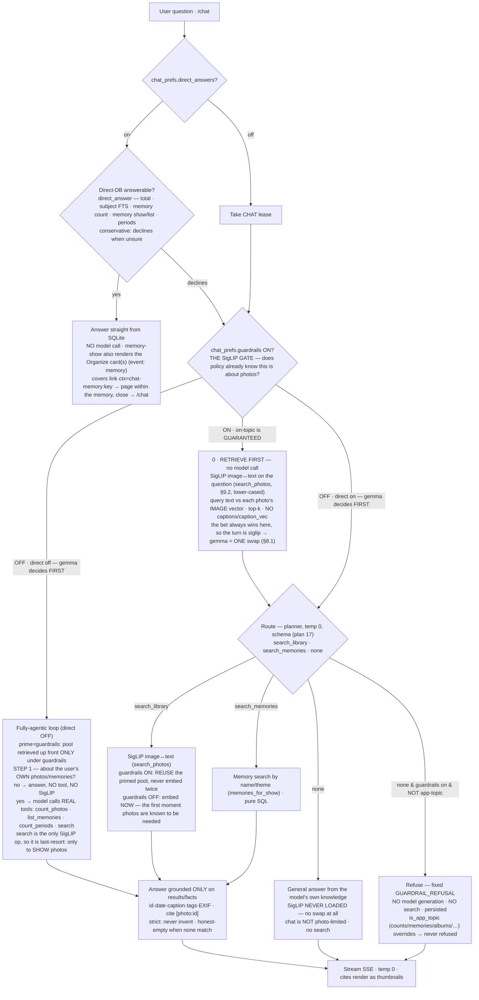
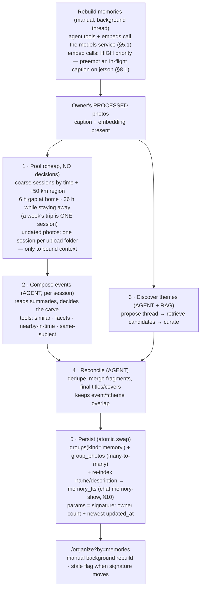

# Photo Library Organizer — Design

Status: approved design, ready for implementation planning
Date: 2026-08-13

## 1. Goal

A Python service with a simple web UI, deployed on a GPU box you control. It
works in two stages.

**Stage 1 — understand, in the cloud.** You select photos in the browser and
upload them. The service classifies every photo, writes a description and tags,
and lets you search, filter, find similar photos, browse suggested groups, and
ask questions about the collection in plain language.

**Stage 2 — reorganize, on your machine.** When the collection is fully
processed, Organize turns the principle on screen into a downloadable **plan
document**, and `ivms777-sync` — a small standalone CLI that runs on the machine
holding the photos — applies it: it creates one folder per album inside your own
folder, moves each file into the folder its album chose, writes each album's
description alongside, and sweeps redundant copies aside. Filenames never change.
It shows you every operation and asks before it touches anything.

The two stages share nothing but that plan document. The cloud never reaches into
your filesystem; the CLI never needs your library uploaded a second time.

All inference runs on hardware you control. Photos never go to a third-party
API.

## 2. Non-goals (v1)

- Search, filters and chat answers by person. Faces are found, grouped and named
  (§4.1, §8, §13), but no query reads them yet; see `docs/roadmap.md`.
- Authentication, signup, and per-user quotas. Deferred to v02; see section 3.2.
- Editing or rating photos in the cloud UI. The only thing that ever writes to
  your disk is `ivms777-sync`, and only on explicit confirmation.
- Cloud model APIs of any kind.
- Video files.

## 3. Constraints and targets

### 3.1 Deploy profiles

The same code runs in three places. `jetson` and `cloud` are containerised — a
base `compose.yaml` plus one per-profile overlay (`compose.jetson.yaml` /
`compose.cloud.yaml`). **`mac` is not containerised at all**: `make up` runs the
models service, the worker and the app as plain host processes, because only a
host process reaches the Apple GPU (see "Why `mac` is host-native" below). The
differences are which inference service is active, which model name is in config,
and — on `jetson` only — which app image is built (see "Jetson image" below).
Ingest is identical everywhere — photos always arrive by upload (section 3.2b),
so no profile depends on a host bind mount.

| Profile | Inference | Caption model | Planner / chat model | Embed device |
|---|---|---|---|---|
| `mac` | `llama-server` on the **host** (Metal) | `gemma4-E2B` | `gemma4-E2B` | `mps` |
| `jetson` | `llama-server` in a container (sm_87 CUDA) | `gemma4-E2B` | `gemma4-E2B` | `cuda` |
| `cloud` | vLLM in a container, `--gpus all` | `qwen2.5vl:7b` | `qwen2.5:3b` | `cuda` |

The model columns are the profile **defaults**, not a fixed roster: since plan 21
each of the four model **slots** (§4.1) is switchable at runtime from the settings
popup (§13), and the stored choice wins over these defaults. `cloud` is the
exception — its slots are config-only.

Since plan 16, `mac` and `jetson` run **one gemma4-E2B GGUF on llama.cpp
`llama-server`**, which serves **both** the caption (vision) and planner/chat
(text) roles over the OpenAI `/v1` API — so both model-name columns are the same
`gemma4-E2B` (the name is for storage/display; `llama-server` serves whatever
`-m` GGUF it loaded). Override with `IVMS777_CAPTION_MODEL` /
`IVMS777_PLANNER_MODEL`. There is **no Ollama** on either profile, and **no
in-process caption VLM** — captioning is a plain OpenAI call to `llama-server`
with the image as an `image_url` data-URI. `cloud` is unchanged by plan 16 (still
vLLM; an open item).

**Why `mac` is host-native — and why NOTHING on it may run on the CPU.** Docker
Desktop on macOS boots a Linux VM, and Apple exposes no GPU to Linux guests —
there is no Metal and no MPS in a container, and no configuration changes that.
Apple's own `container` project does not support GPU passthrough either. A
containerised model on a Mac silently falls back to the CPU: 3-6x slower for
`llama-server`, and **54x** slower for SigLIP (§8.1). That fallback is forbidden
here, so there is **no containerised `mac` path at all** — no `compose.mac.yaml`.
Everything model-related is a host process on the Apple GPU:

- `llama-server`, built natively with Metal (`-DGGML_METAL=ON`), on `:8080` —
  started by `make llama-mac`, reused (not supervised) by the models service.
- The `models` service itself, host-native, with **`embed_device=mps`**: SigLIP
  and the nomic caption-text embedder load through torch's Metal backend.
- `app` and `worker`, host processes reaching the models service at
  `localhost:9000` — they hold no model either way (§5.1).

`make up` starts all of it; the mac profile's defaults (`config.PROFILE_DEFAULTS`)
are the host-native URLs, not container hostnames.

On Linux this problem does not exist. Under `jetson` and `cloud` everything,
including inference, runs in containers with real GPU access via the NVIDIA
container runtime.

**Why llama.cpp and not vLLM on Mac and Jetson.** vLLM's Metal backend does not
support vision models, which is a core workload here, and Docker's own benchmarks
put it 1.2-1.3x behind llama.cpp on Apple Silicon with far more variance. On
Jetson, vLLM's aarch64 build is a maintenance burden — and crucially only a
source-built `sm_87` llama.cpp runs the gemma vision projector on the GPU (§4).
vLLM earns its place only under `cloud`, where continuous batching genuinely helps
with concurrent users.

**Jetson sizing.** After the real, non-reclaimable baseline (kernel + firmware
carveout + system daemons **plus the `app`/`worker`/`models` Python containers**,
~3 GB in practice — higher than the ~1.5 GB kernel-only figure), only **~4.3 GB**
is free for models. gemma4-E2B on the `llama-server` child measures **~5.0 GB**
resident — Q4_K_M weights (~3.1 GB) + the F16 mmproj (~1 GB) + KV/compute buffers +
its own CUDA context — far larger than the SigLIP (~1.6 GB) + nomic (~0.3 GB) torch
models the `models` service hosts in its `TorchWorker` children (§8.1). So **gemma and SigLIP CANNOT be
resident together**: the memory governor (§8.1) evicts SigLIP before it loads gemma
and reloads it afterwards — they **swap** across the embed↔caption stage boundary.
The catalog's per-model cost figures (§4.1, overridable with
`IVMS777_MODEL_COST_MB`) must track these real figures: an under-estimate for gemma makes it skip the eviction and load gemma
on top of SigLIP → OOM.

Everything model-related runs **on the GPU — never the CPU. There is no CPU
offload, on any profile.** gemma must therefore fit **entirely** in GPU RAM:
`llama-server` is launched with **`-ngl 99` (every layer on the GPU)**, and the
conveyor makes room by evicting SigLIP + nomic first (§8.1).

**gemma has two spawn modes, and the vision projector is loaded ONLY for
captioning** — it is the model's vision half, useless to a text turn:

| mode | residency unit | slot | spawn | used by |
|---|---|---|---|---|
| text | `llm` | `planner` | `-m <planner gguf> -ngl 99` | chat, planner |
| vision | `llm_vision` | `caption` | `-m <caption gguf>` **+ `--mmproj`** | captioning |

The two are **mutually exclusive** — one `llama-server` child, one port — so loading
either frees the other. Chat therefore never pays the projector's ~531 MB, which on
the 8 GB board is the difference between ~170 MB and ~700 MB of headroom.

The projector is the **Q8_0** build — `mmproj-gemma-4-E2B-it-Q8_0.gguf` (531 MB) from
`ggml-org/gemma-4-E2B-it-GGUF`, the default since the F16 projector (985 MB) is what
OOM-aborted `llama-server`: its CLIP tensor buffer (589 MiB) was the allocation that
failed. The weights still come from `unsloth/…`, so the projector has its own repo
var (`LLAMA_MMPROJ_REPO`). A small KV context (`IVMS777_LLM_CTX`, jetson 2048) keeps
the rest down. **mac is not memory-bound and does not pay that price: it serves
`-c 32768`** (`make up` passes `LLAMA_CTX` and exports the same number to `app`/
`worker`). Measured on a 32 GB machine, llama-server is 4.11 GiB resident at 4096 and
4.28 GiB at 32768 — gemma's sliding window keeps the KV cache small, so the whole
increase costs ~0.17 GiB. 4096 was not a saving, it was a ceiling: a 40-shot memory's
story prompt is ~6 300 tokens, llama-server **rejects** (never truncates) an
over-long request, and the film failed for want of narration. `make llama-mac` reads
the running server's `/props` and RESTARTS it when its context is not the wanted one —
a `-c` change is the one thing that does not hot-reload, and a stale server looks
exactly like a broken feature. If a pinned all-GPU load still does not fit, `llama-server` aborts at
model load (`failed to fit params to free device memory … abort`) — that is a **hard,
surfaced error** (`app` streams an error turn to the chat UI), and the only fix is
to **shrink the GPU footprint** (smaller KV context, Q8 projector, smaller model
weights), **never** to spill layers to the CPU. mac keeps `-ngl 99` (Metal, ample
RAM). At MAXN_SUPER expect ~5–6 s/photo for captioning with gemma fully on the GPU.

**The empirical reference — device facts, the MAXN_SUPER power-mode lever, the
single-stream decode benchmark, and the GPU-vision benchmark that proved a
source-built `sm_87` `llama.cpp` runs the gemma projector on the GPU (0.57 s/img)
— lives in [`docs/jetson-tuning.md`](jetson-tuning.md).** That measurement is the
basis of plan 16: one gemma4-E2B GGUF on `llama-server` doing text (~30 tok/s) and
vision on the GPU, replacing qwen-text + the in-process VLM, and dropping Ollama
on jetson.

The shipping default on both `mac` and `jetson` is the single **`gemma4-E2B`
GGUF** served by `llama-server` for both roles. It is not an Ollama tag or an HF
`transformers` load any more — `llama-server` loads the GGUF (`-m` + `--mmproj`)
that the entrypoint fetches into the mounted volume on first run (jetson) or
`make llama-mac` downloads to `$HOME/.llama/models` (mac) — a persistent cache
outside the library dir, so `make clean` keeps both the GGUF and the built
`llama.cpp`; only `make llama-rebuild` wipes them. `IVMS777_CAPTION_MODEL`
/ `IVMS777_PLANNER_MODEL` override the name used for storage/display; the actual
weights are whichever GGUF `llama-server` was pointed at. Published benchmark
scores do not settle the captioner choice on their own — the phase 1 bake-off
decides it on real photos.

**Jetson image.** Only the `models` service needs GPU/torch on Jetson —
`app`/`worker` build from the same generic `Dockerfile` as every other profile
(`python:3.12-slim`, CPU-only PyPI `torch`), and never import it: they are thin
HTTP clients (§5.1). The `models` service instead builds from a dedicated
**`Dockerfile.models.jetson`** (repurposed from the old `Dockerfile.jetson`,
which used to build `app`/`worker` directly, back when SigLIP ran in-process
there) — which, on **JetPack 7** (L4T r39, CUDA 13.2), is the *same*
`python:3.12-slim` image as the mac/cloud `Dockerfile.models` with **one
change: `torch` + `torchvision` come from the CUDA-13.2 index**
(`https://download.pytorch.org/whl/cu132`) instead of the CPU PyPI wheel.
JetPack 7 exposes the Orin as **SBSA**, so those upstream CUDA-13.2 wheels run
on the iGPU directly, and the NVIDIA container runtime (`runtime: nvidia`)
hands that iGPU to the two containers that need it — `inference` (the sm_87
`llama-server`, built from `Dockerfile.llamacpp.jetson`) and `models`;
`app`/`worker` declare no GPU access at all. The `models` container
must also declare `NVIDIA_VISIBLE_DEVICES=all` + `NVIDIA_DRIVER_CAPABILITIES=all`:
unlike the CUDA base images, the `python:3.12-slim` base does not set them, and
without them the runtime injects no driver libs, so `libcuda` is absent and
`torch.cuda.is_available()` is `False`. There is **no jetson-containers, no
dusty-nv base image, and no `autotag`**: JetPack 7 ships system Python 3.12,
matching `pyproject.toml`'s `>=3.12` floor, so the image runs the normal `uv
sync --extra models` from `pyproject.toml` and then reinstalls
`torch`/`torchvision` from the cu132 index over the CPU torch that `uv sync`
brought. `numpy` stays on `pyproject`'s `>=2.5.2` — the cu132 wheels are built
against NumPy 2.x, so no Jetson-specific numpy pin is needed.

**Captioning + text both run on the `sm_87` `llama-server`; nothing captions
in-process.** Both roles are one source-built `sm_87` `llama.cpp` (the
GPU-vision rationale is in [`docs/jetson-tuning.md`](jetson-tuning.md)). That
binary is **built once** and reused: on the target board the `inference` compose
service runs the prebuilt `llama-server` from the `llamacpp` volume under the
cu130 image (no in-image recompile), and `Dockerfile.llamacpp.jetson` is the
reproducible from-scratch builder for a fresh board. Captioning is therefore a
plain OpenAI `/v1/chat/completions` call to the `inference` container with the
image as an `image_url` — no `transformers` VLM, no `bitsandbytes`/`accelerate`,
no C toolchain in `Dockerfile.models.jetson`. The `models` service on jetson
loads only SigLIP and the small nomic caption-text embedder on the cu132 GPU.

### 3.2 Multi-tenancy

v1 ships as a single-user product with multi-user bones. There is **no auth, no
login, no user table, no admin role, no signup, and no quotas**. There is one
implicit owner, and `owner_id` is a constant. Deploy it behind a private URL or
a reverse proxy that requires a password.

But three things are cheap now and expensive to retrofit, so they are in from
the start:

- `owner_id` on every user-scoped row and in every query.
- Photo bytes reached through a `Storage` interface (local filesystem now,
  object storage later).
- Inference reached through one HTTP client, so swapping the inference server
  (llama-server / vLLM) is a config change.

v02 adds accounts, signup, and quotas on top of this. Because upload is already
the only ingest path and every row is already owner-scoped, that is an additive
change: no data migration, no rewrite of every query.

### 3.2b Getting photos in — upload

Photos arrive by browser upload. There is no host bind mount, no server-side
folder picker, and no path the server walks. The server never sees your
filesystem; it sees the bytes you chose to send.

The upload screen accepts a whole directory (`<input webkitdirectory>`) or a
drag-and-drop selection, and runs in three steps:

1. **Hash locally.** A Web Worker computes each file's SHA-256, one file at a
   time, off the main thread. WebCrypto has no incremental digest, so a file is
   read whole — handling them one at a time bounds memory to the largest single
   photo rather than the size of the selection. Nothing is sent yet.
   `crypto.subtle` exists only in a *secure context* (HTTPS or `localhost`), but
   the app is normally reached over plain HTTP on the LAN (`http://<jetson>:8000`)
   where it is `undefined`; so the worker falls back to a pure-JS SHA-256 there.
   The fallback digest is byte-identical to the server's `hashlib.sha256`, which
   step 2's probe and step 3's server-side verification both depend on.
2. **Ask what is new.** The client POSTs each hash *with the path it came from*
   to `/api/upload/probe`, which answers with the subset whose bytes the server
   has never seen. Paths for content it already holds are recorded on the spot —
   that is what keeps duplicate detection correct when no bytes move.
   Re-uploading a folder you already sent transfers nothing.
3. **Send the new bytes.** Files upload in bounded concurrent batches with a
   per-file progress row. The relative path from the selected root travels
   alongside each file and is recorded, because that path is what stage 2 needs
   to find the file again on disk.

Interruptions are cheap: closing the tab loses only in-flight files, and
restarting the upload re-probes and resumes with what is still missing. The
server verifies the hash of every received file before storing it, so a
truncated transfer is rejected rather than indexed.

Originals are kept. They are written through the `Storage` interface under a
content-addressed key and are needed for full-resolution viewing and for
re-processing the library when a better model arrives.

**Why upload rather than a host mount.** A mounted folder is faster and copies
nothing, but it only works when the app runs on the same machine as the photos.
That constraint defeats the point of a hosted GPU. Upload costs disk and a first
transfer; in exchange, ingest is one code path on every profile, the container
boundary needs no holes, and the same deployment serves a user who is nowhere
near it.

**Why not have the browser reorganize files directly.** The File System Access
API can write to a user-picked directory (`showDirectoryPicker()` plus
`FileSystemFileHandle.move()`), but only on Chromium desktop — Firefox has no
directory picker, Safari is read-only, and mobile has neither. It is also
**secure-context only**, so on the normal LAN address `http://<jetson>:8000` the
whole API is `undefined` — the same wall `crypto.subtle` hits above, and a fatal
one here because there is no pure-JS fallback for writing to a disk. Stage 2 is a
CLI instead (§12), which works on every OS and has no browser to disagree with.

### 3.2c The upload folder list, and deleting a folder

The library is organised as a **list of folders** — one per distinct
`uploads.root_label` — persisted in the database, so it survives restarts (the
browser file picker cannot remember a selection). `/upload` shows every folder
with its live photo count; a directory-only picker adds a new one and uploads its
photos into the library.

**Deleting a folder removes it from the LIBRARY, never from disk.** The source
folder on the user's machine is a *source* and is never read, moved, or deleted by
the app (§3.2b) — deletion only removes the library's uploaded copies and their
derived state. It removes: the folder's `uploads` rows, every photo sourced only
from that folder, and *all* of each deleted photo's metadata — `photo_vec`,
`caption_vec`, tags, facets, FTS row, jobs, group memberships, faces, thumbnails,
and the stored original. A photo whose identical bytes still belong to another folder is
kept with its faces; only that folder's `photo_sources` path is dropped. A face group
(§6) left with no face after the cascade is deleted in the same drain.

A memory (§11) whose photos all lived in the deleted folder is left with no
`group_photos`; the cascade prunes that now-empty `groups(kind='memory')` row and
its `memory_fts` entry, so a memory the delete emptied disappears from Organize and
chat search in lockstep — never lingering as a coverless, crash-prone orphan.

**Deletion runs through an outbox + worker**, never inline. `POST
/upload/folder/delete` records the intent in `folder_deletions` and returns
immediately; the folder shows "deleting…". The worker drains the outbox each pass
(`process_folder_deletions`) and does the cascade, so a delete is reliable across
restarts and never blocks the UI. This is the Outbox pattern.

### 3.3 Scale

- Collection: 1,000-5,000 photos for the first user.
- First upload of 5,000 photos is a background transfer measured in tens of
  minutes; the first full index may run overnight. Both must be resumable and
  observable.
- The cloud never modifies an uploaded original. Only `ivms777-sync` writes to
  your disk, only after you confirm a plan, and every operation it performs is
  journaled and reversible (section 12).

## 4. Models

The app runs **four model slots** (§4.1), all inside the one `models` service
(§5.1), loaded once — never in `app`/`worker`. **The exact slot→model→backend
table, the catalog, per-profile wiring, download mechanics, and the settled
caption-embedding decision live in [`docs/models.md`](models.md).** The shipping
defaults:

- **SigLIP 2** does image + text embeddings and zero-shot tags, in a `TorchWorker`
  child of the models service (MPS on mac, CUDA on jetson) — neither `llama-server`
  nor vLLM exposes an image-embedding endpoint, so it cannot move behind them.
- **One `gemma4-E2B` GGUF on `llama-server`** does **both** captioning (vision) and
  planner/chat (text) on mac/jetson — one model, one process, on the GPU (§3.1).
  `cloud` keeps Qwen2.5 (vLLM). Prompts are a per-model template registry, so
  adding a model is a template, not pipeline surgery.
- **A dedicated text embedder (`nomic-embed-text`)** embeds caption text for §9
  similarity, NOT SigLIP — SigLIP's text tower is trained image↔text, so text↔text
  has no separation (measured). The `caption_vec` it produces is a **top-k KNN**
  retrieval index, never a fixed cosine floor. Full rationale + benchmarks:
  [`docs/models.md`](models.md).

Gemma 4 is used over the dominated Gemma 3. The default caption model is chosen by
a **bake-off** on real photos, not published benchmarks — the winner is a config
default, not code.

### 4.1 Model slots — the catalog, and switching a model while the app runs

The models above are not hardcoded: they are the **defaults of six slots**, and the
user picks a different model per slot from the settings popup (§13) while the app is
running. A slot is the unit everything else names — the registry, the governor's
budget, the scheduler's "needs" list, and the ingest stages a switch invalidates.

| Slot | Default | Role | Switching invalidates |
|---|---|---|---|
| `image_embed` | SigLIP 2 `so400m-patch14-384` | image + text vectors, zero-shot tags | `embed` → `taxonomy` |
| `text_embed` | `nomic-embed-text-v1.5` | caption-meaning vectors (§9) | `caption_embed` |
| `caption` | `gemma4-E2B` GGUF (vision) | the caption sentence | `caption` → `caption_embed` |
| `planner` | `gemma4-E2B` GGUF (text) | query planner + chat | nothing (no stored output) |
| `voice` | Kokoro-82M (en) · Silero v4_ru (ru) · VoxCPM2 = saved voices (en, ru; mac/cloud) | the narration read over a memory film (§11.1) | nothing (no stored output) |
| `music` | MusicGen **medium** on mac · small on jetson/cloud | the score generated per memory film (§11.1) | nothing (no stored output) |

**`off` is a real catalog entry, not a missing one.** `voice` and `music` are the two
**optional** slots, so the catalog carries an `off` entry (`source=NoSource()`,
`cost_mb=0`) for each. Selecting it unregisters the residency unit entirely, so the
governor never budgets for it and the settings popup shows it as always "on disk".
The feed then degrades honestly for MUSIC only: no music means the film plays silent.
**Narration is not optional** — a film whose voice cannot be produced FAILS (§11.1)
rather than playing mute. `music` is `off` **by default on jetson**
— its resident cost is an estimate, and an unmeasured ~3 GB child on a board with
~4.3 GB free must be opted into, never defaulted on (§8.1).

**A voice entry declares which languages it can speak.** `voice` is the one slot whose
usable set depends on something outside the slot — the film's language (§11.1). So a
`voice` entry carries `languages` (`("en",)` for Kokoro, `("ru",)` for Silero),
`POST /speak` takes the language, and it answers **503** when the selected voice cannot
speak it. Kokoro ships nine languages upstream but **not Russian**, which is exactly
why a second entry exists rather than a bigger one — and why the settings popup states
each voice's languages.

**A `clones` entry speaks SAVED voices, never presets.** `voxcpm2` (VoxCPM2,
`openbmb/VoxCPM2` pinned to one Hub commit, `profiles=("mac", "cloud")`,
`languages=("en", "ru")`) carries `clones=True` and declares **no `speakers`**: it
reads a passage in the voice of an example clip that the request itself brings
(`references`, §5.1). A take holds no words when it is added, recorded or uploaded:
its words exist only after speech recognition hears them, right after the take is saved
(§6, §11.1). Saved
voices and presets never meet in routing. `voice_entry_for` and
`ensure_voice_for` consider only the entries whose `clones` matches the request —
selected entry first, then catalog order: a request with no `references` routes among
the presets only, so Kokoro stays the voice default on every profile and no preset film
changes, and a request with `references` routes to the cloning entry only, so a saved
voice never reaches a preset child. The speakers rule (CLAUDE.md § "A model's own
metadata is DECLARED") does not apply to a `clones` entry: its voices are user data,
never a `catalog.Speaker`. `catalog.cloning_entry_for(profile, language)` and
`cloning_languages(profile)` answer "is voice copy available here" from the catalog
alone; jetson lists no cloning entry. The voice child of an entry comes from
`VOICE_TARGETS[key]` with no fallback — an unknown key raises instead of loading Kokoro.

**A cloning entry may declare an `AdapterSpec`** (`ModelEntry.adapter`). With it, a
saved voice can be **baked**: a LoRA adapter of the cloning model is trained on the
voice's takes, and the result is one adapter file per voice. **`app` no longer bakes
and no longer speaks through an adapter**: a film and a test of a saved voice speak
from ONE take, the newest take of the language whose words were heard (§11.1). In a
blind test of 28 clips that take alone beat the stored baked model (likeness 4.75 vs
3.00, accepted 12 of 12 vs 6 of 12), and it needs no training time. The stored voice
models, their files, the trainer and `/voice/bakes` stay for
`scripts/voice_bake_check.py` (`docs/models.md`); removing them is a separate task.
`voxcpm2` declares one, as data beside the model:

- `lora` — the LoRA shape: the package's own `LoRAConfig` defaults with the LM and the
  DiT on and the projections off (rank 8, alpha 16, dropout 0, on `q_proj`, `k_proj`,
  `v_proj` and `o_proj`). The trainer and the voice child both read it from the catalog,
  so their shapes always agree.
- `train_cost_mb` 14000 and `train_cost_measured=False` — the resident cost of the
  training child (§8.1). It is an **estimate** until a bake is measured.
- `train_profiles=("mac",)` — where the models service trains. `catalog.adapter_entry_for(profile)`
  names the entry that bakes on a profile; jetson and cloud have none yet, and a bake
  request there answers "baking a voice is not offered on this device yet" (§5.1).
- `guidance_minutes=(5, 10)` — the package authors' figure of 5-10 minutes of audio. It
  is their guidance, not a promise of a result.

An adapter is used wherever the entry runs (a voice baked on the mac also speaks on
cloud), and only at the entry's pinned revision: the file records the revision and the
LoRA shape, and the voice child refuses a file made for another (§5.1). The voice child
of `voxcpm2` is always built with these LoRA layers (about 18 MB in float32, an
estimate, inside `cost_mb` 10500). With no adapter loaded every LoRA B weight is zero,
so the layers add no adapter contribution; their extra matmuls still run, and their
cost is not measured. The catalog `note` of `voxcpm2` says the same.

**The speech recognition of a take.** A film and a test send the take's words with its
audio (the child then continues from the person's own speech, §5.1), and the user types
no words: a take is free speech, and the recording kit's text is only a suggestion
(§11.1). So the catalog declares one speech-recognition model beside the slots, in a
tuple of its own, `catalog.TRANSCRIBERS`:

- `whisper-large-v3-turbo` — `openai/whisper-large-v3-turbo` pinned to the Hub commit
  `41f01f3…`, MIT weights, `languages=("en", "ru")`, `profiles=("mac", "cloud")`,
  `cost_mb` 4000 with `cost_measured=False` — an **estimate** (`docs/models.md`). It
  runs on every profile that clones (MPS on mac, CUDA on cloud, float32 on both), so
  each take is heard right after it is saved wherever a saved voice can speak. A
  profile with no transcriber hears no words, so no saved voice is ready for films
  there; jetson clones nothing and lists none. There is no CPU path and no fallback
  that speaks a take without its words.
- It is **no slot and no user choice**: `SLOTS`, `DEFAULTS`, `CATALOG` and the settings
  popup do not list it. `catalog.transcriber_for(profile)` names the entry offered on a
  profile, else `None`.
- `app` asks for it right after a take is saved (§11.1): the hearing job hears every
  take of the voice that has no words yet. The bake check's bakes ask for it too.
  Nothing else uses it.

**The speaker-similarity meter.** A test of a saved voice is judged by ear, and the
user also needs a number that compares generated speech with the recordings (§11.1). So
the catalog declares one speaker-verification model beside the slots, in a tuple of its
own, `catalog.SPEAKER_EMBEDDERS`:

- `ecapa-voxceleb` — `speechbrain/spkrec-ecapa-voxceleb` pinned to the Hub commit
  `0f99f2d…`, Apache-2.0 weights, `dim` 192, `profiles=("mac",)` (on cloud a test is
  still saved: its measure fails and is stored as `likeness_error`, §11.1), `size_mb` 85 for the whole pinned
  snapshot (its pretrainer also loads `classifier.ckpt` and `label_encoder.txt`),
  `cost_mb` 1000 with `cost_measured=False` — an **estimate** (`docs/models.md`).
- It is **no slot and no user choice**: `SLOTS`, `DEFAULTS`, `CATALOG` and the settings
  popup do not list it. `catalog.speaker_embedder_for(profile)` names the entry offered
  on a profile, else `None`. The name is not `SPEAKERS`, because `ModelEntry.speakers`
  means preset narrators.
- It **measures only**. It changes no synthesis, no adapter and no reference, and a film
  never calls it. Only the speaker-similarity step of a test (§11.1) and
  `scripts/voice_bake_check.py` ask for it.

**The face model.** The `faces` ingest stage (§8) finds the faces of each photo and
describes each one with a vector, so the worker can group the faces of one person and
the owner can name the group (§6, §13). So the catalog declares one face model beside
the slots, in a tuple of its own, `catalog.FACE_MODELS`:

- `buffalo-l` — InsightFace `buffalo_l` from `immich-app/buffalo_l` pinned to the Hub
  commit `d097159…` (the ONNX export Immich uses for the same feature): the SCRFD-10G
  detector (`detection/model.onnx`, a box, a score and 5 landmarks per face) and the
  ArcFace R50 recogniser (`recognition/model.onnx`, a 512-value vector of a face aligned
  to 112×112 by its 5 landmarks). `dim` 512, `profiles=("mac", "jetson", "cloud")`,
  `size_mb` 182 for the two ONNX files, `cost_mb` 1000 with `cost_measured=False` — an
  **estimate** (`docs/models.md`).
- **The weights are non-commercial.** InsightFace licenses its model zoo for
  non-commercial research only. The app is a private family library, so it is allowed
  here, like MusicGen's CC-BY-NC weights: never ship it in a commercial build. The
  catalog `note` says the same.
- **It runs on the GPU through torch, never ONNX Runtime.** The child converts both
  ONNX graphs to torch with `onnx2torch` at load and runs them on `mps` or `cuda`; a CPU
  device is a load error, and there is no CPU fallback (§3.1). The models service keeps
  one GPU runtime, torch.
- **Its use is declared, not chosen at the call site** (CLAUDE.md § "A model's own
  metadata is DECLARED"): `score_floor` 0.7 (a lower detection score is dropped),
  `match_threshold` 0.5 (the lowest cosine similarity that joins a face to a group,
  §8), `input_edge` 640 (the long edge the worker shrinks a photo to before it sends
  it) and `min_face_px` 32 (a smaller face side is dropped). The floor and the
  threshold are Immich's public defaults for this model, not tuned on this library;
  `config.py` lets an env value override the threshold and the minimum group size of
  "Faces to name" (2, §13).
- It is **no slot and no user choice**: `SLOTS`, `DEFAULTS`, `CATALOG` and the settings
  popup do not list it. `catalog.face_model_for(profile)` names the entry offered on a
  profile, else `None`.
- Only the `faces` stage asks for it, through `POST /faces/detect` (§5.1).

`caption` and `planner` are **separately selectable but share one `llama-server`
child** — one process, one port. If they resolve to different GGUFs the child
restarts when the role changes, which is exactly the cost shape the existing
text↔vision restart already has (§3.1); pointing both at one GGUF (the default)
keeps that restart to the projector alone.

**The catalog is data, in the repo** (`models/catalog.py`, no torch import). One
entry per selectable model, carrying everything every consumer needs so nothing
downstream has to know model names:

- `source` — the Hugging Face repo id, the GGUF repo + file (+ mmproj file), or
  `NoSource()` for the `off` entry of an optional slot (nothing to fetch, nothing
  to load, always "on disk"). An `HfSource` can pin a `revision` (a Hub commit;
  `None` = the repo's `main`). A pinned entry is fetched at that commit
  (`hf:<repo>@<revision>`), its child loads exactly that snapshot, and the model
  reports the revision with its output (§5.1), so a stored result can be bound to it.
- `cost_mb` — the resident cost the governor budgets against (§8.1), and whether
  that figure is **measured on this board or an estimate**. An estimate is shown
  as unverified in the UI, because an over-estimate can make a model unloadable
  and an under-estimate OOMs the box (§8.1).
- `dim` — the embedding width (embedder slots only). It decides whether a switch
  must rebuild `photo_vec` (§6).
- `preprocess` — `{input_px, resample, mode}` for image embedders. `mode: squash`
  is today's aspect-ignoring stretch to a fixed square; `mode: native` (NaFlex,
  and any native-resolution encoder) means fit-inside `input_px` with the aspect
  ratio kept. **The client resizes by this spec, never by a constant** — see §5.1's
  `/embed/spec`.
- `prompt_template` — the key into `inference/prompts.py` (LLM slots only), so
  adding a model stays "add a template", not pipeline surgery.

Only catalog entries are selectable. A free-form model id is deliberately not
offered: `cost_mb`, `dim`, and `preprocess` cannot be guessed at runtime, and each
of the three breaks something different when wrong.

**A switch is a re-index, and says so before it runs.** The selection lives in
`app_settings` (§6), owned by `app`; resolution is **stored choice → env override →
profile default**. Confirming a switch, in one transaction:

1. writes the new slot choice,
2. rebuilds `photo_vec` when `image_embed`'s `dim` differs from the live table
   (vectors from two encoders are not comparable — the old ones are dropped, not
   migrated),
3. calls `jobs.reprocess()` over the slot's invalidated stage range (table above),

then pushes the switchable slots (`catalog.is_switchable`) to the `models` service —
never the automatic `voice` slot, which the `models` service owns. The `worker` drains the requeued
stages exactly like any other reprocess, with the same per-stage progress rows (§8);
search and "similar" run against a thinning index until it finishes, which is why the
popup states the photo count before it asks for confirmation.

**Every vector records the slot that made it.** The `embed` stage stamps the
**resolved** `image_embed` catalog key on `photos.embedding_model` (§6) — the column
the photo page shows ("Embedded for semantic search (…)", §13). The env override is
not the answer, and neither is a hardcoded id: reading `embed_model_name` directly
made every photo claim `siglip2-so400m-patch14-384` regardless of the selection, the
same bug the chat header had. A stamp that is **not** a catalog key is therefore a
legacy one, and the next drain pass relabels it to the current slot rather than
re-embedding a library to correct a string — the vectors were always the slot's,
since only the `models` service ever picks the model (§5.1).

**No model name is ever snapshotted — every one is read from the slot at the moment
it is used.** The rule above is not about one column; it holds for every name that is
stored, sent, or shown:

- `photos.caption_model` is the **resolved** `caption` key, reported by the service
  with the caption it produced, and the same entry's `prompt_template` is what
  builds that request — so a switched-in model is never given another model's prompt.
- the caption-vector stage (§9) embeds under the resolved `text_embed` key, whose
  family picks the task prefix — a stale name prefixes documents for an encoder that
  is not loaded, which silently degrades every caption vector.
- the resource bar (§13) and the chat header name the resolved `planner` key.

The `models` service is where this is easiest to get wrong: it builds its
sub-backends once, at boot, on the profile defaults, and `app` pushes the stored
selection only afterwards. So each sub-backend holds a **provider** of its slot entry
and re-reads it per request; a captured entry means every caption is stamped
`gemma4-E2B` and prompted as gemma no matter what the user selected.

The `models` service holds no database, so it cannot read the choice itself: it
starts on the profile defaults and reports **which model each slot currently holds**
(on `GET /resources` and `GET /models`, alongside a `generation` counter that moves
on every switch). `app` compares the reported **switchable** slots
(`catalog.is_switchable`) with its own resolved selection on the resource-bar poll it
already makes (§13) and re-pushes only those when they differ — so a `models` restart
converges back to the user's selection without a coordinating store, and no second
polling loop exists. The automatic `voice` slot is in neither the comparison nor the
push: the `models` service owns it (`ensure_voice_for` routes each request — VoxCPM2
for a saved voice, Silero for Russian), and `app` resolves it only to the profile
default, so pushing that back would unload the routed voice child, mid-call too. On
`cloud` nothing is switchable, so nothing is pushed. The `generation` is what
invalidates the caller's cached `/embed/spec` (§5.1).

## 5. Architecture

Three containers and one SQLite file in the cloud. One standalone binary on your
machine.

This diagram is the **canonical architecture picture** — keep it in step with the
components and flows described in this section (CLAUDE.md § "docs/design.md is the
source of truth").

`app` serves the UI, read queries, upload receipt, and the stage-2 plan endpoint.
`worker` owns the ingest pipeline and is the primary writer. Both open the same
SQLite file in WAL mode with a busy timeout — SQLite permits one writer at a
time, and `app`'s writes are small and short (recording a received upload,
accepting a group, editing vocabulary, saving a voice example or a voice test, naming a
face group), so contention stays
negligible at this scale. If public traffic ever makes that false, the fix is Postgres, and the
repository layer is the only thing that changes.

**All model work lives in one process — the `models` service (§5.1).** `app` and
`worker` never import torch/transformers or load a model; they call the `models`
service over HTTP. This is the hard rule (CLAUDE.md § "One model process"): a model
or AI library is loaded **once**, in one process, never duplicated across
containers. It is what makes the 8 GB Jetson viable — a SigLIP loaded in both `app`
and `worker`, each with its own torch CUDA context, is exactly what exhausted the
unified memory.

**One implementation, both platforms.** The `models` service is the same code on
mac and jetson; only its *internals* switch by profile: SigLIP and the nomic
caption-text embedder run on **MPS** on mac and **CUDA** on jetson — always a GPU,
never the CPU (§3.1) — and captioning is the same OpenAI `/v1` call to
`llama-server` on both (host on mac, container on jetson). The service picks these
from config; `app`/`worker` and the whole request flow are identical across
platforms.

`ivms777-sync` is not part of the deployment. It executes a plan document the
browser downloaded — `apply` needs no network at all, and only `verify` calls
`app` — and it is the only component that ever writes to your disk.

Vector search uses `sqlite-vec`, which ships prebuilt wheels for arm64 and
x86_64, so the same code works on Mac, Jetson, and cloud. At 5,000 photos a
brute-force scan would also be fine; `sqlite-vec` is there so growth to 100k+
needs no new component.

### 5.1 The `models` service — the one inference gateway

**Every model, LLM, embedder, and heavy AI library lives in exactly one service:
the `models` service.** It is the only service that touches `torch`/`transformers`,
the only one that loads SigLIP or the caption-text embedder, and the only client of
the inference server (`llama-server` / vLLM). `app`, `worker`, and the CLI hold
**no models and no torch** — they are thin HTTP clients of this service (CLAUDE.md
§ "One model process"). Loading the same model in two processes is forbidden; on
the 8 GB unified-memory Jetson a duplicated SigLIP plus two torch CUDA contexts is
exactly what exhausted memory.

**The service owns supervised children, and its own process holds no model.**
gemma is the `llama-server` child (§3.1); SigLIP, nomic and every other model (voice,
music, training, speech recognition, speaker embedding, faces) are one `TorchWorker`
child each (§8.1, `modelsvc/torch_process.py`). The FastAPI parent imports **no**
torch at all — it starts, calls, and **kills** children, because ending the process
is the only way a CUDA context's memory comes back. This is the one-model-process
rule, not an exception to it: one owner, one copy of each model, everyone else on
HTTP.

**HTTP surface** (the whole app's inference vocabulary):

- `POST /embed/image` — SigLIP image embeddings (ingest `embed`, "similar"). The
  caller (`RemoteEmbedder`) resizes each image to SigLIP's **384×384** input,
  bilinear, before the PNG encode. That is exactly what the model's processor
  does to any input it is given (`do_resize`, `size: 384×384`, `resample:
  BILINEAR`), so the vectors are bit-identical — but it is the difference
  between a working ingest and a stalled one: PNG-encoding a full-resolution
  original cost 5.7 s of CPU and a 15 MB base64 body per photo on the Jetson,
  against ~10 ms of GPU, pinning the embed stage at 0.32 img/s with the GPU idle
  96 % of the time. Only valid for a **fixed-resolution** SigLIP checkpoint —
  a NaFlex variant consumes native resolution and would lose signal here.
- `POST /embed/text` — SigLIP **text** embeddings for search/chat query vectors
  (same joint space as the image vectors).
- `POST /tag` — SigLIP zero-shot scoring against `vocab.yaml` (ingest `taxonomy`).
- `GET /embed/spec` — the image embedder's **calibration and its preprocessing
  contract**: `logit_scale`, `logit_bias`, and the slot's `preprocess`
  (`input_px`, `resample`, `mode`) plus the slots `generation` (§4.1).
  `RemoteEmbedder` fetches and caches it, so taxonomy scoring (§9) stays
  client-side *and* the caller's pre-resize follows the model instead of a
  hardcoded 384. It re-fetches when the generation moves. (It replaces the
  calibration-only `GET /embed/calibration`.)
- `POST /caption` — a caption sentence (title/description) for one image (OpenAI
  `/v1` call to `llama-server` with the image as an `image_url`, §4). It returns
  **no tags** — tags are SigLIP-only (§7).
- `POST /speak` — `{text, language, voice, segments, voices, references}` →
  `{audio (base64 WAV), sample_rate, model, segments, revision, conditioning}`: the
  whole narration of a memory film (§11.1), from the `voice` residency unit.
  `Priority.BATCH`, label `narrating` — a film is prepared offline and must never
  preempt a search or a chat turn.
  - `segments` is the EXACT list of chunks to speak, in order; `voices` is one speaker
    per segment (a `[voice]` bracket, §11.3; `None` or a shorter list falls back to
    `voice`). Same-voice runs are spoken as one call, and the reply's `segments`
    (`[{text, start, end}]`, seconds) says where each chunk landed, because the film
    cuts on the narration (§11.1).
  - `references` (optional) asks for SAVED voices: `{token → {audio (base64 PCM-16 WAV
    of one example), sha256, language, transcript, conditioning: [{model, revision,
    blob}]}}`. With it, `voice` is required and must be a token of `references`, and so
    must every non-empty name in `voices`; a request never mixes saved voices and preset
    speakers. At most 8 references, each decoded WAV ≤ 4 MiB, and its sha256 must match.
    Any breach is a **422** with the reason. The parent decodes the base64 and passes
    `references` to the backend only when the request carries them. The gateway routes a
    reference request to the `clones` entry for the language (§4.1), never to a preset,
    and after the call checks that the reply's `model` is the routed key and its
    `revision` is the entry's pinned commit — a mismatch is a 500
    (`voice identity mismatch`).
  - `revision` is the Hub commit the voice ran at (`None` for Kokoro and Silero).
    `conditioning` is `{token → {state: built | restored, model, revision, reason,
    blob}}`: a `built` entry carries the new blob (base64) and why it was built, a
    `restored` one has `blob: null`. The blob is opaque to everyone but the child that
    made it; the caller stores it and sends it back with the next request for that clip.
  - **A baked voice model rides on its reference** (§4.1). A reference may carry
    `adapter: {blob, sha256}` — the base64 of the safetensors file a bake wrote
    (`/voice/bakes` below) and the sha256 of the decoded bytes — and `use_clip`
    (default `true`; `false` speaks from the adapter alone, with no prompt take, and
    is allowed only with an adapter). At most 4 references with an adapter per
    request, each decoded adapter ≤ 64 MiB, and its sha256 must match. More adapters,
    a larger one, a sha256 mismatch, bad base64 or `use_clip: false` without an
    adapter is a **422** with the reason. The reply gains `adapters`: `{token →
    {state: loaded | kept | none, sha256}}`, the state of the token's last run.
    A reference with `use_clip: false` needs no `audio` and no `sha256`: it speaks
    from the adapter alone. With `use_clip: true` (the default) a reference without
    `audio` is a **422** ("the reference of '<token>' needs its audio"). Audio sent
    with `use_clip: false` is still checked and is not used. No film and no test of
    `app` sends an adapter: they send the voice's newest heard take of the language with
    its words, `use_clip` left at its default (§11.1). Only `scripts/voice_bake_check.py`
    sends one.
  - **Generation settings, for a test run only.** A reference may carry `controls:
    {cfg_value, inference_timesteps}`. Only `scripts/voice_bake_check.py --sweep` and
    `--heldout` send it (§11.1): no film, preview or other path of `app` does. Both
    fields are required. `cfg_value` is a number from 1.5 to 3.0 and `inference_timesteps` an integer from 10
    to 20; anything else, an extra field included, is a **422**. A reference without
    `controls` reaches the child exactly as before. The child lays the two values over a
    fresh copy of its fixed controls for that token's runs (`docs/models.md`), and the
    reply gains `controls`: `{token → {cfg_value, inference_timesteps}}`, only for the
    tokens that set them. That echo is the proof the values reached the child: a stale
    service ignores the field and speaks at the fixed values.
  - The voice child keeps ONE loaded adapter, by sha256, and serves one generation at
    a time, so a switch never races a generation. Before each run of a token it keeps
    the loaded adapter (`kept`), or resets the LoRA weights when the token has none
    (`none`), or checks and loads another (`loaded`). The check comes BEFORE any load:
    the file's metadata must name this app's format, `voxcpm2`, the pinned revision and
    the catalog's LoRA shape, and its tensor names must equal the child's LoRA names
    exactly, each with the same shape. Only then are the LoRA weights reset and the file
    loaded, and the loaded and skipped keys are checked again. So no base weight is ever
    overwritten. Any failure in this step — a check, an I/O error, an error inside the
    load — resets the LoRA weights, forgets the kept sha256 and fails the call with a
    **500** carrying the reason ("made for another model revision", "made with another
    LoRA shape", "the voice model misses N keys", …). An adapter sent to a child built
    without LoRA is a 500 "this voice child was built without LoRA". A film or a test
    fails with that reason: a voice model that does not fit is never spoken in part.
    With `use_clip: false` no conditioning is built or restored for the token, and the
    reply's `conditioning` has no entry for it.
  - **503** when the service has no `voice` unit, or when no offered voice lists
    `language` in its catalog `languages` (§4.1), and **503** `voice copy is not available: <reason>` (`CloningUnavailable`) when a
    reference request finds no cloning entry for the language on this profile.
  - **409** for every voice request, preset or saved, while a voice is being baked:
    "a voice is being baked (N%); try again when it ends, or cancel it" (the voice
    gate, `/voice/bakes` below).
  - Any other synthesis failure — VoxCPM2 weights not on disk, a revision mismatch at
    load, a CPU device — is a **500 carrying the model's own message**, because that
    reason is shown to the user: a film with no speech is a FAILED film (§11.1), so the
    error has to be readable, never swallowed into "no voice".
  - `ModelsClient.speak(…, references=None, timeout=None)` encodes the base64 and
    decodes the reply's blobs to bytes. Its timeout is 1800 s with references (an
    unmeasured cloning model and its first load), else 300 s. A reference may carry
    `"adapter": {"blob": bytes, "sha256"}` and `"use_clip"`; the client encodes the
    blob, and the reply's `adapters` passes through. The client sends `audio` and
    `sha256` only when the reference has them.
- **`/voice/bakes` — baking a saved voice into a LoRA adapter.** One bake at a time per
  service. The service trains the adapter in the `voice_train` child (§8.1) and holds
  no database: the request brings the takes by value, as `/speak` brings references.
  `app` starts no bake any more (§11.1): only the user's `scripts/voice_bake_check.py`
  bakes one read-only for the manual bake check (`docs/models.md`) and compares the
  result by ear. A bake that `app` started before carries `source: "app"` in its tag;
  after a restart `app` still finishes or cleans up such a bake (`reattach`), and it
  never cleans up a bake it did not start.

  | Method | Path | Reply |
  |---|---|---|
  | POST | `/voice/bakes` | 202 with the status; 409 when a bake runs; 422 with the reason; 503 "baking a voice is not offered on this device yet" |
  | GET | `/voice/bakes/current` | the running bake, else the last ended one not yet deleted; 404 when none |
  | GET | `/voice/bakes/{id}` | the status; 404 |
  | POST | `/voice/bakes/{id}/cancel` | the status; 404 |
  | GET | `/voice/bakes/{id}/adapter` | the safetensors file (`application/octet-stream`); 409 when the bake is not `done`; 404 |
  | DELETE | `/voice/bakes/{id}` | 204; 409 while it runs; 404 |

  - **The request:** `{model: "voxcpm2", clips: [{audio (base64 WAV), sha256, text,
    language}], config: {…}, tag: {…}}`. Each is checked, and a breach is a **422**
    with the reason: 1-300 clips; each decoded clip ≤ 4 MiB, its sha256 equal, a mono
    PCM-16 WAV at 48000 Hz (the `/speak` reference format) with at least one frame and
    every declared frame present (else "take N: holds no audio" or "take N: is cut
    short: part of its audio is missing"); all clips ≤ 192 MiB;
    `text` 1-1000 characters after strip; `language` one of the entry's `languages`;
    `config` within the trainer's ranges (`steps` 1-5000, else the default; `0 <
    learning_rate ≤ 1e-2`; `batch_size` 1-8; `0 ≤ weight_decay ≤ 1`; `0 <
    max_grad_norm ≤ 100`); `tag` ≤ 64 KiB as JSON; `model` the entry that bakes on this
    profile. The **503** "baking a voice is not offered on this device yet" answers
    when no entry bakes on this profile (`adapter_entry_for`, §4.1). It is apart from
    `voice copy is not available`: on cloud voice copy runs and a bake does not.
  - **The work folder.** A bake writes its clips and a `train.jsonl` manifest to
    `<data_dir>/voice-bakes/<id>/`, and the `datasets` cache to
    `<data_dir>/voice-bakes/hf-cache` (offline). The folder holds copies of a person's
    voice, so nothing outlives a bake: the cache goes at the end of each bake, the
    previous ended folder at the next start, a folder on `DELETE`, and everything under
    `voice-bakes` at service start (`sweep`). Every caller deletes every ended bake —
    `done`, `failed` or `cancelled`.
  - **The status:** `{id, state: running | done | failed | cancelled, stage, fraction,
    step, steps, loss_first, loss_last, seconds_per_step, stage_seconds, elapsed_s,
    free_mb_before, min_free_mb, peak_device_bytes, device, error, adapter: {sha256,
    bytes, keys} | null, model, revision, lora, config, dataset_sha256, clips, seconds,
    tag}`. The stages, each with its share of the bar:

    | Stage | Fraction | What |
    |---|---|---|
    | preparing the takes | 0.00-0.02 | the work folder (in the request) |
    | waiting for the voice calls to end | 0.02 | the voice gate closes, and every speak and every manual `voice` ensure it already let in ends first, also one that waits for a GPU slot |
    | waiting for the GPU | 0.02 | `voice`, `asr` and `speaker_embed` are unloaded (one VoxCPM2 copy, and neither Whisper nor the speaker model beside the training child) |
    | loading the voice model for training | 0.02-0.10 | `voice_train` is leased, then a BATCH slot is reserved for the whole bake; the scheduler admits the bake and the governor loads the child inside that reserve, so this stage also covers any wait for a free slot; the bar moves on an estimate of the load time (display only) |
    | reading the takes | 0.10-0.12 | the child reads the manifest |
    | training · step N of M | 0.12-0.95 | one step per batch |
    | saving the voice model | 0.95-0.99 | the adapter file |
    | done | 1.00 | |

  - **What Cancel stops.** Before training, the bake checks Cancel after the drain,
    before the reserve and after the load. A Cancel seen there ends the bake as
    `cancelled` at once: the parent sets the status, and no training call is made. A
    load in progress runs to its end first. While the takes are read and during
    training, the child stops at the next step boundary and saves nothing. The end of
    the last step is a step boundary too, so a Cancel during the last step also saves
    nothing. In these two stages the status reads `cancelled` only after the child
    reports it. There is no "within N seconds" promise. A
    caller that cancelled waits for ANY end state (`cancelled`, `done` or `failed`),
    keeps no adapter, and deletes the bake.
  - **The voice gate.** Every voice request (`/speak`, preset or saved), every
    `POST /voice/transcribe` and `POST /voice/embed` (below), every manual
    `POST /models/voice/ensure`, every `POST /models/asr/ensure` and every
    `POST /models/speaker_embed/ensure` enters one counted admission gate before
    routing, and leaves it when it ends. A bake closes the gate, waits for the speaks,
    the transcribe and embed calls and the manual ensures already in it, then unloads
    `voice`, `asr` and `speaker_embed`, and opens the gate again only after the training
    child is torn down. While it is closed, every voice request, every transcribe call
    and every embed call answers the **409** above, and so do
    `POST /models/voice/ensure`, `POST /models/asr/ensure` and
    `POST /models/speaker_embed/ensure`.
    `POST /models/voice_train/ensure` always answers **409** (only a bake loads it,
    through its own reserve), and `POST /models/voice_train/unload` answers **409**
    during a bake (the lease).
    Music, embeddings and chat run as before; an op that cannot fit beside the training
    child fails with the governor's own reason.
  - **A restart ends a bake.** A restart of the models service (a hot reload of
    `modelsvc` or `audio` too) ends the bake with its child. The next process knows no
    bake: every id is 404, and `sweep` removes the old folders.
  - `ModelsClient` has `bake_start`, `bake_status`, `bake_current` (404 → `None`),
    `bake_cancel`, `bake_adapter`, `bake_delete`, `transcribe` and `embed_voice`
    (below).
- **`POST /voice/transcribe` — hearing the words of one take.** A film and a test send
  a take with its words, and the user types no words, so `app` asks the service to hear
  them right after the take is saved, one take per call (the hearing job, §11.1); a
  bake's transcription stage asks the same. The
  service runs the speech-recognition model (`catalog.TRANSCRIBERS`, §4.1) in
  the `asr` child (§8.1) and holds no database: **the app stores the words** on the
  take.
  - **The request:** `{audio (base64 WAV), sha256, language}` — one take, by value.
    **The reply (200):** `{text, model, revision, seconds, elapsed_s}`. `text` is the
    text as the model decoded it, with no cleanup: `app` alone judges whether it holds
    usable words. `language` is the take's own label and forces the decoding language;
    nothing detects a language.
  - The parent decodes and checks the clip before any load, so a refused clip loads
    nothing. A **422** with the reason: bad base64, a sha256 mismatch, a decoded clip
    over 4 MiB, a clip that is not a mono PCM-16 WAV at 48000 Hz with every declared
    frame present (the `/voice/bakes` take checks), a clip over 30 s, or a `language`
    that the entry does not list.
  - **409**, the voice gate's text, while a bake holds the gate (above).
  - **503** "hearing the words of a take is not offered on this device yet" when the
    service has no `asr` unit (no `TRANSCRIBERS` entry on this profile).
  - **500** with the model's own message for a load or model error, for example
    "Whisper weights for <revision> are not on disk: run `make models`". After the
    call the reply's `revision` must equal the entry's pinned commit, else a 500
    (`asr identity mismatch`).
  - The call runs at `Priority.BATCH` (hearing is background work), label "hearing the
    words of a take".
- **`POST /voice/embed` — the speaker embedding of one clip.** The speaker-similarity
  meter (§11.1) compares a generated clip with the takes of a voice, so `app` asks the
  service for one vector per clip. The service runs `catalog.SPEAKER_EMBEDDERS` (§4.1) in
  the `speaker_embed` child (§8.1) and holds no database: **`app` stores the vectors and
  does the arithmetic**.
  - **The request:** `{audio (base64 WAV), sha256}` — one clip, by value: a take or a
    generated test. **The reply (200):** `{vector, model, revision, seconds, elapsed_s,
    pipeline}`. `vector` is the raw 192-value embedding, not normalised. `pipeline` is
    the integer version of the preprocessing (`audio/speaker_embed.py:PIPELINE`); a
    stored vector of another version is never compared with this one.
  - The parent decodes and checks the clip before any load, so a refused clip loads
    nothing. A **422** with the reason: bad base64, a sha256 mismatch, a decoded clip
    over 4 MiB, or a clip that is not a mono PCM-16 WAV at 48000 Hz with every declared
    frame present (the `/voice/bakes` take checks). Takes and VoxCPM2's output are both
    this format. There is **no 30 s cap**: 4 MiB is about 43 s at 48 kHz. The child
    itself accepts any rate from 16000 Hz and resamples to the model's 16 kHz.
  - A **422** with the reason also when the clip holds too little voiced audio after
    resampling (`audio/speaker_embed.py`, one check): fewer than `MIN_VOICED_SECONDS`
    (1.0 s) of 30 ms frames at or over `VOICED_RMS` (0.01). This is an energy check, not
    voice detection. Both constants are a stated choice, not calibrated.
  - **409**, the voice gate's text, while a bake holds the gate (above).
  - **503** "measuring a voice is not offered on this device yet" when the service has
    no `speaker_embed` unit (no `SPEAKER_EMBEDDERS` entry on this profile).
  - **500** with the model's own message for a load or model error, for example
    "ECAPA weights for <revision> are not on disk: run `make models`". After the call
    the reply's `revision` must equal the entry's pinned commit, else a 500
    (`speaker_embed identity mismatch`), and the vector must hold the entry's `dim`
    values.
  - The call runs at `Priority.BATCH`, label "measuring a voice": a measure never
    preempts a search or a chat turn.
- **`POST /faces/detect` — the faces of one photo.** The `faces` ingest stage (§8)
  sends one photo and gets back every face in it. The service runs
  `catalog.FACE_MODELS` (§4.1) in the `faces` child (§8.1) and holds no database: **the
  `worker` stores the faces and does the grouping**.
  - **The request:** `{image}` — base64 of one upright image (EXIF rotation already
    applied by the worker), its long edge shrunk to the entry's `input_edge`. **The
    reply (200):** `{faces: [{box, score, vector}], model, revision, elapsed_s}`. `box`
    is `[x, y, w, h]`, each in 0..1 of the image; `score` is the detector score;
    `vector` is the L2-normalised 512-value face embedding. A face under the entry's
    `score_floor`, or with a side under `min_face_px`, is not in the reply. A photo with
    no face answers an empty `faces`.
  - **422** with the reason for bad base64 or an image the child cannot decode.
  - **503** "finding faces is not offered on this device yet" when the service has no
    `faces` unit (no `FACE_MODELS` entry on this profile).
  - **503** with the load error when the face weights are absent ("face weights are not
    on disk: revision <revision>, run `make models`"): every photo would fail the same
    way, so it is an outage, not a fault of this image.
  - **500** with the model's own message for any other load or model error, for example
    "a face vector is not finite or has a zero norm". After the
    call the reply's `revision` must equal the entry's pinned commit, else a 500
    (`faces identity mismatch`), and every vector must hold the entry's `dim` values.
  - The call runs at `Priority.BATCH`, label "finding faces": it never preempts a
    search or a chat turn. It is not in the voice gate: a bake does not stop it.
- `POST /music` — `{sections | prompt, seconds, seed, temperature, guidance}` →
  `{audio (base64 WAV), sample_rate, model, segments}`: the whole SCORE for a memory
  film in one call (§11.1). `sections` is `[{brief, seconds}]` in running order, and
  each one is generated as a **continuation** of the previous one's tail, so the reply
  is a single piece that changes rather than several clips; `segments` says where each
  section actually landed, because a token count never divides exactly into the seconds
  asked for. `prompt` is the one-section form. `temperature`/`guidance` are the
  decoding controls — left unset they are MusicGen's own defaults, which is one setting
  for every memory. Old shape, kept for reference: `{prompt, seconds, seed}` → `{audio,
  sample_rate, model}` — one clip, looped by the player, which is what made every film
  sound the same. Served from the `music` residency unit
  (MusicGen small, 32 kHz mono, generated autoregressively — the caller's `seconds` is
  clamped to a 30 s COST cap, not a model limit). `Priority.BATCH`. **503** when the
  `music` slot holds `off`.
  A 503 from either is not a failure: it is the documented "the user turned this
  off" answer, and the feed is still prepared without that track.
- `POST /plan`, `POST /chat` — text generation (query planner, chat answers).
- `GET /text/context` — how many tokens the text server accepts, read from the
  RUNNING server (llama.cpp `/props`), falling back to the configured `llm_ctx` when
  it cannot be asked. Callers that assemble a large prompt cut it to fit (§11.1);
  the setting alone will not do, because it disagrees with the server exactly when it
  matters — after a `-c` change and before a restart.
- `POST /text/embed` — caption-meaning text embeddings (§9) from the **dedicated
  text embedder `nomic-embed-text-v1.5`**, in its own worker child (`TextBackend`,
  `embedding/text_embedder.py`) — NOT `/embed/text` (that is SigLIP, image↔text
  only). Consumed as top-k KNN (§10).
- `GET /models/catalog`, `PUT /models/slots`, `POST /models/download` — the slot
  control surface (§4.1). The catalog response is the repo catalog joined with
  live per-model state: the current selection, whether the weights are already on
  disk, and a download's bytes-so-far. `PUT` swaps a slot: it evicts the outgoing
  model (killing its child, §8.1) and re-registers the slot from the new catalog
  entry — the next op loads it, nothing loads eagerly. `POST /models/download`
  fetches weights in a background thread (HF snapshot / GGUF stream into the same
  cache the entrypoint and `make llama-mac` use), never inside the request.
- `GET /resources` — **only what the service alone knows**: which models are
  resident, and the current in-flight op. It reports **no machine metrics**.
  RAM/CPU/GPU-load/temperature are host-wide numbers that any process can read
  from `psutil` and the kernel's own sysfs counters — reading them is not
  "touching the GPU" in the sense of the one-model-process rule (§5.1), it needs
  no CUDA context, no driver library and no `runtime: nvidia`. So `app` reads
  them **itself**, locally, and the bar keeps showing them even when the `models`
  service is down or still starting (§13).

**Backends, chosen by profile inside the service (one implementation, both
platforms):**

- **SigLIP** in a `TorchWorker` child — `embed_device=mps` on mac, `cuda` on
  jetson/cloud; never `cpu` (§3.1). Image **bytes** cross the worker pipe; the
  child does the decode.
- **Captioning** — an OpenAI `/v1/chat/completions` call to `llama-server`
  (mac/jetson) / vLLM (cloud); the same gemma4-E2B GGUF that answers text also does
  vision on the GPU (§3.1/§4). No in-process caption VLM.
- **Text** (`/plan`, `/chat`) — the same OpenAI-compatible inference server, via a
  shared `OpenAICompatClient`. **Caption-meaning text embeddings** run in their own
  `TorchWorker` child (`nomic`, `embedding/text_embedder.py`) on mac/jetson because
  `llama-server` has no embedding endpoint; cloud (vLLM) keeps the OpenAI
  `/embeddings` path and has no worker.

**Residency is coordinated in-process here** — there is no cross-process DB lease.
A `MemoryGovernor` (`modelsvc/governor.py`, driven by the `Scheduler`) makes the
models an op needs resident, evicting non-needed, non-pinned residents (LRU) when
either the `budget_mb` ceiling or the measured free RAM says they will not fit. On
the 8 GB Jetson the gemma child (~5.0 GB in `llama-server`) and SigLIP (~1.6 GB) +
nomic (~0.3 GB, in this process) do **not** fit together, so the governor **swaps**:
it evicts SigLIP to load gemma for a caption/chat and reloads it for the next embed.
Everything is local, so the budget is real and no second process holds a hidden copy.

This **retires the earlier cross-process model lease** (`model_lease`) and the
two-process `ModelCoordinator`: with models in one process, residency is an
in-process concern (§8.1, `modelsvc/governor.py`), and `app`/`worker` need no
coordination because they hold nothing to coordinate — they reach every model over
HTTP and load nothing themselves.

## 6. Data model

The library is one SQLite file. **The full DDL — every table and index, the
`sqlite-vec` (`photo_vec`) and FTS5 (`photo_fts`) virtual tables — lives in
[`docs/data-model.md`](data-model.md).** The shape that matters for the design:

- **`photos`** — one row per distinct image, identified by its `content_hash`
  (sha256 of the bytes). All derived state hangs off it: EXIF, caption,
  `caption_vec`, and the SigLIP vector in the `photo_vec` sqlite-vec table.
- **`photo_sources`** — every local path the bytes arrived from (many-to-one); more
  than one row is a duplicate on disk (§6.1).
- **`photo_facets`** — EXIF-derived facets in their own table, so a *fact* is never
  diluted by a model *guess* (§6.2). **`photo_tags`** holds the model-derived tags,
  each with a `score` (0..1) and a `source`, so the UI can show why a tag is present.
- **`jobs`** — one row per (photo, stage): the resumable ingest queue (§8).
- **`app_settings`** — one key/value row per owner-level setting the UI can
  change. It holds the six model-slot choices (§4.1) and **`feed_language`** — `en`
  (default) or `ru`, the language a film is written and narrated in (§11.1); an absent key means "use
  the env override, else the profile default", so a fresh library and an untouched
  install behave identically. `photo_vec`'s declared width follows the selected
  `image_embed` model's `dim` — a switch to a different width **drops and recreates
  the vec0 table** rather than migrating it (§4.1).
- **`groups` / `group_photos`** — a many-to-many junction backing Memories, so a
  photo may belong to any number of memories (§11).
- **`memory_presentations`** — one row per memory **per language** that has been
  prepared as a film (§11.1), keyed `(group_id, language)`: the `Edit` JSON, the
  storage keys of the two generated WAVs, and the library signature it was built
  against. A ready film's `Edit` JSON also carries its **`passages`** — per passage, in
  telling order: its number `n`, its text, its `start` and `end` in the narration audio
  (both null when the voice's segments do not pair with the passages), its photograph
  (`photo`, an index, and `photo_id`) and its voice (`voice_asked`, `voice_used`) — and
  its **`script`**: a random `token` that names this one film, and the replay inputs
  (`narrator_asked`, `narrator_used`, the title `cards` as `{n, text}` per passage, the
  `score_plan` and the `music_prompt`). A failed row carries neither key; a film made
  before them has none (§11.3). `group_id` cascades from `groups`, so §11's atomic memory swap drops every
  stale presentation in every language for free — a recycled group id can never
  inherit a previous memory's film. A presentation is stale exactly when its stored
  signature no longer matches the library's.
- **`uploads`**, **`chat_sessions` / `chat_messages`** — the folder list (§3.2c) and
  the persisted chat transcript (§10).
- **`people`** — one owner's list of people: a name per owner, 1-80 characters,
  unique per owner case-insensitive (checked in code; the schema holds
  `UNIQUE(owner_id, name)`), with created and updated times. A person is its own record:
  **a person owns voices and face groups, never the other way round**. A person holds no
  file, so deleting one runs inline, with no outbox. It is refused with its reason while
  the person owns a saved voice, one being deleted included (`saved_voices.person_id` is
  `ON DELETE RESTRICT`), so a voice never loses its person; otherwise the person goes and
  their face groups return to "Faces to name" (`face_groups.person_id` is `ON DELETE SET
  NULL`). No photo, face or voice is deleted with a person. The id uses `AUTOINCREMENT`,
  so a stale page never acts on a new person. A new voice takes a person: one the owner
  picks, or by default a new person with the voice's name; when a person of that name
  exists, the create is refused with its reason and nothing is written, so a voice is
  never linked to a person by a silent name match. A voice can move to another person of
  the same owner. **The migration to people** is additive and idempotent: every saved
  voice with no person gets the owner's person of the same name, or a new one with the
  voice's name and owner (a voice being deleted too); a face group attached to a voice
  is attached to that voice's person. A face and face group table that still links to
  `saved_voices` is rebuilt in the migration transaction with every row and id kept
  (SQLite cannot change a foreign key in place, and dropping the group table would clear
  every face's group), then `PRAGMA foreign_key_check` runs. `saved_voices.person_id`
  is nullable in the database, because SQLite adds a column only that way; every write
  sets it, and every read tolerates a voice with no person.
- **`saved_voices` / `voice_examples`** — a **saved voice** is user data, never a
  catalog speaker: a name per owner, the person it belongs to (`person_id` → `people`),
  and its example clips, each in ONE language
  (`recorded` or `uploaded`). An example is a
  mono PCM-16 WAV at 48 kHz with its sha256 and its length. An example also holds the words that speech
  recognition heard in it after it was saved (`transcript`, with `transcript_model` = the
  speech-recognition model and revision that heard it; NULL = not heard yet), or why
  it found no usable words (`transcript_error`), and the recording-kit text it was
  shown (`kit_id`), only a suggestion: NULL for an upload or a recording made with no
  kit text. A take stored before speech recognition holds the text it was shown in
  `transcript` until the hearing job replaces it with the heard words; nothing reads
  that text as words. `transcript_confirmed_at` is unused and kept. `consent_at` is kept and only repeats the store time: a family records its own voices, so no consent statement is asked. The examples are the model-independent source of
  truth of a voice (§11.1). Both ids use `AUTOINCREMENT`, so an id is never reused.
- **`voice_models`** — the voice model of one saved voice: the LoRA adapter baked from
  ALL its takes (§4.1). **Films and tests no longer speak through it**: they speak from
  a take (§11.1). Its rows and files stay, and only `scripts/voice_bake_check.py` reads
  them. One row per voice, versioned (a Rebake stored version + 1 in place), bound to
  the model key, the revision and the LoRA shape it was trained for, and stored at most
  once per bake. It stays when takes are added or deleted.
- **`voice_model_takes`** — what a voice model learned: one row per trained take with
  its language, its length and its fingerprint. A row stays after its take is deleted.
  No page reads these rows. Only `scripts/voice_bake_check.py` uses them: the model's
  languages come from them (`stored_model`), and `--longer-bake` checks that each
  learned take still has its fingerprint.
- **`voice_bake_runs`** — the immutable snapshot of a bake that `app` started, written
  before the bake starts. The snapshot holds each trained take with the words speech
  recognition heard in it. It holds `cancel_requested_at`, which Cancel, a replace and a
  voice delete set before they answer, so a cancelled bake is never stored, also after
  an app restart. The row goes when the bake has ended and its result is stored or
  dropped.
- **`voice_tests`** — the last test of one saved voice (§11.1), made from the take films
  of its language speak from: its language, its text and where the text came from, the
  take that spoke (`prompt_example_id`; NULL once that take is deleted), model,
  revision, time and a WAV in `data_dir/voices`. A test spoken from a take stores
  `model_version` 0 and an empty `model_sha256`; an older row keeps the voice model
  version that spoke it. A film never uses it. `likeness_json`
  holds its speaker-similarity measure and `likeness_error` the reason there is none
  (§11.1); both NULL means that the test was never measured, and that is never a zero.
- **`voice_take_embeddings`** — the speaker embedding of one take (§11.1): one row per
  `(example_id, model_key, revision, pipeline)`. A cache of what `/voice/embed` answered
  for the take's immutable audio. A deleted take takes its vector with it (`ON DELETE
  CASCADE`). This table owns no files.
- **`voice_conditionings`** — what a cloning model built from one example: an opaque
  blob per `(example_id, model_key, revision)`, a cache the voice child restored only
  when the model key, revision, `voxcpm` version, clip sha256, cloning mode and
  transcript all matched (§4.1, §5.1). A film and a test send the stored blobs of their
  take with it (`reference_for`), as the manual bake check does (`docs/models.md`).
  `app` writes no new rows: the `built` blobs of a reply are not stored. The drain
  removes the files with their take.
- **`voice_film_examples`** — legacy per-language film-example choices. Films, tests
  and the page no longer read or write them. Existing rows stay. Deleting their example
  sets `example_id` to NULL; deleting their voice removes the rows. This table owns no
  files.
- **`voice_previews`** — the last test of one example, before voice models: its text,
  model, revision, built/restored, time and a WAV in `data_dir/voices`. **Films and
  tests no longer use it**; the one test per voice is `voice_tests`. Its rows stay, and
  the drain removes their files with their take.
- **`memory_narrators`** — who narrates one memory's film in one language when the
  user chose a narrator, keyed `(group_id, language)`; no row = Automatic. A row holds
  a saved voice (`voice_id`) OR a preset voice (`preset_speaker`, a catalog speaker
  name), never both: a `CHECK` in the schema, and `set_narrator` refuses both on every
  table (an older table gains `preset_speaker` without the `CHECK`). `group_id`
  cascades from `groups`, so §11's atomic memory swap drops the choice together with
  the films. Both NULL = the chosen saved voice was deleted: that film fails until the
  user picks again, and it never becomes Automatic.
- **`narration_drafts`** — the user's edited narration of one memory's film in one
  language (§11.1, §11.3), keyed `(group_id, language)`; no row = the film's own words.
  The first change to a passage seeds the row with ALL passages of the ready film and
  every replay input of its `script` (without its token), so a retry never needs that
  film. Each seeding gets a new `draft_token` (32 hex); `source_token` is the token of
  the film whose times the rows carry; `revision` is 1 at seeding and goes up by one on
  every change and every rebase. A change drops the title card of each row whose text
  changed, from the seed on; every other card stays (§11.1). Every change reads, checks
  and writes under `BEGIN IMMEDIATE`. The ready save of a film made from the draft **rebases** it in the
  same transaction — the rows take that film's passages, times, photographs, token and
  script, the words stay — and never deletes it. Only "Write a new story", a retelling (§11.1) and
  the memory's own deletion remove it: `group_id` cascades from `groups`. A narration
  row is never a note (`memory_notes`).
- **`voice_deletions` / `voice_file_deletions`** — the outbox of saved-voice deletion
  (below): one owner-scoped, idempotent intent per voice or example, and one row per
  file in `data_dir/voices` that may have lost its last row, or may never get one.
- **`face_groups` / `faces`** — the faces the `faces` stage found (§8) and the groups
  it put them in. A `face_groups` row is one owner's group, with `person_id` = the
  person in `people` it is attached to, NULL while it waits under "Faces to name"
  (§13). A face group never points to a saved voice: naming a group with a new name
  creates a person only, never a voice. `person_id` is `ON DELETE SET NULL`, so deleting
  a person returns their groups to "Faces to name"; deleting a voice keeps its person
  and the person's groups. A `faces` row is one face of one photo: the box in 0..1 of the
  upright image (`box_x`, `box_y`, `box_w`, `box_h`), the detector `score`, the
  L2-normalised float32 `vector`, `model` = `<key>@<revision>`, and `pinned` = the
  owner moved it by hand ("Not this person"), so grouping never moves it again.
  `photo_id` is `ON DELETE CASCADE` (a deleted photo takes its faces with it) and
  `group_id` is `ON DELETE SET NULL`. Both ids use `AUTOINCREMENT`, so a stale page
  never acts on a new group or face. A face group with no face is deleted by the
  folder-deletion drain (§3.2c). No file is stored for a face: a crop is cut from the
  detail thumbnail when a page asks for it (§13).
- **`data_dir/voices`** — the saved-voice files: example WAVs, conditioning blobs,
  voice model files and test WAVs, content-addressed (`storage/keys.py`). It is a store of its own, apart from the film
  audio in `data_dir/audio`, so the film's orphan-audio prune never sees it.

**Deleting a saved voice or an example runs through an outbox + worker, never
inline** (the §3.2c pattern). The request records the intent in `voice_deletions` and
returns; the row shows "deleting…" and takes no edit and no new casting. The drain
(`process_voice_deletions`, `drain_pass` group 1) deletes the rows and records their
files in `voice_file_deletions` in one transaction, then removes each file that no row
still holds — voice files are content-addressed, so two voices can share one and a
deleted clip can be added again. The intent ends only after its files are gone. With
no worker (`inline_drain`), `app` runs the same drain on one background thread after a
delete; after a film build, an added example, every voice test and every bake, and at
start, it runs only when the outbox holds a row; it retries every 10 s. A
film whose chosen narrator is being deleted, or was deleted, fails with that reason. A
film finished before the delete keeps its sound until it is regenerated; a film still
being made fails at its save, before any film audio is written (§11.1). Every voice
file write first commits a cleanup row, so a process that dies mid-write leaves no file
that nothing removes. Ids are never reused, so an old intent never meets a new voice.
Test WAVs follow the same rules: written behind a cleanup row, removed only by the drain.
A voice model and a voice test leave with their voice. A deleted take never removes the
stored voice model.

`tags` is a shared vocabulary with no `owner_id`; every user-scoped query filters on
`owner_id`.

## 6.1 Exact duplicates

The same image bytes often sit in several folders under different names. Because
a photo is identified by its `content_hash`, this needs no detection pass at
all: the second copy simply adds a row to `photo_sources` against the photo that
already exists. An image stored in five places is one `photos` row with five
sources, so it is embedded, scored, and captioned exactly once, and its bytes
are stored once.

This is what makes upload the cheaper ingest model in practice. The client
probes hashes before sending (section 3.2b), so redundant copies cost one hash
comparison each and no transfer.

There is no separate duplicates screen. A photo with more than one source wears
an `×N` badge in the grid, and its detail page lists every path the bytes were
found at, with the disk space the redundant copies occupy on **your** machine.
Reclaiming that space is stage 2's job, and only after you approve a plan
(section 12).

The earlier design detected duplicates by walking a mounted filesystem, which
required a two-pass scan to tell a move from a copy. Nothing walks a filesystem
now, so that distinction disappears: the client sends what exists, and paths
that stop appearing in later uploads are simply stale sources, marked rather
than deleted.

This is exact, byte-level matching. Visually similar but not identical shots are
near-duplicates and are handled by perceptual hashing in section 11.

## 6.2 EXIF facets — external filters

Model output is a guess. EXIF is a fact. The two are kept in separate tables so
the UI can be honest about which is which, and so a filter on "shot at ISO 3200"
is never diluted by a model's opinion.

Every photo's full EXIF is stored verbatim in `exif_json`. From it, a fixed set of
**facets** is derived into `photo_facets`, each either categorical or numeric (so
ranges work) — the exact key set (Camera / Exposure / Time / Place / Image groups)
is in [`docs/data-model.md`](data-model.md#exif-facet-keys).

Facets are used four ways:

- **Filtering** — sidebar controls on `/library`, with counts. Categorical
  facets are checkboxes; numeric facets are ranges.
- **Sorting** — any numeric facet is a sort key, in addition to capture date.
- **Search** — facet predicates narrow the candidate set before semantic and
  keyword ranking (section 9).
- **Chat** — the query planner emits facet predicates, and retrieved photos
  carry their facts into the answer context, so "what lens did I use most in
  Italy?" is answered from data rather than from captions.

Facets are also a cheap quality signal the models never see: a photo at ISO
12800 with a 1/8 s shutter is probably a noisy handheld night shot, and that is
knowable without inference.

`time_of_day` uses local clock hour from EXIF, which is what a photographer
means by "evening shots". It is not recomputed from GPS and UTC.

## 7. Taxonomy

**Ten dimensions, defined in an editable `vocab.yaml`** (subject, setting, vibe,
emotion, light, season_weather, composition, palette, occasion, quality). Users add
or remove labels without touching code; re-scoring a changed dimension only re-runs
the (cheap) SigLIP stage. **The label lists, exact per-dimension sources, and the
tuning knobs are in [`docs/taxonomy.md`](taxonomy.md).**

The scoring design:

- **SigLIP is a per-dimension classifier, not an absolute detector** — raw sigmoid
  probabilities are tiny and flat, so tags are chosen by a **softmax over each
  dimension's own labels** (top label + runners-up within `select_ratio`, capped at
  `max_per_dim`), storing a real within-dimension 0..1 confidence.
- **Every label says itself in its own words.** A label is not fed to the text tower
  as its own name in a template; `vocab.yaml`'s `prompts:` block gives it one or more
  natural sentences, embedded and **averaged** (prompt ensembling), with the
  dimension's template only as a fallback. SigLIP's text tower is trained on real
  captions, so "a photo of portrait" / "a photo of top-down" / "a photo of work" cost
  real accuracy: measured against a hand-labelled sample, `subject` was right **37%**
  of the time and is now **80%** (top-3 68% → 100%), with median confidence 0.39 →
  0.76. Only the label side changes, so re-tagging a whole library is seconds.
- **The `subject` labels must be mutually exclusive**, because softmax picks exactly
  one and §9's content gate is built on it. `portrait`/`selfie`/`candid`/`group of
  people` all meant "people" and split that mass four ways — eleven family photos of
  one trip landed on four different labels and shared nothing. They are now
  `person`/`people`/`crowd` (how many), with framing moved to `composition: selfie`.
- **Captions write NO tags** (decision) — a flat-`1.0` free-text VLM guess used to
  override SigLIP's honest scores and mislabel photos. Tags come only from SigLIP +
  pixel stats (`palette`/`quality`) + EXIF.

### 7.1 Vocabulary mining

The starting vocabulary cannot anticipate one library, so a batch job mines
recurring noun phrases from captions, drops any an existing label already covers,
and offers the rest as "suggested tags". Accepting one appends it to `vocab.yaml`
and re-runs that dimension's (SigLIP-only, seconds-fast) taxonomy stage — the
vocabulary grows into the collection instead of being guessed up front. Mechanics
in [`docs/taxonomy.md`](taxonomy.md#vocabulary-mining).

## 8. Ingest pipeline

Every photo flows through a **resumable, per-stage job queue** (`jobs`, §6):
`receive` → `facets` → `thumbnail` → `embed` → `taxonomy` → `caption` →
`caption_embed` → `faces`. `receive`
runs synchronously in `app`; everything after is drained by the `worker`, and
killing/restarting the container resumes exactly where it stopped. **The exact
per-stage mechanics, reprocess endpoints, and failure handling are in
[`docs/ingest-pipeline.md`](ingest-pipeline.md).**

The design decisions that matter:

- **Stages drain library-wide in order, not per photo** — every photo is embedded
  and tagged before any is captioned. On the 8 GB Jetson this is what keeps SigLIP
  and the captioner from being needed at once, and it means search + "similar" work
  across the whole collection minutes after upload, while captions fill in over
  hours. The caption's text embedding (`caption_vec`, §9) is the last stage,
  `caption_embed` — queued and counted per photo like every other stage, so it shows
  its own progress row, but **drained in one batch** (the text embedder loads once
  and embeds up to 50 captions per call), never interleaved per photo.
- **`faces` is the last stage**, drained after `caption_embed` in a guarded group of
  its own, so a Reprocess of `faces` re-runs only faces, and on jetson the `faces`
  unit is never needed beside the caption model (§8.1). Every photo gets a `faces`
  job (a self-healing backfill, like `embed`). The handler opens the original upright
  (EXIF rotation applied), shrinks its long edge to the entry's `input_edge`, calls
  `POST /faces/detect` (§5.1), and in one transaction **replaces** that photo's faces.
  A photo with no face completes with no rows. A `models` service outage — a connect
  error or connect timeout, or a 503 (no face model, or its weights absent) — leaves
  the job pending with no attempt counted, stops the stage for this pass, and never
  fails the pass. A 500 or a read timeout can belong to one photo, so it fails that
  job like any error (up to 3 attempts): one poison photo never stops later photos. A re-run replaces the photo's faces, so a
  "Not this person" fix on that photo is lost; Reprocess is a manual action.
- **Grouping is nearest group by mean vector, one threshold.** Each new face joins
  the owner's group whose mean face vector has the highest cosine similarity with it,
  when that similarity reaches the entry's `match_threshold` (0.5, §4.1); else it
  starts a new group. It runs in the `worker` with numpy, incrementally per face, so
  it needs no model and never moves a face already grouped. A pinned face never moves.
  A face that joins a group attached to a person is that person at once, with no
  action by the owner. The result depends on upload order, so one person can end up
  in two groups; attaching both groups to the same person shows one name. A full
  re-cluster (DBSCAN/HDBSCAN) is not used: it would move faces the owner reviewed.
- **Degrade, never crash.** A drain pass runs the GPU-free stages (thumbnail, place
  facets, deletions) first, then the inference stages; if the `models` service is
  down the inference group is skipped and retried next pass, so photos still appear
  in the library and the upload receipt still returns.
- **Reprocess & self-heal.** Originals are kept, so any stage can be re-run — per
  library range or per photo — without re-uploading, and self-healing backfills
  queue any missing derived state each drain.
- **The plan gate.** `/api/plan` marks the library `complete` only when no job is
  pending/running; `ivms777-sync` refuses an incomplete plan without
  `--allow-incomplete` (§12).

### 8.1 In-process residency — the memory governor (swap under budget)

All model work lives in the one `models` service (§5.1), so residency is an
**in-process** concern, not a cross-process lease. A **`MemoryGovernor`**
(`modelsvc/governor.py`), driven by the `Scheduler` (`modelsvc/scheduler.py`),
makes the models each op needs resident and **evicts** non-needed, non-pinned
residents (LRU, oldest first) whenever the `budget_mb` ceiling *or* the measured
free RAM says they will not fit. Each unit registers a `load`/`free` pair and a
**resident cost** — the selected catalog entry's `cost_mb` (§4.1), which
`IVMS777_MODEL_COST_MB` can override per unit on a board that measures differently;
that cost must track the model's real
footprint, because the eviction guard is `free >= cost + headroom` — an
under-estimate loads a model on top of one that should have been evicted and OOMs
the box (the gemma "connection refused" bug).

**Residents are named by slot, not by model** (§4.1), so switching a model never
renames anything the governor, the scheduler or a "needs" list mentions. The
residency units are `image_embed`, `text_embed`, `llm`, `llm_vision`, `voice` and
`music`; `llm` and `llm_vision` are the `planner` and `caption` slots' two spawn
modes of one `llama-server` child on one port, so they are **mutually exclusive**:
making either resident frees the other (§3.1). A text chat never loads the vision
half. `cost_mb` comes from the selected catalog entry, not from a fixed per-name
table, so a heavier model brings its own budget figure with it.

**A slot set to `off` has no residency unit at all** (§4.1). `voice` and `music` are
optional, and "off" is not a zero-cost unit — it is an **absent** one: `SlotManager`
unregisters it, so the governor cannot be asked to load a model that does not exist,
and switching back re-registers it.

**The feed's two models are batch-only and short-lived.** `voice` and `music` are
needed only while a memory feed is being *prepared* (§11.1), never while one plays —
the player is plain HTML and loads no model at all. Both are `TorchWorker` children
on the GPU and both are ordinary governor units, so on the jetson they swap against
gemma exactly as SigLIP does. Neither cost is measured yet: `music` (MusicGen small,
~2600 MB by estimate) is therefore **`off` by default on jetson**, and both
figures must be measured on the board the way this section requires — the drop in
`psutil.virtual_memory().available` across a load — and pinned with
`IVMS777_MODEL_COST_MB='{"music": <measured>}'` before they are trusted next to gemma.

**The `voice` unit can hold VoxCPM2** (`voxcpm2`, mac/cloud, §4.1) — one unit, so it
swaps with Kokoro and Silero like any language swap, and a saved-voice film and a preset
film never hold two voice children at once. It is by far the heaviest voice: 2.29 B
params, and on MPS the package forces float32, so the weights alone are ≈ 9.1 GB
(2,290,004,544 × 4 B + the 377 MB AudioVAE). Its `cost_mb` of **10500** is an
**estimate** (that figure + ≈ 15 % runtime), labelled unverified like every other
unmeasured cost; it must be measured on the user's mac — the drop in
`psutil.virtual_memory().available` across a load — and pinned with
`IVMS777_MODEL_COST_MB='{"voice": <measured>}'`. The child loads on the GPU only
(`mps` or `cuda`; a CPU device is a load error, §3.1) and its `warm()` runs one short
zero-shot generate, so "resident" means a first call costs no hidden load.
The `voxcpm2` child is built with the catalog's LoRA layers for baked voices (§4.1):
about 18 MB in float32, an estimate, inside that 10500.

**The `voice_train` unit** hosts the training child of a bake
(`audio.voxcpm_trainer:VoxCPMTrainer`, `/voice/bakes` in §5.1). It is no slot and no
catalog choice: `SlotManager` registers it once, when an entry bakes on the profile
(`adapter_entry_for`, §4.1), and a later slot switch never touches it, because a
registration first unloads its unit. Nothing outside a bake asks for it. Its cost is
the entry's `train_cost_mb` (14000 for `voxcpm2`, an **estimate**: the 9.1 GB of
float32 weights plus an unmeasured allowance for activations and gradients), and
`IVMS777_MODEL_COST_MB='{"voice_train": <measured>}'` overrides it. The rules:

- **One bake at a time, and one VoxCPM2 copy.** A bake first closes the voice gate and
  waits for the speaks and the manual `POST /models/voice/ensure` calls it already let
  in (also one that waits for a GPU slot), then unloads `voice`, `asr` and
  `speaker_embed` (below), so the training child is the only VoxCPM2 in memory and never
  shares it with Whisper or the speaker model. While the gate is closed, a new manual `voice` ensure
  answers 409, like a speak. The gate opens
  again only after the training child is torn down; the next `/speak` loads the voice
  child again.
- **A lease keeps the training child resident.** `MemoryGovernor.lease("voice_train")`
  is held for the whole bake: the governor treats a leased unit as kept, so a music or
  embedder load can never evict it, and an unload of it raises `UnitLeased` (the
  `POST /models/voice_train/unload` 409). The bake also holds one BATCH scheduler slot
  for its whole length. At the end the lease is released and the unit is unloaded: the
  child ends, and its memory comes back.
- **The child trains on a thread of its own.** One call to a `TorchWorker` child holds
  its lock until it returns, so a blocking "train" call would hide all progress. The
  child starts a training thread and returns; it answers `status` and `cancel` between
  steps, and the parent polls it every second. A Cancel stops the loop at the next step
  boundary. The end of the last step is a boundary too, so a Cancel during the last
  step also saves no adapter.
- **A hot reload ends a bake.** The models service reloads on a change in `modelsvc`
  or `audio` (as every change does), and a reload ends every child, the training child
  too. The bake is then gone.
- **Unmeasured.** The drop in free memory across the training load, the seconds per
  step and the adapter size are measured only by the user's bake run
  (`scripts/voice_bake_check.py` reports `free_mb_before`, `min_free_mb`,
  `peak_device_bytes` and `seconds_per_step`). Until then 14000 is an estimate, shown
  as one.

**The `asr` unit** hosts the speech-recognition child that hears the words of a take
(`audio.whisper_asr:WhisperASR`, the `catalog.TRANSCRIBERS` entry of §4.1,
`POST /voice/transcribe` in §5.1). It is no slot and no catalog choice. The rules:

- **Registered once.** `SlotManager` registers it once, when the catalog offers a
  transcriber on the profile (`transcriber_for`, §4.1; mac and cloud), as it registers
  `voice_train`: a registration first unloads its unit, so a later slot switch never
  ends a transcribe call. It holds ONE Whisper child, loaded on the GPU (`mps` or
  `cuda`; a CPU device is a load error) from the pinned snapshot on disk only. The
  weights load on ONE thread (`HF_DEACTIVATE_ASYNC_LOAD=1` in the child): transformers'
  4 loader threads each cast float16 to float32 on MPS at once, and torch's MPS kernel
  cache then crashed the child (SIGSEGV) or spun it at 0 of 587 weights.
- **In the voice gate.** Every transcribe call and every `POST /models/asr/ensure`
  enters the voice gate (§5.1), so during a bake they answer 409, and a bake's drain
  waits for one already in flight. A call runs at `Priority.BATCH`: the hearing job and
  a bake are background work and never preempt a search or a chat turn.
- **Unloaded before training.** A bake unloads `asr` right after `voice`, before the
  training lease, so Whisper is never resident beside the training child. Outside a
  bake it can sit beside the voice child under the mac and cloud budgets, and the governor evicts
  it like any other unit. The next transcribe loads it again.
- **A hot reload ends it**, like any child.
- **Its cost is an estimate.** `cost_mb` 4000 with `cost_measured=False`: 3086 MiB of
  float32 weights plus an unmeasured allowance (`docs/models.md`).
  `IVMS777_MODEL_COST_MB='{"asr": <measured>}'` overrides it. When a transcribe call
  loads the child, the service logs one line: `asr <key>@<first 7 of revision> loaded
  by this request: free_mb <before> → <after>, net change <N> MB; evicted: <units, or
  none>`. A load can evict other units to make room, so that figure is the net
  free-memory change of the whole request, evictions included. It is never the model's
  cost. A cost is pinned only from a load that evicts nothing, read the way this
  section requires.

**The `speaker_embed` unit** hosts the speaker-similarity child
(`audio.speaker_embed:SpeakerEmbedder`, the `catalog.SPEAKER_EMBEDDERS` entry of §4.1,
`POST /voice/embed` in §5.1). It is no slot and no catalog choice. The rules:

- **Registered once.** `SlotManager` registers it once, when the catalog offers a
  speaker embedder on the profile (`speaker_embedder_for`, §4.1; mac only), as it
  registers `asr`: a registration first unloads its unit, so a later slot switch never
  ends an embed call. It holds ONE ECAPA-TDNN child, loaded on the GPU (`mps` or
  `cuda`; a CPU device is a load error, and there is no CPU fallback) from the pinned
  snapshot on disk only. It loads through `EncoderClassifier.from_hparams` with
  `source` and `pretrained_path` both set to the snapshot folder and
  `LocalStrategy.NO_LINK`, because the pinned `hyperparams.yaml` names the Hub repo as
  `pretrained_path`. No `savedir` is passed, so it writes no folder.
- **In the voice gate.** Every embed call and every `POST /models/speaker_embed/ensure`
  enters the voice gate (§5.1), so during a bake they answer 409, and a bake's drain
  waits for one already in flight. A call runs at `Priority.BATCH`.
- **Unloaded before training.** A bake unloads `speaker_embed` right after `asr`, before
  the training lease, so the speaker model is never resident beside the training child.
  Outside a bake the governor evicts it like any other unit. The next embed loads it
  again.
- **A hot reload ends it**, like any child.
- **Its cost is an estimate.** `cost_mb` 1000 with `cost_measured=False`: 85 MiB of
  files plus an unmeasured allowance for the torch runtime and the activations of a
  43 s clip (`docs/models.md`). `IVMS777_MODEL_COST_MB='{"speaker_embed": <measured>}'`
  overrides it.

**The `faces` unit** hosts the face child (`embedding.face_model:FaceModel`, the
`catalog.FACE_MODELS` entry of §4.1, `POST /faces/detect` in §5.1). It is no slot and
no catalog choice. The rules:

- **Registered once.** `SlotManager` registers it once, when the catalog offers a
  face model on the profile (`face_model_for`, §4.1; mac, jetson and cloud), as it
  registers `speaker_embed`: a registration first unloads its unit, so a later slot
  switch never ends a detect call. It holds ONE child with the detector and the
  recogniser, converted from ONNX to torch with `onnx2torch` and loaded on the GPU
  (`mps` or `cuda`; a CPU device is a load error, and there is no CPU fallback) from
  the pinned snapshot on disk only. The module imports no torch, onnx or `onnx2torch`
  at module scope; only the child does.
- **An ordinary governor unit.** It is not in the voice gate and holds no lease. On
  jetson it swaps against gemma like SigLIP does; the `faces` stage drains after the
  caption stage, so it never needs the caption model at the same time. A call runs at
  `Priority.BATCH`.
- **A hot reload ends it**, like any child.
- **Its cost is an estimate.** `cost_mb` 1000 with `cost_measured=False`: 182 MiB of
  ONNX files plus an unmeasured allowance for the torch runtime and the activations of
  a 640 px image (`docs/models.md`). `IVMS777_MODEL_COST_MB='{"faces": <measured>}'`
  overrides it.

**Residency is a claim about the world, not a note to self.** gemma lives in a
separate process that can die without asking us — `llama-server` aborts (SIGABRT) the
moment a `cudaMalloc` fails, including *mid-request* at image decode. So every model
that can die behind our back registers an `alive` probe alongside `load`/`free`, and
`ModelRegistry.ensure()` **re-checks it**: a model the bookkeeping calls resident but
whose probe says dead is dropped and **loaded again**. Without that probe the registry
keeps asserting a dead gemma is resident and every caption posts to a closed port —
`connection refused`, forever, until the container is restarted. SigLIP and nomic
carry the same probe for the same reason — they are child processes too (below).

On the 8 GB Jetson gemma (~3.5 GB text / ~4.0 GB with vision, in the `llama-server`
child) and SigLIP (~3.3 GB) + nomic (~2.1 GB) do **not** fit together, so the governor
**swaps** them across the embed↔caption boundary: SigLIP is evicted to load gemma for a
caption/chat, and reloaded for the next embed. Those two figures are each child's WHOLE
footprint — its torch import and CUDA context included — because eviction kills the
child, and they are what the catalog's `cost_mb` must carry.

**A model is loaded with `device_map=<device>`, NEVER `.to(device)`.** `.to()`
materialises every weight in host RAM first, and that copy is never released: measured
on the board, SigLIP's child sat at **5128 MB** RSS loaded with `.to("cuda")` versus
**2940 MB** with `device_map` — a 2.2 GB host copy on a 7.4 GB machine. It is not
un-returned allocator arena, so `gc` + `torch.cuda.empty_cache()` + `malloc_trim`
reclaim **nothing** (all three measured, zero change); the tensors stay referenced.
`device_map` streams the checkpoint shard-by-shard straight onto the device so the host
copy never exists, and it is why `accelerate` is a dependency of the `models` extra.
This applies to every model the service loads, present and future — **with one measured
exception**: `nomic-embed-text` ships custom remote modeling code that `device_map`
splits across devices (`embed_texts` then fails with "index is on cuda:0, different
from other tensors on cpu"), so it keeps `.to()` and pays the host copy — 2.14 GB
resident instead of the 1.28 GB it would cost. That makes the caption-text embedder the
second-most expensive resident on the board, not the "~0.3 GB" earlier notes claimed.

**A torch model is evicted by ENDING ITS PROCESS, never in-process.** Freeing a torch
model in-process frees its tensors but **not** its process footprint. Measured on the
board: SigLIP takes the process to ~5.3 GB anonymous RSS, and after a full in-process
release (cache clear + `gc` + `empty_cache` + `ipc_collect`) it still holds **~2.7 GB**,
with the CUDA driver reporting only ~2.4 GB device-free —
`torch.cuda.memory_reserved()` is ~20 MB at that point, so torch has let go and the
CUDA context has not. `malloc_trim` plus clearing the cuBLAS workspaces recover ~50 MB
between them. That residue is exactly the RAM `llm_vision` (~3.9 GB measured) needs, so the
in-process swap did not work: `llama-server` aborted at load or at image decode and
every caption failed until the container was restarted.

So SigLIP and nomic each run in a **`TorchWorker` child process**
(`modelsvc/torch_process.py`, spawn — never fork), the registry's `load` is
`start()` and its `free` is `terminate()`, and `alive` is the child's liveness. The
`models` parent therefore **never imports torch** and never holds a CUDA context;
`app`/`worker` are unchanged thin HTTP clients, and no model is loaded twice — this is
the one-model-process rule, applied the same way gemma already was. Rejected, with
measurements: SigLIP on the **CPU** (residue drops to ~0.7 GB) costs **54×** throughput
(9.64 img/s GPU → 0.18 img/s CPU); `--parallel 1` on llama-server saves ~20 MB; `-ub
256` breaks vision outright (`n_ubatch >= n_tokens` is required by the non-causal image
encoder). Batch ingest runs stage-by-stage (all embeds, then all
captions), so this costs only a couple of swaps per run, not one per photo. The
scheduler also gives interactive ops (search/chat) priority over batch captioning
on the single Jetson slot, so a chat preempts a queued caption. The service reports
what is resident and the current in-flight op on `GET /resources` for the resource
bar (§13) — and nothing else; the machine metrics beside them in the bar are read
by `app` itself (§5.1).

The governor never *refuses* a load whose declared cost **fits** the budget — it
evicts SigLIP + nomic so a single gemma has the GPU to itself. But "within budget"
means `model_cost_mb[name] + headroom_mb <= ram_budget_mb`, and a model that breaks
that inequality can **never** load, on any amount of free RAM: eviction cannot help,
so the governor refuses every time. **An over-estimated cost is therefore NOT the
safe direction** — past a point it is fatal. `gemma-vision` (now `llm_vision`) was declared at 5000
against a 5000 jetson budget and a 512 MB headroom, so `5000 + 512 > 5000` raised
`InsufficientMemory` on every caption and the entire stage failed on an idle board
with 5.6 GB free. Every entry in `model_cost_mb` must satisfy that inequality for
its profile; `tests/test_config.py::test_every_model_fits_its_profile_budget`
enforces it, and the costs are **measured** (as the drop in
`psutil.virtual_memory().available`, which is what the guard reads), never guessed.
That test now runs over the whole **catalog** (§4.1): a selectable model whose
`cost_mb + headroom` exceeds a profile's budget is not offered on that profile at
all, because offering it would mean offering a slot that can never load. A catalog
entry whose cost is an estimate rather than a board measurement is labelled as such
in the settings popup — it is the one number the user is trusting. gemma always loads **fully on the GPU** (`-ngl
99`, vision projector included) — **the platform never degrades to the CPU** (§3.1).
If the all-GPU load still cannot fit (the non-evictable baseline leaves < gemma's GPU
footprint), `llama-server` aborts at load and `app` streams a plain error turn to the
chat UI; the only fix is to **shrink gemma's GPU footprint** so it fits — a smaller KV
context, a Q8 vision projector (§3.1), smaller weights — **never** a CPU offload. A
"(no answer)" bubble is a bug, not an outcome.

Implementation detail — how a sub-backend names the units it needs, the retired
caption-preemption path, and the `/resources` fields — is in
[`docs/ingest-pipeline.md`](ingest-pipeline.md#in-process-residency--the-model-conveyor).

## 9. Retrieval

Retrieval is **one core, two stages** (`search/retriever.py`, plan 12 — see
§9.2 for the full interface). **`candidates()`** is fast and has no LLM: for a
seed photo it is the image-vector KNN unioned with shared-tag, caption-meaning
and **same-moment** matches; for text it is SigLIP semantic KNN fused with FTS5
keyword search. **`refine()`** then applies the rule that governs the whole core:

**The ADR — hard filters gate, everything else scores.** EXIF facets and
explicit user/planner *facet*/*date* predicates (section 6.2) are **hard**: an
exact cut applied before ranking, and a photo that fails one is **out**, no
matter how well it would otherwise score. Every other signal — shared tags,
caption-meaning cosine, image-vector cosine, the shared moment, the
semantic/keyword fusion rank — is **soft**: a scored **contribution**. A missing
signal (no caption vector yet, no tag, no GPS) is *unavailable*, not zero, so it
is skipped for that one photo, never a kill switch. This is the rule `similar`
always followed; §10 explains why chat needed it made structural too.

EXIF time and place are the exception that proves the rule: as a *predicate* they
are a hard filter (§6.2), and as a *similarity signal* — the `moment` below — they
are soft like everything else. Same data, two roles, never confused.

What used to be described as four separate mechanisms are now candidate
generation and contributions of the one core:

- **Semantic** — query text through the SigLIP text encoder, KNN via
  `sqlite-vec`, inside `candidates()`. Handles "dogs playing in snow" with no
  matching caption.
- **Keyword** — FTS5 BM25 over captions and tag text, fused into `candidates()`
  alongside semantic. Catches proper nouns, OCR'd text, and exact words
  embeddings smear over.
- **EXIF facets** — exact filters over `photo_facets` (section 6.2), now the
  core's hard pre-filter (`_hard_filter`, §9.2): applied to the candidate list
  before any scoring, since they are cheap and exact.
- **Tag facets** — model-derived tag filters are no longer a pre-ranking SQL
  narrow; a sidebar/planner tag hint is a **soft** contribution
  (`_soft_tag_contributions`, §9.2) scored by `refine()`, never a gate.
- **Moment** — for a seed photo only, EXIF time and GPS also generate candidates
  (`search/moment.py`): photos from the same stretch of time in the same place,
  which no model-derived signal can reach. It is the only source needing neither
  an embedding nor a caption.

`/library` search calls `candidates()` directly for the fused ranking, then
narrows that list by the sidebar's EXIF/tag filters — the same
candidate-then-filter order the pre-core fusion always used, just generated by
the shared core now, with no per-click LLM latency (§9.1). `similar`, chat, and
memory call the fuller `refine(candidates())` for the graceful additive score.

**Retriever core flow.** Keep this diagram in step with `search/retriever.py`.

The query planner (§9.1) sits **outside** this core — it is an **input
adapter** that turns free text into `hard_filters` + `soft_tags` once, then
hands the core a `Query`. It is not part of the core itself: keeping it outside
is what keeps the core LLM-free and single-pass, honouring §9.1's
interactive-latency rule.

**Similar photos** — a photo's whole character, from **seven signals** composed into
one 0–1 score, and it **degrades gracefully with the pipeline** so it is useful the
moment a photo is uploaded and richer once it is embedded, tagged and captioned. This
scorer now *is* the core's `refine()` (§9.2) — `similar_photos` is a thin wrapper over
`refine(candidates(Query(seed_photo_id=...)))` — so what follows describes the core's
seed-query scoring, not a separate mechanism.

**Every signal has exactly two numbers: a gate and a weight.** The gate is the
admission bar — below it the signal is **absent**, never a small number. The weight is
the cap — the most that signal may ever claim on its own, on one shared 0–1 scale. In
weight order: **image** (SigLIP image↔image cosine) · **subject** (the shared subject
tag) · **caption** (caption-embedding cosine) · **where** (`setting`, `occasion`) ·
**moment** (same time, same place) · **look** (`light`, `season_weather`, `palette`,
`vibe`, `composition`, `emotion`) · **quality** (a pure tiebreak). **The exact gates,
weights, and the measured distribution behind each one are in
[`docs/retrieval.md`](retrieval.md#similar-photo-scoring); `search/signals.py` is the
single place they live in code.**

**`moment` — same time, same place.** The one signal that never looks at the picture.
Two photos can share no subject, no palette and no visual resemblance and still belong
together because they were taken minutes apart in the same spot: the cake and the faces
around it, the trailhead sign and the summit. `exp(-Δt/12h) × exp(-Δd/1km)` from EXIF
time and GPS, so both must be close; **without GPS it falls back to time alone and is
capped**, because "same hour" without "same place" is a much weaker claim. It needs no
embedding at all, so a just-uploaded photo already has similar photos — graceful
degradation taken to its limit.

**Choosing a gate — the one rule: NEVER below the library's random-pair median.**
Cosines do not start at 0. Two RANDOM photos of the reference library score 0.558
(image) and 0.621 (caption). The bug this model replaced broke exactly that rule —
the caption bar was 0.60, *under* its own noise median, so 64 % of all pairs cleared it
and the caption was scoring pure chance. And because a cosine's gate sits high, a pair
sitting just above it must not score ~0 or admitting it buys nothing: **crossing a gate
is immediately worth half the signal's weight**, rising to full at 1.0. Tags need no
such ramp — they are already softmax probabilities — and are damped by `idf` instead,
which is the tag world's equivalent noise floor.

**Content gate.** A candidate is "similar" ONLY if it shares a **content** signal: a
visual near-dup, a confident shared `subject`, a caption that means the same, or the
same `moment`. Style and scene facets **only rerank** — they never make two photos
similar on their own, however many of them agree. Two photos both shot top-down in cool
overcast light are not "the same thing". **The gate IS the content bar**: a signal that
cleared its gate is real enough to qualify, and one that did not is absent.

**Composition — a noisy-OR, not a sum.** `score = 1 − Π(1 − evidence)`. Each signal
takes a share of what is still unclaimed, which buys three things a decayed sum did
not: the score is a true **0–1** the UI can print as a percentage instead of an
unbounded number chased by a magic floor; one strong signal dominates for free, with no
decay constant to tune; and weak signals **mathematically cannot stack** into a false
positive.

**Score floor.** Below `similar_score_min` a candidate is not shown at all, so a photo
with nothing genuinely like it in the library returns **fewer results, or none** —
never a full strip of the best of a bad set.

**Two gate profiles — `STRICT` and `LOOSE`.** The strip shows `STRICT`: every gate in
the top few per cent of its distribution, so a result is there because something real
matched. When `STRICT` does not fill the strip, a **"Show more"** button offers
`LOOSE` — the same signals at the same weights, admitted at lower bars. Only gates
relax; changing weights would reshuffle results that already rank below the strict
ones and make the two passes incomparable. `LOOSE` still obeys the noise-floor rule
above, which is what makes "looser" honest rather than invented.

The loose results are **appended, never merged**, so a weak match can never outrank a
real one, and they exclude everything the strict pass already showed. They are dimmed
and captioned so the difference is visible. This is where a *moment-only* pair belongs:
measured on the library, a tire close-up matched a plastic container photographed the
same minute — the same outing, an unrelated object. Worth offering, not worth putting
in the default strip.

Each result carries its **top-3 reasons** with a match % (§13), ordered by **what
actually drove the match** — not by the biggest percentage. `quality: sharp` agrees at
100 % on almost every pair and drives ~0.01; sorting by percentage put it at the top of
403 result cards, and headlined two unrelated photos with `light: low light 69 %`. A
big number is not a big reason.

Pure image-vector KNN as the *primary* signal was rejected (a dog on a rooftop returned
other rooftops); so was an LLM reranker for this interactive path — it reintroduces
per-click latency §9.1 forbids.

**Similar-photo flow.** Degrades with the pipeline; the content gate is mandatory.

The dotted edge is the only way `LOOSE` is ever reached: the user asks for it, on a
strip the strict pass could not fill.

### 9.1 Query planner

The planner model (§4) converts a natural-language query into a `QuerySpec` in one
call — a `semantic` string plus `date_from`/`date_to`, categorical `tags`, and
`facets` (numeric `gte`/`lte` or categorical lists) that map directly onto
`photo_facets`. Its predicates are materialized into the same filter params the
sidebar uses, so the parsed filters show as **removable chips**; removing one drops a
predicate and re-runs the ordinary filtered search, and the planner does not run
again until a new query is typed. **Example spec + the exact param mapping:
[`docs/retrieval.md`](retrieval.md#query-planner-output).**

A single structured-output call, not an agent loop. A multi-step tool-calling
agent would cost seconds per step to query one SQLite table, which is a bad
trade. This applies to *interactive* retrieval only. The Memories organizer
(section 11) does run an agent loop, because it is a batch, offline job whose
per-step latency is paid once at build time, not on every keystroke.

**Chat is the one interactive exception (§10).** The user accepted the latency of
an agent loop for chat specifically — a wrong answer there is worse than a slow
one — so chat may run a bounded multi-round retrieval loop. `/library` search
stays a single call; chat does not.

The planner is strictly an enhancement. If it fails, times out, or returns
invalid JSON, the raw query goes straight to semantic + keyword fusion. The UI
shows the parsed filters as removable chips, so the interpretation is always
visible and correctable.

### 9.2 The retriever core

`search/retriever.py` is the **one** retrieval pipeline (plan 12). Every
consumer — `/library` search, `/photo` similar, chat, memory — is a caller of
it; nothing else in the codebase scores, fuses, narrows, or floors photos.

**The `Query` shape, the `candidates()`/`refine()` signatures, and the async-paint
detail are in [`docs/retrieval.md`](retrieval.md).**

**Two tiers, one core.** The **fast tier** (`/library` search, `/photo` similar)
calls the core directly — no agent, no per-click latency (§9.1). The **agentic-RAG
tier** (chat §10, memory §11) layers judgement — verify, curate, decide membership —
*on top* of the same `candidates()`/`refine()`, never a second retrieval pass.

**The single-pipeline invariant.** If a code review ever finds a second place
that scores, fuses, narrows, or floors photos, that is a bug against this
design — `candidates()`/`refine()` are the only two stages, everywhere.

`/photo` already paints instantly with the similar strip loading async; splitting
that fragment into KNN-paint-then-refine is still future — see
[`docs/retrieval.md`](retrieval.md#async-paint-photo).

## 10. Ask-your-library chat

Retrieval is **agentic RAG**, not a one-shot dump. The old path fused the top-30
neighbours and force-fed them to the model, which then invented matches ("a dog
on the dashboard" with no dog) because a semantic KNN always returns *k*
neighbours — there was no "nothing matches". The path is now precise, cheapest
layer first — and the deterministic questions never touch the model at all:

Cheapest layer first, and the deterministic questions never touch the model:

0. **Direct-DB layer.** Everything the DB can answer *unambiguously* — the library
   total, a subject FTS count, the memory count, a month/year span, and **showing a
   memory / all memories** — is answered straight from SQLite by `direct_answer`,
   with **no model call**. Each matcher is **conservative**: it fires only when
   confident, else falls through to the agent, so an odd phrasing degrades to the
   agent, never to a confidently-wrong answer (the boundary is pinned by a routing
   matrix of adversarial phrasings). A memory-show also renders the Organize card(s),
   linked `ctx=chat-memory:<key>` so opening one pages within the memory and closes
   back to the conversation (§13.1).
1. **Route (plan 17).** One schema-constrained planner call (temp 0) classifies the
   message into `search_library`, `search_memories`, or `none` (general
   knowledge/chit-chat). Failure falls back to `none`.
2. **Run the tool.** `search_library` → **SigLIP image↔text** (`search_photos`, §9.2:
   query text vs each photo's *image* vector — NOT captions);
   `search_memories` → name/theme match, pure SQL; `none` → no retrieval at all.
3. **Answer (streamed, temp 0).** A tool result grounds the model on ONLY those
   photos/memories (id, date, caption, top tags, EXIF), citing `[photo:ID]`; the
   prompt forbids inventing a subject and reports none when nothing matches
   (honest-empty). `none` answers from the model's own knowledge — chat is a general
   assistant, not photo-limited.

#### Never wake SigLIP until the question is known to be about photos

SigLIP and gemma cannot be co-resident on the Jetson — 3400 + 3800 against a 5000 MB
budget (§8.1) — so loading one **evicts** the other, and bringing gemma back respawns
`llama-server` and reloads ~3 GB: **~9 s, measured on the board, plus a lost prompt
cache**. gemma is also the model most likely to be **already resident**, since every
turn ends with it. That asymmetry decides the order:

- **Guardrails ON — retrieve FIRST.** An off-topic message is refused, so anything
  answered is about the library: the bet that this question needs photos always wins.
  The turn is `siglip → gemma` — **one** swap — and the pool retrieved up front is
  reused by `search_library` instead of embedding a second time.
- **Guardrails OFF (default) — gemma FIRST.** Only the model can tell whether the
  message is about the library, so it decides before anything is loaded. *"How many
  planets are in the solar system"* then costs **no swap at all**; a photo question
  pays one only when it genuinely needs photos.

Speculatively priming SigLIP on every message is therefore **wrong** with guardrails
off: it evicts a resident gemma and reloads it after, buying two swaps for a search
that never happens. Retrieval-before-generation is an optimisation for the case where
retrieval is certain — not a default.

The same rule governs the fully-agentic loop: `agentic_gather(prime=…)` is passed
`prefs.guardrails`, and its first instruction is to answer with no tool unless the
message is about the user's own photos/memories. `search` is reserved for "show me my
photos of X" — never for a count, never for general knowledge.

**Query text is lower-cased before SigLIP** (`search_photos`). Its text tower is
trained on lower-case web captions and is case-sensitive in a way that misleads:
an upper-case word reads as text *printed in* the image, so `DOG` returned documents
and ID cards while `dog` returned the dog photo at rank 1 — measured on the board.

**Two per-owner toggles (`chat_prefs`), defaults reproducing the pipeline above:**
**Direct answers** (on) — off skips the direct-DB step and runs a fully-agentic tool
loop (`count_photos` / `list_memories` / `count_periods` / `search`) instead; and
**Guardrails** (off) — on turns the router's `none` verdict into an on-topic gate
(fixed refusal, no generation), except app-topic questions, which are never refused.
The two are independent. **Full mechanics — matchers, tool schemas, grounding budget,
guardrail specifics — in [`docs/chat.md`](chat.md).**

**Agentic RAG flow.** Direct-DB first when *Direct answers* is on (no model); the
semantic tail degrades to plain fusion at every stage.

**Degrade, never crash & honest-empty.** Any route/search/embed/generation failure
falls back to a plain answer (failed route → `none`; failed `search_library` → the
core's `candidates()` fusion, §9.2), so chat always answers and no ranking lives
outside the core (single-pipeline invariant). The grounding rule "never invent,
report none" means an empty search yields an honest "none", not a fabrication; the
chat view always shows its cited source thumbnails as the evidence.

**History is persisted** (`chat_sessions`/`chat_messages`, §6): `/chat` renders the
current session server-side on load, so the conversation survives navigation and
restarts; **New session** starts a fresh one. Each question is answered independently
against freshly retrieved photos — the transcript is not multi-turn model memory. The
chat route calls the small, always-loaded planner directly, so a question during
indexing does not evict the captioner.

## 11. Organize — albums by principle

The **Organize** tab groups the library into albums by a principle the user
picks from a dropdown. Most organizers recompute their albums live — the grouping
is a view over the current data, so it is always up to date, with no
accept/dismiss step and nothing persisted. **Memories** is the one exception: it
runs an agent, is far too slow to recompute per view, so it is built in the
background and stored (below).

An **organizer** is a function from the library to a list of albums. Each album
has a title, a description, a cover, and its photos. The organizers live in
`albums/` behind an `Organizer` protocol, so a new principle is one module and
one dropdown entry.

**By date.** A `grain` sub-selector picks the calendar bucket — `day`, `month`
(default), or `year`. It is a query parameter on `/organize` alongside the
organizer name and needs only EXIF, no model. Title is the period ("14 Jun 2025",
"June 2025", "2025"); description is the photo count and dominant camera — "140
photos, mostly Canon EOS R6."

Day, month, and year are the **same axis at three zooms** — a real hierarchy. There
is deliberately no "events" grouping here: time-gap clustering is a different
principle, not a zoom level of the calendar, so it never sits in this sub-selector.
It lives on only as an internal seeding step for Memories (below).

**By camera / device.** Group by EXIF camera model. Exact, trivial.

**By place.** Group photos by where they were taken and title each album with a
**real place name** — "Kyiv", "Rome", "Toronto" — from offline reverse geocoding
of the GPS, **never raw coordinates**. A bundled GeoNames dataset (`reverse_geocoder`)
resolves each point on the box, with no network, so one city is one album. Only
photos carrying GPS appear. Coordinates are a technical detail, shown only on
`/photo` (§13) and never in Organize — bare lat/long is not a place a person
recognizes. The library also filters by place: the facets stage reverse-geocodes
GPS into `place_city`/`place_country` facets (§6.2), shown as a "Place" group in
the `/library` sidebar.

**Memories.** The interesting one, and the reason the Organize tab needs the LLM.
It composes the library into named, described *memories* — "A day at Borjomi",
"Family night in Ontario" — not sets of look-alike photos.

**The governing principle: the LLM decides every membership; heuristics only make
the problem tractable.** How photos combine into a memory is a judgement call — it
needs a model that has read what is *in* the photos, not a distance formula. So no
heuristic ever decides a memory's contents. Time/place/retrieval are used *only*
to hand the agent a small, relevant working set (897 photos will never fit one
context); within and across those sets the **agent alone** decides what is one
memory, what splits, what merges, and which photos belong — including the **same
photo in several memories**.

**Two kinds of memory, and why overlap is the point.**

- **Event** — a time-and-place-bounded happening: "A day at Borjomi, 1 Dec 2023."
- **Theme** — a thread across time: "Waterfalls", "With grandma", "Autumn 2023".

A single photo naturally belongs to **one event and several themes** — the
waterfall shot is in "A day at Borjomi" *and* "Waterfalls" *and* "2023 in
Georgia". Memories are therefore **overlapping sets, not a partition**. The data
model already supports this for free: `group_photos` is a many-to-many junction, so
a photo id may appear in any number of `groups(kind='memory')` — **no schema
change**. Overlap is a feature to embrace, not a conflict to resolve.

The composition pipeline is five agent-driven passes — **pool** (cheap, bounds
context) → **compose events** (per session) → **discover themes** (RAG) →
**reconcile** → **persist** (atomic swap into `groups(kind='memory')` +
`group_photos`, re-indexing `memory_fts` so chat can find them). Every membership is
the agent's; the pooling only bounds context, and its expand tools route through the
one retriever core (§9.2). **Step-by-step mechanics, tools, and persistence are in
[`docs/memories.md`](memories.md).**

**Memory composition flow.** The agent decides every membership; heuristics only
bound context. Runs only over processed photos.

**Cost is bounded** (§9.1's batch, offline exception): agent loops are capped and the
build is signature-guarded, run only on demand. **Rebuilding is manual**, on a
background thread, one at a time; the tab flags **stale** when the library signature
(owner photo count + newest `updated_at`) moves, and a rebuild runs only after
captioning/embedding completes. Rebuild details, and the superseded heuristic seeder,
are in [`docs/memories.md`](memories.md#cost-and-rebuild).

**Organize is also the entry to stage 2.** Whatever principle is on screen can be
turned into folders on your own disk: **Organize files…** previews the tree that
principle would create, asks whether to reorganize that way, and downloads a plan
document the local CLI executes (§12). The organizer *is* the layout — nothing else
is configured. Overlapping memories are resolved at that boundary only, in the plan:
the event owns the file, themes become description-only folders. The app itself keeps
the overlap.

### 11.1 Playing a memory — the film

A memory is a story, so it is **played as a short film**, not paged as a slideshow.
`/feed/{key}` is a fullscreen presentation of one memory: the camera moves through
each photo, shots dissolve and cut into one another on a deliberate rhythm, a
generated atmospheric track plays under it, and a generated voice reads a script
written for that memory — in English or Russian.

**Generation is offline; playback loads no model.** This is the governing rule, and
it is what keeps the film viable on the 8 GB board. A background job prepares the
artifacts once per memory **per language**; the player is plain WebGL over the
thumbnails that already exist.

**One timeline, not three things playing at once.** Picture, score and voice are the
same clock. Every shot carries an **absolute `at`**, the player looks the current shot
up by the audio element's own `currentTime`, and a cut is placed on a **detected
downbeat** while a title card is placed on the **exact narration sentence** that says
it. A duration-chain drifts against audio within seconds, and a drifting cut is the
whole difference between a film and a slideshow with a soundtrack near it.

**Five stages, and two of them use a model.**

1. **Signals** (`feed/signals.py`) — read what the library already knows about each
   photo: orientation from `width`/`height`, the top-scoring label per tag dimension
   (`vibe`, `palette`, `light`, `quality`, `subject`, …), `place_city`, `shot_at`,
   and its SigLIP vector. Pure SQL.
2. **Direct** (`feed/director.py`) — turn those signals into an **`Edit`**: for each
   shot a duration, a **camera move** (scale + translation, eased), the **transition**
   into it, a **colour grade**, and whether it is a **hero** shot. Deterministic, no
   model, so the same memory always cuts the same way. The rules:
   - **the camera only ever pushes**, never pans, and never reverses between shots.
     An earlier version alternated direction and swept sideways along the photo's long
     edge; together those made the film rock like a boat for its whole runtime. The
     variation is in HOW MUCH a shot moves, never in which way. The one exception is
     the **opening shot, which pulls back** — a reveal is how a film starts, and a
     single bookend is not an oscillation;
   - a **burst** — consecutive shots inside 90 s whose image cosine clears
     `STRICT.image` (0.80, §9) — collapses into a fast montage of hard cuts, because
     six near-identical frames are one moment, not six;
   - a **hero** shot (`quality=sharp` high, `subject=person` present) is held longer
     on a slow push-in;
   - a **chapter beat** — a time gap over three hours, or a change of `place_city` —
     is a dip to black;
   - `palette` + `light` pick the **grade**;
   - pacing opens slow, tightens through the middle, and closes slow.
3. **Story** (`feed/story.py`) — ONE model call, for the things taste owns: the
   narration script, the sparse title cards (each names the sentence it sits on), and
   the music prompt. It is shown the
   **same rich briefs the conductor gets** — every taxonomy dimension, the place, the
   hour, the camera — plus a **digest of the memory as a whole** (`signals.digest`):
   how many photographs, over what span, where, and the dominant occasion, mood,
   weather and light. It was previously shown only the bare vision sentence, so it
   wrote about pictures instead of about an evening; the labels are what turn "several
   individuals in front of illuminated structures" into "a snowy holiday night in
   Tbilisi".

   **The words are WRITTEN from what the photographs show, not from labels.** The
   story is written in its own call before any photograph is matched to it (one job,
   so it is a story and not a caption track), and that call — and the "write more"
   follow-up — is shown every photograph's **description in the memory's order**, as
   the facts the story is built on, plus only the hard facts of the digest
   (`signals.digest(guesses=False)`: count, time, place, camera). It is NOT shown the
   zero-shot labels (mood, feeling, weather, light, setting, colour): they are guesses
   at 0.2-0.6 confidence, and a writer given only them and three sentences narrated
   "you and I in the rain, a little bored" over five friends with guitars by a
   campfire — 90% of it unrelated to the memory. The labels stay where a guess is
   harmless: the matching call's per-photo briefs, the score and the conductor. Written **directly in the target language**, so it is also the translation — the shot lines
   are never the raw `ai_title`, which is object labelling ("Spray Bottle in Hand")
   and reads as such.
4. **Audio** — narration (`POST /speak`) and the score (`POST /music`), both `BATCH`.
   **Narration is MANDATORY and music is not.** A film is a story being told; with no
   voice there is no film, only a slideshow. So a narration that cannot be written in
   the film's language, or cannot be spoken, **fails the whole prepare**: the row is
   stored `status='failed'` with the reason, the page shows that reason instead of a
   player, and nothing half-made is presented as ready. Music failing is still only a
   silent film.

   **The voice reports WHERE each sentence lands.** `POST /speak` returns `segments`
   — `[{text, start, end}]` — because only the voice child knows how long a sentence
   took to say, and the conductor cannot put a picture under a sentence it cannot
   locate. Silero gets them free from the length-limit chunking below; kokoro already
   yields per sentence.

   **The narration decides the runtime.** The film is as long as the voice plus a
   three-second tail, not as long as a sum of nominal shot holds. It used to be the
   other way round, which is exactly how the voice ended up finishing halfway through
   the pictures. The conductor's plan is then **clamped to that runtime** — the last
   shot lands exactly on it — because a model asked to fill sixty seconds will happily
   return ninety, and a film that outlives its own audio finishes in silence, which
   reads as a hang.

   **The script is sized to the PHOTOGRAPHS** (`story.narration_words`): about 14-22
   words per shot, floored at 55 and capped at 400. A fixed 200-400 words over a
   three-photo memory is a minute of speech across three pictures — a forty-second hold
   on one still, which is not a long take, it is a stall.

   **A run that is INTERRUPTED says so.** A prepare runs on a daemon thread; if the
process goes away underneath it — a code reload, a restart, a crash — nothing is written
and the page simply shows the Prepare button again, which is indistinguishable from
never having clicked it. So a `running` row is written when the run starts, and a
`running` row with no live thread is reported as "the last run was interrupted". It is
only written when there is nothing to lose: an interrupted **Regenerate** leaves the
previous film playable.

**A stored film with no `narration_key` is never played.** Rows written before
   narration became mandatory are silent, and some carry an English script under a
   Russian film; the page offers to prepare them again and says why, rather than
   playing one.

   **Long narration is split before it reaches the voice.** The script is 200-400
   words, and Silero v4_ru refuses anything past roughly a thousand symbols
   (`Model couldn't generate your text, probably it's too long`) — which silently cost
   every Russian film its voice. The Silero child therefore cuts the script at sentence
   boundaries into pieces well under that ceiling and concatenates the clips itself, so
   one WAV still crosses the boundary. Kokoro already chunks per sentence internally.

5. **Conduct** (`feed/conductor.py`) — the SECOND model call, and the one that makes
   the film one thing. It is briefed with everything the machine knows and asked for a
   single plan:

   - every photograph's **full signal set** (`ShotSignal.brief()`): the rich
     description, all ten taxonomy dimensions, place, time, camera, aperture, ISO,
     orientation, and `people=Ann, Bob` — the names of the people recognised in it
     (its faces whose group is attached to a person, §6, each name once; the name is the
     person's in `people`, never a voice's, and a person with no voice is named too) — so it can
     answer *which picture is this sentence about?*. A shot with no named person has
     no `people=` part, so its brief is the same as before. The story pass reads the
     same brief, so the story can name the people in a photograph;
   - **where every narration sentence starts and ends**, to the millisecond;
   - **where every musical downbeat falls** (`feed/beats.py`), plus the tempo;
   - the **effect library** (`feed/effects.py`), each entry describing what it looks
     like, when to reach for it and when not to, with every parameter's range explained.

   It returns, per position: which photograph plays, when it starts, how long it holds,
   which effect with which parameters, and how it arrives. **It never reorders a film
   with a script**: the story pass already put each photograph under its own words, so
   the shot order is the told order (`keep_order`, "THE PHOTO ORDER BELONGS TO THE
   MEMORY" below), and the conductor's answer gives the times and the effects.

   Nothing trusts the answer. `director.with_arrangement` repairs it: every photograph
   appears exactly once, times are forced monotonic, names are validated, out-of-range
   numbers are clamped, and a plan of the wrong length is dropped whole. A failed call
   falls back to an even, beat-snapped arrangement, so a film never depends on it.

**The beat grid is signal processing, not a model** (`feed/beats.py`). Spectral flux →
onset envelope → tempo by autocorrelation → a phase-fitted pulse train, in numpy, on the
clip we just generated. Cuts snap to a downbeat only within 0.35 s: sync serves the edit,
it does not overrule it.

**Nothing may JUMP at a cut.** The outgoing shot ends its push at, say, 1.12 while the
incoming one begins at 1.00 — and because a dissolve shows both at once, the eye reads
that difference as the picture snapping as the blend crosses over. So the incoming shot
does not start on its own trajectory: it starts at **exactly the outgoing shot's current
transform** — scale, offset and blur — and eases onto its own across the transition. At
`tTrans = 0` the two are identical, so there is nothing to jump; by `tTrans = 1` the new
shot owns its move. A hard `cut` is deliberately exempt: changing everything at once is
what a cut is for. Beat weights are eased for the same reason — a linear ramp announces
its own start and stop, where an eased one just becomes the next thing.

**The craft pass ROTATES through the library** (`director._default_beats`). Which bed a
shot gets suits the photograph, but *which of the suitable ones* rotates by shot index —
deterministically, so a memory always cuts the same way. Without it, a memory whose
photographs share one `light` tag received one identical bed on every shot and the film
read as "two effects": a bit of light and a bit of movement.

**A shot is an ARC, not a filter** (`effects.pack_beats`). One treatment held for eight
seconds is a screensaver, so every shot carries a **sequence of beats** —
`{effect, params, from, to}` with the times as fractions of that shot — and they
**overlap**, so one hands over to the next instead of snapping. At most `MAX_ACTIVE`
(two) play at once: one thing you notice and one thing you feel; past that the frame
stops being a photograph. The shape that works, and the one the craft pass produces
without any model: something **arrives** at the cut (`rack_focus`, `glitch`), a **bed**
runs under most of the hold (`breeze`, `weave`, `bloom`, `bokeh`), and on a long hold
something **leaves** near the end (`light_leak`, `pulse`). The renderer cross-fades each
beat's weight over half a second and composes the two live ones in one pass — A's warp
feeds B's, and B's colour pass sees A's output, so "a focus pull settling into a breeze"
is one continuous thing rather than two filters fighting.

**The effect library is data, and its descriptions ARE the interface** (`feed/effects.py`).
**Thirty-six shot effects and fourteen transitions**, in six families:

| family | effects |
|---|---|
| the plain push | `plain` |
| optics — what the lens does with light | `rack_focus`, `bloom`, `bokeh`, `light_leak`, `anamorphic_flare`, `god_rays`, `prism`, `soft_focus`, `spotlight` |
| colour — the same picture, developed differently | `duotone`, `bleach_bypass`, `cross_process`, `infrared`, `colour_isolate`, `flash` |
| geometry — what the camera does with the frame | `breeze`, `pixelate`, `zoom_punch`, `shake`, `dolly_swing`, `mirror`, `kaleidoscope`, `tilt`, `parallax` |
| the surface it is shown on | `weave`, `film_burn`, `vhs`, `crt`, `halftone`, `paper` |
| rhythm — things that happen ON the beat | `pulse`, `glitch`, `strobe_cut`, `freeze_ripple`, `echo` |

Transitions: `dissolve`, `cut`, `dip`, `whip`, `burn`, `slide`, `slide_up`, `zoom_blur`,
`glitch_cut`, `iris`, `page_turn`, `shatter`, `match_zoom`.

Each is one fragment-shader branch plus **four numbers packed positionally into a `vec4`**
(`PARAM_ORDER`), so no effect costs a pass, a framebuffer or a texture. A model handed
`{"bloom": "id 2"}` picks at random; a model told *what it looks like, when to use it and
when to avoid it* picks like an editor — so every entry carries `feel`, `use_when`,
`avoid_when`, and a note per parameter explaining both ends of its range.

**NOTHING MAY APPEAR FROM NOWHERE, AND NOTHING MAY SNAP BACK.** Two beats run at once and
hand over by weight, and a beat pinned to the shot's own edges is at weight 1 on its first
frame — so an effect that is full strength at t = 0 is a jump, and one still displaced at
t = dur is a snap. Every effect added beyond the first nine therefore carries its own
envelope (`beatEnv` in the shader): exactly zero at t = 0, exactly zero once the shot's
clock has run out, and zero through the overrun the outgoing layer spends inside a
transition. Geometry effects satisfy it structurally as well — a fold reflects back into
the frame, a curl pins its far edge, a parallax holds its border — so no move can uncover
emptiness. Transitions carry the same guarantee at their own scale: every mid-transition
flourish is multiplied by `sin(pi * uMix)`, which is zero at both ends, so a mode is
exactly the outgoing picture at 0 and exactly the incoming one at 1. That is the `dip` bug
of §11.1 made impossible by construction rather than by remembering it.

**The conductor is shown only what this memory can use.** The whole library is ~13 000
tokens and the brief already carries a line per photograph, so each entry declares the
moods it belongs to and `catalogue_for_prompt(energy)` sends the shortlist — 28 effects
for a lively memory, 15 for a sad one. A birthday is never offered `soft_focus`; a
hospital visit is never offered `kaleidoscope`. `tests/test_feed_effects.py` fails the
build if the catalogue ever advertises an effect or a transition the shader does not
implement, and if the no-model pools in `feed/director.py` name one that does not exist or
does not suit the energy they are filed under.

**The waiting screen is part of the film.** Preparing takes minutes, nearly all of it one
MusicGen call, so the memory's own photographs drift behind the progress bar as scattered
rotated prints — **and the viewer's own notes tumble in among them**, as bubbles at
varied sizes and angles. This run is reading those notes (§11.3), and a waiting screen
showing only pictures gives no sign of it; seeing your own words in the pile is how you
know they are part of what is being made. Positions, angles and scales are derived
server-side from each item's index, so the layout is stable across the bar's one-second
polling instead of flickering. Each stage is named
for **what it is making** — "recording the voice", "composing the music", "matching
effects to the music" — because that is the only thing the user can see during the run.

**The long stage reports its own progress.** Composing the score is minutes of work
behind ONE blocking call, so the bar parked at 92% for the whole of it — and a number
that does not move is indistinguishable from a hung process, which is the failure this
whole bar exists to prevent. It now counts down inside that stage ("composing the music
— about 3 min left") from the seconds of audio it is about to generate and the MEASURED
rate (~4.8 s of compute per second of audio). It is an estimate and it says so: it never
runs backwards, never reaches the next stage's number, and holds at "nearly there" if a
slower board outlasts the estimate.

**The renderer is WebGL2, not CSS** (`web/static/feed-gl.js`). CSS can cross-fade two
`` layers and nothing more; the film needs true dissolves and dips, **zoom and
directional blur** on fast moves, a per-memory **colour grade**, vignette and grain —
all of which are one fragment shader and none of which the DOM can do. The camera move
is a UV transform, so it costs no layout and holds 60 fps. There is **no ffmpeg and no
server-side render** anywhere in this pipeline — a video FILE is produced, but by
recording this same canvas in the browser (§11.2).

**Autoplay is a click.** Browsers refuse to start audio without a user gesture, so the
film opens paused behind a title card; the first click starts picture and sound. A
click starts nothing until the first photograph is loaded, failed, or 40 seconds have
passed: Play then says "Loading…" and never starts by itself. The film clock starts at
that click, so time spent idle on the title card or paused does not count.

**Controls.** The page's controls sit in ONE header, the only fixed element among
them: an action row (language, ↓ Download, ×) that wraps, and, on a ready film, a
settings region below it with the ↻ Regenerate form, which scrolls inside its own
bounded height. There are no fixed offsets between controls, so a wider control
pushes the others along instead of covering them. Each control fades on its own,
never the header as a whole, so an exporting ↓ Download stays fully visible. The
header's empty parts pass clicks through to the film (`docs/ui.md`).

**Language.** `feed_language` (§6, `app_settings`) is `en` by default and may be `ru`.
It selects the language the story pass writes in, and therefore the language the voice
reads. A **presentation is per language** — `memory_presentations` is keyed
`(group_id, language)` — so both can exist side by side and switching does not discard
the other. Narration needs a voice that speaks the language: Kokoro covers English but
**not Russian**, so the catalog declares each voice's `languages` and `POST /speak`
answers **503** when no offered voice can speak the requested one (§4.1). The film's
language also picks the voice MODEL automatically — the user never selects it — and a
Russian film that cannot be narrated is a failed film, not a mute one. A **saved voice**
narrates a film from ONE take: **the newest take of the film's language whose words
were heard** (`film_take`, `feed/saved_voices.py`), sent with those words and no
adapter. Nobody picks it: a new take whose words are heard replaces it for the next
film. A take whose words are not heard yet, or that has no usable words, is skipped, so
the take before it speaks meanwhile. The voice is **ready** for a language when it has
such a take. A voice with no take in the film's language, or whose takes of that
language are all waiting for their words or all without usable words, cannot narrate,
and the narrator picker shows it disabled with the reason. No voice model, no bake and
no training wait are involved (§4.1).

**Film pipeline.**

```mermaid
flowchart TB
    trigger["Prepare film (manual, background thread)<br/>one at a time per process · per LANGUAGE<br/>narrator: Automatic · a preset voice · a saved voice"] --> sig
    sig["1 · Signals (PURE SQL, no model)<br/>orientation · tags (vibe/palette/light/quality/subject)<br/>place_city · shot_at · SigLIP vector<br/>people: the names of the persons recognised in it (faces → group → person in people, §6; never a voice name)"] --> dir
    dir["2 · Direct (PURE, no model)<br/>camera move per shot (one eased PUSH, never a pan)<br/>burst → hard cuts · hero → long push-in<br/>palette+light → grade · a DEFAULT effect per shot<br/>this is the film if no model ever runs"] --> story
    story["3 · Story (model call 1, POST /text/complete)<br/>narration WRITTEN from each photo's description + the people named in it, in memory order (no guessed labels)<br/>sparse title cards · music prompt<br/>+ SCORE PLAN: where the music changes, and to what<br/>written DIRECTLY in en or ru<br/>passages ≥ photos, best effort · told order = film order<br/>then ONE temperature-0 call per passage matches its photograph: a vote stands, no vote keeps stage 2's photograph<br/>memory order recorded kept or broken, never corrected · a photo no sentence is about is left out and logged<br/>Automatic only: casts the narrator + a per-passage voice from the preset table and the saved voices ready for the language<br/>an edited narration (narration_drafts): no story call, its words are the script<br/>only the per-passage match runs: no vote keeps the stored photograph"] --> narr
    narr["4a · Narration (POST /speak, BATCH) — MANDATORY<br/>kokoro (en) · silero v4_ru (ru, split at sentences)<br/>voxcpm2 — a SAVED voice (mac/cloud): its newest heard take of the language, with its words<br/>a CHOSEN narrator (preset or saved) reads EVERY passage<br/>Automatic: a [voice] bracket may give ONE passage another voice of the narrator's kind<br/>returns segments [{text,start,end}] — the film's SPINE<br/>no script in the language, or no speech → FAIL"] --> music
    narr -- "cannot speak · chosen or picked narrator unavailable" --> failed["status='failed' + the reason<br/>the page shows the error, never a mute film"]
    music["4b · SCORE (POST /music, BATCH) — feed/score.py plans it<br/>2-4 sections on the story's own turns, each a CONTINUATION of the last<br/>brief per section = mood + THAT stretch's photographs + role (open/lift/turn/close)<br/>covers the runtime and ENDS — no loop · 503 when the slot is off"] --> beats
    beats["4c · Beats (PURE numpy, feed/beats.py)<br/>spectral flux → onset envelope → tempo → downbeats<br/>NO model"] --> cond
    cond["5 · Conduct (model call 2, feed/conductor.py)<br/>briefed with: every photo's description + 10 tag dimensions +<br/>place/time/EXIF + people · every narration sentence's timing ·<br/>every downbeat · the whole effect library<br/>returns: WHEN each shot plays, with which effect + params<br/>never reorders a film with a script: the shots keep the told order<br/>repaired by director.with_arrangement · fallback = even + snapped"] --> persist
    persist["6 · Persist<br/>WAVs → data_dir/audio (content-addressed, §6.1)<br/>row → memory_presentations(group_id, language)<br/>saved film: voice check → WAVs → row in one transaction<br/>timeline.passages + script · a used draft is rebased in the same transaction"] --> play
    persist -- "a used saved voice was deleted (no WAV written)" --> failed
    play["/feed/{key}?lang=… — WebGL2 player<br/>CLOCK = the soundtrack's currentTime, never a timer<br/>36 shot effects + 14 transitions, one fragment shader<br/>NO model · NO ffmpeg · a LEAF under the memory grid (§13.1)"] --> save
    save["↓ Download (§11.2) — MediaRecorder over THIS canvas + THIS audio bus<br/>real time · mp4 where the browser can encode H.264, else webm<br/>no second renderer, so the file is what you watched"]
    play -- "the rows in Tell the story better (§11.3)" --> rephrase
    rephrase["Ask AI to rephrase (feed/rephrase.py, a job in app, POST /text/complete)<br/>reads: active rows · title · notes · photo details (as they are today)<br/>+ the READY film's timeline and decisions (the exact record)<br/>over the model's context: refused, nothing is cut<br/>proposes changed words only · any bad item rejects the whole proposal<br/>writes NOTHING"] -- "Use this: one locked write of the whole patch" --> drafts
    drafts["narration_drafts<br/>the words change · a changed row loses its title card<br/>voices and times stay · the next build matches the photographs again"] -- "↻ Regenerate: an explicit build, step 3 runs no story pass" --> story
```

**A model CASTS the film; the code only checks the cast is real.** Every speaker a
voice model offers is declared in `models/catalog.py` beside it — name, gender,
register, and a sentence saying what it sounds like (CLAUDE.md § "A model's own metadata
is DECLARED"). In an Automatic film the story pass is shown that table together with
the memory and the viewer's notes, and returns a **`narrator`** for the film plus, per passage, an optional
different **`voice`**. Where voice copy speaks the film's language here, the table also
lists the user's saved voices that are ready for that language, by name
only: a saved voice declares nothing else, so the table says their sound is not
described and that the two kinds never mix (`voice.automatic_for_prompt`).
Judging which voice suits which moment is taste, and taste is
what the story pass owns; enumerating what exists is data, and `feed/voice.py` holds no
list of names at all.

Two things the model is not trusted with. `voice.resolve()` checks preset casts against
the catalog; `voice.resolve_saved()` checks saved casts against the eligible saved voices.
An invented name must not reach the TTS child, because narration is mandatory. And
`voice.pick_speaker()` supplies a preset narrator from the memory's mood and photographs
when the story names no valid narrator.

**Automatic may pick a saved voice.** The candidates are the user's saved voices that
are ready for the film's language (`castable_takes`, the call that enables
them in the picker), and only when voice copy speaks that language on this profile
(`cloning_entry_for`). A saved voice whose name is also a preset name of the language
is left out, so the story's answer is never ambiguous. With no candidate, Automatic
picks presets only. The story's narrator resolves as a preset first, then as a
candidate (`voice.resolve_saved`). The mood fallback (`voice.pick_speaker`) picks a
preset only, because a saved voice declares no register.
Each film records who
chose its narrator — `user`, `story` or `mood` — and the narrator's name and label,
in `decisions["cast"]` (`narrator_chosen_by`, `narrator_name`, `narrator_label`, and
`used_label` per passage). `/feed` and the Organize card show them, and read them
from the film, never from the current choice in `memory_narrators`, so a later delete
or rename does not change what a film says about itself. A film made before these
fields existed shows the label of `narrator_used` ("a saved voice" for a saved-voice
token), and "Voice not recorded" when it has no cast. Nothing predicts the Automatic
voice before the film is made: the story pass decides it during the build.

**The user may choose the narrator: Automatic, a preset voice or a saved voice.** The
Prepare and ↻ Regenerate forms on `/feed` carry the picker "Narrator for the next
film", always shown (§13). The choice is stored per memory and language in
`memory_narrators` (§6), so it survives navigation, and the build reads it from that
table. **One voice engine per film** — saved voices and presets never mix. Automatic
is the path above: the story pass is shown the preset table and the saved candidates,
and casts the narrator and any per-passage voice. The narrator's kind decides the kind
of every passage voice: a preset narrator takes preset passage voices only, a saved
narrator saved passage voices only. A passage voice of the other kind is dropped, and
that passage reads in the narrator's voice. With no saved candidate, only presets
speak.

**A chosen narrator reads the whole film.** When the user chooses a preset or a saved
voice, that voice speaks EVERY passage. The story pass is shown no voice table, so it is
asked for no cast and is never retried for one; a narrator or a per-passage voice it
returns anyway is ignored. A `[voice]` bracket in the notes is still an instruction that
is never narrated, but it recasts no passage. The film records no per-passage cast
(`decisions["cast"]["passages"]` is empty). It still keeps what the story pass returned
(`model_cast`) and whether a note asked for a voice (`notes_asked_for_a_voice`), and it
shows no "a note asked for a different voice and none was cast" warning: only an
Automatic film shows that. A saved narrator, chosen or picked by Automatic, makes the
film a saved-voice film. The narration is one `POST /speak` with `references` — the
narrator's take and the take of each saved passage voice (Automatic only), each the
voice's newest heard take of the language with its audio, its heard words and its
stored conditioning blobs (`reference_for`, §5.1), and no adapter —
and it routes to the cloning entry, VoxCPM2 on mac/cloud (§4.1). A saved-voice
narration can take minutes, so the call has a longer timeout and the "recording the
voice" bar moves on an estimate. A narration call waits while another voice call of
`app` runs (a film, a voice test or the hearing job), and the bar then reads "waiting
for the voice model"; `app` never runs two voice calls at once. One turn covers
resolving each take again, reading its audio and the speak call: a take whose words
were heard while the film waited gives the film that take. The reply must report a
conditioning (`built` or `restored`) for each sent take, else the film fails with "The
models service did not speak «<name>» from its take." The film records the take it
used (`decisions["voice"]["takes"]`: id and sha256), and "This film" names it ("·
spoken from take #12"); a film made through a voice model keeps "· voice model v3",
and one made from one take before voice models says "· made from one take, before
voice models".

**A saved narrator never degrades to a preset.** This holds for a saved narrator the
user chose and for one Automatic picked: a pick is resolved again in the voice turn
like a chosen voice, and ↻ Regenerate makes a new pick. The film fails with the reason,
and no speak call runs, when the narrator was deleted or is being deleted, or is not
ready for the film's language ("«me» has no English take yet. Record one under Voices,
or choose another narrator."; "The words of «me»'s English takes are not heard yet.
Open «me» under Voices and let it hear them, or choose another narrator."; "No English
take of «me» has usable words. Record a take where you speak, or choose another
narrator."; a deleted one: "The saved voice chosen for this film was deleted. Choose
another narrator."). A take whose audio cannot be read fails it with "Take #<id> of
«<name>» could not be read (<reason>)." It never falls back to Automatic or to a
preset. It fails
with the service's reason when voice copy is not available or the speak call fails —
never a second call with a preset. Every film writes its WAVs only at "saving the
film"; the steps before it use the bytes only. A saved film runs, in one transaction
at that step: the check that the saved narrator
still exists and is not being deleted → the WAV writes → the ready row. So a voice
deleted while the film is made fails it at the save, before any film audio is written
("The saved voice «<name>» was deleted while this film was made."). A take deleted or
added while the film is made does not fail it: the film used the take it read and
records it. A film finished before the
delete keeps its sound until it is regenerated (§6). **A chosen preset never degrades
either:** when the catalog no longer offers it for the film's language
(`voice.resolve` rejects it), the film fails with that reason before the story pass,
with no speak call, and never becomes Automatic.

**Edited narration is spoken as written.** Every ready film keeps its narration as
`timeline.passages` and `timeline.script` (§6): one passage per sentence of the story, in
telling order — the order of the `/speak` chunks and of the audio — with its time in that
audio, its photograph and its voice. The user may change those words in "Tell the story
better" (§11.3); the first change makes a draft (`narration_drafts`, §6). A build reads the
draft once, at "writing the narration", and with no draft runs the story pass as above.
With a draft (`feed/narration.py`):

- **No model call writes the story.** `write_story` does not run: no telling, no
  translation, no expansion, no note weaving and no stage 2. The draft becomes the
  `Story`: its texts in the draft's order are the script, joined they are the narration,
  and its `voice_asked` values, `narrator_asked`, `music_prompt` and cards come from the
  draft. Each passage starts from the photograph stored with it (`photo_id`); a photograph
  no longer in the library takes the previous passage's, else the first. A card stays on
  its own passage, and a card whose passage was removed is dropped. Each score-plan entry
  moves to the first remaining passage at or after it; a second entry on the same passage,
  or one with no such passage, is dropped. `draft_story` calls no model.
- **Each passage's photograph is matched again.** A stored photograph can be wrong, and
  edited words can describe another picture. So after `draft_story` the build runs
  `story.match_photographs` (below), with the photographs' descriptions, the context the
  server reports and Cancel. A vote sets its passage's photograph. No vote, a failed call
  or Cancel keeps the stored photograph. The words, their order, the voices, the narrator,
  the cards and the score plan do not change. The film records the diagnostic
  `memory_order`, "kept" or "broken", from the final photographs (below); nothing relabels
  them.
- **A changed row loses its title card.** A card was written for the words of its passage.
  So a change that gives a row new text removes that row's card from the draft's script,
  at the seed and at every later change: `save_passage` and `rewrite_passages` alike. A
  row whose text did not change keeps its card. Putting the old words back does not bring
  the card back. Nothing else clears a card: a draft saved earlier keeps its cards until
  its row changes.
- **The narrator rules do not change.** A chosen preset or saved narrator reads every
  passage, and the stored `voice_asked` values are ignored. Automatic resolves
  `narrator_asked` as a preset, then as a saved candidate, else from the mood. A stored
  passage voice stays only at a passage that a current `[voice]` bracket points at, and
  with no bracket note there is none. A new `[voice]` note recasts nothing, because no
  story pass reads it; when no passage is cast, the film keeps the notice "a note asked for
  a different voice and none was cast". A saved-voice film runs its voice turn, its reply
  check and its save checks as above.
- **What a note can still do.** `/speak` gets the draft's texts exactly. The score, the
  beats and the conductor run as for any film, and the conductor still reads the notes:
  an effect bracket reaches it. When the speech pairs with the shots, every shot keeps
  its narration time, so a timing note changes nothing. A note's words are never narrated
  and change no word, voice or music of the draft. The stages, the progress bar and Cancel
  are the same.
- **The draft is rebased, never consumed.** The new film gets its own passages (`n` from
  0) and times from its own audio. Its ready save runs in ONE `BEGIN IMMEDIATE`: the
  deleted-voice check (a saved-voice film) → the ready row → the rebase of the draft,
  matched by its `draft_token` AND the revision the build read → `COMMIT`. The draft then
  holds the same words with the new film's passages, times, final photographs, token and
  script, at revision + 1, so every later ↻ Regenerate speaks the same words again, with any narrator, until
  "Write a new story" (§11.3). An edit saved while the build ran has another revision: it
  stays as it is, with the earlier film's times. A deleted voice rolls the save back and
  the film fails, and the draft stays. A failed or cancelled build never touches the
  draft, and nothing touches it when a build starts. `decisions["story"]` of such a film
  reads `"source": "draft"` with `draft_revision`, the passage count, `narrator_asked`,
  the moved score plan, the music prompt, the uncovered notes, `memory_order`, the final
  `photos`, `matched`, `votes` (one per passage) and the `context_tokens` the server
  reported.

**Asking AI to rephrase changes only a draft.** "Ask AI to rephrase" (§11.3) is the one
other model call on the narration, and it is not a step of a build. It proposes words,
and **Use this** writes them to the draft like any other edit. No audio changes. The next
↻ Regenerate speaks them as written, by the path above.

**Testing a saved voice.** One Test per person: the Test tab of a voice
(`/voices/{id}`) makes a test through the same `POST /speak` and the same reference a
film sends — the voice's newest heard take of the language (`film_take`), with its
words. The user picks a language (one the voice is ready for), then writes the text
(≤ 300 characters) or picks one of its takes in that language, which fills in what the
user said there (the words speech recognition heard; a take not heard yet, or one with
no usable words, is not offered). Editing those words makes them the user's own text.
Then one Generate. `POST /voices/{id}/preview` still takes a fixed voice-check sentence
(`text_kind=sentence`, `scripts/voice_check.py`, EN-1..5 and RU-1..5); no page sends one.
A voice that is ready for no language says "Record a take first. Tests speak from the
newest take of the language, once its words are heard." and Generate stays disabled; a
language the voice is not ready for refuses with its reason. The test resolves the take
under the voice lock and speaks from the take it finds there. The last test per voice
is kept (`voice_tests`, §6) with its language, text, the take that spoke, model,
revision and time; a test whose take was deleted, or whose voice is being deleted,
while it ran is dropped ("The take of the test was deleted while the test ran, or the
voice is being deleted. Generate it again."), and a kept test made from another take
than the one films now speak from says so. ▶ Original plays the take whose words the
test spoke, while that take exists. The reply must report a conditioning (`built` or
`restored`) for the take, else the test fails. One test runs at a time per process,
with stage, percent and Cancel; Cancel frees the page at once and drops the result,
while the running model call ends in the background. A test that was cancelled or
replaced is never stored after the cancel or the new Generate returns: the store step
and the cancel share one lock. Cancel is logical, not a GPU stop: it may wait for a
test that is being stored, never for synthesis. A cancel before the model call makes no
call; a call already sent runs to its end in the models service, and the next test or
film waits for it ("waiting for the voice model"). The 1800-second limit is the HTTP
timeout of the call, not a GPU deadline. After an app restart the panel says that the
test stopped. A test never changes a take or the narrator films use.

**Speaker similarity of a test.** After a test is made, `app` measures it against the
voice's own takes (`feed/voice_likeness.py`), and the page shows the result under the
test: "Speaker similarity 0.31 (cosine) · your own takes 0.72-0.85". This measures only:
it changes no synthesis and no take, a film never calls it, and it is evidence
for the ear, not a verdict. **There is no fixed threshold and no pass line**, and the
number is never shown as a percent or a probability, because a raw cosine differs by
model and has no meaning alone. The scale is the voice's own take range and nothing
else.

- **The model.** `ecapa-voxceleb` through `POST /voice/embed` (§4.1, §5.1). The score
  uses the real stored WAV of the test.
- **The reference takes.** Every take of the voice in the TEST'S language that is not
  being deleted and passes the speaker model's audio checks (a refusal of
  `/voice/embed`). `transcript_error` plays no part: it concerns the words. The set is read
  from `voice_examples`, not from `voice_model_takes`, which outlives deleted takes.
  Skipped takes are listed with their ids and reasons. ONE snapshot of the takes serves
  the centroid, the own range and the fingerprint of the whole measurement.
- **The arithmetic.** Each vector is L2-normalised. The centroid is the equal-weight
  mean of the takes, L2-normalised again. The **score** is the cosine of the test with
  the centroid of ALL the reference takes. The **own range** is leave-one-out: each
  take's cosine with the centroid of the other takes, reported as min, median and max.
  With fewer than 2 takes there is no own range, and the score still shows.
- **Take vectors are cached** in `voice_take_embeddings` (§6) by take, model, revision
  and pipeline version, so a later test embeds only new takes.
- **Where it runs.** After the check of which take spoke, before `job_lock` and
  outside `voice_turn`: no model call runs under `job_lock`, and a film does not wait on
  the first embedding of all the takes. It has the stage "measuring the voice · take N
  of M", a percentage, and a Cancel check before the first call and between calls.
  `Cancelled` stays a cancel and never becomes a failed measure. The result goes into
  the ONE `save_test` row, so publication stays one store under `job_lock`.
- **A failed measure never fails the test.** A 409 of a running bake, a 503, a refused
  test clip, a clip over the 4 MiB limit or any other error is stored as
  `likeness_error` and shown as "Speaker similarity not measured: <reason>". "Not
  measured" is never a zero.
- **Provenance.** `likeness_json` (sorted JSON) holds the cosine, each take's
  leave-one-out cosine, the own min, median and max, the evaluator `key@revision`, the
  pipeline and method versions, the takes count, the exact ids and content hashes of the
  reference takes (as `voice_bake_runs.snapshot_json`), the skipped ids with reasons, and
  the reference hash: the sha256 of the sorted content hashes. When the takes of that
  language have changed since, the page adds "measured against older takes"; a skipped
  take had no part in the score, so it does not count.
- **The limits.** The own range comes from 5-30 s takes, so a short test may score
  lower for its length alone; `report.json` keeps the seconds per row so this can be
  seen. The Russian accuracy of a VoxCeleb model is not measured. The score compares
  with one person only: **with no second person, the meter's separation of two speakers
  is not proven on this user's data.** A real run proves that the model runs, no more.
  Known takes of this user and generated samples must be scored before the meter is
  called reliable for this user's problem.
- **The distribution lives in the bake check.** One test is one sample. A generated
  voice varies from run to run, so `scripts/voice_bake_check.py --measure --repeats N`
  speaks the check sentences and a long passage through the STORED voice model with no
  bake, N times per variant, and scores every file; a bake run scores its files too
  (`docs/models.md`). The scores go in `report.json` only, and the console table prints
  none, so the listening stays blind. The pass rule stays by ear.
- **Comparing models and architectures.** `--compare OLD NEW` reads two reports and
  prints mean, worst and spread per arm and per text, the deltas, and every frozen input
  that differs. A report's `results` hold nothing of VoxCPM2 (arm, label, model, revision,
  text, repeat, cosine, seconds), so a report of another model compares with this one.
- **The settings sweep lives in the bake check too.** `--sweep` speaks one new Russian
  sentence through the stored voice model at six settings of `cfg_value` and
  `inference_timesteps`, for a blind listen (`docs/models.md`). It is a test: films keep
  the fixed controls, and the meter score of a sweep is a diagnostic, never a ranking.
- **The held-out check lives there too.** `--heldout` speaks five new Russian texts through
  the stored voice model at the baseline and candidate settings, 28 calls under neutral
  names, for a blind listen (`docs/models.md`). `key.json` and `frozen.json` go to disk
  before the first call, and a wall budget of 1500 s ends the run. A pass under the frozen
  rule earns only the question of changing the fixed controls. Its meter score is a
  diagnostic.
- **The longer bake lives there too.** `--longer-bake` bakes one voice model of 1000 steps
  from the takes and the recipe of the stored v2, through the models service, and keeps it
  only in its output folder: the stored model and the database stay unchanged. A watchdog
  requests a cooperative cancel (at a step boundary) at 12 h, under 1024 MiB free, above
  45 s per step after step 50, or on a failure. Its 12 h clock starts at the local time of
  the first good status request minus the status's `elapsed_s`, and keeps running through
  failed polls. A poll that times out or loses its connection is retried on the same bake,
  a failed cancel is retried until the bake ends, and the service's bake folder is deleted
  only after an end state. A new bake's id goes to `bake.json` in the output folder, and
  `--attach BAKE_ID` follows a bake that already runs, with no new start, only when the
  folder and the bake's status match `frozen.json`. After a complete bake it speaks the five
  held-out texts through the new model and v2 at the production controls, 28 calls under
  neutral names, for a blind listen (`docs/models.md`). A pass earns only a separate question
  of adopting the new model for this voice; a fail keeps v2.

**Recording a saved voice.** The Recordings tab offers a recording kit per language —
the four reading texts, then slow, fast, calm, happy, sad, serious, excited, questions,
emphasis, articulation, and numbers and names, each with its instruction; a kit text
can have several takes. **A take is free speech.** The kit texts are suggestions only:
the user may read one, say anything else, or upload any recording, and types, checks or
confirms no words. A take records which kit text it was shown (`kit_id`), never that
text as its words. **The app bakes nothing**: the Bake and Rebake buttons are gone, and
`POST /voices/{id}/bake` no longer exists. A take is used by the next film as soon as
its words are heard.

**The words of a take are heard right after it is saved.** A film and a test send the
take's words with its audio, so the voice child continues from the person's own speech
(§5.1). When a take is saved and this device offers speech recognition
(`transcriber_for`, §4.1), `app` starts the **hearing job** (`feed/voice_hearing.py`,
`VoiceHearings` in `web/voices_api.py`): one job per process, with stage ("hearing the
words · take N of M"), percent and Cancel, shown under the header of the voice it
hears; the page of a voice that waits for another voice shows "queued" with Cancel, and
every page polls while its voice is heard or queued and refreshes its state and Test tab
at the end. It sends every take of the voice that has not been heard yet — the new one, and
any take a Cancel, a failure or a restart left behind, or a take stored before speech
recognition — one by one to the speech-recognition model in the models service (`POST
/voice/transcribe`, §5.1; Whisper, §4.1), and stores the words it heard on the take
(`voice_examples.transcript`, §6). A take saved while the job runs is heard in the same
job; a take of another voice waits in its queue and is heard after. Cancel stops the
work of the voice whose page sent it; the other voices are heard as before. The take's language
label is the decoding language; nothing detects a language. Cancel is checked between
takes: the call in flight ends first, and no other take is heard. A take is heard once:
its words never change after that, and nothing hears it again. Words that the model
hears wrongly are spoken as heard; nobody corrects them. Words already stored stay
after a Cancel, a failure or a restart. A voice with a take not heard yet, and no
hearing job of its own, shows **Hear the words**, which starts the job again. A
transcribe call that fails ends the job with its reason ("Could not hear the words of
take #N (<reason>)."; "Hearing the words of a take is not offered on this device
yet."; a 409 while the bake check bakes: "The models service is baking a voice for the
bake check. Hear the words again when it ends."), shown on the page of that voice until
Close or until it is heard again, and nothing is stored for that take. A failure ends the
work of that voice only: the job goes on with the next voice in the queue. A take deleted during the job is skipped. The job holds the voice
lock for each take, so films and tests wait for it ("waiting for the voice model"), and
it waits for them.

**A take with no usable words stays.** When the heard words hold no letter and no
digit (blank, or symbols only), the take keeps the reason "the speech recognition found
no words in it"; when they hold more than 1000 characters, "it holds more than 1000
characters of words". Such a take keeps its audio, its row reads "not used: <reason>",
and no film or test speaks from it: the newest heard take before it speaks instead.

**The voice's state.** The header of the voice names, per language with takes or
recordable here, the take films and tests speak from ("English · films and tests speak
from take #12"), a newer take that waits for its words ("· take #14 waits for its
words") or has none usable ("· take #14 has no usable words"), or why the language is
not ready ("Russian · no take yet", "Russian · the words of its takes are not heard
yet", "Russian · no take with usable words"). The stored voice models,
the snapshot runs and the bake check stay as data (§6, `docs/models.md`); after a
restart `app` still finishes or cleans up a bake it had started before (`reattach`),
and no page shows it.

**A `[voice]` bracket targets ONE PASSAGE when a previous cut supplies its position**, and only in an
Automatic film: a chosen narrator reads every passage, and there the bracket recasts
nothing (above). The narration is
spoken in parts — `POST /speak` takes the exact chunks *and* a speaker per chunk — and
the clips are merged into one WAV, so the film keeps its narrator and returns to it after
the moment that asked to sound different. *One* passage is load-bearing: keying the
override to a **photograph** repainted every passage that showed it, and a story that
returns to one picture five times got five hoarse passages out of a single note. The
note's timestamp as a fraction of the previous cut's duration selects one passage by index
in the new script. The story prompt also receives the photograph that was on screen, when
known; this context does not move the gate's target. With a bracket but no previous cut to
measure against, the positional gate imposes no restriction. Without a bracket, no passage
may override the narrator.

**Same-voice passages are spoken in ONE call** (`audio/segments.py`). Synthesising each
passage separately restarts the prosody every time, so an eight-passage film came out
sounding like eight different readers even where the speaker never changed. Passages are
grouped into runs that share a voice, each run is one call, and the per-passage timings
are recovered by splitting the run's audio in proportion to its text. That split is an
approximation, bounded inside one continuous utterance — a far better trade than exact
boundaries around a delivery that lurches every few seconds.

**One memory can be retold on its own**, from a **↻ Retell memory** on its Organize
card — on the memory, not on the film screen, because it changes the memory and every
film made of it follows (`POST /feed/{key}/rebuild`,
`memories_build.rebuild_memory`). Rebuilding *every* memory re-seeds the clusters, so a
memory you liked can come back split or merged — a heavy, whole-library operation for
what is usually one dissatisfaction. The per-memory button asks the same agent one
question about one memory, with that memory's **current photographs** as the candidate,
so it is re-ordering and re-describing what is already there rather than re-clustering
anything.

It rewrites the memory **in place** (`memory_store.rewrite_memory`), and that is
load-bearing: `replace_memories` drops every group row and takes the group ids with it,
and `memory_notes` cascades on those. The viewer's own words must survive a retelling —
they are the input to it. What does *not* survive is the film: every stored presentation
for that memory is dropped, because it narrated a memory that no longer exists in that
shape. The memory's edited narration goes with it, in every language
(`narration_drafts`, §6): its photographs, cards and score plan were made for the old
telling. A retelling that fails writes nothing and the old memory stands, its drafts
too. The card says
what the button does, under it: it rewrites the title, description and photo order,
makes no film, and deletes the films of the languages that have one (or "No film to
delete."), and, when a draft exists, "Deletes your edited narration in: <Language>, …."
The narrator choices in `memory_narrators` stay.

**THE PHOTO ORDER BELONGS TO THE MEMORY.** It is decided once, by the memory-composing
agent (`albums/compose.py`), which now returns an `order` alongside `keep`/`title`/
`description`: every kept photograph exactly once, pictures of the same thing placed
next to each other so they read as one beat, and those groups sequenced the way the day
would be told. The **description is written for that order**. The Organize album shows
it, and the story pass of every film of that memory is shown the photographs in that order.

**The told order is the film's order.** The passages are never sorted. Sentence `i` of
the story is passage `i`: its words, its `/speak` chunk, its voice, its shot, its title
card, its place in the score plan and in the conductor's briefs, and `timeline.passages[i]`
(`director.with_script` keeps the script's order). A passage's words and its photograph
never separate.

**Each sentence is matched to its photograph on its own.** Stage 2 picks every photograph
in one sampled answer, beside the cards, the cast and the score, and on the film of
2026-11-04 it put "двух котиков … в плетёной корзине" on the photograph of one cat. So
after stage 2, and after `draft_story` for an edited narration (above),
`story.match_photographs` makes one small call per passage, at temperature 0, with the schema `{"photo": int}`. The call holds that one sentence and the numbered
photographs, in the memory's order: their descriptions, else their briefs, through
`_listing` and `brief_chars`, so a long memory still fits the context. It asks only which
photograph the sentence describes. It has no order clause: one call sees one sentence, so
it has no position to judge an order from. A usable answer is that passage's vote, and it
sets that passage's photograph. An unusable answer (no JSON, no integer, a number outside
the listing) is no vote: the passage keeps the photograph it came with, stage 2's or the
draft's. A transport exception stops the calls, and every remaining passage keeps the
photograph it came with. The step never raises and never rewrites a word. Only the photographs change, so every text, voice, card
and score entry stays on its passage.

**Votes stand.** Nothing moves a photograph to serve coverage or chronology. A return to
an earlier photograph, a match out of the memory's order and a photograph no sentence is
about all stay: a photograph under words it was not matched to is the defect, not the cure.
**A repeat is not a reorder**, so the memory's order binds first appearances only:
photograph N first appears only after photographs 1 to N-1 have, and a return to an earlier
one is always allowed. `decisions["story"]["memory_order"]` records this for the final
photographs (`story.introduces_in_order`): `kept` or `broken`. It is a diagnostic: `broken`
logs at info level, and no call and no change follow. `decisions["story"]` also holds
`votes` (per passage, the 0-based photograph its call chose, or null for no vote), `photos` (the final 0-based photographs) and `matched` (false when
stage 2's own photographs came from the even fallback, which is not a real match). Removing
a passage of an edited narration (§11.1 above) can make a later return to a photograph its
first appearance; that film reads `broken`, and the words and their order stay as the user
left them.

The conductor never reorders the shots of a film with a script (`with_arrangement`
with `keep_order`): this order holds for every film, also when the voice's segments do
not pair with the passages. Exact sync — shot `i` starts on segment `i` — needs paired
segments (`keep_timing`); without them the conductor's monotonic times stand and every
passage time stays null. The memory's order changes only when the memory itself is rebuilt.
Without this the same memory came out in a different sequence on every regeneration and
never looked like itself twice. The agent's `order` is repaired, never trusted: invented
ids are dropped and forgotten ones appended, so a memory cannot silently lose a
photograph it decided to keep.

**EVERY PHOTOGRAPH GETS ITS CHANCE, BEST EFFORT.** A shot is a passage, so a film can
only show as many photographs as its story has passages — and a memory's photographs were
all chosen to be in it. The first two rules give every one a passage to be matched to; a
longer story is the accepted price. The third says what happens when none is about it:

- **The story is cut into at least as many passages as there are photographs**
  (`story.sentences(text, at_least=…)`). Short sentences are still joined so a picture
  is not cut every two seconds, but a join stops once the passage is 45 characters
  long, and no join happens that would leave fewer passages than photographs. The old
  join had no stop: it glued every short sentence onto the one before, so fourteen
  sentences under 45 characters became two passages, and a six-photo memory played as
  a two-photo film.
- **A story with fewer sentences than photographs is extended** — the same follow-up
  call as a short story (`_expand`), asked for the missing sentences.
- **A photograph no sentence is about may be left out, and is recorded.** Neither
  stage 2 nor the per-sentence match is told to use every photograph, and nothing
  substitutes one for a sentence's match. The story pass logs each left-out photograph,
  the difference between `decisions["story"]["photos"]` and the memory's photographs, so
  an omission can be read after the fact.

`story.MAX_PASSAGES` is 40, the same as the director's `max_shots`, so the passage cap
never drops a photograph the director kept.

**THE PROMPT IS CUT TO THE SERVER'S CONTEXT.** `llama-server` does not truncate a
prompt that does not fit — it rejects the whole call ("request (6306 tokens) exceeds
the available context size (4096 tokens)"), the story comes back empty and the film
fails for want of narration, naming the language rather than the real cause. So the
story pass asks the models service what the running server accepts
(`GET /text/context`, §5.1) and budgets against it: everything else in the prompt is
assembled first, and the **photo listing** — the only part that grows without limit,
one ~130-token brief per photograph — is given what is left after the answer is
reserved, shared equally and clipped per line. **Numbering is the contract** (the
story answers with `shot` numbers), so a brief is clipped, never dropped. Below a
floor of one short line per photograph nothing more can be cut; that memory is over
the context however it is written, and it is logged as such rather than failing
silently. Token counts are estimated from characters (~3.5 measured; 3.0 used, so the
estimate errs towards trimming): `app` is a thin client and holds no tokenizer.

**A NOTE THE MODEL WILL NOT WRITE IN IS PUT IN ANYWAY.** Asking twice is not a
guarantee, and it was measured not to be one: on a real film gemma4-E2B dropped the same
note through three different attempts — a word budget raised to cover it (it then wrote
45 words of the 115 it was given), an explicit complaint on retry, and a required schema
field forcing one entry per note (it filed the FIRST note twice). A 2B model composing a
whole story around a fact is the hard version of the task. So after the retry, anything
still uncovered gets the easy version:

1. **One small call rewrites ONE passage** to carry that one fact, in the film's own
   language — the same reason the language fallback is a translation pass rather than
   another attempt. The passage is the one at the note's own share of the film.
2. **If that does not carry it either, the viewer's own words go in verbatim**, as their
   own passage, at their position, over the photograph they were written about. A
   sentence that reads a little flat is worth more than one that is missing.

A `[bracket]` is stripped before either — it is an instruction, never narration (§11.3)
— and a note written in a language the film does not speak is left to the model rather
than fed to a voice that would read it phonetically.

**The word budget PAYS FOR THE NOTES.** `narration_words` adds 30 words per note on top
of the photographs' share. It used to count photographs only, so a three-photograph
memory was told to write 55-75 words in total while carrying two notes worth 32 words of
mandatory content — the model obeyed the cap and dropped one, every time.

**The story pass CHECKS ITS OWN OUTPUT, and asks again.** Telling a model that every
note matters is not the same as it obeying, and each way it disobeys is silent — the film
looks fine and something the person said is gone or in the wrong place. So three things
are verified after the call, and any that fail are named back to it in one retry:

- **coverage** — a note whose content appears nowhere (`uncovered_notes`);
- **placement** — a note whose words landed far from where it was written
  (`misplaced_notes`), measured in shares of the film rather than seconds because the
  new cut is a different length. This exists because the coverage retry *caused* it:
  told only to include a missing note, the model appended it to the last passage, so a
  remark about the middle of the evening was read over the closing shot. The complaint
  names both positions — "you put this about 92% in; it belongs about 49% in";
- **casting** — in an Automatic film, a note carries a bracket and no passage was given
  a voice. A chosen narrator casts nothing, so it is never retried for a cast.

The retry is kept only if it answered MORE than the first attempt, so a worse second try
cannot make the film worse. None of these read what a bracket MEANS: they notice that
something was asked and not answered, which is a different thing from deciding the
answer.

A share is quoted only when a previous cut says how long the film was. Falling back to
the notes' own span made the last note "100% of the way through" every time — it is the
one that defines the span, so that is an artefact, not a position.

**Notes are a SEQUENCE, not a bag of facts.** They are listed to the story pass in time
order, and the prompt states that this order *is* the order of the day: a note at 0:07
describes something that happened before one at 0:11, and the passages must follow the
same sequence. A story that tells the fourth and fifth and then doubles back to the third
contradicts itself.

**THE SCORE IS A SCORE, NOT A CLIP** (`feed/score.py`). The film's music is two to four
**sections** that follow the story's own turns, generated in one call as one continuous
piece: section two is a **continuation** of section one's last two seconds, so it
arrives in the same key and tempo even when its brief asks for something different, and
the join is crossfaded over the model's own reconstruction of what it was given. The
score covers the runtime and **ends** — the player no longer loops anything, because a
loop is both a seam in the middle of the story and the reason every film sounded like
one bed under different pictures.

Three things write each section's brief, and the order is the order of authority:

- **the memory's measured mood and occasion** (`feed/mood.py`), first, for the reason
  above;
- **the photographs THAT SECTION is under** — its own stretch of `season_weather`,
  `light`, `setting` and place. This is what a single prompt cannot do at all: it can
  only ever describe the average of the whole memory, so snow in the last third either
  colours the entire film or none of it;
- **the role** — `open` is sparse, `lift` adds percussion, `turn` changes the lead
  instrument, `close` resolves and fades. Without it the sections are four variations
  on one idea rather than a piece that goes somewhere.

**The story pass says WHERE the music changes.** It wrote the passages, so it knows
where the film turns; its `score` plan is `[{from: passage, brief}]` and it decides the
boundaries, while `feed/score.py` still writes the measured half of every brief. With no
plan the film is split evenly, every boundary dragged to the nearest **passage start**
(never mid-sentence, `SNAP_WINDOW`), and the story's one film-wide sentence colours each
section. Nothing here can fail a film: music has always been the one artifact a memory
may go without.

**It costs what it covers.** MusicGen is autoregressive and measured at ~4.9x realtime
for `musicgen-small` on an M-series mac (15 s of audio in 73 s), so a 90-second film is
about seven minutes of generation and `SCORE_MAX_SECONDS` (180 s) is the ceiling that
keeps a long memory from doubling a wait nobody asked for. The seed is derived from the
memory, its language and its signature, so the same film scores the same way twice and
no two memories share music.

**The MOOD decides the score, the voice and the pace** (`feed/mood.py`). One vote across
every photograph's `vibe`/`emotion`/`occasion` gives `high`, `calm` or `low`, and three
things obey it so the film cannot contradict itself:

- **the score** — the mood clause is put FIRST in every section brief and names a tempo
  in BPM and real instruments. A small model reaches for "warm ambient pads, gentle"
  whatever it is shown, and that is funeral music over a birthday; the story pass's own
  sentence is kept after ours as colour, not as the brief. The energy also sets HOW the
  score is sampled (`mood.SAMPLING`): a party is generated with more guidance and more
  heat than a quiet afternoon, where MusicGen's one default setting for everything was
  itself a reason every film came back sounding the same;
- **the narrator** — the energy picks the band and the memory's own photo ids pick which
  voice within it, so two quiet afternoons do not sound like the same person reading
  twice. Every name is verified to load and produce audio before being offered, because
  narration is mandatory and an unknown speaker FAILS a film rather than degrading it;
- **the pace** — how many beats a shot cycles through and how fast they hand over
  (`mood.PACE`), and which effects are reachable at all: `glitch` and `pulse` belong to
  a party, not to a hospital visit.

### 11.2 Taking the film with you

A film you cannot keep is a demo. **`↓ Download` records the film to a video file**, and
it records **this canvas and this audio bus** — the same WebGL context the player just
drew and the same WebAudio mix it just played through. There is no second renderer, so
the file cannot drift from what was on screen, and the effect library grew to thirty-six
shaders and fourteen transitions without an export path to keep in step behind it.

Consequences of that choice, both accepted deliberately:

- **It records in REAL TIME.** `MediaRecorder` muxes a live audio track and there is no
  way to hand it a faster-than-realtime one without shipping a muxer into the page, so a
  50-second film takes 50 seconds to write. The button says so, shows a percentage, and
  is its own Stop.
- **The container follows the browser.** MP4 (H.264 + AAC) where the browser can encode
  it — Chrome ≥ 130, Safari — and WebM (VP9 + Opus) otherwise. A playable WebM beats an
  MP4 the browser refuses to produce. A browser with no `MediaRecorder` at all is told
  so on the button rather than handed a broken file.
- **NOTHING IS RECORDED UNTIL THE FILM CAN PLAY WITHOUT STOPPING.** Because it records
  in real time, whatever the film does while the recorder runs is in the file — and on a
  cold page neither WAV is buffered (`preload` is a hint, not a promise) and no
  photograph is in the browser's cache, since textures are fetched as each shot comes
  up. Starting the recorder and playing in the same tick therefore RECORDED THE
  BUFFERING: the first download stalled and the second, after a reload had warmed the
  cache, was smooth. So the export now waits for `canplaythrough` on both tracks and for
  every photograph to decode before it starts, says "Preparing…" while it does, and
  treats a click during that wait as "never mind". Both waits are bounded (20 s), because
  a browser that never fires `canplaythrough` must not hang the button.

**There is still no ffmpeg and no server-side render.** Exporting on the server would
mean reimplementing every GLSL effect as a filter graph and maintaining two renderers
that must agree frame for frame — the exact drift this app avoids everywhere else. The
canvas already is the renderer; recording it is the whole feature.

**One consequence for the audio graph:** `createMediaElementSource` may be called only
once per `<audio>` element, so the mix is built once into a single `bus` node, and the
recorder taps that bus. Building a second graph for the export throws and silences the
film.

### 11.3 The viewer's own words

Generation knows what the machine could work out. It cannot know what the day MEANT to
the person who lived it — who that is in the photograph, why that evening mattered, what
the caption model got wrong. So **the film can be annotated while it plays**.

Pausing opens a panel: every note already on this film, editable, plus a new one stamped
at wherever the film is standing. Notes may be in **any language**. They are stored in
`memory_notes(group_id, at_seconds, text)` and cascade with the memory, like a
presentation. The panel also lists the film's own narration, one editable row per
passage tagged "narration" (below).

**The editor is hidden only while the film PLAYS.** Watching is the one moment a form
over the picture is wrong; every other state wants it. So it is open on the title card
(where you read what you already said before deciding to watch or to prepare again), on
a pause, and on the **Prepare** screen where there is no player at all. It is hidden
outright while a film is being generated, along with every other control except close
and cancel. Bubbles frozen mid-flight stay **behind** it: context, never
over the thing being typed into.

**The panel is a sheet that folds.** It overlays the memory's own description on the
Prepare screen, and covering the thing you are writing notes *about* is not a trade
worth making — so the whole body slides down into its title bar, which keeps showing the
count. The choice is remembered per browser, because reopening a film and finding the
opposite state is the panel arguing with you. Each field is **sized to its text** rather
than scrolling inside itself; the sheet takes the scrollbar when there are more notes
than fit.

**The panel does not belong to the player** (`web/static/feed-notes.js`). It renders on
the **Prepare** screen too — the one where the film does not exist yet, which is exactly
where a note is worth writing, because it is then the only thing that can steer the
first cut. That screen has no canvas, no clock and no `feed-gl.js`, so the panel is its
own script: the player borrows it through `window.feedNotes` to float bubbles and to
stamp a note with the moment it paused at, and everything else works without one.

**The film's narration is in the same list, and its words can be changed**
(`feed/narration.py`, `/feed/{key}/narration`;
§11.1 "Edited narration is spoken as written"). Each passage of the film is a row tagged "narration": its stamp, its text in an
auto-grown field, and ×. Passages and notes form ONE list, keyed by passage `n` and note
id, sorted by time (a passage's `start`, a note's `at`; on a tie the passage first);
passages with no time come first, in telling order. The count of the folded bar is the
number of rows. A passage stamp seeks the film to where that passage is spoken, but only
with a player and when the times are those of the ready film of this language
(`seekable`); a draft row keeps the time of the film it came from, also after its text
changed. A draft of an earlier film shows its stamp disabled ("From the film these words
were taken from"); the Prepare screen shows it disabled with the notes' title; a passage
with no time shows "–:––". A narration row is **never a note**: it is not stored in
`memory_notes`, never floats as a bubble (`window.feedNotes.all()` stays the notes), has
no 600-character cut and no word budget, and no story pass reads it. Whitespace joins to
single spaces; nothing is cut. A text with `[` or `]` is refused ("The narration is read
aloud word for word. Put a [bracket] instruction in a note."), because the voice would
read the bracket aloud. A script over 10 000 characters in all is refused ("The narration
is longer than this app allows: <N> characters, at most 10000."). There is no "add a
passage", and photographs and passage voices are not edited here.

A row saves on blur and on Enter, one save at a time, in order. Each save posts the
`(source, draft, revision)` of the rows the page shows, and the server takes it only when
that triple is still the current one under its write lock; anything else — another
window, a new film, a failed build that replaced the film, a rebase, "Write a new story",
a retelling — answers 409 "Not saved: this narration changed in another window, or a new
film replaced it." Then the panel saves no more passages, makes every passage field
read-only with its text kept, and offers "Load the current narration"; nothing typed is
lost. A refusal or a network failure ("Not saved: the app did not answer. Your text stays
in its row.") drops the saves queued behind it, and those rows stay unsaved until their
next blur. A × that has no 200 of its own (refused, failed, or dropped behind a failure)
leaves its row and counts as unsaved: `settled()` answers false. Click × again, or "Load
the current narration", which the error line then offers; the fields stay editable. That
load waits for the save in flight and posts no passage save while it loads. A failed load
changes nothing. A re-render never replaces a row in focus or one with unsaved text.

The panel says which narration the next film speaks:

- the film's own rows: "The film's narration is in this list with your notes. Change its
  words, and ↻ Regenerate speaks them as written. With no change, ↻ Regenerate writes a
  new story.";
- a draft whose words differ from the ready film's (`changed`, computed, never stored):
  "Your edited narration. ↻ Regenerate speaks it as written." — and ↻ Regenerate is lit
  from the page load on;
- a draft that the ready film speaks: "This film speaks your edited narration.
  ↻ Regenerate speaks it again as written." — not lit;
- under either draft line: "Notes cannot rewrite these words or provide a new voice or
  music interpretation. Existing voice choices still pass current note gating and
  validation. Effect instructions reach the conductor; matched speech fixes shot timing."
  and the button **Write a new story**, which asks "Stop using your edited narration? The
  next Prepare or Regenerate writes a new story." and deletes the draft: the rows are the
  ready film's own again, or none after a failed build. The next Prepare or ↻ Regenerate
  runs the story pass;
- a film made before passages were stored: "This older film has no timed narration text.
  ↻ Regenerate makes a new film whose narration you can edit here."

With a draft, the picker's Automatic `[voice]` line and the legend's first lead read their
draft twins (`docs/ui.md`), shown again after every reply, because the first change makes
the draft without a page load. **Prepare and ↻ Regenerate wait for the panel first**
(`window.feedNotes.settled()`): the focused field is blurred, the queued saves finish, and
a build starts only when no passage row is unsaved and no 409 froze the panel; otherwise
nothing is posted and the form reads "Not started: an edit to the narration is not saved.
See Tell the story better." "Write a new story" waits the same way. A note's own save is
not waited for.

**"Ask AI to rephrase" asks a model for new words** (`feed/rephrase.py`,
`/feed/{key}/narration/rephrase`). It sits under the list in "Tell the story better": a
transcript, then a field and Send. The AI proposes and the user decides. Nothing changes
until **Use this**, and a request writes nothing. The form is hidden with no rows (an older
film, or no film) and disabled while a 409 freezes the panel. The conversation lives in
the page session (`sessionStorage`, per memory and language), never in a table. A return to
the page shows it again and polls its job.

- **What the model reads.** The server reads one snapshot: the active rows and their
  `(source, draft, revision)`, then the title, the description, every note with its time
  and photograph, and every photograph's brief. Those four are **as they are today**, and
  the prompt says so: the app keeps no copy of a build's inputs, so a note corrected after
  the film wins. Automatic tags are labelled as guesses. The film's own record comes only
  from the **ready row of that language**, and it is exact: its shots with their times,
  effects, beats, params, moves, transitions and grade, its cards, and
  `decisions.story`, `cast`, `voice`, `score` and `film`. So the model knows the music
  sections and the voices asked and used. A draft with no ready film has only
  `script_json`, and the prompt says so. No audio, no vector and no effect or grade table
  is sent.
- **A job, not a request.** `/text/complete` cannot be stopped, so `POST …/rephrase` starts
  one job in `app` and answers 202. The job has named stages ("reading the film", "writing
  new words", "checking the words") and a percent. The percent is a time estimate, says so,
  and holds below 100. A new request replaces the running one, and Cancel or Esc drops it
  and never waits: the model call runs out, and its answer is thrown away. Esc cancels first
  (§13.1 rule 7). No database lock is held during the model call. A job is refused while
  the panel is frozen, with no rows, or while this film is being made or queued. A request
  is at most 1 000 characters, and the model sees the last 6 messages.
- **Over the model's context, the request is refused with the reason.** Nothing is cut.
  The room for the answer comes from the size of the rows. A server that does not say its
  context has no budget.
- **The model names only what it changes.** It answers `{reply, changes: [{n, text}]}`, and
  every other passage keeps its words by identity. A small model asked to copy twenty rows
  changes some by accident. The page says "Changed N of M passages." and lists each one
  old → new. A reply with no change is a valid turn: it shows no **Use this**.
- **Any bad item rejects the whole proposal, with the reason:** an unknown or repeated `n`,
  an empty text, a `[` or `]`, the wrong language, a complete narration over 10 000
  characters, or an answer that is not JSON. Whitespace joins to single spaces first.
  Nothing is dropped silently.
- **A follow-up refines what is on screen.** The page posts its proposal, which the prompt
  keeps apart from the saved rows. New changes go on top of it, and the result is the
  cumulative patch against the saved rows: turn 1 changes passage 1, turn 2 changes passage
  2, and **Use this** keeps both. The length check counts the complete narration.
- **Use this is one locked write.** It waits for `settled()`, like Send, and every passage
  field and × is read-only until the answer comes. `POST …/narration/rewrite` runs
  `rewrite_passages`: ONE `BEGIN IMMEDIATE` checks `(source, draft, revision)` and writes all
  the words, or none. Photographs, voices, times and the score plan stay, and a row whose
  text changed loses its title card (§11.1). An empty
  text is refused here, because in a row it means "remove". A patch with no difference makes
  no draft. A 409 is the same freeze as above: the preview and every text stay. Any other
  refusal or a failure gives the fields back with their text. A reply never replaces a row
  that holds unsaved text.
- **An old answer never looks current.** The job's result carries the triple it was
  written for, and every read of it compares that with the current rows. Any later change
  shows the proposal as outdated, with Dismiss and no **Use this**, and the next request
  starts from the saved rows. A job the app no longer knows (a reload of `app`, or one
  replaced) answers 404: "This did not finish. Ask again."

Four things then happen with the notes:

- **They are visible wherever the memory is, behind a fold.** On its Organize card, and
  under the memory's own title when a photo is opened inside it — above the
  photograph's words, because a note describes the memory rather than that picture.
  Living only inside the player would mean a note can be found only by playing the film
  again. Both are a collapsed `
` labelled "N notes for the film": they steer
  the next generation, so they matter while you are working on the video and are noise
  the rest of the time. Each timestamp deep-links back into the film at that second.
- **They float during playback, one at its own second, and only while the film is
  actually running.** Each rises up a right-hand column — the side the panel is on, so a
  note appears where it was written and never over the middle of the photograph — and
  drifts out of the top. Emission is gated on `playing` and each note fires once; the
  record of what has been shown is cleared on a **seek or a replay**, as events, never
  by testing the clock. (A clock test is true on every frame the film sits near it: on
  the title card, where the clock rests at 0 for ever, a 0:00 note was emitted sixty
  times a second until the screen was a wall of them.) They
  live in the **DOM, never on the canvas** — the export records
  `canvas.captureStream()`, so notes are absent from a downloaded film by construction.
  They are working notes for the person making the memory, not for whoever receives it.
- **They rewrite the next cut, and they are FACTS, not splices.** The story pass reads
  them **first, above every machine label** — a label is a guess, this is testimony from
  someone who was actually there — and each one is stamped with three things: the
  timestamp, its position as a **percentage** of the way through (a model writing a list
  of passages knows what "40% in" means and has no idea how long 0:12 is), and **which
  photograph was on screen** when it was written, resolved from the previous cut.

  That last one is what makes a note a fact rather than a local patch. "This is Julia"
  written over photograph 3 means the woman in photograph 3 *is* Julia — named in the
  passage about that photograph, named again wherever it comes back, named in any other
  photograph that is plainly her, and named in passages **before** that point too,
  because the writer knows who she is while writing them. Rewriting one sentence around
  the timestamp and leaving her "a woman" everywhere else is the failure the instruction
  exists to prevent. Where a note contradicts a caption, the note wins and the caption's
  word is dropped from the whole film.

- **Regenerate says so.** A note changes nothing until the film is rebuilt, and nothing
  else on the page admits that. So writing one lights the Regenerate control and keeps
  it lit — even while the film plays, where the controls normally fade back. A note
  written and then forgotten is worse than one never written: the viewer believes they
  have been heard.

Editing a note to nothing deletes it: this is a scratchpad, not a form, and notes save
on blur rather than behind a button. A note lost because it was not "submitted" is the
whole feature failing quietly. A narration passage emptied, or removed with ×, leaves
the narration; the last one never does ("A film needs narration. Keep at least one
passage.").

**`[Brackets]` are instructions, not sentences** (`feed/directives.py`). Sometimes the
viewer does not want to describe the moment, they want to DIRECT it. So anything in
square brackets is lifted out of the note and routed to whichever stage can act on it,
and the rest stays as prose — `[low man's voice] it was a bad day` gives the voice a
register *and* the story a sentence, and the story pass never sees the bracket it would
otherwise try to narrate.

**NOTHING PARSES A BRACKET.** There was a matcher — a table of phrases, then of word
stems — that classified each bracket and routed it. It is gone, and it was wrong in a
way no amount of table-filling fixes: `[страшных хриплый мужкской голос]` fell straight
through it, because it knew `хриплый голос` and another word sat between the two. People
write instructions in their own words, in their own order, in either language, with
typos; a table only ever recognises the phrasings someone thought to add.

So notes go to the models **verbatim**, and each pass is told that brackets are
instructions to obey rather than sentences to narrate. The story pass reads them,
casts the narrator and any per-passage voice (in an Automatic film only, §11.1), and
plans the score; the conductor reads them and
places effects and lengths. Interpreting "a scary hoarse man's voice" into a speaker is
judgement, and judgement is what a model is for. Code keeps only the parts a model must
not be trusted with: `voice.resolve()` checks a cast is a real speaker, `effects` checks
a named effect exists, and the deterministic fallbacks decide nothing more than what the
film looks like when no model runs.

The categories below are what the on-screen legend shows as EXAMPLES of what can be
asked for — not a vocabulary, since a model is reading it:

| category | what acts on it | example phrasings |
|---|---|---|
| `voice` | **in an Automatic film, that PASSAGE alone is spoken by another voice of the narrator's kind: a preset in a preset film, a saved voice in a saved-voice film.** The film keeps its own narrator; the narration is synthesised per passage and the clips merged. A chosen narrator (a preset or a saved voice, §11.1) reads the whole film: the bracket is never narrated and recasts no passage | `[low man's voice]` `[страшным хриплым голосом]` `[whisper]` `[excited]` |
| `music` | **leads the score brief**, ahead of the measured mood and ahead of the story pass's own sentence | `[fun chord]` `[swell]` `[drums]` |
| `effect` | **`feed/conductor.py`**, on the shot covering that timestamp, told not to substitute a nicer-looking one | `[glitch]` `[bloom]` `[slide]` `[light leak]` |
| `timing` | **`feed/conductor.py`**: a named length sets that shot's `seconds` and its neighbours absorb the difference; `skip` drops the photograph, `title` gives it a card | `[hold 5s]` `[quick]` `[skip]` `[title]` |
| anything else | passed to the story pass verbatim | `[like a fairytale]` |

Every prompt that receives notes says in as many words that bracketed text is an
**instruction, not inference, and outranks its own judgement**.

There is deliberately no `sound effects` category: this app generates a score and a
voice and nothing else, and a bracket the pipeline cannot honour would be a lie.

**Either language, whatever the film is in.** A note may be written in English or
Russian regardless of the language being generated. The *prose* half is translated by
the story pass into the film's language; the *bracket* half is matched against a table
of Russian aliases (`[низкий мужской голос]`, `[весёлый аккорд]`, `[держать 5с]`),
because a direction is a switch rather than a sentence and matching it is cheaper and
surer than asking a model to translate it. The legend shows both forms.

A trailing number is kept, so `[hold 5s]` differs from `[hold]` — and `с`/`сек` count
as seconds too. Every effect and
transition name in the library is automatically a valid bracket, and an **unrecognised**
bracket is not an error — it is passed on verbatim, because a person writing `[like a
fairytale]` means something even though we never enumerated it. The on-screen legend is
generated from the parser's own vocabulary, so it can never advertise a word the
pipeline ignores.

Directions **outrank the pipeline's own judgement**: they are the one thing in the whole
prompt that is not a guess.

## 12. Stage 2 — reorganizing your folders on disk

Stage 1 learns what the photos are. Stage 2 acts on it, on the machine that holds
them. The whole contract between the two is **one JSON plan document**, downloaded
from Organize — and the local `ivms777-sync` CLI is the only component that ever
writes to your disk (§3.2b). **The plan schema, the CLI commands, and the full
safety rules live in [`docs/sync-cli.md`](sync-cli.md).** The design:

- **The organizer IS the layout.** There is no separate layout picker, no `Layout`
  protocol, and no `/export` screen. The principle already chosen in Organize
  (§11) — date at day/month/year, camera, place, memories — is exactly the folder
  structure the plan produces, so adding an organizer adds an export for free.
- **The plan** (`GET /api/plan?by=…&grain=…`) runs that organizer and lists, per
  photo, its content hash, the `target` relative path its album assigns, and every
  source path it was uploaded from; plus, per album, the folder name, title, and
  description. It is derived state: a different organizer re-derives every `target`
  and nothing else. It carries a `complete` flag (§8).
- **Reorganization happens in place, inside a source folder.** The tree is built
  under the root the CLI is pointed at; files never move between folders and their
  **filenames never change**. One plan covers the whole library — run it in each
  source folder you want reorganized, and hash matching means each run touches only
  the files actually present there.
- **Every album folder gets a `description.txt`** — title, description, photo count.
  For a memory that is the agent's full description, so the story survives outside
  the app.
- **A photo can be in several memories; a file cannot be in several folders.** The
  export resolves it: the **event** memory owns the file, and a **theme** memory
  becomes a folder holding `description.txt` plus a `photos.txt` listing where its
  photos actually live (§11). Photos no album claims go to `_unsorted/`.
- **The CLI is `apply` / `undo` / `verify`.** It matches files by content hash,
  never by path, so a library reorganized since upload still matches. `apply` needs
  no network — the plan document is self-contained.
- **Safety is paranoid:** nothing is ever deleted (redundant copies move to
  `_duplicates/`), nothing outside the plan is touched, every operation is
  journaled before it runs and reversible by `undo`, cross-filesystem moves are
  copy-verify-unlink, and `apply` refuses an incomplete plan unless told otherwise.

## 13. UI

The app is a **persistent HTMX-boosted shell** — a fixed full-width nav with a live
resource bar (RAM/CPU always, GPU and board temperatures where readable) over a
single scrolling `<main>`
that the six top-level links swap without re-rendering the nav. The routes:

- **`/upload`** — the folder list (add / delete-from-library, §3.2c), then
  client-side hashing, transfer, and live per-stage processing progress with
  per-stage **Reprocess** buttons (§8).
- **`/library`** — infinite-scroll grid with a faceted sidebar (model tags + EXIF
  facets, apply-on-change), sort, search box, and parsed-filter chips (§9).
- **`/photo/{id}`** — the one **leaf** view: the photo shown inside the collection it
  was opened from (`ctx`), its AI title/description, tags, full EXIF (incl. the GPS
  coordinates, which live only here), source paths, the **People** line — the names of
  the people recognised in it (§6: the person's name in `people`, never a voice's),
  each once, as plain text, never a link (a link to a person would open a leaf from a
  leaf, §13.1) — and an async "similar" strip with
  why-it-matched reasons (§9). All drill-down navigation obeys §13.1.
- **`/organize`** — a principle dropdown (date grain / camera / place / memories) over
  album cards; memories has the background Rebuild control; the last-opened view is
  remembered. An **Organize files…** button turns the current principle into a
  stage-2 plan: `/organize/plan` previews the folder tree it would create, asks for
  confirmation, and downloads `ivms777-plan.json` (§12).
  A **memory card** lists one film per language: a link (▶ Play, Open or Prepare
  <Language> film), its state, and for a ready film its narrator with "(auto)" or
  "(your choice)" (§11.1). Under the rows, **↻ Retell memory** says what it does:
  it rewrites the title, description and photo order, makes no film, and deletes the
  films in the languages that have one and the edited narration in the languages that
  have one (§11.1). The film rows refresh in place — on a
  return from `/feed` restored from bfcache, and by polling while a film of that memory
  is being made or waits. There is no page reload, so the grid keeps its scroll, its
  controls and its expanded notes.
- **`/people`** — the grid of **People** (§6): the owner's people, each a card that is a
  plain link to the person page, with the person's name, the names of their voices and
  the number of their faces. **New person** sits at the head: a name with the person
  name rules (1-80 characters, unique per owner, case-insensitive); an empty, too long or
  taken name is refused with its reason and nothing is written. With no person, the grid
  reads "No people yet.". Under the cards, **Faces to name** lists every face group
  of the owner with no person and at least the minimum face count (2, §4.1), plus every
  such group that holds a face the owner released (Not this person) whatever its size,
  the largest first: up to four
  face crops and the number of faces, each a plain link to the group leaf
  `/faces/{id}`; it is hidden when no group waits. It is a top-level grid (§13.1), on
  every profile, jetson included: a person needs no voice copy.
- **`/people/{id}`** — one person, the leaf of the People grid (§13.1). The header reads
  "People › <name>", a **⋯** menu (Rename…, Delete person…) and ×. Rename follows the
  person name rules. Delete is refused with its reason while the person owns a voice
  (§6); otherwise the person goes, their face groups return to "Faces to name", and the
  page closes to `/people`. Then, all in place and with no link to another leaf: the
  person's **voices** by name (plain text), their **face groups** each with up to four
  crops, the number of faces and **Remove from this person** (the group returns to
  "Faces to name"), and the thumbnails of the **photos** with their faces. Another
  owner's person or a missing id answers 404.
- **`/voices`** — the grid of **Voices**: the voices that can narrate a film, each owned
  by a person (§6, §11.1). **New voice** sits at the head: the voice's name and its
  person — a select of the owner's people, by default "New person with this name"; a
  person of that name that exists already refuses the create with its reason and asks
  the owner to pick them (§6). Each voice is a card, a plain link to its
  page, with its name, its person's name as plain text, per language with takes the minutes and the number of takes,
  and one line of the languages it is ready for: "For films: English, Russian" or "Not
  ready for films yet"; a card plays nothing. A voice being deleted shows "deleting…"
  with no link, and the grid polls while a card shows "deleting…" (§6). With no voice, the grid reads "No voices yet." Create
  opens the new voice at once. The grid shows "Voice copy is not available on this device." and no New voice
  when the catalog lists no cloning entry for the profile (§4.1); existing cards still
  open, for rename and delete. Faces are not on this grid: they belong to people
  (`/people`). It is a top-level grid (§13.1). The
  old address `/organize/voices` answers 308 to `/voices`.
- **`/faces/{id}`** — one face group, a leaf of the People grid (§13.1). The header
  reads "People › Faces to name" (or "People › <person>" for an attached group) and ×,
  then every face of the group as a crop. The owner **attaches** the group to an
  existing person (a select of the owner's people), or types a name to **create a new
  person** for it — the person name rules (1-80 characters, unique per owner,
  case-insensitive; an empty or taken name is refused with its reason). Creating a
  person here creates no saved voice. It works on every profile, jetson
  included, because a person needs no voice copy. An attached group leaves "Faces to
  name", and its leaf offers **Remove from this person** instead. **Not this person**
  on a face moves it out to a new group of its own and pins it, so it never rejoins a
  group automatically; that group is listed under "Faces to name", so the face can be
  named; a one-face group does not offer it. Every action answers the
  group leaf, swapped in place. A face crop (`/faces/crop/{face_id}`) is cut from the
  detail thumbnail on request, by the face box plus a margin of 20% of its side;
  another owner's face answers 404.
- **`/voices/{id}`** — one voice, the leaf of the Voices grid (§13.1). The header reads
  "Voices › <name>", a **⋯** menu (Rename…, Delete voice…) and ×, then the voice's
  person as plain text ("Voice of <person>", no link: §13.1) with **Move to another
  person**, a select of the owner's other people answered in place (another owner's
  person is refused), then the state of the
  voice on every tab (§11.1): per language the take films and tests speak from, a newer
  take that waits for its words, or why the language is not ready; **Hear the words**
  when a take waits and no hearing job runs for this voice; and the hearing job (stage,
  percent, Cancel; a failure with its reason and Close). Two tabs, **Recordings /
  Test**, are state of the leaf: the URL carries `?tab` through `replaceState`, never a
  history entry, and a switch keeps the recorder, the typed text and every selection;
  an old `?tab=model` or `?tab=faces` opens Recordings. A voice page has no Faces tab:
  the face groups belong to the person and live on the person page. **Recordings** lists the recording kit per
  language (§11.1): each style with its instruction, each kit text with its takes, then
  **Other takes** (uploads, and recordings with no kit text). A take row shows ▶,
  seconds, recorded/uploaded, date, Record again on a kit row, and Delete, which asks
  nothing; a take not heard yet adds "words not heard yet", and a take whose heard words
  are unusable adds "not used: <reason>". No row shows, asks for or confirms words.
  There is no Test button on a take. "Add a take" opens the recorder in place, right
  under its row; the recorder shows the kit text with the hint "Read it, or say
  anything else: the app hears what you say.". While it records, the recorder shows
  the timer, **Pause** and **Stop**; Pause becomes **Resume** and the status reads
  "Paused — the pause is not recorded.", so the reader can stop to re-read the text. A
  paused recording is still a live one, and the pauses join into ONE take. The timer and
  the 30 s limit count recorded time only. A recording or an upload ends in a
  preview with Save and Discard; a recording also offers Record again, which drops the
  unsaved take and records the same text at once, in the same place. Save starts the
  hearing job. **Test** is one test of the voice (§11.1): a language the voice is ready
  for, a text box that is always there, a list of the takes with heard words that
  fills the box with a take's words, Generate ("from take #<id> only", the take of the
  chosen language), the job line with stage, percent and Cancel, and a comparison:
  ▶ Generated with its text, the take that spoke, model, revision and time, and
  ▶ Original when the test spoke the words of a take that still exists. With no ready
  language the tab says "Record a take first. Tests speak from the newest take of the
  language, once its words are heard." and Generate is disabled. No page picks a take
  for films.
- **`/feed/{key}`** — the fullscreen **memory film**: one memory played as a directed
  short with camera moves, cuts, a colour grade, a generated soundtrack and optional
  narration (§11.1). A **Film language** selector (English / Русский, ✓ on each
  language with a ready film) sits on the page; each language is prepared and cached
  separately. A ready film says "This film: <Language> · narrated by <label> — <who
  chose it>" ("your choice", or "picked automatically" by the story or using the
  memory's mood), and an "Other voices" line names each passage spoken by another
  voice. The Prepare and ↻ Regenerate forms carry the always-shown picker **Narrator
  for the next film** — "Automatic — the app picks a voice for this memory",
  the preset voices of the film's language, and every saved voice (§11.1) — with its
  hints and the `[voice]` bracket line. A saved voice that is not ready for the film's
  language is a disabled option with its reason ("«me» — no English take"), and when
  the selected voice is not ready, a line under the picker links to its page
  (`/voices/<id>`). The stored choice is preselected; a choice that can no
  longer narrate stays selected with its reason, never shown as Automatic.
  **Tell the story better**, the notes panel, also lists the film's narration as
  editable rows with their times, tagged "narration"; ↻ Regenerate speaks the edited
  words as written until **Write a new story** (§11.3).
  Reached from a film link on a memory card in `/organize?by=memories`. A
  memory with no prepared presentation is offered one, and the page polls while
  the background job runs; otherwise it plays. It is a **leaf** under the memory
  grid (§13.1), and it is the one page that does not use the app shell — a
  fullscreen player has no room for the nav, and the nav must not boost it.
- **`/chat`** — the persisted conversation with streamed answers and thumbnail
  citations (§10).
- **Settings (⚙, in the nav beside the resource bar)** — a modal `<dialog>` served
  by `/settings/models`: one section per model slot (§4.1), the selectable catalog
  entries as radios with the current one checked, each showing its download size,
  RAM cost (flagged when estimated), and either "on disk" or a live download bar.
  An entry that is **part** on disk says so and offers only the remainder — two
  slots share a file whenever the caption entry is the planner's weights plus a
  vision projector, so the same model reads "on disk" in one slot and "absent" in
  the other, and offering the full size there would overstate it by GB.
  Choosing a different model states what the switch re-runs and for how many
  photos, and only then offers **Switch**. It is an **overlay, not a layer** — it
  pushes no history entry and changes no URL, so §13.1's `[grid, leaf]` invariant is
  untouched, and Esc/close simply closes it.

**Per-route detail — the resource-bar internals, the full `/photo` panel, the feed
player's controls, throughput readouts — is in [`docs/ui.md`](ui.md).** The nav order **Upload → Library → Chat →
Organize → People → Voices** follows the workflow: bring photos in, browse, understand, then
reorganize — Organize feeds stage 2. People and their voices are resources of their own,
so they sit last: People first, because a voice belongs to a person and the faces in
the photos are named there.

### 13.1 Navigation model (STRICT — every drill-down obeys this)

The UI is **grids** and **leaves**. A *grid* is a browsable list — the library
(with its filters/search/sort), an Organize album, a memory. A *leaf* is a detail
view (`/photo/{id}`). The rules below are absolute; every current and future
drill-down follows them exactly.

**The persistent shell does not touch this model.** Only the six top-level nav
links are HTMX-boosted (§13); every grid↔leaf move here is a plain `<a href>` full
navigation, so the `history.back()` + bfcache behaviour rules 3–4 rely on is
unchanged. Never boost a drill-down link — doing so would put htmx's history cache
in front of bfcache and break the `[grid, leaf]` invariant.

1. **A leaf is always exactly ONE level below a grid.** There is no photo-inside-a-
   photo nesting. A "similar" photo is still just a leaf one level under a grid.
   **The memory feed (`/feed/{key}`, §11.1) is a leaf too**: one level under the
   memory grid, it never opens a photo leaf from inside itself (that would be
   leaf-inside-leaf), and every shot change is player state — never a history entry.
   **Voices (`/voices`) is a top-level grid**, and `/voices/{id}` is its one leaf: a
   card is a plain link (the one push; Create opens the new voice the same way, with
   `location.assign`). Tabs (`replaceState`) and every action on the leaf (rename,
   add a take, delete, hear the words, test) push no history.
   **People (`/people`) is a top-level grid**, and it has two leaves, each one level
   under it: the person page `/people/{id}` (a card is a plain link, the one push) and
   the face group `/faces/{id}` (a "Faces to name" crop is a plain link, the one push).
   Every action on either leaf (rename, delete, attach, create a person, Remove from
   this person, Not this person) is a POST answered in place, never a push: the URL
   changes only through `replaceState`. The person page shows the person's voices,
   face groups and photos in place and links to no other leaf — not to a voice, a face
   group or a photo (that would be leaf-to-leaf). The voice page names its person as
   plain text, with no link to the person page, and the photo page's People line holds
   no link either.

2. **The leaf records its grid in a `ctx` URL parameter** — never guessed:
   - `ctx=library` (plus `q`/`f_`/`n_`/`t_`/`sort`/`date_*`) → the library grid.
   - `ctx=album:<by>:<grain>:<key>` → an Organize album grid.
   - `ctx=similar:<id>` → the library grid, with the origin photo `<id>` as an
     intermediate **step on the way up**: it is shown as clickable context (a
     thumbnail in the header) AND it is what close returns to first. Close from
     there goes up to the library. It is the one ctx whose close takes two steps.
   - The **feed** (`/feed/{key}`) needs no `ctx` at all: the key IS the memory's
     album key, so its grid is never guessed. An optional `ctx` supplies only the
     deep-link `href` fallback that close uses when the feed was opened cold from a
     pasted URL.
   - The **voice leaf** (`/voices/{id}`) needs no `ctx` either: it has one grid, and
     that grid has no filter, sort or search to carry. Close goes back only when the
     leaf was opened from the grid, else to `/voices`.
   - The **person leaf** (`/people/{id}`) and the **face-group leaf** (`/faces/{id}`)
     need no `ctx` either, for the same reason: their grid is `/people`.
   - `ctx=chat` → the grid is the **conversation**; close returns to `/chat`. A
     cited thumbnail carries this ctx, and it pages within the photos the current
     chat session cited (its evidence set), never the wider library.
   - `ctx=chat-memory:<key>` → a **memory shown in chat**. The grid is that memory
     (resolved by the Organize album `<key>`), so it pages within the memory's
     photos and shows the whole-memory collage exactly like the Organize leaf — but
     close returns UP to `/chat`, the conversation it was surfaced in, not to
     `/organize`. It is the one ctx whose grid (a memory) and close-target (the
     chat) differ, because the memory is browsed *through* the conversation.

3. **History invariant: `[grid, leaf]` — depth two, always.** Grid→leaf (clicking
   a photo in a grid) is the ONE `push`. Every move at the leaf level —
   **prev/next paging, opening a similar photo, clicking the origin thumbnail, and
   closing a similar photo back to its origin** — uses `location.replace`, never a
   push. History therefore never accumulates a chain of visited photos, and the
   two-step close of rule 4 costs no extra depth.

4. **Close / Esc goes UP exactly ONE level.** For a normal leaf that level is the
   grid: `history.back()` (so the grid's scroll and filter state restore via
   bfcache), with the computed grid URL (`origin_url`) as the deep-link fallback.
   Because history is `[grid, leaf]`, back always lands on the grid — it can never
   "replay" photos, because none are in history.

   **A `similar:<id>` leaf has one extra level above it — the origin photo.** Close
   there goes to `/photo/<id>` **in place** (`location.replace`, so the history entry
   is swapped, never pushed), and closing *that* runs the normal `history.back()` to
   the grid. Two closes: similar → origin → grid. The replace is what keeps rule 3
   intact — the depth stays two, the leaf slot simply now holds the origin photo.

   **A LEAF MAY HOLD LEVELS OF ITS OWN, and Esc unwinds those first.** The film (§11.1)
   is the case: a recording in progress and a playback in progress are each a state the
   viewer is inside, and closing the page out from under one is not "up one level", it
   is losing their place — the rule this whole section exists to protect. So Esc there
   is: cancel the recording → stop the playback and return to the title card → and only
   with nothing left to undo, `history.back()` to the grid. The film answers whether it
   consumed the key (`window.feedFilm.escape()`); when it does not, the page closes
   exactly as before. The voice leaf (`/voices/{id}`) is the second case: Esc stops and
   discards a live recording, paused or not → discards an unsaved take → closes a prepared recorder →
   blurs a focused text field → and only then closes. Tabs are not a level, and the
   test is not one either (it is a tab); a test that runs runs on in `app`, and the
   page shows it again when it is opened. Close (×, the "Voices" link, Esc) runs
   `history.back()` only when the leaf was opened from the grid — the page marks
   itself `data-from-grid` at mount when `document.referrer` has the same origin and
   the path `/voices`; the mark lives in the DOM, so a bfcache or htmx history restore
   keeps it and a deep link never has it — else `location.replace("/voices")`. It
   never reads `history.length`. Leaving through a nav link with a live recording or
   an unsaved take asks first. The person leaf and the face-group leaf close the same
   way: × and Esc run `history.back()` when the page carries `data-from-grid` (same
   origin, path `/people`), else `location.replace("/people")`. They hold no level of
   their own. Deleting a person closes the person leaf the same way.

5. **Prev/next move only *within* the current layer's order** (owner-scoped),
   carrying `ctx` forward — never leaking into a sibling album/memory or the wider
   library.

6. **The grid keeps the user's place.** Filters, search, sort, and scroll survive
   the round trip (the "never lose the user's place" rule).

The recurring bug this prevents: pushing on a photo→photo move makes
`history.back()` walk backwards through every photo visited instead of returning
to the grid. If a drill-down ever "replays" photos on close, it pushed where it
must replace.

## 14. Code layout

The source uses a **flat layout**: each top-level package (`config`, `db`,
`storage`, `inference`, `embedding`, `ingest`, `organize`, `search`, `albums`,
`feed`, `audio`, `chat`, `web`) sits at the repo root — no wrapping package
directory. **The full annotated tree is in
[`docs/code-layout.md`](code-layout.md).** Three boundaries the architecture leans
on:

- **One OpenAI-compatible HTTP client** (`inference/client.py`) covers every
  profile — `llama-server` (mac/jetson) and vLLM (cloud) differ only in `base_url`
  and model name.
- **`feed` and `audio` are opposite sides of the one-model-process line** (§5.1).
  `feed` builds and stores memory presentations (§11.1) and is a thin client — it
  holds no model and is covered by the import gate. `audio` is models-service-only:
  it hosts the TTS, music, speech-recognition, speaker-embedding and voice-training
  models inside `TorchWorker` children, so — like
  `modelsvc` — it is exempt from that gate and is never imported by `app`, `worker`
  or `feed`. `storage/wav.py` is the one piece both use, and it is torch-free
  precisely so it can be.
  In `embedding`, `siglip.py`, `text_embedder.py` and `face_model.py` are
  models-service-only too, and exempt from the gate file by file; the import gate
  forbids `onnx` and `onnx2torch` beside torch everywhere else (§4.1).
- **`ivms777_sync` is a standalone package** that imports nothing from `ivms777` —
  no database, no Pillow, no models, only the stdlib plus `httpx` — so it installs
  on a user's machine in seconds and runs anywhere Python does.

## 15. Testing

The testing strategy — deterministic fakes, PIL-generated fixtures,
integration/route/upload tests, `owner_id` scoping tests, and `ivms777_sync`
plan/apply/undo + failure-injection tests — lives in
[`docs/testing.md`](testing.md).

## 16. Phases

The delivery phases (0–7) live in [`docs/roadmap.md`](roadmap.md). Each phase
leaves a working, useful application; phase 7 (stage-2 sync) is last because the
plan is richer the more the library knows — memories need the agent — but it
depends on nothing after phase 3 and can be pulled forward.

## 17. Risks

The risk register — single-writer contention, 8 GB residency, chat precision,
resumable indexing, HEIC/RAW handling, `sqlite-vec` portability, and
`ivms777-sync` data safety — lives in [`docs/risks.md`](risks.md).

## 18. Future work

The future-work backlog lives in [`docs/roadmap.md`](roadmap.md): auth/quotas
(v02), search and chat by person, object storage, XMP export, a read-only MCP server, video
support, an `ivms777-sync` watch mode, and a browser-side apply wherever the File
System Access API is actually available (§3.2b) — plus the
already-shipped retrieval-core and chat-degradation items kept there for history.
