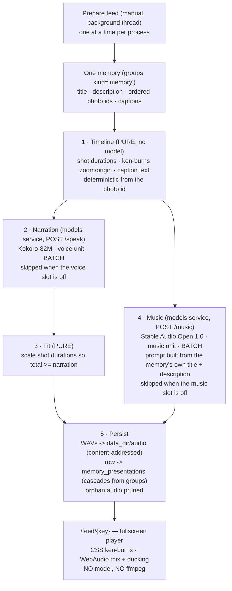

# Memory Feed Implementation Plan

> **For agentic workers:** REQUIRED SUB-SKILL: Use superpowers:subagent-driven-development (recommended) or superpowers:executing-plans to implement this plan task-by-task. Steps use checkbox (`- [ ]`) syntax for tracking.

**Goal:** Play a stored memory as a fullscreen slideshow — Ken Burns photo motion, an animated caption overlay, locally generated background music, and optional locally generated speech narration.

**Architecture:** Generation is **offline**, playback loads **no model**. A background job asks the `models` service for one narration WAV (Kokoro-82M) and one music WAV (Stable Audio Open 1.0), writes both to storage, and records a deterministic timeline JSON in `memory_presentations`. The browser player is plain HTML/CSS/JS — CSS transforms over the existing 1600px detail thumbnails, two `<audio>` elements mixed through the WebAudio API. No ffmpeg, no video file.

**Tech Stack:** Python 3.12 · FastAPI + Jinja + HTMX · SQLite (WAL, `sqlite-vec`) · `kokoro` (Apache-2.0 TTS, 24 kHz mono) · `diffusers` → Stable Audio Open 1.0 (Stability AI Community License, 44.1 kHz stereo, ≤47 s) · torch/transformers **only inside the `models` service** · vanilla JS + WebAudio in the browser.

**Spec:** `docs/design.md` §4.1, §5, §5.1, §6, §8.1, §11, §13, §13.1 — updated by Task 1 of this plan, which is therefore the spec this plan argues from. Read Task 1's doc edits before implementing Tasks 2-8.

## Global Constraints

- **One model process (CLAUDE.md, §5.1).** `app`, `worker`, `feed/`, `albums/` and every other thin client MUST NOT import `torch`, `transformers`, `kokoro`, or `stable_audio_tools`. Only `modelsvc/` and the new `audio/` package may. `tests/test_one_model_process_gate.py` enforces this and MUST be extended with `feed` in Task 2.
- **GPU only, never CPU (§3.1).** Both new models load on `settings.embed_device` (`mps` on mac, `cuda` on jetson/cloud). No CPU fallback path is written.
- **Killable children (§8.1).** Both new models live in `TorchWorker` children, exactly like SigLIP — freeing torch memory in-process does not return it.
- **The source folders are never touched.** This feature reads thumbnails and writes to `data_dir/audio` only.
- **Design doc is the source of truth (CLAUDE.md).** Task 1 lands every doc edit BEFORE any code. Any later drift updates the doc in the same task.
- **Navigation §13.1.** The player is a **leaf** exactly one level under the memory grid. Grid→player is the one `push`; every move inside the player is state, never history. Close = `history.back()`.
- **`ruff` line-length is 100.** Run `make lint` before each commit.
- **Test command:** `uv run pytest tests/<file>.py -v`. Full suite: `make test`.
- **Never run `git commit`/`git add`** — the user commits. Where a task says "Commit", stop and report the task is ready to commit instead.

---

## File Structure

**New package `feed/` — thin client, no models, gate-scanned:**

| File | Responsibility |
|---|---|
| `feed/__init__.py` | empty |
| `feed/timeline.py` | Pure: memory + captions → `Timeline`. Ken Burns params, shot durations, narration text, music prompt. No I/O, no models. |
| `feed/store.py` | `memory_presentations` read/write, orphan-audio pruning. |
| `feed/build.py` | The prepare job: call the `models` service, write audio to storage, save the row. |

**New package `audio/` — models-service-only, NOT gate-scanned (may import torch):**

| File | Responsibility |
|---|---|
| `audio/__init__.py` | empty — must NOT import the torch modules |
| `audio/kokoro_voice.py` | `KokoroVoice` — the TTS child hosted by `TorchWorker` |
| `audio/stable_audio.py` | `StableAudioComposer` — the music child hosted by `TorchWorker` |

**New shared utility (thin-client-safe, numpy + stdlib only):**

| File | Responsibility |
|---|---|
| `storage/wav.py` | `encode_wav(samples, sample_rate)` and `duration_seconds(wav_bytes)`. Imported by both `audio/*` and `feed/*`, so it must stay torch-free. |

**New models-service sub-backends:**

| File | Responsibility |
|---|---|
| `modelsvc/backends/voice_backend.py` | `VoiceBackend` — torch-free wrapper over the voice `TorchWorker` |
| `modelsvc/backends/music_backend.py` | `MusicBackend` — torch-free wrapper over the music `TorchWorker` |

**New web assets:**

| File | Responsibility |
|---|---|
| `web/templates/feed.html` | The fullscreen player page. Does NOT extend `base.html` (no nav over a fullscreen player). |
| `web/static/feed.js` | Shot scheduler, Ken Burns layer cross-fade, WebAudio mix + ducking, keyboard controls. |
| `web/static/feed.css` | Player styling. Separate from `app.css` — the player shares none of the shell's layout. |

**Modified:**

| File | Change |
|---|---|
| `db/schema.sql` | `memory_presentations` table |
| `db/connection.py` | `SCHEMA_VERSION` 10 → 11 |
| `albums/memory_store.py` | `group_id_for_album_key` (inverse of `album_key_for_group`, same ordering) |
| `models/catalog.py` | `NoSource`, `voice`/`music` slots, 3 new entries, defaults |
| `models/slots.py` | `_ENV_FIELD` gains `voice`/`music` |
| `config.py` | `voice_model`, `music_model`, `audio_dir` |
| `modelsvc/backends/base.py` | `speak` / `music` in the protocol |
| `modelsvc/backends/fake.py` | deterministic `speak` / `music` |
| `modelsvc/backends/composite.py` | route both through the scheduler |
| `modelsvc/backends/__init__.py` | wire the two sub-backends |
| `modelsvc/app.py` | `POST /speak`, `POST /music` |
| `modelsvc/slots.py` | `UNIT_BY_SLOT`, `_register_voice`, `_register_music`, `off` handling |
| `modelsvc/downloads.py` | `NoSource` handling |
| `inference/models_client.py` | `speak()` / `music()` |
| `web/app.py` | 5 feed routes + build state |
| `web/deps.py` | `AppContext.audio` storage |
| `web/templates/_album_card.html` | Play button when `play_url` is set |
| `tests/test_one_model_process_gate.py` | scan `feed` |
| `pyproject.toml` | ship `feed` + `audio`; add the `models` extra deps |
| `docs/design.md`, `docs/memories.md`, `docs/ui.md`, `docs/models.md`, `docs/roadmap.md`, `docs/code-layout.md`, `docs/testing.md` | Task 1 |

---

### Task 1: Design docs — the source of truth, first

`docs/design.md` describes the **current** state and must be changed before the code (CLAUDE.md). Everything below is a doc-only task; no Python is touched.

**Files:**
- Modify: `docs/design.md` (§4.1, §5 mermaid, §5.1, §6, §8.1, §11 + its mermaid, §13, §13.1, §14)
- Modify: `docs/memories.md`, `docs/ui.md`, `docs/models.md`, `docs/code-layout.md`, `docs/testing.md`, `docs/roadmap.md`

**Interfaces:**
- Consumes: nothing.
- Produces: the wording every later task's code must match — slot names `voice`/`music`, residency units `voice`/`music`, endpoints `POST /speak` and `POST /music`, the table `memory_presentations`, the route family `/feed/{key}`.

- [ ] **Step 1: §4.1 — add the two slots**

In the slot table in §4.1, add two rows after `caption` / `planner`:

```markdown
| `voice`   | `voice`  | Kokoro-82M — the narration read over a memory feed (§11.1). `off` is an offered entry: the feed then plays with text only. |
| `music`   | `music`  | Stable Audio Open 1.0 — the background track generated per memory (§11.1). `off` is an offered entry, and it is the **jetson default**: the model's resident cost is an ESTIMATE, and an unmeasured ~3 GB child on a board with ~4.3 GB free must be opted into, not defaulted on. |
```

Then add this paragraph directly under the table:

```markdown
**`off` is a real catalog entry, not a missing one.** Two slots hold optional
models, so the catalog carries an `off` entry (`source=NoSource()`, `cost_mb=0`)
for each. Selecting it unregisters the residency unit entirely, so the governor
never budgets for it and the settings popup shows it as always "on disk". The
feed degrades honestly: no voice means captions still animate, no music means
the slideshow plays silent.
```

- [ ] **Step 2: §5 — the architecture mermaid**

In the `models` node's HTTP line, append the two endpoints so it reads:

```
HTTP: /embed/image · /embed/text · /embed/spec · /tag · /caption · /speak · /music · /plan · /chat · /resources · /models/*
```

In the `worker` node's stage list, append `feed audio` so it reads:

```
worker · ingest pipeline (primary writer)<br/>facets · thumbs · taxonomy · caption · memories · feed audio · deletions<br/>NO models, NO torch — a thin client of the models service
```

Add a storage note to the `store` node:

```
store[("Storage<br/>originals + thumbnails + feed audio")]
```

And add one edge after the existing `browser -->|"read UI · SSE chat"| app` line:

```
    browser -->|"fullscreen memory feed: timeline JSON + audio (no model)"| app
```

- [ ] **Step 3: §5.1 — document the two endpoints**

In §5.1's endpoint list, add:

```markdown
- **`POST /speak`** — `{text, voice}` → `{audio (base64 WAV), sample_rate, model}`.
  The `voice` residency unit (Kokoro-82M, 24 kHz mono). `Priority.BATCH`: a feed is
  prepared offline and must never preempt a search or a chat turn. Returns **503**
  when the `voice` slot is `off`.
- **`POST /music`** — `{prompt, seconds, seed}` → `{audio (base64 WAV), sample_rate,
  model}`. The `music` residency unit (Stable Audio Open 1.0, 44.1 kHz stereo,
  47 s ceiling). `Priority.BATCH`. Returns **503** when the `music` slot is `off`.
```

- [ ] **Step 4: §6 — the new table**

Add to the §6 data-model table listing:

```markdown
`memory_presentations` — one row per memory that has been prepared for the feed
(§11.1). `group_id` is the primary key and cascades from `groups`, so §11's atomic
memory swap drops every stale presentation for free. It holds the timeline JSON,
the storage keys of the two generated WAVs, and the library signature the
presentation was built against — a presentation is stale exactly when that
signature no longer matches the memory's.
```

- [ ] **Step 5: §8.1 — residency**

Add after the existing swap description:

```markdown
**The feed's two models are batch-only and short-lived.** `voice` and `music` are
needed only while a memory feed is being prepared, never during playback — the
player is plain HTML and loads no model at all. Both are `TorchWorker` children on
the GPU and both are ordinary governor units, so on the jetson they swap against
gemma exactly as SigLIP does. `music` costs ~3000 MB by ESTIMATE, not measurement:
it is therefore `off` by default on jetson, and its figure must be measured on the
board (the drop in `psutil.virtual_memory().available` across a load) and pinned
with `IVMS777_MODEL_COST_MB='{"music": <measured>}'` before it is trusted.
```

- [ ] **Step 6: §11 — add §11.1 "Playing a memory — the feed"**

Add a new subsection at the end of §11:

````markdown
### 11.1 Playing a memory — the feed

A memory is a story, so it can be **played**, not only browsed. `/feed/{key}` is a
fullscreen presentation of one memory: its photos pan and zoom, its captions animate
in, a generated instrumental track plays under it, and — when the `voice` slot holds
a model — a generated voice reads the memory's title, description and captions.

**Generation is offline; playback loads no model.** This is the governing rule, and
it is what makes the feed usable on the 8 GB board. A background job prepares three
artifacts once per memory; the player is plain HTML/CSS/JS over the thumbnails that
already exist.

- **`timeline.json`** — deterministic and model-free: per shot the photo id, its
  duration, its Ken Burns start/end zoom and origin, and its caption. Derived from
  the photo id, so the same memory always plays the same way.
- **`narration.wav`** — one clip for the whole memory (Kokoro-82M). Its measured
  duration scales the shot durations up so the narration is never cut off.
- **`music.wav`** — one clip (Stable Audio Open 1.0), prompted from the memory's own
  title and description, looped by the player to cover the run time.

The two WAVs live in `data_dir/audio`, content-addressed like every other blob, and
are recorded in `memory_presentations` (§6). Nothing is re-generated on a page load.

**No video file is produced.** There is no ffmpeg anywhere in this app: the player
animates CSS transforms over the 1600 px detail thumbnails and mixes the two audio
tracks in the browser with the WebAudio API, ducking the music while speech plays.
Rendering an MP4 for sharing is future work (`docs/roadmap.md`), not this design.

**Autoplay is a click.** Browsers refuse to start audio without a user gesture, so
the player opens paused behind a play control; the first click starts photos and
audio together.

**Feed composition flow.**


````

- [ ] **Step 7: §13 and §13.1 — the route and the leaf**

In §13's route list, add after the `/organize` bullet:

```markdown
- **`/feed/{key}`** — the fullscreen **memory feed**: one memory played as an
  animated slideshow with generated music and optional narration (§11.1). Reached
  from a Play control on a memory card in `/organize?by=memories`. When the memory
  has no prepared presentation the page offers to prepare one and polls progress;
  otherwise it plays. It is a **leaf** under the memory grid (§13.1).
```

In §13.1's rule 2 (`ctx` values), add:

```markdown
   - The **feed** (`/feed/{key}`) is a leaf whose grid is the memory itself. The key
     IS the album key, so no `ctx` is guessed; an optional `ctx` parameter only
     supplies the deep-link `href` fallback for close.
```

And extend rule 1 with one sentence:

```markdown
   The feed is a leaf too: it is one level under the memory grid, it never opens a
   photo leaf from inside itself (that would be leaf-inside-leaf), and every shot
   change is player state — never a history entry.
```

- [ ] **Step 8: §14 — code layout**

Add `feed` and `audio` to the package list in §14, with:

```markdown
`feed` builds and stores memory presentations (§11.1) and holds no model. `audio`
is the opposite: it is models-service-only, hosts the TTS and music models inside
`TorchWorker` children, and — like `modelsvc` — is exempt from the thin-client
import gate. `storage/wav.py` is the one piece both share, and it is torch-free.
```

- [ ] **Step 9: the satellite docs**

- `docs/memories.md`: add a "Playing a memory" section pointing at §11.1, stating that a rebuild invalidates every presentation by cascade and that presentations are prepared per memory on demand, never in bulk.
- `docs/ui.md`: add a `/feed/{key}` section — the play control on the memory card, the paused-first play button, the controls (space = play/pause, ←/→ = prev/next shot, Esc = close), and the fact that close is `history.back()`.
- `docs/models.md`: add Kokoro-82M and Stable Audio Open 1.0 with their licences (Apache-2.0; Stability AI Community License — free commercially under $1M revenue), sample rates, and the note that Stable Audio Open 1.0 is a **gated** HF repo needing an accepted licence and an `HF_TOKEN` before `snapshot_download` succeeds.
- `docs/code-layout.md`: add `feed/` and `audio/`.
- `docs/testing.md`: add that the feed is fully testable offline — the timeline is pure, and `FakeBackend` returns real, parseable WAV bytes.
- `docs/roadmap.md`: move nothing; add "Export a memory feed as an MP4 (ffmpeg over the same timeline JSON)" to future work.

- [ ] **Step 10: verify the docs agree with themselves**

Run: `grep -n "speak\|/music\|memory_presentations\|/feed/" docs/design.md`
Expected: hits in §5, §5.1, §6, §11.1, §13, §13.1 — and no section describing behaviour this plan does not build.

- [ ] **Step 11: Commit**

```bash
git add docs/
git commit -m "docs: design the memory feed (§11.1) — slots, endpoints, table, routes"
```

---

### Task 2: Schema + presentation store

**Files:**
- Modify: `db/schema.sql`
- Modify: `db/connection.py` (`SCHEMA_VERSION`)
- Modify: `albums/memory_store.py` (add `group_id_for_album_key`)
- Create: `feed/__init__.py`, `feed/store.py`
- Modify: `tests/test_one_model_process_gate.py` (scan `feed`)
- Modify: `pyproject.toml` (`only-include` gains `feed`)
- Test: `tests/test_feed_store.py`

**Interfaces:**
- Consumes: `albums.memory_store.read_memories`, `storage.base.Storage`.
- Produces:
  - `albums.memory_store.group_id_for_album_key(conn, owner_id, key) -> int | None`
  - `feed.store.Presentation` — frozen dataclass `(group_id: int, signature: str, timeline: dict, music_key: str | None, narration_key: str | None, status: str, error: str | None)`
  - `feed.store.save_presentation(conn, presentation: Presentation) -> None`
  - `feed.store.read_presentation(conn, group_id: int) -> Presentation | None`
  - `feed.store.prune_orphan_audio(conn, audio) -> int`

- [ ] **Step 1: Write the failing tests**

Create `tests/test_feed_store.py`:

```python
"""`memory_presentations` — one prepared feed per memory (design §6, §11.1)."""

import pytest

from albums.memory_store import Memory, group_id_for_album_key, replace_memories
from feed.store import (
    Presentation,
    prune_orphan_audio,
    read_presentation,
    save_presentation,
)
from storage.local import LocalStorage
from tests.factories import add_photo


@pytest.fixture
def memory_group(conn):
    for pid in (1, 2, 3):
        add_photo(conn, photo_id=pid, content_hash=f"h{pid}", thumb_key=f"{pid}.jpg",
                  caption="x", shot_at=f"2025-07-12T1{pid}:00:00")
    replace_memories(conn, 1, [Memory("Beach day", "Warm afternoon.", [1, 2, 3], "sig")])
    return conn.execute("SELECT id FROM groups WHERE kind = 'memory'").fetchone()["id"]


def _presentation(group_id: int, **over) -> Presentation:
    fields = {
        "group_id": group_id,
        "signature": "sig",
        "timeline": {"title": "Beach day", "shots": [{"photo_id": 1}]},
        "music_key": "aa/bb/aabb.wav",
        "narration_key": "cc/dd/ccdd.wav",
        "status": "ready",
        "error": None,
    }
    fields.update(over)
    return Presentation(**fields)


def test_save_then_read_round_trips(conn, memory_group):
    save_presentation(conn, _presentation(memory_group))
    stored = read_presentation(conn, memory_group)
    assert stored.timeline["title"] == "Beach day"
    assert stored.music_key == "aa/bb/aabb.wav"
    assert stored.status == "ready"


def test_read_returns_none_when_never_prepared(conn, memory_group):
    assert read_presentation(conn, memory_group) is None


def test_saving_twice_replaces_rather_than_duplicates(conn, memory_group):
    save_presentation(conn, _presentation(memory_group))
    save_presentation(conn, _presentation(memory_group, signature="sig2"))
    assert read_presentation(conn, memory_group).signature == "sig2"
    n = conn.execute("SELECT count(*) AS n FROM memory_presentations").fetchone()["n"]
    assert n == 1


def test_rebuilding_memories_cascades_the_presentation_away(conn, memory_group):
    # §11's atomic swap deletes the groups; the presentation must go with them, or
    # a new memory would inherit a stale feed keyed by a recycled row id.
    save_presentation(conn, _presentation(memory_group))
    replace_memories(conn, 1, [Memory("Other", "d", [1], "sig2")])
    n = conn.execute("SELECT count(*) AS n FROM memory_presentations").fetchone()["n"]
    assert n == 0


def test_group_id_for_album_key_is_the_inverse_of_album_key_for_group(conn, memory_group):
    assert group_id_for_album_key(conn, 1, "memory-0") == memory_group
    assert group_id_for_album_key(conn, 1, "memory-9") is None


def test_prune_orphan_audio_deletes_only_unreferenced_blobs(conn, memory_group, tmp_path):
    audio = LocalStorage(tmp_path / "audio")
    audio.write("aa/bb/aabb.wav", b"kept")
    audio.write("ee/ff/eeff.wav", b"orphan")
    save_presentation(conn, _presentation(memory_group, narration_key=None))
    assert prune_orphan_audio(conn, audio) == 1
    assert audio.exists("aa/bb/aabb.wav")
    assert not audio.exists("ee/ff/eeff.wav")
```

- [ ] **Step 2: Run the tests to verify they fail**

Run: `uv run pytest tests/test_feed_store.py -v`
Expected: FAIL — `ModuleNotFoundError: No module named 'feed'`.

- [ ] **Step 3: Add the table**

In `db/schema.sql`, after the `memory_fts` line, add:

```sql
-- One prepared memory feed (design §6, §11.1). `group_id` is the primary key AND
-- cascades from `groups`, so §11's atomic memory swap drops every stale
-- presentation for free — a recycled group id can never inherit an old feed.
CREATE TABLE IF NOT EXISTS memory_presentations (
  group_id      INTEGER PRIMARY KEY REFERENCES groups(id) ON DELETE CASCADE,
  signature     TEXT NOT NULL,
  timeline_json TEXT NOT NULL,
  music_key     TEXT,
  narration_key TEXT,
  status        TEXT NOT NULL,
  error         TEXT,
  created_at    TEXT NOT NULL
);
```

In `db/connection.py`, change `SCHEMA_VERSION = 10` to `SCHEMA_VERSION = 11`.

- [ ] **Step 4: Add the inverse key lookup**

Append to `albums/memory_store.py`:

```python
def group_id_for_album_key(
    conn: sqlite3.Connection, owner_id: int, key: str
) -> int | None:
    """The memory `group_id` behind an Organize album key (`memory-<index>`) — the
    inverse of `album_key_for_group`, and it lives beside it for the same reason:
    the ordering (size desc, then id) MUST match `read_memories`, and one file owns
    it. The feed resolves `/feed/memory-3` to a row through this (§11.1).

    None when the key names no memory of this owner."""
    rows = conn.execute(
        "SELECT g.id,"
        " (SELECT count(*) FROM group_photos gp WHERE gp.group_id = g.id) AS n"
        " FROM groups g WHERE g.owner_id = ? AND g.kind = 'memory'"
        " ORDER BY n DESC, g.id",
        (owner_id,),
    ).fetchall()
    for index, row in enumerate(rows):
        if f"memory-{index}" == key:
            return int(row["id"])
    return None
```

- [ ] **Step 5: Write the store**

Create `feed/__init__.py` (empty file) and `feed/store.py`:

```python
"""Stored memory presentations (design §6, §11.1).

A presentation is derived data: a deterministic timeline plus the storage keys of
two generated WAVs. It is keyed by the memory's `group_id` and cascades with it, so
rebuilding memories (§11) throws every presentation away — which is correct, because
the memory it described no longer exists.

No models, no HTTP: this module is a thin client (CLAUDE.md § "One model process").
"""

import json
import sqlite3
from dataclasses import dataclass

from storage.base import Storage

NOW_SQL = "strftime('%Y-%m-%dT%H:%M:%SZ','now')"


@dataclass(frozen=True)
class Presentation:
    group_id: int
    signature: str
    timeline: dict
    music_key: str | None
    narration_key: str | None
    status: str          # "ready" | "failed"
    error: str | None = None


def save_presentation(conn: sqlite3.Connection, presentation: Presentation) -> None:
    """Upsert: preparing a memory twice replaces the previous feed rather than
    failing on the primary key."""
    conn.execute(
        "INSERT INTO memory_presentations"
        "(group_id, signature, timeline_json, music_key, narration_key, status, error,"
        f" created_at) VALUES (?, ?, ?, ?, ?, ?, ?, {NOW_SQL})"
        " ON CONFLICT(group_id) DO UPDATE SET"
        " signature = excluded.signature, timeline_json = excluded.timeline_json,"
        " music_key = excluded.music_key, narration_key = excluded.narration_key,"
        f" status = excluded.status, error = excluded.error, created_at = {NOW_SQL}",
        (
            presentation.group_id,
            presentation.signature,
            json.dumps(presentation.timeline),
            presentation.music_key,
            presentation.narration_key,
            presentation.status,
            presentation.error,
        ),
    )


def read_presentation(conn: sqlite3.Connection, group_id: int) -> Presentation | None:
    row = conn.execute(
        "SELECT group_id, signature, timeline_json, music_key, narration_key, status,"
        " error FROM memory_presentations WHERE group_id = ?",
        (group_id,),
    ).fetchone()
    if row is None:
        return None
    return Presentation(
        group_id=int(row["group_id"]),
        signature=row["signature"],
        timeline=json.loads(row["timeline_json"]),
        music_key=row["music_key"],
        narration_key=row["narration_key"],
        status=row["status"],
        error=row["error"],
    )


def prune_orphan_audio(conn: sqlite3.Connection, audio: Storage) -> int:
    """Delete every audio blob no presentation references, and return how many went.

    The table cascades away with its memories but the FILES do not, so a rebuild
    would otherwise leave every previous feed's WAVs on disk forever. Called at the
    start of each prepare run — the one moment we know the table is authoritative.
    """
    referenced = {
        key
        for row in conn.execute(
            "SELECT music_key, narration_key FROM memory_presentations"
        )
        for key in (row["music_key"], row["narration_key"])
        if key
    }
    removed = 0
    for key in list(audio.iter_keys()):
        if key not in referenced:
            audio.delete(key)
            removed += 1
    return removed
```

- [ ] **Step 6: Close the import gate over `feed`**

In `tests/test_one_model_process_gate.py`, add `"feed"` to the directory tuple in `_thin_client_files`:

```python
    for d in ("chat", "search", "ingest", "web", "albums", "storage", "db", "embedding", "inference", "feed"):
```

In `pyproject.toml`, add `"feed"` to `[tool.hatch.build.targets.wheel] only-include`.

- [ ] **Step 7: Run the tests to verify they pass**

Run: `uv run pytest tests/test_feed_store.py tests/test_migrate.py tests/test_one_model_process_gate.py -v`
Expected: PASS.

- [ ] **Step 8: Commit**

```bash
git add db/schema.sql db/connection.py albums/memory_store.py feed/ pyproject.toml tests/
git commit -m "feat(feed): memory_presentations table and presentation store"
```

---

### Task 3: The timeline — pure, deterministic, model-free

**Files:**
- Create: `feed/timeline.py`
- Test: `tests/test_feed_timeline.py`

**Interfaces:**
- Consumes: `albums.memory_store.Memory`.
- Produces:
  - `feed.timeline.Shot` — frozen dataclass `(photo_id: int, seconds: float, zoom_from: float, zoom_to: float, origin_x: float, origin_y: float, caption: str)`
  - `feed.timeline.Timeline` — frozen dataclass `(title: str, description: str, shots: tuple[Shot, ...], narration_text: str, music_prompt: str)`, with `.seconds` property and `.as_dict()`
  - `feed.timeline.build_timeline(title, description, photos, *, seconds_per_photo=4.0, max_photos=40) -> Timeline` where `photos` is `list[tuple[int, str]]` of `(photo_id, caption)`
  - `feed.timeline.fit_to_narration(timeline, narration_seconds) -> Timeline`

- [ ] **Step 1: Write the failing tests**

Create `tests/test_feed_timeline.py`:

```python
"""The feed timeline (design §11.1) — pure, deterministic, no model, no I/O."""

from feed.timeline import build_timeline, fit_to_narration

PHOTOS = [(10, "a dog on the sand"), (11, "waves at sunset"), (12, "")]


def test_one_shot_per_photo_in_order():
    tl = build_timeline("Beach day", "Warm afternoon.", PHOTOS)
    assert [s.photo_id for s in tl.shots] == [10, 11, 12]


def test_total_is_the_sum_of_the_shots():
    tl = build_timeline("Beach day", "Warm afternoon.", PHOTOS, seconds_per_photo=3.0)
    assert tl.seconds == 9.0


def test_is_deterministic_for_the_same_input():
    first = build_timeline("Beach day", "Warm afternoon.", PHOTOS)
    second = build_timeline("Beach day", "Warm afternoon.", PHOTOS)
    assert first.as_dict() == second.as_dict()


def test_ken_burns_alternates_direction_and_always_moves():
    tl = build_timeline("Beach day", "Warm afternoon.", PHOTOS)
    for shot in tl.shots:
        assert shot.zoom_from != shot.zoom_to, shot.photo_id
        assert 1.0 <= min(shot.zoom_from, shot.zoom_to)
        assert max(shot.zoom_from, shot.zoom_to) <= 1.4
        assert 0.0 <= shot.origin_x <= 1.0 and 0.0 <= shot.origin_y <= 1.0
    directions = [shot.zoom_to > shot.zoom_from for shot in tl.shots]
    assert directions[0] != directions[1]  # never the same move twice running


def test_long_memories_are_capped():
    photos = [(i, f"c{i}") for i in range(200)]
    tl = build_timeline("Big", "d", photos, max_photos=40)
    assert len(tl.shots) == 40
    assert [s.photo_id for s in tl.shots] == list(range(40))


def test_narration_text_leads_with_the_memory_then_reads_captions():
    tl = build_timeline("Beach day", "Warm afternoon.", PHOTOS)
    assert tl.narration_text.startswith("Beach day. Warm afternoon.")
    assert "a dog on the sand" in tl.narration_text
    assert "waves at sunset" in tl.narration_text


def test_music_prompt_uses_the_memory_and_forbids_vocals():
    tl = build_timeline("Beach day", "Warm afternoon.", PHOTOS)
    assert "Beach day" in tl.music_prompt
    assert "instrumental" in tl.music_prompt and "no vocals" in tl.music_prompt
    assert len(tl.music_prompt) <= 300


def test_empty_memory_produces_no_shots():
    tl = build_timeline("Empty", "", [])
    assert tl.shots == () and tl.seconds == 0.0


def test_fit_to_narration_stretches_shots_so_speech_is_never_cut_off():
    tl = build_timeline("Beach day", "Warm afternoon.", PHOTOS, seconds_per_photo=3.0)
    fitted = fit_to_narration(tl, 18.0)
    assert fitted.seconds >= 18.0
    assert [s.photo_id for s in fitted.shots] == [10, 11, 12]
    assert all(s.seconds == 6.0 for s in fitted.shots)


def test_fit_to_narration_never_shortens_a_slideshow():
    tl = build_timeline("Beach day", "Warm afternoon.", PHOTOS, seconds_per_photo=4.0)
    assert fit_to_narration(tl, 2.0).seconds == tl.seconds


def test_fit_to_narration_on_an_empty_timeline_is_a_no_op():
    tl = build_timeline("Empty", "", [])
    assert fit_to_narration(tl, 30.0).shots == ()
```

- [ ] **Step 2: Run the tests to verify they fail**

Run: `uv run pytest tests/test_feed_timeline.py -v`
Expected: FAIL — `ModuleNotFoundError: No module named 'feed.timeline'`.

- [ ] **Step 3: Write the timeline**

Create `feed/timeline.py`:

```python
"""The feed timeline (design §11.1) — what plays, when, and how it moves.

PURE. No model, no HTTP, no database, no clock, no randomness. The Ken Burns
parameters are derived from the shot's position, so the same memory always plays
identically — which is what makes the whole feed testable offline and what stops a
re-prepare from producing a different-looking slideshow for the same photos.
"""

from dataclasses import dataclass, replace

# Ken Burns bounds. Below 1.05 the motion is invisible; above ~1.4 a 1600 px detail
# thumbnail starts to show softness on a 1080p screen.
_ZOOM_NEAR = 1.0
_ZOOM_FAR = 1.25
# Five transform origins, cycled. Prime-length against the 2-cycle zoom direction, so
# consecutive shots differ in BOTH the direction and the anchor point.
_ORIGINS: tuple[tuple[float, float], ...] = (
    (0.5, 0.5), (0.2, 0.3), (0.8, 0.3), (0.3, 0.75), (0.75, 0.7),
)
# How many captions the narration reads. Past this the voice outlasts any patience,
# and the text overlay is already showing every caption anyway.
_NARRATED_CAPTIONS = 6
_MUSIC_PROMPT_MAX = 300


@dataclass(frozen=True)
class Shot:
    photo_id: int
    seconds: float
    zoom_from: float
    zoom_to: float
    origin_x: float
    origin_y: float
    caption: str


@dataclass(frozen=True)
class Timeline:
    title: str
    description: str
    shots: tuple[Shot, ...]
    narration_text: str
    music_prompt: str

    @property
    def seconds(self) -> float:
        return round(sum(shot.seconds for shot in self.shots), 3)

    def as_dict(self) -> dict:
        return {
            "title": self.title,
            "description": self.description,
            "seconds": self.seconds,
            "narration_text": self.narration_text,
            "music_prompt": self.music_prompt,
            "shots": [
                {
                    "photo_id": shot.photo_id,
                    "seconds": shot.seconds,
                    "zoom_from": shot.zoom_from,
                    "zoom_to": shot.zoom_to,
                    "origin_x": shot.origin_x,
                    "origin_y": shot.origin_y,
                    "caption": shot.caption,
                }
                for shot in self.shots
            ],
        }


def build_timeline(
    title: str,
    description: str,
    photos: list[tuple[int, str]],
    *,
    seconds_per_photo: float = 4.0,
    max_photos: int = 40,
) -> Timeline:
    """`photos` is `(photo_id, caption)` in the memory's own rank order (cover first).

    Capped at `max_photos`: a 300-photo theme is a slideshow nobody watches, and the
    cap is applied HERE rather than in the caller so the cost of a feed is bounded in
    one place.
    """
    shots = tuple(
        Shot(
            photo_id=photo_id,
            seconds=seconds_per_photo,
            zoom_from=_ZOOM_NEAR if index % 2 == 0 else _ZOOM_FAR,
            zoom_to=_ZOOM_FAR if index % 2 == 0 else _ZOOM_NEAR,
            origin_x=_ORIGINS[index % len(_ORIGINS)][0],
            origin_y=_ORIGINS[index % len(_ORIGINS)][1],
            caption=caption or "",
        )
        for index, (photo_id, caption) in enumerate(photos[:max_photos])
    )
    return Timeline(
        title=title,
        description=description,
        shots=shots,
        narration_text=_narration_text(title, description, shots),
        music_prompt=_music_prompt(title, description),
    )


def fit_to_narration(timeline: Timeline, narration_seconds: float) -> Timeline:
    """Stretch every shot equally so the slideshow outlasts the narration.

    Speech length is only knowable AFTER the voice model has spoken, so the timeline
    is built at a nominal pace and fitted here. It only ever grows: a 4-second-per
    -photo rhythm is the floor, never something a short narration compresses.
    """
    total = timeline.seconds
    if not timeline.shots or total <= 0 or narration_seconds <= total:
        return timeline
    factor = narration_seconds / total
    return replace(
        timeline,
        shots=tuple(
            replace(shot, seconds=round(shot.seconds * factor, 3))
            for shot in timeline.shots
        ),
    )


def _narration_text(title: str, description: str, shots: tuple[Shot, ...]) -> str:
    parts = [f"{title}."]
    if description:
        parts.append(description if description.endswith(".") else f"{description}.")
    for shot in shots[:_NARRATED_CAPTIONS]:
        if shot.caption:
            caption = shot.caption.strip()
            parts.append(caption if caption.endswith(".") else f"{caption}.")
    return " ".join(parts)


def _music_prompt(title: str, description: str) -> str:
    """A text prompt for the music model, built from the memory itself (§11.1).

    Deliberately generic in style and specific in subject: the model conditions on
    the memory's own words, and the fixed tail keeps every track instrumental,
    slow, and quiet enough to sit under a voice.
    """
    subject = f"{title}. {description}".strip()
    tail = (
        " Warm nostalgic instrumental background music, slow, gentle acoustic guitar"
        " and soft piano, no vocals, no drums."
    )
    room = _MUSIC_PROMPT_MAX - len(tail)
    return (subject[:room] + tail).strip()
```

- [ ] **Step 4: Run the tests to verify they pass**

Run: `uv run pytest tests/test_feed_timeline.py -v`
Expected: PASS (11 tests).

- [ ] **Step 5: Lint and commit**

```bash
make lint
git add feed/timeline.py tests/test_feed_timeline.py
git commit -m "feat(feed): deterministic, model-free timeline builder"
```

---

### Task 4: WAV helpers + catalog slots

**Files:**
- Create: `storage/wav.py`
- Modify: `models/catalog.py`
- Modify: `models/slots.py` (`_ENV_FIELD`)
- Modify: `config.py` (`voice_model`, `music_model`, `audio_dir`)
- Modify: `modelsvc/downloads.py` (`NoSource`)
- Test: `tests/test_wav.py`, and extend `tests/test_catalog.py`

**Interfaces:**
- Consumes: nothing new.
- Produces:
  - `storage.wav.encode_wav(samples, sample_rate: int) -> bytes` — `samples` is a numpy array, shape `(n,)` mono or `(channels, n)`; float in [-1, 1] or int16.
  - `storage.wav.duration_seconds(data: bytes) -> float`
  - `models.catalog.NoSource` — frozen dataclass, no fields
  - `models.catalog.SLOTS == ("image_embed", "text_embed", "caption", "planner", "voice", "music")`
  - catalog keys `off` (both new slots), `kokoro-82m` (voice), `stable-audio-open-1.0` (music)
  - `Settings.audio_dir` property → `data_dir / "audio"`

- [ ] **Step 1: Write the failing tests**

Create `tests/test_wav.py`:

```python
"""WAV encode/measure (design §11.1). numpy + stdlib only — no torch, no soundfile:
`feed/` (a thin client) and `audio/` (models-service-only) both import this."""

import numpy as np
import pytest

from storage.wav import duration_seconds, encode_wav


def test_mono_float_round_trips_to_a_measurable_duration():
    samples = np.zeros(24000, dtype=np.float32)
    data = encode_wav(samples, 24000)
    assert data[:4] == b"RIFF"
    assert duration_seconds(data) == pytest.approx(1.0)


def test_stereo_is_interleaved_and_keeps_its_duration():
    samples = np.zeros((2, 44100), dtype=np.float32)
    data = encode_wav(samples, 44100)
    assert duration_seconds(data) == pytest.approx(1.0)


def test_float_samples_are_scaled_and_clipped_to_int16():
    samples = np.array([0.0, 1.0, -1.0, 2.0, -2.0], dtype=np.float32)
    decoded = np.frombuffer(encode_wav(samples, 8000)[44:], dtype="<i2")
    assert decoded.tolist() == [0, 32767, -32767, 32767, -32767]


def test_int16_samples_are_written_unchanged():
    samples = np.array([0, 1000, -1000], dtype=np.int16)
    decoded = np.frombuffer(encode_wav(samples, 8000)[44:], dtype="<i2")
    assert decoded.tolist() == [0, 1000, -1000]


def test_duration_of_a_non_wav_payload_is_zero():
    assert duration_seconds(b"not audio at all") == 0.0
```

Append to `tests/test_catalog.py`:

```python
def test_voice_and_music_are_real_slots_with_an_off_entry():
    for slot in ("voice", "music"):
        assert slot in catalog.SLOTS
        assert catalog.INVALIDATES[slot] is None  # they store nothing in ingest
        keys = [e.key for e in catalog.entries_for(slot, "jetson")]
        assert "off" in keys, slot


def test_off_entries_cost_nothing_and_download_nothing():
    for slot in ("voice", "music"):
        off = catalog.get(slot, "off")
        assert off.cost_mb == 0
        assert isinstance(off.source, catalog.NoSource)
        assert off.size_mb == 0


def test_music_is_off_by_default_on_jetson_but_on_elsewhere():
    # Its cost is an ESTIMATE (design §8.1): an unmeasured ~3 GB child must be opted
    # into on a board with ~4.3 GB free, never defaulted on.
    assert catalog.default_key("music", "jetson") == "off"
    assert catalog.default_key("music", "mac") == "stable-audio-open-1.0"
    assert catalog.default_key("voice", "jetson") == "kokoro-82m"


def test_the_two_audio_models_are_hf_sources_with_no_dim_or_preprocess():
    for slot, key in (("voice", "kokoro-82m"), ("music", "stable-audio-open-1.0")):
        entry = catalog.get(slot, key)
        assert isinstance(entry.source, catalog.HfSource)
        assert entry.dim is None and entry.preprocess is None
        assert entry.cost_measured is False  # neither has been measured on the board
```

- [ ] **Step 2: Run the tests to verify they fail**

Run: `uv run pytest tests/test_wav.py tests/test_catalog.py -v`
Expected: FAIL — `No module named 'storage.wav'`, and `AttributeError: NoSource`.

- [ ] **Step 3: Write the WAV helpers**

Create `storage/wav.py`:

```python
"""WAV bytes in and out — numpy + the stdlib `wave` module, nothing else.

Deliberately dependency-free. `audio/` (which owns torch) encodes with it and
`feed/` (which must never see torch) measures with it, so it has to be importable
from both sides of the one-model-process boundary (CLAUDE.md, §5.1). That also rules
out `soundfile` and `torchaudio`, which would drag a native audio stack into `app`.
"""

import io
import wave

import numpy as np


def encode_wav(samples: np.ndarray, sample_rate: int) -> bytes:
    """PCM-16 WAV bytes for `samples`.

    Accepts `(n,)` mono or `(channels, n)` — the shape both model families produce.
    Float input is assumed to be in [-1, 1] and is clipped before scaling, because a
    diffusion sampler occasionally overshoots and a wrapped int16 is an audible click.
    """
    array = np.asarray(samples)
    if array.ndim == 1:
        channels, frames = 1, array.reshape(1, -1)
    else:
        channels, frames = array.shape[0], array
    if frames.dtype != np.int16:
        frames = (np.clip(frames.astype(np.float32), -1.0, 1.0) * 32767.0).astype(np.int16)
    interleaved = frames.T.reshape(-1)  # (channels, n) -> n*channels, L R L R ...
    buffer = io.BytesIO()
    with wave.open(buffer, "wb") as handle:
        handle.setnchannels(channels)
        handle.setsampwidth(2)
        handle.setframerate(sample_rate)
        handle.writeframes(interleaved.tobytes())
    return buffer.getvalue()


def duration_seconds(data: bytes) -> float:
    """Seconds of audio in a WAV payload, read from the header.

    0.0 for anything unreadable: the caller uses this to FIT a slideshow to a
    narration, and a broken clip must degrade to "no narration timing", never raise
    in the middle of a background build.
    """
    try:
        with wave.open(io.BytesIO(data), "rb") as handle:
            rate = handle.getframerate()
            return handle.getnframes() / rate if rate else 0.0
    except Exception:  # noqa: BLE001 - unreadable audio is a fact, not an error here
        return 0.0
```

- [ ] **Step 4: Add the catalog slots and entries**

In `models/catalog.py`:

Add the sentinel source beside `HfSource`/`GgufSource`:

```python
@dataclass(frozen=True)
class NoSource:
    """An entry that loads nothing — the `off` choice for an OPTIONAL slot (§4.1).

    `voice` and `music` are the only optional slots: a feed with no voice still
    animates its captions, and a feed with no music plays silent. Modelling "off"
    as a catalog entry rather than a null slot keeps one code path — the settings
    popup renders it, the resolver validates it, and `SlotManager` simply registers
    no residency unit for it, so the governor never budgets a byte.
    """
```

Change `SLOTS` and `INVALIDATES`:

```python
SLOTS: tuple[str, ...] = (
    "image_embed", "text_embed", "caption", "planner", "voice", "music",
)

INVALIDATES: dict[str, tuple[str, str] | None] = {
    "image_embed": ("embed", "taxonomy"),
    "text_embed": ("caption_embed", "caption_embed"),
    "caption": ("caption", "caption_embed"),
    "planner": None,
    # The feed's models store nothing in the ingest pipeline (§11.1) — switching
    # either re-runs no stage. A prepared presentation is invalidated by the
    # MEMORY changing, not by the voice changing, so a switch is free.
    "voice": None,
    "music": None,
}
```

Append these entries to `CATALOG`:

```python
    # --- voice (feed narration, design §11.1) --------------------------------
    ModelEntry(
        key="kokoro-82m",
        slot="voice",
        display="Kokoro 82M",
        source=HfSource("hexgrad/Kokoro-82M"),
        size_mb=330,
        cost_mb=1200,
        cost_measured=False,
        profiles=_ALL,
        note="The default. 82M params, Apache-2.0, 24 kHz mono, 54 voices. Reads a "
        "memory's title, description and captions over the feed. Needs the "
        "`espeak-ng` system package for phonemisation.",
    ),
    ModelEntry(
        key="off",
        slot="voice",
        display="No narration",
        source=NoSource(),
        size_mb=0,
        cost_mb=0,
        cost_measured=True,
        profiles=_ALL,
        note="Loads nothing. The feed still animates every caption as text.",
    ),
    # --- music (feed soundtrack, design §11.1) -------------------------------
    ModelEntry(
        key="stable-audio-open-1.0",
        slot="music",
        display="Stable Audio Open 1.0",
        source=HfSource("stabilityai/stable-audio-open-1.0"),
        size_mb=5300,
        cost_mb=3000,
        cost_measured=False,
        profiles=_ALL,
        note="1.1B params, Stability AI Community License, 44.1 kHz stereo, 47 s "
        "ceiling — one clip covers a whole memory, looped for longer ones. A GATED "
        "Hugging Face repo: accept the licence and set HF_TOKEN before downloading. "
        "Its cost is an ESTIMATE — measure it on the board and pin it with "
        "IVMS777_MODEL_COST_MB before trusting it next to gemma.",
    ),
    ModelEntry(
        key="off",
        slot="music",
        display="No music",
        source=NoSource(),
        size_mb=0,
        cost_mb=0,
        cost_measured=True,
        profiles=_ALL,
        note="Loads nothing. The feed plays silent, or with narration only.",
    ),
```

Add both slots to every profile in `DEFAULTS`:

```python
    "mac": {..., "voice": "kokoro-82m", "music": "stable-audio-open-1.0"},
    # jetson: `music` is OFF by default — an UNMEASURED ~3 GB child on a board with
    # ~4.3 GB free must be opted into from the settings popup, never defaulted on
    # (design §8.1). `voice` is small enough to swap freely.
    "jetson": {..., "voice": "kokoro-82m", "music": "off"},
    "cloud": {..., "voice": "kokoro-82m", "music": "stable-audio-open-1.0"},
```

(Keep the four existing keys in each dict unchanged; add only the two new ones.)

- [ ] **Step 5: Teach the resolver and the downloader about the new shapes**

In `models/slots.py`, extend `_ENV_FIELD`:

```python
_ENV_FIELD: dict[str, str] = {
    "image_embed": "embed_model_name",
    "text_embed": "text_embed_model",
    "caption": "caption_model",
    "planner": "planner_model",
    "voice": "voice_model",
    "music": "music_model",
}
```

In `config.py`, add two fields beside `caption_model`/`planner_model`:

```python
    # Feed narration + soundtrack slots (§4.1, §11.1). Catalog keys, exactly like the
    # other slot overrides; `off` is a real key. Not in PROFILE_DEFAULTS on purpose —
    # None means "use the catalog default for this profile".
    voice_model: str | None = None
    music_model: str | None = None
```

and a directory property beside `thumb_dir`:

```python
    @property
    def audio_dir(self) -> Path:
        """Generated feed audio (§11.1) — derived, content-addressed, never a source."""
        return self.data_dir / "audio"
```

In `modelsvc/downloads.py`, import `NoSource` and handle it in the three type
switches so an `off` entry is always "ready" and never downloads:

```python
from models.catalog import GgufSource, HfSource, NoSource, ModelEntry
```

```python
    @staticmethod
    def _source_id(entry: ModelEntry) -> str:
        source = entry.source
        if isinstance(source, NoSource):
            return "none"
        ...
```

```python
    def is_present(self, entry: ModelEntry) -> bool:
        source = entry.source
        if isinstance(source, NoSource):
            return True  # nothing to fetch: "off" is always ready
        ...
```

```python
    def present_bytes(self, entry: ModelEntry) -> int:
        source = entry.source
        if isinstance(source, NoSource):
            return 0
        ...
```

- [ ] **Step 6: Run the tests to verify they pass**

Run: `uv run pytest tests/test_wav.py tests/test_catalog.py tests/test_config.py tests/test_slots.py tests/test_downloads.py -v`
Expected: PASS. `test_every_offered_entry_can_actually_load_on_that_profile` must pass on jetson: `3000 + 512 = 3512 <= 5000` for music, `1200 + 512 <= 5000` for voice.

- [ ] **Step 7: Run the full suite — new slots touch every slot-iterating consumer**

Run: `make test`
Expected: PASS. If `tests/test_web_settings.py` or `tests/test_models_slots_api.py` assert a slot count, update the expectation to 6 and note the two new slots in the assertion's comment.

- [ ] **Step 8: Commit**

```bash
git add storage/wav.py models/ config.py modelsvc/downloads.py tests/
git commit -m "feat(models): voice + music slots with an off entry, and WAV helpers"
```

---

### Task 5: The `/speak` and `/music` HTTP surface

Everything here is torch-free and fully testable with `FakeBackend`.

**Files:**
- Modify: `modelsvc/backends/base.py`, `modelsvc/backends/fake.py`, `modelsvc/backends/composite.py`, `modelsvc/app.py`
- Modify: `inference/models_client.py`
- Test: extend `tests/test_modelsvc_api.py`, `tests/test_models_client.py`, `tests/test_modelsvc_backends.py`

**Interfaces:**
- Consumes: `storage.wav.encode_wav` (for the fake), `models.catalog`.
- Produces:
  - `ModelBackend.speak(text: str, voice: str | None) -> dict` with keys `audio` (raw `bytes`), `sample_rate` (int), `model` (str)
  - `ModelBackend.music(prompt: str, seconds: float, seed: int | None) -> dict`, same keys
  - `POST /speak` `{text, voice}` → `{audio: base64 str, sample_rate, model}`; **503** when the slot is off
  - `POST /music` `{prompt, seconds, seed}` → same shape; **503** when off
  - `ModelsClient.speak(text, voice=None) -> dict` and `ModelsClient.music(prompt, seconds, seed=None) -> dict`, both returning `audio` as raw `bytes`
  - `SlotOff` — the exception both backends raise, defined in `modelsvc/backends/base.py`

- [ ] **Step 1: Write the failing tests**

Append to `tests/test_modelsvc_api.py`:

```python
def test_speak_returns_base64_wav_and_the_model_name():
    client = TestClient(create_models_app(FakeBackend()))
    body = client.post("/speak", json={"text": "Beach day."}).json()
    assert base64.b64decode(body["audio"])[:4] == b"RIFF"
    assert body["sample_rate"] == 24000
    assert body["model"] == "fake-voice"


def test_music_honours_the_requested_length():
    from storage.wav import duration_seconds

    client = TestClient(create_models_app(FakeBackend()))
    body = client.post("/music", json={"prompt": "warm guitar", "seconds": 3}).json()
    assert duration_seconds(base64.b64decode(body["audio"])) == pytest.approx(3.0, abs=0.1)
    assert body["sample_rate"] == 44100


def test_speak_is_503_when_the_voice_slot_is_off():
    backend = FakeBackend()
    backend.set_slots({"voice": "off"})
    client = TestClient(create_models_app(backend))
    assert client.post("/speak", json={"text": "hi"}).status_code == 503


def test_music_is_503_when_the_music_slot_is_off():
    backend = FakeBackend()
    backend.set_slots({"music": "off"})
    client = TestClient(create_models_app(backend))
    assert client.post("/music", json={"prompt": "x", "seconds": 3}).status_code == 503
```

(Add `import base64` and `import pytest` to that file's imports if absent.)

Append to `tests/test_models_client.py`:

```python
def test_speak_round_trips_raw_wav_bytes():
    result = _client().speak("Beach day.")
    assert isinstance(result["audio"], bytes)
    assert result["audio"][:4] == b"RIFF"
    assert result["sample_rate"] == 24000


def test_music_round_trips_raw_wav_bytes():
    result = _client().music("warm guitar", seconds=2.0)
    assert result["audio"][:4] == b"RIFF"
    assert result["sample_rate"] == 44100


def test_speak_raises_for_a_slot_that_is_off():
    app = create_models_app(FakeBackend())
    backend_off = FakeBackend()
    backend_off.set_slots({"voice": "off"})
    client = ModelsClient("http://modelsvc", transport=TestClient(create_models_app(backend_off))._transport)
    with pytest.raises(httpx.HTTPStatusError):
        client.speak("hi")
    assert app is not None
```

Append to `tests/test_modelsvc_backends.py`:

```python
def test_composite_runs_speak_on_the_voice_unit_at_batch_priority():
    seen = []

    class Sched:
        def run(self, needed, priority, fn):
            seen.append((tuple(needed), priority))
            return fn()

        def reap_idle(self, units):
            pass

    from modelsvc.backends.composite import CompositeBackend
    from modelsvc.scheduler import Priority

    class Voice:
        def speak(self, text, voice):
            return {"audio": b"RIFF", "sample_rate": 24000, "model": "v"}

    backend = CompositeBackend(embed=None, voice=Voice(), scheduler=Sched())
    assert backend.speak("hi", None)["sample_rate"] == 24000
    assert seen == [(("voice",), Priority.BATCH)]


def test_composite_raises_slot_off_when_no_voice_is_wired():
    from modelsvc.backends.base import SlotOff
    from modelsvc.backends.composite import CompositeBackend

    with pytest.raises(SlotOff):
        CompositeBackend(embed=None).speak("hi", None)
```

- [ ] **Step 2: Run the tests to verify they fail**

Run: `uv run pytest tests/test_modelsvc_api.py tests/test_models_client.py tests/test_modelsvc_backends.py -v`
Expected: FAIL — `404` on `/speak`, and `ImportError: cannot import name 'SlotOff'`.

- [ ] **Step 3: Extend the protocol**

In `modelsvc/backends/base.py`, add above the protocol:

```python
class SlotOff(RuntimeError):
    """The requested slot holds the catalog's `off` entry (design §4.1).

    A distinct exception, not `NotImplementedError`: "the user turned this off" is a
    normal, expected answer that the HTTP layer turns into a 503 and the feed builder
    turns into a skipped artifact. A wiring bug must not look the same.
    """
```

and inside `ModelBackend`:

```python
    def speak(self, text: str, voice: str | None) -> dict:
        """One narration clip for a memory feed (design §11.1).

        Returns `{audio: bytes (WAV), sample_rate: int, model: str}`. Raises
        `SlotOff` when the `voice` slot holds `off`.
        """
        ...

    def music(self, prompt: str, seconds: float, seed: int | None) -> dict:
        """One background track for a memory feed (design §11.1).

        `seconds` is clamped by the backend to the model's ceiling (47 s for Stable
        Audio Open 1.0); the player loops the clip for longer memories. Returns
        `{audio: bytes (WAV), sample_rate: int, model: str}`. Raises `SlotOff` when
        the `music` slot holds `off`.
        """
        ...
```

- [ ] **Step 4: Implement them in `FakeBackend`**

In `modelsvc/backends/fake.py`, add (the fake produces REAL, parseable WAV bytes, so
every downstream test measures a real duration):

```python
    def speak(self, text: str, voice: str | None = None) -> dict:
        from modelsvc.backends.base import SlotOff
        from storage.wav import encode_wav

        if self._slots.get("voice") == "off":
            raise SlotOff("voice")
        # ~14 characters a second is roughly a read-aloud pace, so a longer memory
        # produces a longer clip and `fit_to_narration` has something to fit.
        import numpy as np

        seconds = max(0.5, len(text) / 14.0)
        return {
            "audio": encode_wav(np.zeros(int(24000 * seconds), dtype="float32"), 24000),
            "sample_rate": 24000,
            "model": "fake-voice",
        }

    def music(self, prompt: str, seconds: float = 30.0, seed: int | None = None) -> dict:
        from modelsvc.backends.base import SlotOff
        from storage.wav import encode_wav

        if self._slots.get("music") == "off":
            raise SlotOff("music")
        import numpy as np

        length = int(44100 * max(0.5, min(seconds, 47.0)))
        return {
            "audio": encode_wav(np.zeros((2, length), dtype="float32"), 44100),
            "sample_rate": 44100,
            "model": "fake-music",
        }
```

- [ ] **Step 5: Route them through the conveyor**

In `modelsvc/backends/composite.py`, add `voice=None, music=None` to `__init__`
(storing `self._voice` / `self._music`), and add the two ops:

```python
    # --- feed audio (voice / music units, batch) ---
    def _unit_available(self, unit: str) -> bool:
        # `SlotManager` registers no residency unit for an `off` entry (§4.1), so
        # asking the scheduler for it would KeyError deep in the governor. Check
        # first and answer with the honest reason instead.
        return self._slots is None or self._slots.has_unit(unit)

    def speak(self, text: str, voice: str | None = None) -> dict:
        from modelsvc.backends.base import SlotOff

        if self._voice is None or not self._unit_available("voice"):
            raise SlotOff("voice")
        return self._run(["voice"], Priority.BATCH, "narrating",
                         lambda: self._voice.speak(text, voice))

    def music(self, prompt: str, seconds: float = 30.0, seed: int | None = None) -> dict:
        from modelsvc.backends.base import SlotOff

        if self._music is None or not self._unit_available("music"):
            raise SlotOff("music")
        return self._run(["music"], Priority.BATCH, "composing",
                         lambda: self._music.music(prompt, seconds, seed))
```

- [ ] **Step 6: Add the endpoints**

In `modelsvc/app.py`, add the models and routes:

```python
class SpeakRequest(BaseModel):
    text: str
    voice: str | None = None


class MusicRequest(BaseModel):
    prompt: str
    seconds: float = 30.0
    seed: int | None = None


class AudioResponse(BaseModel):
    audio: str  # base64-encoded WAV
    sample_rate: int
    model: str
```

```python
    @app.post("/speak", response_model=AudioResponse)
    def speak(req: SpeakRequest) -> AudioResponse:
        # A slot the user turned off is a 503, not a 500: the feed builder skips the
        # artifact and the presentation is still produced (design §11.1).
        try:
            result = backend.speak(req.text, req.voice)
        except SlotOff as exc:
            raise HTTPException(status_code=503, detail=str(exc)) from exc
        return AudioResponse(
            audio=base64.b64encode(result["audio"]).decode(),
            sample_rate=result["sample_rate"],
            model=result["model"],
        )

    @app.post("/music", response_model=AudioResponse)
    def music(req: MusicRequest) -> AudioResponse:
        try:
            result = backend.music(req.prompt, req.seconds, req.seed)
        except SlotOff as exc:
            raise HTTPException(status_code=503, detail=str(exc)) from exc
        return AudioResponse(
            audio=base64.b64encode(result["audio"]).decode(),
            sample_rate=result["sample_rate"],
            model=result["model"],
        )
```

Add `from modelsvc.backends.base import ModelBackend, SlotOff` to the imports.

- [ ] **Step 7: Add the two client methods**

In `inference/models_client.py`:

```python
    def speak(self, text: str, voice: str | None = None, *, timeout: float = 300.0) -> dict:
        """One narration clip (design §11.1). `audio` comes back as raw WAV bytes.

        The timeout is generous on purpose: this is a BATCH call on a board that may
        first have to evict gemma and load the voice model (§8.1).
        """
        payload = {"text": text, "voice": voice}
        response = self._client.post("/speak", json=payload, timeout=timeout)
        response.raise_for_status()
        body = response.json()
        return {
            "audio": base64.b64decode(body["audio"]),
            "sample_rate": body["sample_rate"],
            "model": body["model"],
        }

    def music(
        self, prompt: str, seconds: float = 30.0, seed: int | None = None,
        *, timeout: float = 900.0,
    ) -> dict:
        """One background track (design §11.1). `audio` comes back as raw WAV bytes.

        900 s: a 100-step diffusion sample of 47 s of 44.1 kHz stereo is minutes of
        GPU time on the jetson, and it may queue behind an in-flight caption.
        """
        payload = {"prompt": prompt, "seconds": seconds, "seed": seed}
        response = self._client.post("/music", json=payload, timeout=timeout)
        response.raise_for_status()
        body = response.json()
        return {
            "audio": base64.b64decode(body["audio"]),
            "sample_rate": body["sample_rate"],
            "model": body["model"],
        }
```

- [ ] **Step 8: Run the tests to verify they pass**

Run: `uv run pytest tests/test_modelsvc_api.py tests/test_models_client.py tests/test_modelsvc_backends.py -v`
Expected: PASS.

- [ ] **Step 9: Lint and commit**

```bash
make lint
git add modelsvc/ inference/models_client.py tests/
git commit -m "feat(models): POST /speak and POST /music through the conveyor"
```

---

### Task 6: The real voice and music children

The only task that touches torch. Everything here is either inside `audio/` (exempt from the import gate) or a torch-free wrapper.

**Files:**
- Create: `audio/__init__.py`, `audio/kokoro_voice.py`, `audio/stable_audio.py`
- Create: `modelsvc/backends/voice_backend.py`, `modelsvc/backends/music_backend.py`
- Modify: `modelsvc/slots.py` (`UNIT_BY_SLOT`, registration, `off` handling)
- Modify: `modelsvc/backends/__init__.py` (wire them)
- Modify: `pyproject.toml` (`models` extra + `only-include`)
- Modify: `Dockerfile.models`, `Dockerfile.models.jetson` (`espeak-ng`)
- Test: extend `tests/test_modelsvc_slots.py`

**Interfaces:**
- Consumes: `models.catalog.NoSource`, `modelsvc.torch_process.TorchWorker`, `storage.wav.encode_wav`.
- Produces:
  - `audio.kokoro_voice.KokoroVoice(repo: str, device: str)` with `warm() -> None` and `speak(text: str, voice: str | None) -> dict`
  - `audio.stable_audio.StableAudioComposer(repo: str, device: str)` with `warm() -> None` and `music(prompt: str, seconds: float, seed: int | None) -> dict`
  - `modelsvc.backends.voice_backend.VoiceBackend(provider)` / `modelsvc.backends.music_backend.MusicBackend(provider)` — `provider` is a zero-arg callable returning the live `TorchWorker`
  - `SlotManager` registers residency units `voice` and `music`, and registers **nothing** for an `off` entry

- [ ] **Step 1: Write the failing tests**

Append to `tests/test_modelsvc_slots.py`:

```python
def test_voice_and_music_register_torch_units(settings):
    registry, manager = _manager(settings)  # existing helper in this file
    manager.apply({"voice": "kokoro-82m", "music": "stable-audio-open-1.0"})
    assert manager.has_unit("voice")
    assert manager.has_unit("music")
    assert registry.cost_mb("voice") == catalog.get("voice", "kokoro-82m").cost_mb


def test_selecting_off_registers_no_unit_at_all(settings):
    # An `off` entry must not merely cost 0 — it must be ABSENT, or the governor
    # would still try to `load()` a model that does not exist (design §4.1).
    registry, manager = _manager(settings)
    manager.apply({"music": "stable-audio-open-1.0"})
    assert manager.has_unit("music")
    manager.apply({"music": "off"})
    assert not manager.has_unit("music")
    assert not registry.is_resident("music")


def test_switching_back_on_re_registers_the_unit(settings):
    registry, manager = _manager(settings)
    manager.apply({"music": "off"})
    manager.apply({"music": "stable-audio-open-1.0"})
    assert manager.has_unit("music")
```

If `_manager` does not already exist in that file, add it, mirroring the file's
existing construction of `SlotManager` with a fake worker factory:

```python
def _manager(settings):
    registry = ModelRegistry()
    manager = SlotManager(
        settings,
        registry,
        llm_factory=lambda planner, caption: object(),
        worker_factory=lambda target, args, warm=None: _FakeWorker(),
    )
    manager.apply(slot_defaults.resolve_keys(None, settings))
    return registry, manager
```

- [ ] **Step 2: Run the tests to verify they fail**

Run: `uv run pytest tests/test_modelsvc_slots.py -v`
Expected: FAIL — `has_unit("voice")` is False; the manager registers nothing for the new slots.

- [ ] **Step 3: Register the two units, and unregister an `off` one**

In `modelsvc/registry.py`, add the missing counterpart to `register`:

```python
    def unregister(self, name: str) -> None:
        """Forget a unit entirely — used when a slot is switched to `off` (§4.1).

        Frees it first if it is resident: a unit that is dropped while loaded would
        keep its memory with no way left to release it.
        """
        with self._lock:
            self.unload(name)
            self._specs.pop(name, None)
```

In `modelsvc/slots.py`:

```python
UNIT_BY_SLOT: dict[str, str] = {
    "image_embed": "image_embed",
    "text_embed": "text_embed",
    "planner": "llm",
    "caption": "llm_vision",
    "voice": "voice",
    "music": "music",
}
```

Add the two registrars beside `_register_image_embed`:

```python
    def _register_optional_torch_unit(self, slot: str, target: str) -> None:
        """An OPTIONAL slot: `off` means the unit does not exist (§4.1, §11.1)."""
        unit = UNIT_BY_SLOT[slot]
        entry = self.entry(slot)
        if isinstance(entry.source, NoSource):
            self._registry.unregister(unit)
            self._workers.pop(unit, None)
            return
        self._register_torch_unit(unit, entry, target, warm="warm")

    def _register_voice(self) -> None:
        self._register_optional_torch_unit("voice", "audio.kokoro_voice:KokoroVoice")

    def _register_music(self) -> None:
        self._register_optional_torch_unit("music", "audio.stable_audio:StableAudioComposer")
```

Extend `apply()`'s dispatch:

```python
        if "voice" in changed:
            self._register_voice()
        if "music" in changed:
            self._register_music()
```

Import `NoSource`: `from models.catalog import GgufSource, HfSource, ModelEntry, NoSource`.

Note `_register_torch_unit` already asserts `isinstance(entry.source, HfSource)` and
passes `(repo, settings.embed_device)` — exactly the constructor signature both new
children take, so no change is needed there.

- [ ] **Step 4: Write the voice child**

Create `audio/__init__.py` (empty — it must import nothing, so `feed/` never pulls
torch through a package `__init__`) and `audio/kokoro_voice.py`:

```python
"""Kokoro-82M in a `TorchWorker` child (design §5.1, §8.1, §11.1).

Models-service-only: this module imports torch transitively through `kokoro`, so it
lives in `audio/` and is never imported by `app`, `worker`, or `feed`
(CLAUDE.md § "One model process"). The parent process resolves it by NAME through
`TorchWorker`, so nothing torch-shaped crosses the boundary — only the WAV bytes do.

Needs the `espeak-ng` system package: `kokoro`'s G2P (`misaki`) shells out to it.
"""

import numpy as np

from storage.wav import encode_wav

SAMPLE_RATE = 24000
DEFAULT_VOICE = "af_heart"


class KokoroVoice:
    def __init__(self, repo: str, device: str) -> None:
        # `repo` is the HF id the `voice` SLOT holds (§4.1) — never hardcoded, so
        # switching the slot rebuilds this child against the new checkpoint.
        from kokoro import KPipeline

        self.repo = repo
        self.device = device
        # `lang_code='a'` is Kokoro's American-English pack, which is what the
        # default `af_*` voices belong to. A different language means a different
        # catalog entry, not a runtime flag.
        self._pipeline = KPipeline(lang_code="a", repo_id=repo, device=device)

    def warm(self) -> None:
        """Resident must mean resident (§8.1): the pipeline builds its models lazily
        on the first call, so a one-word synthesis at load time is what makes the
        governor's accounting honest."""
        self.speak("ready", None)

    def speak(self, text: str, voice: str | None = None) -> dict:
        """One WAV for the whole text. `kokoro` yields per-sentence chunks; they are
        concatenated here, in the child, so exactly one clip crosses the pipe."""
        chunks = [
            np.asarray(audio, dtype=np.float32)
            for _, _, audio in self._pipeline(text, voice=voice or DEFAULT_VOICE)
        ]
        samples = (
            np.concatenate(chunks) if chunks else np.zeros(1, dtype=np.float32)
        )
        return {
            "audio": encode_wav(samples, SAMPLE_RATE),
            "sample_rate": SAMPLE_RATE,
            "model": self.repo,
        }
```

- [ ] **Step 5: Write the music child**

Create `audio/stable_audio.py`:

```python
"""Stable Audio Open 1.0 in a `TorchWorker` child (design §5.1, §8.1, §11.1).

Models-service-only, for the same reason as `audio/kokoro_voice.py`. The model is a
GATED Hugging Face repo: the licence must be accepted and `HF_TOKEN` set before
`get_pretrained_model` can fetch it.

47 seconds is the model's ceiling, not a tuning choice — the player loops the clip
to cover a longer memory rather than asking for something the model cannot produce.
"""

import numpy as np

from storage.wav import encode_wav

MAX_SECONDS = 47.0
# 100 steps is the model card's own figure. Fewer is faster and audibly muddier; the
# feed is prepared offline, so quality wins over latency here.
STEPS = 100
CFG_SCALE = 7.0


class StableAudioComposer:
    def __init__(self, repo: str, device: str) -> None:
        import torch
        from stable_audio_tools import get_pretrained_model

        self.repo = repo
        self.device = device
        model, config = get_pretrained_model(repo)
        # fp16 on cuda for the same reason SigLIP is (§8.1): this is a 1.1B model and
        # the half-precision copy is the difference between fitting beside nothing
        # and fitting beside nothing at all on the 8 GB board. MPS keeps fp32.
        self._dtype = torch.float16 if device == "cuda" else torch.float32
        self._model = model.to(device=device, dtype=self._dtype).eval()
        self._sample_rate = int(config["sample_rate"])
        self._sample_size = int(config["sample_size"])

    def warm(self) -> None:
        """Already resident after __init__ — the constructor does the whole load, so
        there is nothing lazy left to force. Present so the unit can be registered
        with `warm="warm"` uniformly with the other torch units."""
        return None

    def music(self, prompt: str, seconds: float = 30.0, seed: int | None = None) -> dict:
        import torch
        from einops import rearrange
        from stable_audio_tools.inference.generation import generate_diffusion_cond

        length = max(1.0, min(float(seconds), MAX_SECONDS))
        if seed is not None:
            torch.manual_seed(seed)
        output = generate_diffusion_cond(
            self._model,
            steps=STEPS,
            cfg_scale=CFG_SCALE,
            conditioning=[
                {"prompt": prompt, "seconds_start": 0, "seconds_total": length}
            ],
            sample_size=self._sample_size,
            sigma_min=0.3,
            sigma_max=500,
            sampler_type="dpmpp-3m-sde",
            device=self.device,
        )
        # (batch, channels, n) -> (channels, batch*n); batch is 1, so this is just
        # the stereo pair. Peak-normalise: the sampler's absolute level varies run to
        # run and an un-normalised clip is either inaudible or clipping.
        stereo = rearrange(output, "b d n -> d (b n)").to(torch.float32).cpu().numpy()
        peak = float(np.max(np.abs(stereo))) or 1.0
        keep = int(self._sample_rate * length)
        return {
            "audio": encode_wav(stereo[:, :keep] / peak, self._sample_rate),
            "sample_rate": self._sample_rate,
            "model": self.repo,
        }
```

- [ ] **Step 6: Write the two torch-free sub-backends**

Create `modelsvc/backends/voice_backend.py`:

```python
"""Voice sub-backend (design §5.1, §11.1).

Torch-free by construction, exactly like `SiglipBackend`: Kokoro lives in a
`TorchWorker` child, so this module imports nothing from `audio/` and the models
PARENT process never builds a CUDA context for it.

`provider`, not a snapshot: switching the `voice` slot builds a NEW child (§4.1), so
the live worker is asked for on every call.
"""


class VoiceBackend:
    def __init__(self, provider) -> None:
        self._provider = provider

    def speak(self, text: str, voice: str | None = None) -> dict:
        return self._provider().call("speak", text, voice)
```

Create `modelsvc/backends/music_backend.py`:

```python
"""Music sub-backend (design §5.1, §11.1). Torch-free; see `voice_backend.py`."""


class MusicBackend:
    def __init__(self, provider) -> None:
        self._provider = provider

    def music(self, prompt: str, seconds: float = 30.0, seed: int | None = None) -> dict:
        return self._provider().call("music", prompt, seconds, seed)
```

`TorchWorker.call` is `call(self, method: str, *args)` (`modelsvc/torch_process.py:96`),
so both wrappers above are already the right arity — the same shape `SiglipBackend`
uses.

- [ ] **Step 7: Wire them into `build_backend`**

In `modelsvc/backends/__init__.py`, import the two backends and pass them to
`CompositeBackend`. The providers must tolerate an `off` slot — `CompositeBackend`
checks `has_unit` before calling, so a plain lambda is enough:

```python
    from modelsvc.backends.music_backend import MusicBackend
    from modelsvc.backends.voice_backend import VoiceBackend
```

```python
        voice=VoiceBackend(lambda: manager.worker("voice")),
        music=MusicBackend(lambda: manager.worker("music")),
```

- [ ] **Step 8: Declare the dependencies**

In `pyproject.toml`, extend the `models` extra:

```toml
models = [
    "torch>=2.13.0",
    "transformers>=5.15.0",
    "einops>=0.8",
    "accelerate>=1.0",
    # Feed audio (design §11.1). Both are models-service-only, like torch itself:
    # `kokoro` is the Apache-2.0 TTS (needs the `espeak-ng` system package) and
    # Stable Audio Open 1.0 runs through `diffusers`, NOT `stable-audio-tools`:
    # that harness hard-pins torch==2.7.1 and a transitive numpy==1.23.5, both
    # unsatisfiable here. See the deviation note at the end of this plan.
    "kokoro>=0.9.2",
    "diffusers>=0.30",
]
```

and add `"audio"` and `"feed"` to `only-include`.

In `Dockerfile.models` and `Dockerfile.models.jetson`, add `espeak-ng` to the
`apt-get install` line (create the line if the image installs no system packages
yet):

```dockerfile
RUN apt-get update && apt-get install -y --no-install-recommends espeak-ng \
    && rm -rf /var/lib/apt/lists/*
```

- [ ] **Step 9: Run the tests to verify they pass**

Run: `uv run pytest tests/test_modelsvc_slots.py tests/test_one_model_process_gate.py -v`
Expected: PASS. The gate must still pass — `audio/` is not scanned, and nothing under `feed/`, `web/`, `albums/` imports it.

- [ ] **Step 10: Full suite + lint**

Run: `make test && make lint`
Expected: PASS. Note that `kokoro` and `diffusers` are NOT installed by a
plain `uv sync`, so no test may import `audio.kokoro_voice` or `audio.stable_audio`
at module scope — they are exercised only on a board with the `models` extra.

- [ ] **Step 11: Commit**

```bash
git add audio/ modelsvc/ pyproject.toml Dockerfile.models Dockerfile.models.jetson tests/
git commit -m "feat(models): Kokoro voice and Stable Audio music children"
```

---

### Task 7: The prepare job

**Files:**
- Create: `feed/build.py`
- Test: `tests/test_feed_build.py`

**Interfaces:**
- Consumes: `feed.timeline.build_timeline` / `fit_to_narration`, `feed.store.*`, `albums.memory_store.read_memories`, `storage.wav.duration_seconds`, `storage.keys.content_key`, `inference.models_client.ModelsClient`.
- Produces:
  - `feed.build.build_presentation(conn, client, audio, owner_id, group_id, *, seconds_per_photo=4.0, max_photos=40) -> Presentation`

- [ ] **Step 1: Write the failing tests**

Create `tests/test_feed_build.py`:

```python
"""The feed prepare job (design §11.1) — offline generation, fully faked."""

import httpx
import numpy as np
import pytest

from albums.memory_store import Memory, replace_memories
from feed.build import build_presentation
from feed.store import read_presentation
from storage.local import LocalStorage
from storage.wav import encode_wav
from tests.factories import add_photo


class FakeModels:
    """Just the two methods the job calls, with a recorder for the prompts."""

    def __init__(self, *, voice_off: bool = False, music_off: bool = False) -> None:
        self.voice_off = voice_off
        self.music_off = music_off
        self.spoken: list[str] = []
        self.prompted: list[tuple[str, float]] = []

    def _off(self):
        request = httpx.Request("POST", "http://models/x")
        return httpx.HTTPStatusError(
            "slot off", request=request, response=httpx.Response(503, request=request)
        )

    def speak(self, text, voice=None):
        if self.voice_off:
            raise self._off()
        self.spoken.append(text)
        return {
            "audio": encode_wav(np.zeros(24000 * 20, dtype="float32"), 24000),
            "sample_rate": 24000,
            "model": "fake-voice",
        }

    def music(self, prompt, seconds=30.0, seed=None):
        if self.music_off:
            raise self._off()
        self.prompted.append((prompt, seconds))
        return {
            "audio": encode_wav(np.zeros((2, 44100 * 5), dtype="float32"), 44100),
            "sample_rate": 44100,
            "model": "fake-music",
        }


@pytest.fixture
def memory_group(conn):
    for pid in (1, 2, 3):
        add_photo(conn, photo_id=pid, content_hash=f"h{pid}", thumb_key=f"{pid}.jpg",
                  caption=f"caption {pid}", shot_at=f"2025-07-12T1{pid}:00:00")
    replace_memories(conn, 1, [Memory("Beach day", "Warm afternoon.", [1, 2, 3], "sig")])
    return conn.execute("SELECT id FROM groups WHERE kind = 'memory'").fetchone()["id"]


@pytest.fixture
def audio(tmp_path):
    return LocalStorage(tmp_path / "audio")


def test_stores_both_clips_and_a_ready_presentation(conn, memory_group, audio):
    result = build_presentation(conn, FakeModels(), audio, 1, memory_group)
    assert result.status == "ready"
    assert audio.exists(result.music_key) and audio.exists(result.narration_key)
    assert read_presentation(conn, memory_group).status == "ready"


def test_the_timeline_covers_every_photo_and_carries_its_captions(conn, memory_group, audio):
    result = build_presentation(conn, FakeModels(), audio, 1, memory_group)
    shots = result.timeline["shots"]
    assert [s["photo_id"] for s in shots] == [1, 2, 3]
    assert shots[0]["caption"] == "caption 1"


def test_the_slideshow_is_stretched_to_outlast_the_narration(conn, memory_group, audio):
    # 3 photos x 4 s = 12 s nominal; the fake narration is 20 s.
    result = build_presentation(conn, FakeModels(), audio, 1, memory_group)
    assert result.timeline["seconds"] >= 20.0


def test_the_music_prompt_comes_from_the_memory_itself(conn, memory_group, audio):
    models = FakeModels()
    build_presentation(conn, models, audio, 1, memory_group)
    prompt, seconds = models.prompted[0]
    assert "Beach day" in prompt and "no vocals" in prompt
    assert seconds <= 47.0  # the model's ceiling; the player loops for longer feeds


def test_a_voice_slot_that_is_off_still_produces_a_playable_feed(conn, memory_group, audio):
    result = build_presentation(conn, FakeModels(voice_off=True), audio, 1, memory_group)
    assert result.status == "ready"
    assert result.narration_key is None
    assert result.music_key is not None


def test_a_music_slot_that_is_off_still_produces_a_playable_feed(conn, memory_group, audio):
    result = build_presentation(conn, FakeModels(music_off=True), audio, 1, memory_group)
    assert result.status == "ready" and result.music_key is None


def test_both_slots_off_is_a_silent_but_ready_feed(conn, memory_group, audio):
    result = build_presentation(
        conn, FakeModels(voice_off=True, music_off=True), audio, 1, memory_group
    )
    assert result.status == "ready"
    assert result.music_key is None and result.narration_key is None
    assert result.timeline["shots"]


def test_identical_audio_is_stored_once(conn, memory_group, audio):
    # Content-addressed: re-preparing the same memory must not grow the store.
    build_presentation(conn, FakeModels(), audio, 1, memory_group)
    first = len(list(audio.iter_keys()))
    build_presentation(conn, FakeModels(), audio, 1, memory_group)
    assert len(list(audio.iter_keys())) == first


def test_an_unknown_group_raises(conn, audio):
    with pytest.raises(LookupError):
        build_presentation(conn, FakeModels(), audio, 1, 999)
```

- [ ] **Step 2: Run the tests to verify they fail**

Run: `uv run pytest tests/test_feed_build.py -v`
Expected: FAIL — `No module named 'feed.build'`.

- [ ] **Step 3: Write the job**

Create `feed/build.py`:

```python
"""Preparing one memory for the feed (design §11.1).

Runs OFFLINE, on a background thread, and is the only place the feed talks to a
model. What it produces — a timeline and at most two WAVs — is everything the player
needs, so playback is plain HTML with no model anywhere near it.

Both audio artifacts are OPTIONAL by design. A slot set to `off` (§4.1) answers 503,
which is not a failure: the feed is still prepared and still plays, with text instead
of speech and silence instead of music. Only an unexpected error fails the run.
"""

import hashlib
import logging
import sqlite3

import httpx

from albums.memory_store import current_signature, read_memories
from feed.store import Presentation, prune_orphan_audio, read_presentation, save_presentation
from feed.timeline import Timeline, build_timeline, fit_to_narration
from storage.base import Storage
from storage.keys import content_key
from storage.wav import duration_seconds

logger = logging.getLogger(__name__)

# The music model's ceiling (§11.1). A longer feed loops the clip in the player
# rather than asking for audio the model cannot generate.
MUSIC_MAX_SECONDS = 47.0


def build_presentation(
    conn: sqlite3.Connection,
    client,
    audio: Storage,
    owner_id: int,
    group_id: int,
    *,
    seconds_per_photo: float = 4.0,
    max_photos: int = 40,
) -> Presentation:
    """Generate, store, and record one memory's feed. Raises `LookupError` when the
    group is not this owner's memory."""
    title, description, photos = _memory_rows(conn, owner_id, group_id)
    timeline = build_timeline(
        title, description, photos,
        seconds_per_photo=seconds_per_photo, max_photos=max_photos,
    )

    narration_key = None
    narration = _optional(client.speak, timeline.narration_text)
    if narration is not None:
        timeline = fit_to_narration(timeline, duration_seconds(narration["audio"]))
        narration_key = _store_audio(audio, narration["audio"])

    music_key = None
    music = _optional(
        client.music, timeline.music_prompt, min(timeline.seconds, MUSIC_MAX_SECONDS)
    )
    if music is not None:
        music_key = _store_audio(audio, music["audio"])

    presentation = Presentation(
        group_id=group_id,
        signature=current_signature(conn, owner_id),
        timeline=timeline.as_dict(),
        music_key=music_key,
        narration_key=narration_key,
        status="ready",
        error=None,
    )
    save_presentation(conn, presentation)
    # The table is authoritative right now — the one safe moment to drop the WAVs a
    # previous memory build left behind (§11.1).
    prune_orphan_audio(conn, audio)
    return presentation


def _memory_rows(
    conn: sqlite3.Connection, owner_id: int, group_id: int
) -> tuple[str, str, list[tuple[int, str]]]:
    row = conn.execute(
        "SELECT name, COALESCE(description, '') AS description FROM groups"
        " WHERE id = ? AND owner_id = ? AND kind = 'memory'",
        (group_id, owner_id),
    ).fetchone()
    if row is None:
        raise LookupError(f"no memory {group_id} for owner {owner_id}")
    photos = [
        (int(r["id"]), r["caption"] or "")
        for r in conn.execute(
            "SELECT p.id, COALESCE(p.ai_title, p.caption) AS caption"
            " FROM group_photos gp JOIN photos p ON p.id = gp.photo_id"
            " WHERE gp.group_id = ? AND p.thumb_key IS NOT NULL"
            " ORDER BY gp.rank",
            (group_id,),
        )
    ]
    return row["name"], row["description"], photos


def _optional(call, *args):
    """Run a models-service call whose slot may be `off`.

    A 503 is the documented "the user turned this off" answer (§5.1) and yields None.
    Anything else is logged and also yields None: one missing soundtrack must not cost
    the whole presentation, which is still perfectly watchable without it.
    """
    try:
        return call(*args)
    except httpx.HTTPStatusError as exc:
        if exc.response.status_code != 503:
            logger.warning("feed audio call failed: %s", exc)
        return None
    except Exception:  # noqa: BLE001 - a silent feed beats no feed
        logger.exception("feed audio call raised")
        return None


def _store_audio(audio: Storage, data: bytes) -> str:
    """Content-addressed, like every other blob (§6.1): re-preparing a memory whose
    audio came out identical rewrites the same key instead of growing the store."""
    key = content_key(hashlib.sha256(data).hexdigest(), ".wav")
    audio.write(key, data)
    return key


__all__ = ["build_presentation", "read_presentation", "Timeline"]
```

- [ ] **Step 4: Run the tests to verify they pass**

Run: `uv run pytest tests/test_feed_build.py -v`
Expected: PASS (9 tests).

- [ ] **Step 5: Lint and commit**

```bash
make lint
git add feed/build.py tests/test_feed_build.py
git commit -m "feat(feed): the offline prepare job"
```

---

### Task 8: The player — routes, template, JS, CSS

**Files:**
- Modify: `web/deps.py` (`AppContext.audio`)
- Modify: `web/app.py` (5 routes + build state)
- Modify: `web/templates/_album_card.html` (Play control)
- Create: `web/templates/feed.html`, `web/static/feed.js`, `web/static/feed.css`
- Test: `tests/test_web_feed.py`

**Interfaces:**
- Consumes: everything from Tasks 2, 3, 7.
- Produces the routes:
  - `GET /feed/{key}` — the player page (or the prepare prompt)
  - `GET /feed/{key}/timeline.json` — the timeline the JS plays
  - `GET /feed/{key}/audio/{kind}` — `music` | `narration`, `audio/wav`
  - `POST /feed/{key}/prepare` — start the background job, 303 back to `/feed/{key}`
  - `GET /feed/{key}/prepare/progress` — HTMX poll fragment

- [ ] **Step 1: Write the failing tests**

Create `tests/test_web_feed.py`:

```python
"""The fullscreen memory feed (design §11.1, §13, §13.1)."""

import numpy as np
import pytest
from fastapi.testclient import TestClient

from albums.memory_store import Memory, replace_memories
from config import Settings
from storage.wav import encode_wav
from tests.factories import add_photo
from web.app import create_app


class FakeModels:
    def speak(self, text, voice=None):
        return {"audio": encode_wav(np.zeros(24000, dtype="float32"), 24000),
                "sample_rate": 24000, "model": "fake-voice"}

    def music(self, prompt, seconds=30.0, seed=None):
        return {"audio": encode_wav(np.zeros((2, 44100), dtype="float32"), 44100),
                "sample_rate": 44100, "model": "fake-music"}


@pytest.fixture
def client(settings, monkeypatch):
    settings.data_dir.mkdir(parents=True, exist_ok=True)
    monkeypatch.setattr(Settings, "build_models_client", lambda self: FakeModels())
    app = create_app(settings)
    conn = app.state.context.conn
    for pid in (1, 2, 3):
        add_photo(conn, photo_id=pid, content_hash=f"h{pid}", thumb_key=f"{pid}.jpg",
                  caption=f"caption {pid}", shot_at=f"2025-07-12T1{pid}:00:00")
    replace_memories(conn, settings.owner_id,
                     [Memory("Beach day", "Warm afternoon.", [1, 2, 3], "sig")])
    with TestClient(app) as test_client:
        yield test_client


def test_an_unprepared_memory_offers_to_prepare(client):
    body = client.get("/feed/memory-0").text
    assert "Prepare" in body
    assert "Beach day" in body


def test_an_unknown_key_is_404(client):
    assert client.get("/feed/memory-9").status_code == 404


def test_prepare_then_play(client):
    client.post("/feed/memory-0/prepare", follow_redirects=False)
    client.app.state.await_feed_build()
    body = client.get("/feed/memory-0").text
    assert "feed.js" in body
    assert "Beach day" in body


def test_the_timeline_endpoint_serves_the_shots(client):
    client.post("/feed/memory-0/prepare", follow_redirects=False)
    client.app.state.await_feed_build()
    timeline = client.get("/feed/memory-0/timeline.json").json()
    assert [s["photo_id"] for s in timeline["shots"]] == [1, 2, 3]
    assert timeline["title"] == "Beach day"


def test_the_audio_endpoints_serve_wav(client):
    client.post("/feed/memory-0/prepare", follow_redirects=False)
    client.app.state.await_feed_build()
    for kind in ("music", "narration"):
        response = client.get(f"/feed/memory-0/audio/{kind}")
        assert response.status_code == 200
        assert response.headers["content-type"] == "audio/wav"
        assert response.content[:4] == b"RIFF"


def test_an_unknown_audio_kind_is_404(client):
    client.post("/feed/memory-0/prepare", follow_redirects=False)
    client.app.state.await_feed_build()
    assert client.get("/feed/memory-0/audio/podcast").status_code == 404


def test_the_timeline_is_404_before_preparation(client):
    assert client.get("/feed/memory-0/timeline.json").status_code == 404


def test_progress_refreshes_the_page_when_the_build_is_done(client):
    client.app.state.feed_building = None
    response = client.get("/feed/memory-0/prepare/progress")
    assert response.headers.get("HX-Refresh") == "true"


def test_the_organize_memory_card_links_to_the_feed(client):
    assert "/feed/memory-0" in client.get("/organize?by=memories").text


def test_the_player_closes_back_to_the_memory_grid(client):
    # §13.1 rule 4: close goes UP exactly one level, with a deep-link fallback href.
    client.post("/feed/memory-0/prepare", follow_redirects=False)
    client.app.state.await_feed_build()
    body = client.get("/feed/memory-0").text
    assert "history.back()" in body or "history.back" in body
    assert "/organize?by=memories" in body
```

- [ ] **Step 2: Run the tests to verify they fail**

Run: `uv run pytest tests/test_web_feed.py -v`
Expected: FAIL — `404` on `/feed/memory-0`.

- [ ] **Step 3: Add the audio storage to the app context**

In `web/deps.py`, add an `audio` parameter to `AppContext.__init__` (stored as
`self.audio`) and construct it in `build_context`:

```python
    return AppContext(
        settings=settings,
        db_path=settings.db_path,
        derived=LocalStorage(settings.thumb_dir),
        originals=LocalStorage(settings.originals_dir),
        audio=LocalStorage(settings.audio_dir),
    )
```

- [ ] **Step 4: Add the routes**

In `web/app.py`, add the imports:

```python
from albums.memory_store import group_id_for_album_key
from feed.build import build_presentation
from feed.store import read_presentation
```

Add the build state beside the memories state in `create_app`:

```python
    # Feed prepare state (§11.1). One at a time per process, exactly like the
    # memories rebuild: it is the same kind of long, model-bound background work.
    # `feed_building` holds the album key being prepared, or None.
    app.state.feed_building = None
    app.state.feed_build_thread = None

    def await_feed_build() -> None:
        thread = app.state.feed_build_thread
        if thread is not None:
            thread.join()

    app.state.await_feed_build = await_feed_build
```

Add the routes after the memories progress route:

```python
    def _memory_group(key: str) -> int:
        ctx = context()
        group_id = group_id_for_album_key(ctx.conn, ctx.settings.owner_id, key)
        if group_id is None:
            raise HTTPException(status_code=404)
        return group_id

    @app.get("/feed/{key}", response_class=HTMLResponse)
    def feed(request: Request, key: str) -> HTMLResponse:
        ctx = context()
        group_id = _memory_group(key)
        row = ctx.conn.execute(
            "SELECT name, COALESCE(description, '') AS description FROM groups"
            " WHERE id = ?", (group_id,),
        ).fetchone()
        presentation = read_presentation(ctx.conn, group_id)
        return templates.TemplateResponse(
            request,
            "feed.html",
            {
                "key": key,
                "title": row["name"],
                "description": row["description"],
                # §13.1 rule 4: close is history.back(); this is only the deep-link
                # fallback for a feed opened cold from a pasted URL.
                "origin_url": "/organize?by=memories",
                "ready": presentation is not None,
                "has_music": bool(presentation and presentation.music_key),
                "has_narration": bool(presentation and presentation.narration_key),
                "building": app.state.feed_building == key,
            },
        )

    @app.get("/feed/{key}/timeline.json")
    def feed_timeline(key: str) -> JSONResponse:
        presentation = read_presentation(context().conn, _memory_group(key))
        if presentation is None:
            raise HTTPException(status_code=404)
        return JSONResponse(presentation.timeline)

    @app.get("/feed/{key}/audio/{kind}")
    def feed_audio(key: str, kind: str) -> Response:
        ctx = context()
        presentation = read_presentation(ctx.conn, _memory_group(key))
        if presentation is None or kind not in ("music", "narration"):
            raise HTTPException(status_code=404)
        blob_key = presentation.music_key if kind == "music" else presentation.narration_key
        if not blob_key or not ctx.audio.exists(blob_key):
            raise HTTPException(status_code=404)
        return Response(ctx.audio.read(blob_key), media_type="audio/wav")

    @app.post("/feed/{key}/prepare")
    def feed_prepare(key: str) -> RedirectResponse:
        ctx = context()
        group_id = _memory_group(key)
        if app.state.feed_building is None:
            client = ctx.settings.build_models_client()
            owner_id = ctx.settings.owner_id
            app.state.feed_building = key

            def run() -> None:
                # ctx.conn is thread-local (§5), so this daemon thread gets its own
                # connection. Generation goes through the models service conveyor.
                try:
                    build_presentation(ctx.conn, client, ctx.audio, owner_id, group_id)
                except Exception:  # noqa: BLE001 - a failed feed must not kill the app
                    logger.exception("preparing the feed for %s failed", key)
                finally:
                    app.state.feed_building = None

            thread = threading.Thread(target=run, daemon=True)
            app.state.feed_build_thread = thread
            thread.start()
        return RedirectResponse(f"/feed/{key}", status_code=303)

    @app.get("/feed/{key}/prepare/progress", response_class=HTMLResponse)
    def feed_progress(key: str) -> HTMLResponse:
        # Polled by HTMX while the job runs. There is no percentage to report — it is
        # two model calls, not a loop over photos — so this is a liveness poll that
        # reloads the page the moment the presentation exists.
        if app.state.feed_building != key:
            return HTMLResponse("", headers={"HX-Refresh": "true"})
        return HTMLResponse(
            f'<span hx-get="/feed/{key}/prepare/progress" hx-trigger="every 2s"'
            ' hx-swap="outerHTML">Composing music and narration…</span>'
        )
```

- [ ] **Step 5: Add the Play control to the memory card**

In `web/templates/_album_card.html`, add inside `<div class="album-info">`, after the
description:

```html
  
    {# The feed is a LEAF under this grid (§13.1): a plain <a>, never hx-boosted, so
       history stays [grid, leaf] and close can use bfcache. #}
    <a class="album-play" href="{{ play_url }}">▶ Play</a>
  
```

In `web/templates/organize.html`, set it for memories only:

```html
      
      
```

- [ ] **Step 6: Write the player template**

Create `web/templates/feed.html`. It deliberately does NOT extend `base.html` — a
fullscreen player has no room for the app shell, and the nav's `hx-boost` must not
touch this page:

```html
<!doctype html>
<html lang="en">
  <head>
    <meta charset="utf-8">
    <meta name="viewport" content="width=device-width, initial-scale=1">
    <title>{{ title }} — ivms777</title>
    <link rel="stylesheet" href="/static/feed.css?v={{ static_v('feed.css') }}">
    <script src="/static/htmx.min.js?v={{ static_v('htmx.min.js') }}"></script>
  </head>
  <body class="feed-body" data-key="{{ key }}"
        data-has-music="{{ '1' if has_music else '' }}"
        data-has-narration="{{ ' 1' if has_narration else '' }}">
    <button class="feed-close" type="button" data-origin="{{ origin_url }}"
            aria-label="Close">×</button>

    
      <div class="feed-stage" id="stage">
        
        
      </div>
      <div class="feed-text" id="feed-text"></div>
      <button class="feed-start" id="start" type="button">
        <span class="feed-start-title">{{ title }}</span>
        <span class="feed-start-desc">{{ description }}</span>
        <span class="feed-start-play">▶ Play</span>
      </button>
      
        <audio id="music" src="/feed/{{ key }}/audio/music" loop preload="auto"></audio>
      
      
        <audio id="narration" src="/feed/{{ key }}/audio/narration" preload="auto"></audio>
      
      <script src="/static/feed.js?v={{ static_v('feed.js') }}" defer></script>
    
      <div class="feed-prepare">
        <h1>{{ title }}</h1>
        <p>{{ description }}</p>
        
          <span hx-get="/feed/{{ key }}/prepare/progress" hx-trigger="load, every 2s"
                hx-swap="outerHTML">Composing music and narration…</span>
        
          <form method="post" action="/feed/{{ key }}/prepare">
            <button type="submit">Prepare this memory</button>
          </form>
          <p class="feed-note">
            Generates a soundtrack and a narration on this machine. It runs once and
            is kept until the memory is rebuilt.
          </p>
        
      </div>
    
    <script>
      // §13.1 rule 4/5: close goes UP exactly one level. history.back() restores the
      // Organize grid's scroll and filters through bfcache; the data-origin href is
      // only the fallback for a feed opened cold from a pasted URL.
      document.querySelector('.feed-close').addEventListener('click', () => {
        if (history.length > 1) { history.back(); }
        else { location.href = document.querySelector('.feed-close').dataset.origin; }
      });
      document.addEventListener('keydown', (event) => {
        if (event.key === 'Escape') { document.querySelector('.feed-close').click(); }
      });
    </script>
  </body>
</html>
```

- [ ] **Step 7: Write the player JavaScript**

Create `web/static/feed.js`:

```javascript
// The memory feed player (design §11.1). Plays a timeline the server already
// computed: no model, no ffmpeg, no video — two  layers cross-fading under a
// CSS transform, and two <audio> elements mixed through WebAudio.
//
// Every shot change is PLAYER STATE, never a history entry (§13.1 rule 3): the URL
// does not move while a feed plays, so close is always one step back to the grid.
(() => {
  const body = document.body;
  const key = body.dataset.key;
  const stage = document.getElementById('stage');
  const layers = [document.getElementById('layer-a'), document.getElementById('layer-b')];
  const caption = document.getElementById('feed-text');
  const start = document.getElementById('start');
  const music = document.getElementById('music');
  const narration = document.getElementById('narration');

  // Music sits under speech, so it is ducked while the narration plays. Two constants
  // rather than a compressor: the material is a generated pad, not a live mix.
  const MUSIC_LEVEL = 0.55;
  const MUSIC_DUCKED = 0.16;

  let shots = [];
  let index = 0;
  let timer = null;
  let front = 0;
  let playing = false;
  let musicGain = null;

  const load = async () => {
    const response = await fetch(`/feed/${key}/timeline.json`);
    const timeline = await response.json();
    shots = timeline.shots || [];
  };

  // WebAudio is what makes ducking possible at all — an <audio> volume property
  // cannot be ramped smoothly. Built on the first gesture, because an AudioContext
  // created before one starts suspended.
  const buildMix = () => {
    if (!music || musicGain) { return; }
    const context = new (window.AudioContext || window.webkitAudioContext)();
    musicGain = context.createGain();
    musicGain.gain.value = MUSIC_LEVEL;
    context.createMediaElementSource(music).connect(musicGain).connect(context.destination);
    if (narration) {
      context.createMediaElementSource(narration).connect(context.destination);
      const duck = (to) => musicGain.gain.linearRampToValueAtTime(to, context.currentTime + 0.6);
      narration.addEventListener('play', () => duck(MUSIC_DUCKED));
      narration.addEventListener('pause', () => duck(MUSIC_LEVEL));
      narration.addEventListener('ended', () => duck(MUSIC_LEVEL));
    }
  };

  const show = (shot) => {
    const back = layers[1 - front];
    back.src = `/thumb/${shot.photo_id}?size=detail`;
    back.style.transition = 'none';
    back.style.transformOrigin = `${shot.origin_x * 100}% ${shot.origin_y * 100}%`;
    back.style.transform = `scale(${shot.zoom_from})`;
    // Force a reflow so the starting transform is committed before the long
    // transition is attached — without this the browser coalesces both and the
    // photo jumps straight to its end scale with no motion at all.
    void back.offsetWidth;
    back.style.transition = `transform ${shot.seconds}s linear, opacity 0.9s ease`;
    back.style.transform = `scale(${shot.zoom_to})`;
    back.classList.add('is-front');
    layers[front].classList.remove('is-front');
    front = 1 - front;
    caption.textContent = shot.caption || '';
    caption.classList.remove('is-in');
    void caption.offsetWidth;
    caption.classList.add('is-in');
  };

  const schedule = () => {
    clearTimeout(timer);
    if (!playing || !shots.length) { return; }
    const shot = shots[index];
    show(shot);
    timer = setTimeout(() => {
      index = (index + 1) % shots.length;
      schedule();
    }, shot.seconds * 1000);
  };

  const play = () => {
    playing = true;
    buildMix();
    start.classList.add('is-hidden');
    body.classList.add('is-playing');
    if (music) { music.play().catch(() => {}); }
    if (narration) { narration.play().catch(() => {}); }
    schedule();
  };

  const pause = () => {
    playing = false;
    clearTimeout(timer);
    if (music) { music.pause(); }
    if (narration) { narration.pause(); }
    start.classList.remove('is-hidden');
    body.classList.remove('is-playing');
  };

  const step = (delta) => {
    if (!shots.length) { return; }
    index = (index + delta + shots.length) % shots.length;
    if (playing) { schedule(); } else { show(shots[index]); }
  };

  start.addEventListener('click', () => (playing ? pause() : play()));
  document.addEventListener('keydown', (event) => {
    if (event.key === ' ') { event.preventDefault(); playing ? pause() : play(); }
    if (event.key === 'ArrowRight') { step(1); }
    if (event.key === 'ArrowLeft') { step(-1); }
  });

  load().then(() => { if (shots.length) { show(shots[0]); } });
})();
```

- [ ] **Step 8: Write the player CSS**

Create `web/static/feed.css`:

```css
/* The fullscreen memory feed (design §11.1). Self-contained: the player shares no
   layout with the app shell, so it does not load app.css. */
* { box-sizing: border-box; }

.feed-body {
  margin: 0;
  height: 100vh;
  overflow: hidden;
  background: #000;
  color: #fff;
  font: 16px/1.5 system-ui, -apple-system, "Segoe UI", sans-serif;
}

.feed-stage { position: fixed; inset: 0; overflow: hidden; }

.feed-layer {
  position: absolute;
  inset: 0;
  width: 100%;
  height: 100%;
  object-fit: contain;
  opacity: 0;
  will-change: transform, opacity;
}
.feed-layer.is-front { opacity: 1; }

.feed-text {
  position: fixed;
  left: 0;
  right: 0;
  bottom: 8vh;
  padding: 0 8vw;
  text-align: center;
  font-size: clamp(1.1rem, 3vw, 2rem);
  text-shadow: 0 2px 24px rgba(0, 0, 0, 0.9);
  opacity: 0;
  transform: translateY(1.5rem);
  pointer-events: none;
}
.feed-text.is-in {
  transition: opacity 1s ease, transform 1s ease;
  opacity: 1;
  transform: translateY(0);
}

.feed-start {
  position: fixed;
  inset: 0;
  display: flex;
  flex-direction: column;
  align-items: center;
  justify-content: center;
  gap: 0.75rem;
  border: 0;
  background: rgba(0, 0, 0, 0.55);
  color: inherit;
  font: inherit;
  cursor: pointer;
}
.feed-start.is-hidden { opacity: 0; pointer-events: none; transition: opacity 0.6s ease; }
.feed-start-title { font-size: clamp(1.6rem, 5vw, 3.2rem); font-weight: 600; }
.feed-start-desc { max-width: 46ch; opacity: 0.8; text-align: center; }
.feed-start-play { margin-top: 1rem; font-size: 1.3rem; opacity: 0.9; }

.feed-close {
  position: fixed;
  top: 1rem;
  right: 1rem;
  z-index: 10;
  width: 2.5rem;
  height: 2.5rem;
  border: 0;
  border-radius: 50%;
  background: rgba(0, 0, 0, 0.5);
  color: #fff;
  font-size: 1.4rem;
  cursor: pointer;
}
.feed-body.is-playing .feed-close { opacity: 0.25; }
.feed-close:hover { opacity: 1; }

.feed-prepare {
  display: flex;
  flex-direction: column;
  align-items: center;
  justify-content: center;
  gap: 1rem;
  height: 100vh;
  padding: 2rem;
  text-align: center;
}
.feed-prepare button {
  padding: 0.7rem 1.6rem;
  border: 1px solid #555;
  border-radius: 0.4rem;
  background: #1b1b1b;
  color: #fff;
  font: inherit;
  cursor: pointer;
}
.feed-note { max-width: 44ch; opacity: 0.6; font-size: 0.9rem; }

/* Motion is the whole point of this page, but it must still be opt-out. */
@media (prefers-reduced-motion: reduce) {
  .feed-layer { transition: opacity 0.9s ease !important; transform: none !important; }
  .feed-text.is-in { transition: opacity 0.4s ease; transform: none; }
}
```

Add the Play link's style to `web/static/app.css` (the card lives in the shell):

```css
.album-play {
  display: inline-block;
  margin-top: 0.4rem;
  font-size: 0.9rem;
  text-decoration: none;
}
```

- [ ] **Step 9: Run the tests to verify they pass**

Run: `uv run pytest tests/test_web_feed.py tests/test_web_organize.py -v`
Expected: PASS.

- [ ] **Step 10: Full suite and lint**

Run: `make test && make lint`
Expected: PASS.

- [ ] **Step 11: Verify it in a browser**

Run: `make up`, open `http://localhost:8000/organize?by=memories`, click **▶ Play**
on a memory, prepare it, then play. Confirm by eye:
- the photo pans/zooms and cross-fades, and captions animate in;
- music plays and audibly drops in level while the voice speaks;
- **Esc** returns to `/organize?by=memories` with the scroll position intact;
- pressing **Esc** once is enough — the browser does not replay visited shots (§13.1).

- [ ] **Step 12: Commit**

```bash
git add web/ tests/test_web_feed.py
git commit -m "feat(web): fullscreen memory feed player"
```

---

## Self-Review

**Spec coverage.** Every element of the approved design maps to a task: routes → Task 8; offline generation with the three artifacts → Tasks 3, 5, 6, 7; CSS Ken Burns over `thumb_detail_px` and WebAudio ducking → Task 8; §13.1 leaf behaviour → Task 8 (template) and Task 1 (doc); `memory_presentations` cascading from `groups` → Task 2; `voice`/`music` slots with an `off` entry → Tasks 4 and 6; doc updates → Task 1; tests → every task.

**Known gaps, stated rather than hidden.**
- **`stable-audio-open-1.0` is a gated HF repo.** A first download fails without an accepted licence and an `HF_TOKEN`. Task 1 documents it and Task 4's catalog note repeats it; there is no code to work around it, by design.
- **`music`'s `cost_mb` is an estimate**, which is why jetson defaults it to `off`. It must be measured on the board and pinned via `IVMS777_MODEL_COST_MB` before it is switched on there.
- **Audio is stored as WAV**, roughly 8 MB per 47 s stereo track. Compressing it would mean an encoder dependency (ffmpeg or similar) that the approved design deliberately excludes.
- **No MP4 export.** Recorded in `docs/roadmap.md` as future work over the same timeline JSON.
- **`audio/` is not covered by the import gate** (like `modelsvc/`), and neither `kokoro` nor `diffusers` is installed by a plain `uv sync` — so no test imports either module. They are exercised only on a machine with the `models` extra.

**Deviation from the plan as written, found during Task 6.** The plan named
`stable-audio-tools` as the music harness. It is unusable here: it hard-pins
`torch==2.7.1` (this project requires `torch>=2.13`) and pulls a transitive
`numpy==1.23.5` (this project requires `numpy>=2.5.2`), so `uv sync --extra models`
fails to resolve. Stable Audio Open 1.0 is therefore driven through
`diffusers.StableAudioPipeline`, which ships the same checkpoint with no version
pins and takes the clip length directly as `audio_end_in_s`. Verified: the `models`
extra resolves to torch 2.13.0, numpy 2.5.2, diffusers 0.40.0, kokoro 0.9.4.

**Type consistency.** `Presentation`, `Timeline`, and `Shot` field names are used identically in Tasks 2, 3, 7 and 8. `speak`/`music` keep the same `(text, voice)` / `(prompt, seconds, seed)` signature across the protocol, the fake, the composite, the HTTP layer, the client, and both children. Residency units are `voice` and `music` everywhere — never `tts` or `soundtrack`.
