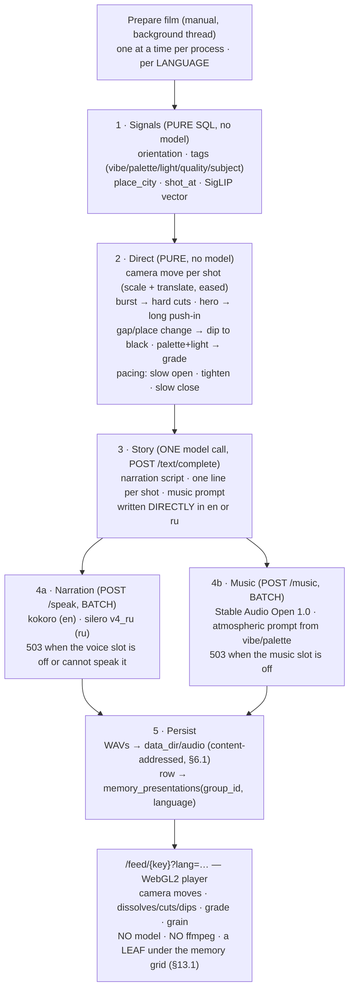

# Memory Movie Implementation Plan

> **For agentic workers:** REQUIRED SUB-SKILL: Use superpowers:subagent-driven-development (recommended) or superpowers:executing-plans to implement this plan task-by-task. Steps use checkbox (`- [ ]`) syntax for tracking.

**Goal:** Turn the memory feed from a CSS slideshow into a directed film — WebGL motion and transitions, an edit decided from the library's own signals, LLM-written story text, atmospheric music, in English or Russian.

**Architecture:** Three new pure Python stages feed one renderer. **`feed/signals.py`** reads what the library already knows about each photo (orientation, tags, vectors, place, time). **`feed/director.py`** turns those signals into an `Edit` — shot order, per-shot camera move, transition, colour grade, pacing — deterministically, with no model. **`feed/story.py`** makes one LLM call for the things taste owns: the narration script, the per-shot line, the music prompt, written directly in the target language. The browser renders the `Edit` on **WebGL2** (`web/static/feed-gl.js`), which is what makes real cross-dissolves, zoom blur and colour grading possible at 60 fps. Playback still loads no model.

**Tech Stack:** Python 3.12 · FastAPI + Jinja + HTMX · SQLite (`sqlite-vec`) · **WebGL2, no JS dependency** · `kokoro` (en narration) · **Silero v4_ru** (ru narration) · Stable Audio Open 1.0 via `diffusers` (music) · gemma4-E2B via the models service (story pass).

**Spec:** `docs/design.md` §11.1 — rewritten by Task 1 of this plan, which is therefore the spec. Read Task 1's doc edits before implementing Tasks 2-8. Plan 23 (`docs/plans/23-memory-feed.md`) built the slideshow this supersedes; its store, routes and prepare-job skeleton are reused.

## Global Constraints

- **One model process (CLAUDE.md, §5.1).** `feed/` is a thin client and MUST NOT import `torch`, `transformers`, `kokoro`, `diffusers`, or `silero`. Only `modelsvc/` and `audio/` may. `tests/test_one_model_process_gate.py` already scans `feed`.
- **GPU only, never CPU (§3.1).** The new Russian voice loads on `settings.embed_device` like every other torch unit.
- **Playback loads no model.** The renderer consumes a JSON `Edit` and two WAVs. Nothing else.
- **`feed/signals.py`, `feed/director.py` are PURE** — no HTTP, no models, no clock, no randomness. Every camera move is derived from the shot's position and its signals so a re-prepare produces an identical film.
- **`photos.phash` is a dead column** — never written, all NULL. Burst detection uses SigLIP vectors, gated at `search.signals.STRICT.image` (0.80; random-pair median 0.558).
- **Navigation §13.1 is unchanged.** The player is still a leaf one level under the memory grid; close is `history.back()`.
- **`ruff` line-length is 100.** Run `make lint` before each commit.
- **Test command:** `uv run pytest tests/<file>.py -v`. Full suite: `make test`.
- **Never run `git commit`/`git add`** — the user commits. Where a task says "Commit", stop and report the task is ready to commit instead.

---

## File Structure

**New — pure, thin-client, gate-scanned:**

| File | Responsibility |
|---|---|
| `feed/signals.py` | Read per-shot signals from the DB. SQL only. |
| `feed/director.py` | `signals → Edit`. All craft rules. Pure. |
| `feed/story.py` | One LLM call → narration, per-shot lines, music prompt, in `en`/`ru`. |
| `feed/language.py` | The `feed_language` setting + the supported-language check. |

**New — models-service-only (may import torch):**

| File | Responsibility |
|---|---|
| `audio/silero_voice.py` | `SileroVoice` — Russian TTS in a `TorchWorker` child. |

**New — browser:**

| File | Responsibility |
|---|---|
| `web/static/feed-gl.js` | WebGL2 renderer: textures, camera moves, transitions, grade, grain. |

**Modified:** `feed/build.py` (orchestrates the new stages), `feed/store.py` + `db/schema.sql` (per-language presentations), `feed/timeline.py` (**deleted** — the director replaces it), `models/catalog.py` (`languages` field + Silero entry), `modelsvc/{app,slots}.py` + `modelsvc/backends/{base,fake,composite,voice_backend}.py` (`/speak` takes a language), `inference/models_client.py`, `web/app.py` (language routes), `web/templates/feed.html`, `web/static/feed.css`, `docs/*`.

---

### Task 1: Design docs — the spec, first

`docs/design.md` describes the **current** state and must change before the code (CLAUDE.md).

**Files:**
- Modify: `docs/design.md` (§4.1, §5.1, §6, §11.1, §13), `docs/memories.md`, `docs/ui.md`, `docs/models.md`, `docs/code-layout.md`, `docs/testing.md`

**Interfaces:**
- Consumes: nothing.
- Produces: the vocabulary every later task uses — `Edit`, `Shot`, `Move`, the residency unit `voice`, `POST /speak {text, language, voice}`, `memory_presentations(group_id, language)`, the setting key `feed_language`.

- [ ] **Step 1: Rewrite §11.1 as the film pipeline**

Replace the whole of §11.1 (added by plan 23) with the text below. It keeps the offline/playback split and replaces the "timeline" vocabulary with the director's.

````markdown
### 11.1 Playing a memory — the film

A memory is a story, so it is **played as a short film**, not paged as a slideshow.
`/feed/{key}` is a fullscreen presentation of one memory: the camera moves through
each photo, shots dissolve and cut into one another on a deliberate rhythm, a
generated atmospheric track plays under it, and a generated voice reads a script
written for that memory — in English or Russian.

**Generation is offline; playback loads no model.** This is the governing rule, and
it is what keeps the film viable on the 8 GB board. A background job prepares the
artifacts once per memory **per language**; the player is plain WebGL over the
thumbnails that already exist.

**Four stages, and only one of them uses a model.**

1. **Signals** (`feed/signals.py`) — read what the library already knows about each
   photo: orientation from `width`/`height`, the top-scoring label per tag dimension
   (`vibe`, `palette`, `light`, `quality`, `subject`, …), `place_city`, `shot_at`,
   and its SigLIP vector. Pure SQL.
2. **Direct** (`feed/director.py`) — turn those signals into an **`Edit`**: for each
   shot a duration, a **camera move** (scale + translation, eased), the **transition**
   into it, a **colour grade**, and whether it is a **hero** shot. Deterministic, no
   model, so the same memory always cuts the same way. The rules:
   - **orientation** decides the motion axis — a portrait gets a vertical push, a
     landscape a lateral drift, so the move always travels along the photo's long edge;
   - a **burst** — consecutive shots inside 90 s whose image cosine clears
     `STRICT.image` (0.80, §9) — collapses into a fast montage of hard cuts, because
     six near-identical frames are one moment, not six;
   - a **hero** shot (`quality=sharp` high, `subject=person` present) is held longer
     on a slow push-in;
   - a **chapter beat** — a time gap over three hours, or a change of `place_city` —
     is a dip to black;
   - `palette` + `light` pick the **grade**;
   - pacing opens slow, tightens through the middle, and closes slow.
3. **Story** (`feed/story.py`) — ONE model call, for the things taste owns: the
   narration script, one short line per shot, and the music prompt. Written
   **directly in the target language**, so it is also the translation — the shot lines
   are never the raw `ai_title`, which is object labelling ("Spray Bottle in Hand")
   and reads as such.
4. **Audio** — narration (`POST /speak`) and music (`POST /music`), both `BATCH`,
   both optional: a slot set to `off` answers 503 and the film is still prepared.

**The renderer is WebGL2, not CSS** (`web/static/feed-gl.js`). CSS can cross-fade two
`` layers and nothing more; the film needs true dissolves and dips, **zoom and
directional blur** on fast moves, a per-memory **colour grade**, vignette and grain —
all of which are one fragment shader and none of which the DOM can do. The camera move
is a UV transform, so it costs no layout and holds 60 fps. There is still **no ffmpeg
and no video file**: exporting an MP4 over this same `Edit` is future work
([`docs/roadmap.md`](roadmap.md)).

**Autoplay is a click.** Browsers refuse to start audio without a user gesture, so the
film opens paused behind a title card; the first click starts picture and sound.

**Language.** `feed_language` (§6, `app_settings`) is `en` by default and may be `ru`.
It selects the language the story pass writes in, and therefore the language the voice
reads. A **presentation is per language** — `memory_presentations` is keyed
`(group_id, language)` — so both can exist side by side and switching does not discard
the other. Narration needs a voice that speaks the language: Kokoro covers English but
**not Russian**, so the catalog declares each voice's `languages` and `POST /speak`
answers **503** when the selected voice cannot speak the requested one (§4.1).

**Film pipeline.**


````

- [ ] **Step 2: §4.1 — voices declare their languages**

Add after the `off` paragraph:

```markdown
**A voice entry declares which languages it can speak.** `voice` is the one slot whose
usable set depends on something outside the slot — the film's language (§11.1). So a
`voice` entry carries `languages` (e.g. `("en",)` for Kokoro, `("ru",)` for Silero),
`POST /speak` takes the language and answers **503** when the selected voice cannot
speak it, and the settings popup states each voice's languages. Kokoro ships nine
languages upstream but **not Russian**, which is exactly why a second entry exists
rather than a bigger one.
```

Add the Silero row to the slot table:

```markdown
| `voice` | Kokoro-82M (en) · Silero v4_ru (ru) | the narration read over a memory film (§11.1) | nothing (no stored output) |
```

- [ ] **Step 3: §5.1 — `/speak` takes a language**

Replace the `POST /speak` bullet with:

```markdown
- **`POST /speak`** — `{text, language, voice}` → `{audio (base64 WAV), sample_rate,
  model}`: one narration clip for a memory film (§11.1), from the `voice` residency
  unit. `Priority.BATCH`. **503** when the `voice` slot holds `off` **or** when the
  selected voice does not list `language` in its catalog `languages` (§4.1) — the film
  is then prepared without speech rather than with the wrong accent.
```

- [ ] **Step 4: §6 — presentations are per language**

Replace the `memory_presentations` bullet with:

```markdown
- **`memory_presentations`** — one row per memory **per language** that has been
  prepared as a film (§11.1), keyed `(group_id, language)`. It holds the `Edit` JSON,
  the storage keys of the two generated WAVs, and the library signature it was built
  against. `group_id` cascades from `groups`, so §11's atomic memory swap drops every
  stale presentation in every language for free.
- **`app_settings`** additionally holds **`feed_language`** — `en` (default) or `ru`
  — the language a film is written and narrated in (§11.1).
```

- [ ] **Step 5: §13 — the route gains a language**

Replace the `/feed/{key}` bullet's first sentence with:

```markdown
- **`/feed/{key}`** — the fullscreen **memory film**: one memory played as a directed
  short with camera moves, cuts, a colour grade, a generated soundtrack and optional
  narration (§11.1). A language selector (English / Russian) sits on the page; each
  language is prepared and cached separately.
```

- [ ] **Step 6: the satellite docs**

- `docs/models.md`: add Silero v4_ru to the slot table and the audio-model table — pure torch (no espeak, no uroman), loads via `torch.hub` / `torch.package`, **CC-BY-NC** (Silero's MIT covers only their base cis-tts models), Russian only. State plainly that Kokoro has no Russian, which is why both exist.
- `docs/ui.md`: rewrite the `/feed/{key}` section — the WebGL canvas, the language selector, the title card, controls (space, ←/→, Esc), and that `prefers-reduced-motion` drops camera moves and keeps dissolves.
- `docs/code-layout.md`: add `feed/signals.py`, `feed/director.py`, `feed/story.py`, `feed/language.py`, `audio/silero_voice.py`, `web/static/feed-gl.js`; remove `feed/timeline.py`.
- `docs/memories.md`: note that a film is prepared per memory **per language**, on demand.
- `docs/testing.md`: note that signals + director are pure and fully unit-tested, and that the story pass is tested against `FakeInferenceClient`.

- [ ] **Step 7: verify the docs agree with themselves**

Run: `grep -n "feed_language\|Edit\|silero\|languages" docs/design.md`
Expected: hits in §4.1, §5.1, §6, §11.1, §13 — and no section still describing `feed/timeline.py` or a CSS-layer renderer.

- [ ] **Step 8: Commit**

```bash
git add docs/
git commit -m "docs: design the memory film (§11.1) — director, story pass, WebGL, en/ru"
```

---

### Task 2: Per-shot signals

**Files:**
- Create: `feed/signals.py`
- Test: `tests/test_feed_signals.py`

**Interfaces:**
- Consumes: `embedding.store.read_vectors(conn, ids) -> dict[int, list[float]]`.
- Produces:
  - `feed.signals.ShotSignal` — frozen dataclass `(photo_id: int, width: int, height: int, shot_at: str | None, caption: str, place: str | None, tags: dict[str, str], scores: dict[str, float], vector: list[float] | None)`
  - `feed.signals.read_signals(conn, group_id: int) -> list[ShotSignal]`
  - `feed.signals.is_portrait(signal) -> bool`

- [ ] **Step 1: Write the failing test**

Create `tests/test_feed_signals.py`:

```python
"""Per-shot signals for the director (design §11.1) — pure SQL, no model."""

import pytest

from albums.memory_store import Memory, replace_memories
from embedding.store import write_vector
from feed.signals import is_portrait, read_signals
from tests.factories import add_photo


def _tag(conn, photo_id, dimension, label, score):
    conn.execute("INSERT OR IGNORE INTO tags(dimension, label) VALUES (?, ?)",
                 (dimension, label))
    tag_id = conn.execute("SELECT id FROM tags WHERE dimension = ? AND label = ?",
                          (dimension, label)).fetchone()["id"]
    conn.execute("INSERT INTO photo_tags(photo_id, tag_id, score, source) VALUES (?,?,?,?)",
                 (photo_id, tag_id, score, "siglip"))


@pytest.fixture
def group(conn):
    add_photo(conn, photo_id=1, content_hash="h1", thumb_key="1.jpg", width=4000,
              height=3000, caption="a beach", ai_title="Beach at noon",
              shot_at="2025-07-12T10:00:00")
    add_photo(conn, photo_id=2, content_hash="h2", thumb_key="2.jpg", width=3000,
              height=4000, caption="a portrait", ai_title="Girl in the sun",
              shot_at="2025-07-12T10:01:00")
    _tag(conn, 1, "palette", "warm", 0.7)
    _tag(conn, 1, "palette", "cool", 0.2)       # loses: lower score
    _tag(conn, 1, "quality", "sharp", 0.95)
    _tag(conn, 2, "subject", "person", 0.83)
    conn.execute("INSERT INTO photo_facets(photo_id, key, value_text) VALUES (?,?,?)",
                 (1, "place_city", "Borjomi"))
    write_vector(conn, 1, [0.1] * 1152)
    replace_memories(conn, 1, [Memory("Beach day", "Warm.", [1, 2], "sig")])
    return conn.execute("SELECT id FROM groups WHERE kind='memory'").fetchone()["id"]


def test_returns_one_signal_per_photo_in_rank_order(conn, group):
    assert [s.photo_id for s in read_signals(conn, group)] == [1, 2]


def test_top_scoring_label_wins_per_dimension(conn, group):
    first = read_signals(conn, group)[0]
    assert first.tags["palette"] == "warm"      # 0.7 beats cool's 0.2
    assert first.scores["palette"] == pytest.approx(0.7)
    assert first.tags["quality"] == "sharp"


def test_place_comes_from_the_facet(conn, group):
    assert read_signals(conn, group)[0].place == "Borjomi"
    assert read_signals(conn, group)[1].place is None


def test_orientation_is_read_from_the_stored_dimensions(conn, group):
    landscape, portrait = read_signals(conn, group)
    assert is_portrait(landscape) is False
    assert is_portrait(portrait) is True


def test_the_caption_prefers_the_ai_title(conn, group):
    assert read_signals(conn, group)[0].caption == "Beach at noon"


def test_vectors_are_attached_when_present(conn, group):
    signals = read_signals(conn, group)
    assert signals[0].vector is not None and len(signals[0].vector) == 1152
    assert signals[1].vector is None            # never embedded


def test_photos_without_a_thumbnail_are_skipped(conn, group):
    conn.execute("UPDATE photos SET thumb_key = NULL WHERE id = 2")
    assert [s.photo_id for s in read_signals(conn, group)] == [1]
```

- [ ] **Step 2: Run the test to verify it fails**

Run: `uv run pytest tests/test_feed_signals.py -v`
Expected: FAIL — `ModuleNotFoundError: No module named 'feed.signals'`.

- [ ] **Step 3: Write the implementation**

Create `feed/signals.py`:

```python
"""What the library already knows about each shot (design §11.1).

Pure SQL, no model, no HTTP. Everything here was computed by the ingest pipeline
long before a film was asked for — the director's whole job is to read it well, not
to add a new analysis pass.
"""

import sqlite3
from dataclasses import dataclass

from embedding.store import read_vectors

# Dimensions the director actually reads. Fetching only these keeps the row count
# small on a 40-shot memory and documents the coupling in one place.
DIMENSIONS: tuple[str, ...] = ("vibe", "palette", "light", "quality", "subject", "setting")


@dataclass(frozen=True)
class ShotSignal:
    photo_id: int
    width: int
    height: int
    shot_at: str | None
    caption: str
    place: str | None
    tags: dict[str, str]      # dimension -> the top-scoring label
    scores: dict[str, float]  # dimension -> that label's score
    vector: list[float] | None


def is_portrait(signal: ShotSignal) -> bool:
    """Taller than wide. Drives the motion axis: the camera should travel along the
    photo's LONG edge, or the move reveals nothing (§11.1)."""
    return signal.height > signal.width


def read_signals(conn: sqlite3.Connection, group_id: int) -> list[ShotSignal]:
    rows = conn.execute(
        "SELECT p.id, p.width, p.height, p.shot_at,"
        " COALESCE(p.ai_title, p.caption, '') AS caption"
        " FROM group_photos gp JOIN photos p ON p.id = gp.photo_id"
        " WHERE gp.group_id = ? AND p.thumb_key IS NOT NULL"
        " ORDER BY gp.rank",
        (group_id,),
    ).fetchall()
    ids = [int(r["id"]) for r in rows]
    if not ids:
        return []
    tags, scores = _top_tags(conn, ids)
    places = _places(conn, ids)
    vectors = read_vectors(conn, ids)
    return [
        ShotSignal(
            photo_id=int(r["id"]),
            width=int(r["width"] or 0),
            height=int(r["height"] or 0),
            shot_at=r["shot_at"],
            caption=r["caption"],
            place=places.get(int(r["id"])),
            tags=tags.get(int(r["id"]), {}),
            scores=scores.get(int(r["id"]), {}),
            vector=vectors.get(int(r["id"])),
        )
        for r in rows
    ]


def _top_tags(
    conn: sqlite3.Connection, ids: list[int]
) -> tuple[dict[int, dict[str, str]], dict[int, dict[str, float]]]:
    """The single best label per dimension per photo.

    A photo carries several labels in one dimension with different scores, and the
    same (dimension, label) can appear more than once because `source` is part of
    `photo_tags`' primary key — so this takes MAX(score) per label and then the
    highest-scoring label per dimension.
    """
    placeholders = ", ".join("?" for _ in ids)
    dims = ", ".join("?" for _ in DIMENSIONS)
    rows = conn.execute(
        "SELECT pt.photo_id, t.dimension, t.label, MAX(pt.score) AS score"
        " FROM photo_tags pt JOIN tags t ON t.id = pt.tag_id"
        f" WHERE pt.photo_id IN ({placeholders}) AND t.dimension IN ({dims})"
        " GROUP BY pt.photo_id, t.dimension, t.label"
        " ORDER BY pt.photo_id, t.dimension, score DESC",
        (*ids, *DIMENSIONS),
    ).fetchall()
    tags: dict[int, dict[str, str]] = {}
    scores: dict[int, dict[str, float]] = {}
    for row in rows:
        photo_id, dimension = int(row["photo_id"]), row["dimension"]
        # Rows arrive score-descending within a dimension, so the FIRST one wins.
        if dimension in tags.setdefault(photo_id, {}):
            continue
        tags[photo_id][dimension] = row["label"]
        scores.setdefault(photo_id, {})[dimension] = float(row["score"])
    return tags, scores


def _places(conn: sqlite3.Connection, ids: list[int]) -> dict[int, str]:
    placeholders = ", ".join("?" for _ in ids)
    return {
        int(r["photo_id"]): r["value_text"]
        for r in conn.execute(
            "SELECT photo_id, value_text FROM photo_facets"
            f" WHERE key = 'place_city' AND photo_id IN ({placeholders})",
            ids,
        )
        if r["value_text"]
    }
```

- [ ] **Step 4: Run the test to verify it passes**

Run: `uv run pytest tests/test_feed_signals.py -v`
Expected: PASS (7 tests).

- [ ] **Step 5: Lint and commit**

```bash
make lint
git add feed/signals.py tests/test_feed_signals.py
git commit -m "feat(feed): read per-shot signals for the director"
```

---

### Task 3: The director

**Files:**
- Create: `feed/director.py`
- Delete: `feed/timeline.py`, `tests/test_feed_timeline.py` (the director supersedes them)
- Test: `tests/test_feed_director.py`

**Interfaces:**
- Consumes: `feed.signals.ShotSignal`, `feed.signals.is_portrait`, `search.signals.STRICT`.
- Produces:
  - `feed.director.Move` — `(scale_from: float, scale_to: float, x_from: float, x_to: float, y_from: float, y_to: float, ease: str)`
  - `feed.director.Shot` — `(photo_id: int, seconds: float, move: Move, transition: str, transition_seconds: float, grade: str, line: str, hero: bool)`
  - `feed.director.Edit` — `(shots: tuple[Shot, ...], grade: str)` with `.seconds` and `.as_dict()`
  - `feed.director.direct(signals, *, base_seconds=4.5, max_shots=40) -> Edit`
  - `feed.director.with_lines(edit, lines: list[str]) -> Edit`
  - `feed.director.GRADES: dict[str, dict]` — the shader's lift/gamma/gain per preset

- [ ] **Step 1: Write the failing test**

Create `tests/test_feed_director.py`:

```python
"""The director (design §11.1) — pure, deterministic, no model, no I/O."""

import pytest

from feed.director import GRADES, direct, with_lines
from feed.signals import ShotSignal


def sig(pid, *, w=4000, h=3000, at=None, tags=None, scores=None, vec=None, place=None):
    return ShotSignal(photo_id=pid, width=w, height=h, shot_at=at, caption=f"c{pid}",
                      place=place, tags=tags or {}, scores=scores or {}, vector=vec)


LAND = [sig(1), sig(2), sig(3), sig(4)]


def test_one_shot_per_signal_in_order():
    assert [s.photo_id for s in direct(LAND).shots] == [1, 2, 3, 4]


def test_is_deterministic():
    assert direct(LAND).as_dict() == direct(LAND).as_dict()


def test_landscape_moves_laterally_and_portrait_vertically():
    landscape = direct([sig(1, w=4000, h=3000)]).shots[0].move
    portrait = direct([sig(1, w=3000, h=4000)]).shots[0].move
    assert landscape.x_from != landscape.x_to and landscape.y_from == landscape.y_to
    assert portrait.y_from != portrait.y_to and portrait.x_from == portrait.x_to


def test_every_move_actually_moves():
    for shot in direct(LAND).shots:
        moved = (shot.move.scale_from != shot.move.scale_to
                 or shot.move.x_from != shot.move.x_to
                 or shot.move.y_from != shot.move.y_to)
        assert moved, shot.photo_id
        assert 1.0 <= min(shot.move.scale_from, shot.move.scale_to)
        assert max(shot.move.scale_from, shot.move.scale_to) <= 1.35


def test_a_hero_shot_is_held_longer_on_a_slow_push_in():
    hero = sig(2, tags={"quality": "sharp", "subject": "person"},
               scores={"quality": 0.95, "subject": 0.83})
    shots = direct([sig(1), hero, sig(3)]).shots
    assert shots[1].hero is True
    assert shots[1].seconds > shots[2].seconds
    assert shots[1].move.scale_to > shots[1].move.scale_from   # push IN
    assert shots[1].move.ease == "in-out"


def test_a_burst_collapses_into_fast_hard_cuts():
    # Same scene (cosine 1.0) inside 90 s -> one moment, not three.
    v = [1.0] + [0.0] * 1151
    burst = [sig(1, at="2025-07-12T10:00:00", vec=v),
             sig(2, at="2025-07-12T10:00:20", vec=v),
             sig(3, at="2025-07-12T10:00:40", vec=v)]
    shots = direct(burst).shots
    assert [s.transition for s in shots[1:]] == ["cut", "cut"]
    assert all(s.seconds < 1.5 for s in shots[1:])


def test_photos_far_apart_in_time_are_not_a_burst():
    v = [1.0] + [0.0] * 1151
    apart = [sig(1, at="2025-07-12T10:00:00", vec=v),
             sig(2, at="2025-07-12T14:00:00", vec=v)]
    assert apart and direct(apart).shots[1].transition != "cut"


def test_a_visually_different_pair_is_not_a_burst():
    a = [1.0] + [0.0] * 1151
    b = [0.0] * 1151 + [1.0]
    pair = [sig(1, at="2025-07-12T10:00:00", vec=a),
            sig(2, at="2025-07-12T10:00:10", vec=b)]
    assert direct(pair).shots[1].transition != "cut"


def test_a_long_time_gap_is_a_dip_to_black():
    shots = direct([sig(1, at="2025-07-12T10:00:00"),
                    sig(2, at="2025-07-12T20:00:00")]).shots
    assert shots[1].transition == "dip"


def test_a_change_of_city_is_a_dip_to_black():
    shots = direct([sig(1, at="2025-07-12T10:00:00", place="Borjomi"),
                    sig(2, at="2025-07-12T10:30:00", place="Tbilisi")]).shots
    assert shots[1].transition == "dip"


def test_the_grade_comes_from_palette_and_light():
    warm = direct([sig(1, tags={"palette": "warm"}, scores={"palette": 0.7})])
    night = direct([sig(1, tags={"light": "low light"}, scores={"light": 0.9})])
    assert warm.grade == "warm"
    assert night.grade == "night"
    assert warm.grade in GRADES and night.grade in GRADES


def test_every_grade_preset_carries_the_shader_uniforms():
    for name, preset in GRADES.items():
        assert set(preset) == {"lift", "gamma", "gain"}, name
        assert all(len(preset[k]) == 3 for k in preset), name


def test_pacing_opens_and_closes_slower_than_the_middle():
    shots = direct([sig(i) for i in range(1, 8)]).shots
    assert shots[0].seconds > shots[3].seconds
    assert shots[-1].seconds > shots[3].seconds


def test_the_first_shot_has_no_transition_in():
    assert direct(LAND).shots[0].transition == "none"


def test_long_memories_are_capped():
    edit = direct([sig(i) for i in range(200)], max_shots=40)
    assert len(edit.shots) == 40


def test_with_lines_attaches_the_story_text():
    edit = with_lines(direct(LAND), ["a", "b", "c", "d"])
    assert [s.line for s in edit.shots] == ["a", "b", "c", "d"]


def test_with_lines_ignores_a_wrong_length_list():
    # The model returned the wrong number of lines; the film must still play.
    edit = with_lines(direct(LAND), ["only", "two"])
    assert [s.line for s in edit.shots] == ["", "", "", ""]


def test_an_empty_memory_produces_an_empty_edit():
    edit = direct([])
    assert edit.shots == () and edit.seconds == 0.0


def test_as_dict_carries_everything_the_renderer_needs():
    payload = direct(LAND).as_dict()
    assert set(payload) == {"shots", "grade", "grades", "seconds"}
    shot = payload["shots"][0]
    assert set(shot) == {"photo_id", "seconds", "move", "transition",
                         "transition_seconds", "grade", "line", "hero"}
    assert set(shot["move"]) == {"scale_from", "scale_to", "x_from", "x_to",
                                 "y_from", "y_to", "ease"}
```

- [ ] **Step 2: Run the test to verify it fails**

Run: `uv run pytest tests/test_feed_director.py -v`
Expected: FAIL — `ModuleNotFoundError: No module named 'feed.director'`.

- [ ] **Step 3: Write the implementation**

Create `feed/director.py`:

```python
"""The director (design §11.1) — signals in, an `Edit` out.

PURE and DETERMINISTIC. No model, no HTTP, no database, no clock, no randomness.
Everything is derived from the shot's signals and its position, so the same memory
always cuts the same way and every rule below is a unit test.

The split this file exists to enforce: **craft is rules, story is the model**. How
long a shot holds, which way the camera travels, where the cuts land and what the
film is graded — all of that is measurable from the library and belongs here. What
the film SAYS is taste, and lives in `feed/story.py`.
"""

from dataclasses import dataclass, replace
from datetime import datetime

from feed.signals import ShotSignal, is_portrait
from search import signals as gates

# Camera bounds. Below ~1.05 the move is invisible; past ~1.35 a 1600 px thumbnail
# softens on a 1080p screen.
_REST = 1.06
_PUSH = 1.22
_HERO_PUSH = 1.16          # heroes move LESS — the slower it is, the more it reads
_DRIFT = 0.06              # UV translation, in texture widths

# A burst is the same scene photographed several times in a row: close in TIME and
# close in APPEARANCE. The cosine bar is `STRICT.image` (0.80) — the measured top 4%
# of pairs, where the random-pair median is 0.558 (search/signals.py, design §9).
_BURST_SECONDS = 90.0
_BURST_COSINE = gates.STRICT.image
_BURST_HOLD = 0.7

# A chapter break: a real gap in the day, or a different city.
_CHAPTER_GAP_SECONDS = 3 * 3600.0

_HERO_SHARP = 0.80
_HERO_SUBJECT = 0.60
_HERO_HOLD = 1.7

_DISSOLVE = 0.8
_DIP = 1.1
_CUT = 0.0

# Grade presets. Each is what the fragment shader multiplies with: lift (added),
# gamma (curve), gain (multiplied), per RGB channel.
GRADES: dict[str, dict] = {
    "neutral": {"lift": [0.00, 0.00, 0.00], "gamma": [1.00, 1.00, 1.00],
                "gain": [1.00, 1.00, 1.00]},
    "warm":    {"lift": [0.02, 0.01, 0.00], "gamma": [0.98, 1.00, 1.03],
                "gain": [1.06, 1.01, 0.95]},
    "cool":    {"lift": [0.00, 0.01, 0.02], "gamma": [1.03, 1.00, 0.97],
                "gain": [0.95, 1.01, 1.07]},
    "pastel":  {"lift": [0.04, 0.04, 0.05], "gamma": [1.05, 1.05, 1.05],
                "gain": [0.97, 0.97, 0.99]},
    "muted":   {"lift": [0.02, 0.02, 0.02], "gamma": [1.02, 1.02, 1.02],
                "gain": [0.93, 0.94, 0.95]},
    "night":   {"lift": [0.00, 0.01, 0.03], "gamma": [1.10, 1.08, 1.00],
                "gain": [0.88, 0.92, 1.05]},
    "bright":  {"lift": [0.01, 0.01, 0.01], "gamma": [0.95, 0.95, 0.95],
                "gain": [1.05, 1.05, 1.04]},
}


@dataclass(frozen=True)
class Move:
    scale_from: float
    scale_to: float
    x_from: float
    x_to: float
    y_from: float
    y_to: float
    ease: str          # "in-out" | "linear"


@dataclass(frozen=True)
class Shot:
    photo_id: int
    seconds: float
    move: Move
    transition: str            # "none" | "dissolve" | "cut" | "dip"
    transition_seconds: float
    grade: str
    line: str
    hero: bool


@dataclass(frozen=True)
class Edit:
    shots: tuple[Shot, ...]
    grade: str

    @property
    def seconds(self) -> float:
        return round(sum(s.seconds + s.transition_seconds for s in self.shots), 3)

    def as_dict(self) -> dict:
        return {
            "grade": self.grade,
            "grades": GRADES,
            "seconds": self.seconds,
            "shots": [
                {
                    "photo_id": s.photo_id,
                    "seconds": s.seconds,
                    "transition": s.transition,
                    "transition_seconds": s.transition_seconds,
                    "grade": s.grade,
                    "line": s.line,
                    "hero": s.hero,
                    "move": {
                        "scale_from": s.move.scale_from, "scale_to": s.move.scale_to,
                        "x_from": s.move.x_from, "x_to": s.move.x_to,
                        "y_from": s.move.y_from, "y_to": s.move.y_to,
                        "ease": s.move.ease,
                    },
                }
                for s in self.shots
            ],
        }


def direct(
    signals: list[ShotSignal], *, base_seconds: float = 4.5, max_shots: int = 40
) -> Edit:
    """Turn per-shot signals into a cut film."""
    chosen = signals[:max_shots]
    if not chosen:
        return Edit(shots=(), grade="neutral")
    bursts = _burst_flags(chosen)
    grade = _grade(chosen)
    shots: list[Shot] = []
    for index, signal in enumerate(chosen):
        hero = _is_hero(signal) and not bursts[index]
        seconds = _hold(index, len(chosen), base_seconds, hero=hero, burst=bursts[index])
        transition, transition_seconds = _transition(
            index, signal, chosen[index - 1] if index else None, bursts[index]
        )
        shots.append(
            Shot(
                photo_id=signal.photo_id,
                seconds=round(seconds, 3),
                move=_move(index, signal, hero=hero, burst=bursts[index]),
                transition=transition,
                transition_seconds=transition_seconds,
                grade=grade,
                line="",
                hero=hero,
            )
        )
    return Edit(shots=tuple(shots), grade=grade)


def with_lines(edit: Edit, lines: list[str]) -> Edit:
    """Attach the story pass's per-shot lines.

    A wrong-length list is DROPPED rather than zipped short: a half-captioned film
    reads as a bug, whereas a silent-but-moving one reads as a choice. The model is
    asked for exactly one line per shot; when it disobeys, the film still plays.
    """
    if len(lines) != len(edit.shots):
        return edit
    return replace(
        edit,
        shots=tuple(replace(s, line=line) for s, line in zip(edit.shots, lines)),
    )


def _is_hero(signal: ShotSignal) -> bool:
    sharp = signal.tags.get("quality") == "sharp" and signal.scores.get("quality", 0.0)
    person = signal.tags.get("subject") == "person" and signal.scores.get("subject", 0.0)
    return bool(sharp and sharp >= _HERO_SHARP and person and person >= _HERO_SUBJECT)


def _hold(index: int, total: int, base: float, *, hero: bool, burst: bool) -> float:
    if burst:
        return _BURST_HOLD
    if hero:
        return base * _HERO_HOLD
    if index == 0:
        return base * 1.35            # open slow: let the first frame land
    if index == total - 1:
        return base * 1.45            # close slow: let it end, don't just stop
    return base * 0.85                # tighten through the middle


def _move(index: int, signal: ShotSignal, *, hero: bool, burst: bool) -> Move:
    if burst:
        # A montage frame is on screen for well under a second; a travelling camera
        # would only smear it. Hold a fixed, slightly-in framing instead.
        return Move(_PUSH, _PUSH, 0.0, 0.0, 0.0, 0.0, "linear")
    if hero:
        return Move(_REST, _HERO_PUSH, 0.0, 0.0, 0.0, 0.0, "in-out")
    # Alternate the direction so two neighbours never travel the same way, and put
    # the travel on the photo's LONG edge — across a landscape, down a portrait.
    forward = index % 2 == 0
    drift = _DRIFT if forward else -_DRIFT
    scale_from, scale_to = (_REST, _PUSH) if forward else (_PUSH, _REST)
    if is_portrait(signal):
        return Move(scale_from, scale_to, 0.0, 0.0, -drift, drift, "in-out")
    return Move(scale_from, scale_to, -drift, drift, 0.0, 0.0, "in-out")


def _transition(
    index: int, signal: ShotSignal, previous: ShotSignal | None, burst: bool
) -> tuple[str, float]:
    if index == 0:
        return "none", 0.0
    if burst:
        return "cut", _CUT
    if previous is not None and _is_chapter_break(previous, signal):
        return "dip", _DIP
    return "dissolve", _DISSOLVE


def _is_chapter_break(previous: ShotSignal, signal: ShotSignal) -> bool:
    if previous.place and signal.place and previous.place != signal.place:
        return True
    gap = _gap_seconds(previous.shot_at, signal.shot_at)
    return gap is not None and gap > _CHAPTER_GAP_SECONDS


def _burst_flags(signals: list[ShotSignal]) -> list[bool]:
    """Mark every member of a run of near-identical, near-simultaneous shots.

    Both members of a matching pair are marked, so a three-shot burst is three fast
    cuts rather than one slow shot followed by two fast ones.
    """
    flags = [False] * len(signals)
    for index in range(1, len(signals)):
        previous, current = signals[index - 1], signals[index]
        gap = _gap_seconds(previous.shot_at, current.shot_at)
        if gap is None or gap > _BURST_SECONDS:
            continue
        if _cosine(previous.vector, current.vector) >= _BURST_COSINE:
            flags[index - 1] = flags[index] = True
    return flags


def _grade(signals: list[ShotSignal]) -> str:
    """One grade for the whole film — a film that re-grades every shot looks broken,
    not styled. Low light wins outright; otherwise the most common palette does."""
    lows = sum(1 for s in signals if s.tags.get("light") == "low light")
    if lows * 2 > len(signals):
        return "night"
    counts: dict[str, int] = {}
    for signal in signals:
        palette = signal.tags.get("palette")
        if palette in GRADES:
            counts[palette] = counts.get(palette, 0) + 1
    if not counts:
        return "neutral"
    # Sorted by count then name so ties resolve deterministically.
    return sorted(counts.items(), key=lambda kv: (-kv[1], kv[0]))[0][0]


def _gap_seconds(first: str | None, second: str | None) -> float | None:
    if not first or not second:
        return None
    try:
        return abs((_parse(second) - _parse(first)).total_seconds())
    except ValueError:
        return None


def _parse(stamp: str) -> datetime:
    return datetime.fromisoformat(stamp.replace("Z", "+00:00"))


def _cosine(first: list[float] | None, second: list[float] | None) -> float:
    if not first or not second or len(first) != len(second):
        return 0.0
    dot = sum(a * b for a, b in zip(first, second))
    norm = (sum(a * a for a in first) ** 0.5) * (sum(b * b for b in second) ** 0.5)
    return dot / norm if norm else 0.0
```

- [ ] **Step 4: Run the test to verify it passes**

Run: `uv run pytest tests/test_feed_director.py -v`
Expected: PASS (18 tests).

- [ ] **Step 5: Delete the superseded timeline**

```bash
rm feed/timeline.py tests/test_feed_timeline.py
```

- [ ] **Step 6: Lint and commit**

```bash
make lint
git add feed/ tests/
git commit -m "feat(feed): the director — deterministic edit from library signals"
```

---

### Task 4: The story pass (en/ru)

**Files:**
- Create: `feed/story.py`, `feed/language.py`
- Test: `tests/test_feed_story.py`

**Interfaces:**
- Consumes: `feed.director.Edit`, `inference.models_client.ModelsClient.text_complete`.
- Produces:
  - `feed.language.LANGUAGES: tuple[str, ...]` == `("en", "ru")`, `feed.language.DEFAULT == "en"`
  - `feed.language.get_language(conn, owner_id) -> str`, `feed.language.set_language(conn, owner_id, language) -> None`
  - `feed.story.Story` — `(narration: str, lines: tuple[str, ...], music_prompt: str)`
  - `feed.story.write_story(client, model, *, title, description, edit, language) -> Story`
  - `feed.story.STORY_SCHEMA: dict`

- [ ] **Step 1: Write the failing test**

Create `tests/test_feed_story.py`:

```python
"""The story pass (design §11.1) — one model call, en or ru, schema-checked."""

import json

import pytest

from feed.director import direct
from feed.language import DEFAULT, LANGUAGES, get_language, set_language
from feed.signals import ShotSignal
from feed.story import write_story


class FakeClient:
    def __init__(self, payload):
        self.payload = payload
        self.calls = []

    def text_complete(self, model, messages, *, json_schema=None, **kw):
        self.calls.append({"model": model, "messages": messages, "schema": json_schema})
        return self.payload


def sig(pid):
    return ShotSignal(photo_id=pid, width=4000, height=3000, shot_at=None,
                      caption=f"caption {pid}", place=None, tags={}, scores={}, vector=None)


EDIT = direct([sig(1), sig(2)])
GOOD = json.dumps({"narration": "A warm afternoon.", "lines": ["Golden light", "Still water"],
                   "music_prompt": "warm ambient drone"})


def test_returns_the_parsed_story():
    story = write_story(FakeClient(GOOD), "gemma", title="Beach day",
                        description="Warm.", edit=EDIT, language="en")
    assert story.narration == "A warm afternoon."
    assert story.lines == ("Golden light", "Still water")
    assert story.music_prompt == "warm ambient drone"


def test_it_asks_for_exactly_one_line_per_shot():
    client = FakeClient(GOOD)
    write_story(client, "gemma", title="T", description="D", edit=EDIT, language="en")
    prompt = client.calls[0]["messages"][-1]["content"]
    assert "2" in prompt                       # the shot count is stated
    assert "caption 1" in prompt and "caption 2" in prompt


def test_russian_asks_the_model_to_write_in_russian():
    client = FakeClient(GOOD)
    write_story(client, "gemma", title="T", description="D", edit=EDIT, language="ru")
    prompt = client.calls[0]["messages"][-1]["content"]
    assert "Russian" in prompt


def test_a_schema_is_always_sent():
    client = FakeClient(GOOD)
    write_story(client, "gemma", title="T", description="D", edit=EDIT, language="en")
    assert client.calls[0]["schema"]["required"] == ["narration", "lines", "music_prompt"]


def test_unparseable_output_degrades_to_an_empty_story():
    # The film must still play, silent and unlabelled, if the model returns junk.
    story = write_story(FakeClient("not json at all"), "gemma", title="Beach day",
                        description="Warm.", edit=EDIT, language="en")
    assert story.narration == ""
    assert story.lines == ()
    assert story.music_prompt


def test_a_missing_key_degrades_rather_than_raising():
    story = write_story(FakeClient(json.dumps({"narration": "x"})), "gemma", title="T",
                        description="D", edit=EDIT, language="en")
    assert story.narration == "x" and story.lines == ()


def test_the_fallback_music_prompt_is_still_atmospheric():
    story = write_story(FakeClient("junk"), "gemma", title="T", description="D",
                        edit=EDIT, language="en")
    assert "instrumental" in story.music_prompt and "no vocals" in story.music_prompt


def test_language_defaults_to_english(conn):
    assert DEFAULT == "en"
    assert get_language(conn, 1) == "en"


def test_language_round_trips(conn):
    set_language(conn, 1, "ru")
    assert get_language(conn, 1) == "ru"


def test_an_unknown_language_is_rejected(conn):
    with pytest.raises(ValueError):
        set_language(conn, 1, "klingon")


def test_a_stored_junk_language_degrades_to_the_default(conn):
    from db.settings import set_setting

    set_setting(conn, 1, "feed_language", "klingon")
    assert get_language(conn, 1) == "en"
    assert set(LANGUAGES) == {"en", "ru"}
```

- [ ] **Step 2: Run the test to verify it fails**

Run: `uv run pytest tests/test_feed_story.py -v`
Expected: FAIL — `ModuleNotFoundError: No module named 'feed.language'`.

- [ ] **Step 3: Write the language module**

Create `feed/language.py`:

```python
"""The film's language (design §11.1) — `en` (default) or `ru`.

It selects the language the story pass WRITES in, which is what makes it the
translation as well: the shot lines and the narration are generated in that language
rather than produced in English and translated afterwards.
"""

import sqlite3

LANGUAGES: tuple[str, ...] = ("en", "ru")
DEFAULT = "en"
SETTING_KEY = "feed_language"

DISPLAY: dict[str, str] = {"en": "English", "ru": "Русский"}


def get_language(conn: sqlite3.Connection, owner_id: int) -> str:
    """The stored choice, or the default. A stored value that is no longer a known
    language degrades to the default rather than raising — a downgraded install must
    still play films."""
    from db.settings import get_setting

    stored = get_setting(conn, owner_id, SETTING_KEY)
    return stored if stored in LANGUAGES else DEFAULT


def set_language(conn: sqlite3.Connection, owner_id: int, language: str) -> None:
    from db.settings import set_setting

    if language not in LANGUAGES:
        raise ValueError(f"unknown language: {language}")
    set_setting(conn, owner_id, SETTING_KEY, language)
```

- [ ] **Step 4: Write the story pass**

Create `feed/story.py`:

```python
"""The story pass (design §11.1) — the ONE model call in the whole film pipeline.

The director owns craft, which is measurable. This owns story, which is taste: what
the film says, how it says it, and what it should sound like. It is one call, made
offline, and its output is text — so a failure costs the words, never the film.

The shot lines exist because the raw captions cannot carry a film: `photos.ai_title`
is object labelling ("Spray Bottle in Hand"), accurate and inert. The model is given
those labels and the memory's own description and asked for something a person would
write under a photograph.
"""

import json
import logging
from dataclasses import dataclass

from feed.director import Edit
from feed.language import DEFAULT

logger = logging.getLogger(__name__)

MAX_LINE_WORDS = 6
_MUSIC_TAIL = (
    "Atmospheric cinematic instrumental, slow, warm pads and soft piano, "
    "gentle, unobtrusive, no vocals, no drums."
)

STORY_SCHEMA: dict = {
    "type": "object",
    "properties": {
        "narration": {"type": "string"},
        "lines": {"type": "array", "items": {"type": "string"}},
        "music_prompt": {"type": "string"},
    },
    "required": ["narration", "lines", "music_prompt"],
}

_LANGUAGE_NAME = {"en": "English", "ru": "Russian"}


@dataclass(frozen=True)
class Story:
    narration: str
    lines: tuple[str, ...]
    music_prompt: str


def write_story(
    client, model: str, *, title: str, description: str, edit: Edit, language: str = DEFAULT
) -> Story:
    """One call. Never raises: a film with no words still plays."""
    prompt = _prompt(title, description, edit, language)
    try:
        raw = client.text_complete(
            model,
            [{"role": "user", "content": prompt}],
            json_schema=STORY_SCHEMA,
            temperature=0.8,
            max_tokens=900,
        )
        payload = json.loads(raw)
    except Exception:  # a wordless film beats no film
        logger.exception("story pass failed; falling back to a silent film")
        payload = {}
    lines = payload.get("lines")
    return Story(
        narration=str(payload.get("narration") or ""),
        lines=tuple(str(line) for line in lines) if isinstance(lines, list) else (),
        music_prompt=str(payload.get("music_prompt") or "") or _fallback_music(title),
    )


def _fallback_music(title: str) -> str:
    return f"{title}. {_MUSIC_TAIL}".strip()


def _prompt(title: str, description: str, edit: Edit, language: str) -> str:
    name = _LANGUAGE_NAME.get(language, _LANGUAGE_NAME[DEFAULT])
    shots = "\n".join(
        f"{index + 1}. {shot.line or _caption_placeholder(index)}"
        for index, shot in enumerate(edit.shots)
    )
    return (
        f"You are writing a short film made from someone's photographs.\n"
        f"Memory: {title}\n"
        f"What happened: {description}\n\n"
        f"The film has {len(edit.shots)} shots. Here is what is in each one, as blunt "
        f"machine labels:\n{shots}\n\n"
        f"Write ALL of your output in {name}.\n"
        f"Return JSON with three keys:\n"
        f'- "narration": a warm, spoken script for the whole film, 3-5 sentences. It '
        f"is read aloud, so write it to be heard, not read.\n"
        f'- "lines": EXACTLY {len(edit.shots)} strings, one per shot in order — what '
        f"appears on screen over that shot. At most {MAX_LINE_WORDS} words each. "
        f"Evocative, not descriptive: not 'Man outdoors in sunlight' but "
        f"'Golden hour, and no hurry'.\n"
        f'- "music_prompt": one English sentence describing a instrumental score for '
        f"this memory's mood, for a text-to-audio model. Always instrumental, "
        f"no vocals."
    )


def _caption_placeholder(index: int) -> str:
    return f"(shot {index + 1})"
```

Note: `_prompt` reads `shot.line`, which the director leaves empty until `with_lines`
runs. Task 6 wires the real captions in by calling `with_lines(edit, captions)` with
the signals' captions **before** the story pass, so the model sees the labels.

- [ ] **Step 5: Run the test to verify it passes**

Run: `uv run pytest tests/test_feed_story.py -v`
Expected: PASS (11 tests).

- [ ] **Step 6: Lint and commit**

```bash
make lint
git add feed/story.py feed/language.py tests/test_feed_story.py
git commit -m "feat(feed): LLM story pass with en/ru language selection"
```

---

### Task 5: Russian voice + language-aware `/speak`

**Files:**
- Create: `audio/silero_voice.py`
- Modify: `models/catalog.py` (`languages` field, Silero entry), `modelsvc/backends/base.py`, `modelsvc/backends/fake.py`, `modelsvc/backends/composite.py`, `modelsvc/backends/voice_backend.py`, `modelsvc/app.py`, `modelsvc/slots.py`, `inference/models_client.py`
- Test: extend `tests/test_catalog.py`, `tests/test_modelsvc_api.py`, `tests/test_models_client.py`

**Interfaces:**
- Consumes: `modelsvc.torch_process.TorchWorker`, `storage.wav.encode_wav`.
- Produces:
  - `ModelEntry.languages: tuple[str, ...]` (empty for non-voice slots)
  - `audio.silero_voice.SileroVoice(repo: str, device: str)` with `warm()` and `speak(text, voice)`
  - `ModelBackend.speak(text, language="en", voice=None) -> dict`, raising `SlotOff` when the slot is off **or** the voice cannot speak `language`
  - `POST /speak {text, language, voice}`
  - `ModelsClient.speak(text, language="en", voice=None) -> dict`

- [ ] **Step 1: Write the failing tests**

Append to `tests/test_catalog.py`:

```python
def test_voice_entries_declare_their_languages():
    assert catalog.get("voice", "kokoro-82m").languages == ("en",)
    assert catalog.get("voice", "silero-v4-ru").languages == ("ru",)
    # `off` speaks nothing, which is what makes the 503 uniform.
    assert catalog.get("voice", "off").languages == ()


def test_non_voice_entries_declare_no_languages():
    for entry in catalog.CATALOG:
        if entry.slot != "voice":
            assert entry.languages == (), entry.key


def test_every_offered_language_has_a_voice_that_speaks_it():
    from feed.language import LANGUAGES

    for profile in PROFILES:
        spoken = {
            lang
            for entry in catalog.entries_for("voice", profile)
            for lang in entry.languages
        }
        assert set(LANGUAGES) <= spoken, profile
```

Append to `tests/test_modelsvc_api.py`:

```python
def test_speak_defaults_to_english():
    with _client() as tc:
        resp = tc.post("/speak", json={"text": "hello"})
    assert resp.status_code == 200


def test_speak_is_503_when_the_voice_cannot_speak_the_language():
    # Kokoro has no Russian (design §4.1) — the film is prepared without speech
    # rather than narrated in the wrong language.
    with _client() as tc:
        resp = tc.post("/speak", json={"text": "привет", "language": "ru"})
    assert resp.status_code == 503


def test_switching_the_voice_slot_makes_russian_speakable():
    backend = FakeBackend()
    backend.set_slots({"voice": "silero-v4-ru"})
    with TestClient(create_models_app(backend)) as tc:
        assert tc.post("/speak", json={"text": "привет", "language": "ru"}).status_code == 200
        assert tc.post("/speak", json={"text": "hello", "language": "en"}).status_code == 503
```

Append to `tests/test_models_client.py`:

```python
def test_speak_sends_the_language():
    result = _client().speak("hello", language="en")
    assert result["audio"][:4] == b"RIFF"
```

- [ ] **Step 2: Run the tests to verify they fail**

Run: `uv run pytest tests/test_catalog.py tests/test_modelsvc_api.py -v`
Expected: FAIL — `AttributeError: 'ModelEntry' object has no attribute 'languages'`.

- [ ] **Step 3: Add `languages` and the Silero entry**

In `models/catalog.py`, add the field to `ModelEntry` (after `prompt_template`):

```python
    # Which languages a VOICE entry can speak (design §4.1, §11.1). Empty for every
    # other slot. `POST /speak` 503s when the film's language is not in here, because
    # a voice reading Russian text with an English frontend is worse than silence.
    languages: tuple[str, ...] = ()
```

Add `languages=("en",)` to the `kokoro-82m` entry, and append the Silero entry after it:

```python
    ModelEntry(
        key="silero-v4-ru",
        slot="voice",
        display="Silero v4 · Russian",
        source=HfSource("silero/silero-models"),
        size_mb=60,
        cost_mb=700,
        cost_measured=False,
        profiles=_ALL,
        languages=("ru",),
        note="Russian narration. Kokoro speaks nine languages but NOT Russian, so "
        "this is a second voice rather than a bigger one. Pure torch — no espeak, no "
        "uroman — and tiny. Licence is CC-BY-NC (Silero's MIT covers only their base "
        "cis-tts models): fine for your own library, not for commercial shipping.",
    ),
```

- [ ] **Step 4: Write the Silero child**

Create `audio/silero_voice.py`:

```python
"""Silero v4 Russian TTS in a `TorchWorker` child (design §5.1, §8.1, §11.1).

Models-service-only, like every other module in `audio/`.

Chosen for Russian because Kokoro does not speak it and Silero needs **no system
dependency at all** — no espeak-ng for phonemes, no uroman for Cyrillic
transliteration. It is a single `torch.package` archive driven by plain torch, which
is already the one heavy library this process is allowed to load.

Licence: CC-BY-NC (Silero's MIT applies only to their base cis-tts models).
"""

import torch

from storage.wav import encode_wav

SAMPLE_RATE = 48000
DEFAULT_VOICE = "xenia"
_MODEL_URL = "https://models.silero.ai/models/tts/ru/v4_ru.pt"


class SileroVoice:
    def __init__(self, repo: str, device: str) -> None:
        # `repo` is the catalog entry's source id; Silero ships one archive per
        # language rather than an HF checkpoint, so the URL is the real address and
        # `repo` is kept only for the model stamp the caller stores.
        self.repo = repo
        self.device = device
        path = torch.hub.get_dir() + "/v4_ru.pt"
        try:
            self._model = torch.package.PackageImporter(path).load_pickle("tts_models", "model")
        except FileNotFoundError:
            torch.hub.download_url_to_file(_MODEL_URL, path)
            self._model = torch.package.PackageImporter(path).load_pickle("tts_models", "model")
        self._model.to(torch.device(device))

    def warm(self) -> None:
        """Resident must mean resident (§8.1) — the archive loads lazily, so speak
        once at load time to make the governor's accounting honest."""
        self.speak("готово")

    def speak(self, text: str, voice: str | None = None) -> dict:
        audio = self._model.apply_tts(
            text=text, speaker=voice or DEFAULT_VOICE, sample_rate=SAMPLE_RATE
        )
        return {
            "audio": encode_wav(audio.cpu().numpy(), SAMPLE_RATE),
            "sample_rate": SAMPLE_RATE,
            "model": self.repo,
        }
```

In `modelsvc/slots.py`, make `_register_voice` pick the child by the selected entry:

```python
    def _register_voice(self) -> None:
        target = (
            "audio.silero_voice:SileroVoice"
            if self.entry("voice").key == "silero-v4-ru"
            else "audio.kokoro_voice:KokoroVoice"
        )
        self._register_optional_torch_unit("voice", target)
```

- [ ] **Step 5: Thread the language through the backend and the client**

In `modelsvc/backends/base.py`, change the protocol signature and docstring:

```python
    def speak(self, text: str, language: str = "en", voice: str | None = None) -> dict:
        """One narration clip for a memory film (design §11.1).

        Returns `{audio: bytes (WAV), sample_rate: int, model: str}`. Raises `SlotOff`
        when the `voice` slot holds `off`, or when the selected voice does not list
        `language` in its catalog `languages` (§4.1).
        """
        ...
```

In `modelsvc/backends/fake.py`, honour the language:

```python
    def speak(self, text: str, language: str = "en", voice: str | None = None) -> dict:
        from modelsvc.backends.base import SlotOff
        from storage.wav import encode_wav

        key = self._slots.get("voice")
        if key == "off":
            raise SlotOff("voice")
        if language not in self._catalog.get("voice", key).languages:
            raise SlotOff(f"the {key} voice does not speak {language}")
        import numpy as np

        seconds = max(0.5, len(text) / 14.0)
        return {
            "audio": encode_wav(np.zeros(int(24000 * seconds), dtype=np.float32), 24000),
            "sample_rate": 24000,
            "model": "fake-voice",
        }
```

In `modelsvc/backends/composite.py`:

```python
    def speak(self, text: str, language: str = "en", voice: str | None = None) -> dict:
        from modelsvc.backends.base import SlotOff

        if self._voice is None or not self._unit_available("voice"):
            raise SlotOff("voice")
        if self._slots is not None and language not in self._slots.entry("voice").languages:
            raise SlotOff(f"the selected voice does not speak {language}")
        return self._run(["voice"], Priority.BATCH, "narrating",
                         lambda: self._voice.speak(text, voice))
```

In `modelsvc/app.py`, add `language: str = "en"` to `SpeakRequest` and pass it:

```python
class SpeakRequest(BaseModel):
    text: str
    language: str = "en"
    voice: str | None = None
```

```python
            result = backend.speak(req.text, req.language, req.voice)
```

In `inference/models_client.py`:

```python
    def speak(
        self, text: str, language: str = "en", voice: str | None = None,
        *, timeout: float = 300.0,
    ) -> dict:
        payload = {"text": text, "language": language, "voice": voice}
        response = self._client.post("/speak", json=payload, timeout=timeout)
        response.raise_for_status()
        return _audio(response.json())
```

- [ ] **Step 6: Ship the new module and dependency**

In `pyproject.toml`, `only-include` already lists `audio`. No new Python dependency —
Silero is plain `torch`, which the `models` extra already installs. In
`Dockerfile.models` and `Dockerfile.models.jetson`, nothing changes: `audio/` is
already copied and `espeak-ng` is already installed for Kokoro.

- [ ] **Step 7: Run the tests to verify they pass**

Run: `uv run pytest tests/test_catalog.py tests/test_modelsvc_api.py tests/test_models_client.py tests/test_modelsvc_slots.py -v`
Expected: PASS.

- [ ] **Step 8: Lint and commit**

```bash
make lint
git add audio/ models/ modelsvc/ inference/ tests/
git commit -m "feat(models): Silero Russian voice and language-aware /speak"
```

---

### Task 6: Rebuild the prepare job around the director

**Files:**
- Modify: `feed/build.py`, `feed/store.py`, `db/schema.sql`, `db/connection.py`
- Test: rewrite `tests/test_feed_build.py`, extend `tests/test_feed_store.py`

**Interfaces:**
- Consumes: everything from Tasks 2-5.
- Produces:
  - `feed.store.Presentation` gains `language: str`
  - `feed.store.read_presentation(conn, group_id, language) -> Presentation | None`
  - `feed.build.build_presentation(conn, client, audio, owner_id, group_id, *, language="en", planner_model="gemma4-E2B", base_seconds=4.5, max_shots=40) -> Presentation`

- [ ] **Step 1: Write the failing tests**

Rewrite `tests/test_feed_build.py` — keep the existing `FakeModels` class from plan 23
(it already fakes `speak`/`music` with real WAV bytes) and add `text_complete`:

```python
    def text_complete(self, model, messages, *, json_schema=None, **kw):
        import json as _json
        shots = messages[-1]["content"].count("\n1. ") and 3 or 3
        return _json.dumps({
            "narration": "A warm afternoon by the water.",
            "lines": ["Golden light", "Still water", "Nobody in a hurry"][:shots],
            "music_prompt": "warm ambient drone, no vocals",
        })
```

Then the new tests:

```python
def test_the_edit_replaces_the_old_timeline_shape(conn, memory_group, audio):
    result = build_presentation(conn, FakeModels(), audio, 1, memory_group)
    edit = result.timeline
    assert set(edit) == {"shots", "grade", "grades", "seconds"}
    assert edit["shots"][0]["move"]["scale_from"] != edit["shots"][0]["move"]["scale_to"]


def test_the_story_lines_land_on_the_shots(conn, memory_group, audio):
    result = build_presentation(conn, FakeModels(), audio, 1, memory_group)
    assert result.timeline["shots"][0]["line"] == "Golden light"


def test_the_narration_is_the_story_script_not_the_captions(conn, memory_group, audio):
    models = FakeModels()
    build_presentation(conn, models, audio, 1, memory_group)
    assert models.spoken[0] == "A warm afternoon by the water."


def test_the_music_prompt_comes_from_the_story_pass(conn, memory_group, audio):
    models = FakeModels()
    build_presentation(conn, models, audio, 1, memory_group)
    assert models.prompted[0][0] == "warm ambient drone, no vocals"


def test_the_language_is_recorded_and_passed_to_the_voice(conn, memory_group, audio):
    result = build_presentation(conn, FakeModels(), audio, 1, memory_group, language="ru")
    assert result.language == "ru"


def test_both_languages_coexist(conn, memory_group, audio):
    build_presentation(conn, FakeModels(), audio, 1, memory_group, language="en")
    build_presentation(conn, FakeModels(), audio, 1, memory_group, language="ru")
    assert read_presentation(conn, memory_group, "en") is not None
    assert read_presentation(conn, memory_group, "ru") is not None


def test_a_failed_story_pass_still_produces_a_playable_film(conn, memory_group, audio):
    class NoStory(FakeModels):
        def text_complete(self, model, messages, **kw):
            raise RuntimeError("planner is down")

    result = build_presentation(conn, NoStory(), audio, 1, memory_group)
    assert result.status == "ready"
    assert result.timeline["shots"]                      # the edit survives
    assert all(s["line"] == "" for s in result.timeline["shots"])
```

Extend `tests/test_feed_store.py`:

```python
def test_the_same_memory_can_hold_one_presentation_per_language(conn, memory_group):
    save_presentation(conn, _presentation(memory_group, language="en"))
    save_presentation(conn, _presentation(memory_group, language="ru"))
    assert read_presentation(conn, memory_group, "en").language == "en"
    assert read_presentation(conn, memory_group, "ru").language == "ru"
    n = conn.execute("SELECT count(*) AS n FROM memory_presentations").fetchone()["n"]
    assert n == 2
```

(and add `"language": "en"` to `_presentation`'s default fields, plus `language` to
every `read_presentation` call in that file.)

- [ ] **Step 2: Run the tests to verify they fail**

Run: `uv run pytest tests/test_feed_build.py tests/test_feed_store.py -v`
Expected: FAIL — `read_presentation() takes 2 positional arguments but 3 were given`.

- [ ] **Step 3: Make presentations per-language**

In `db/schema.sql`, replace the `memory_presentations` table:

```sql
CREATE TABLE IF NOT EXISTS memory_presentations (
  group_id      INTEGER NOT NULL REFERENCES groups(id) ON DELETE CASCADE,
  language      TEXT NOT NULL DEFAULT 'en',
  signature     TEXT NOT NULL,
  timeline_json TEXT NOT NULL,
  music_key     TEXT,
  narration_key TEXT,
  status        TEXT NOT NULL,
  error         TEXT,
  created_at    TEXT NOT NULL,
  PRIMARY KEY (group_id, language)
);
```

Bump `SCHEMA_VERSION` in `db/connection.py` from `11` to `12`. `CREATE TABLE IF NOT
EXISTS` cannot change an existing table's primary key, so add a rebuild to
`migrate()` beside `_backfill_memory_fts`:

```python
def _rebuild_presentations_for_language(conn: sqlite3.Connection) -> None:
    """Plan 24 keys presentations by (group_id, language); plan 23's table was keyed
    by group_id alone. `CREATE TABLE IF NOT EXISTS` cannot change a primary key, so
    the old shape is dropped — a presentation is derived data and is cheaply
    regenerated, unlike the memories it hangs off."""
    columns = {r["name"] for r in conn.execute("PRAGMA table_info(memory_presentations)")}
    if columns and "language" not in columns:
        conn.execute("DROP TABLE memory_presentations")
        conn.executescript(SCHEMA_PATH.read_text())
```

Call it from `migrate()` **before** `conn.executescript(SCHEMA_PATH.read_text())`.

In `feed/store.py`: add `language: str = "en"` to `Presentation`, add it to the INSERT
column list and the `ON CONFLICT(group_id, language)` target, and give
`read_presentation` a `language` parameter used in the WHERE clause.

- [ ] **Step 4: Rewrite the prepare job**

Replace the body of `feed/build.py`'s `build_presentation` with the four-stage
pipeline (imports change from `feed.timeline` to `feed.signals`/`director`/`story`):

```python
def build_presentation(
    conn: sqlite3.Connection,
    client,
    audio: Storage,
    owner_id: int,
    group_id: int,
    *,
    language: str = DEFAULT,
    planner_model: str = "gemma4-E2B",
    base_seconds: float = 4.5,
    max_shots: int = 40,
) -> Presentation:
    """Generate, store and record one memory's film, in one language."""
    title, description = _memory_row(conn, owner_id, group_id)
    shot_signals = read_signals(conn, group_id)
    edit = direct(shot_signals, base_seconds=base_seconds, max_shots=max_shots)
    # Hand the model the blunt machine labels as the starting point — `_prompt` reads
    # them off the shots, so they go in before the story pass and come back replaced.
    edit = with_lines(edit, [s.caption for s in shot_signals[:len(edit.shots)]])
    story = write_story(client, planner_model, title=title, description=description,
                        edit=edit, language=language)
    edit = with_lines(edit, list(story.lines))

    narration_key = None
    if story.narration:
        narration = _optional(client.speak, story.narration, language)
        if narration is not None:
            narration_key = _store_audio(audio, narration["audio"])

    music = _optional(client.music, story.music_prompt,
                      min(edit.seconds, MUSIC_MAX_SECONDS))
    music_key = _store_audio(audio, music["audio"]) if music is not None else None

    presentation = Presentation(
        group_id=group_id,
        language=language,
        signature=current_signature(conn, owner_id),
        timeline=edit.as_dict(),
        music_key=music_key,
        narration_key=narration_key,
        status="ready",
        error=None,
    )
    save_presentation(conn, presentation)
    prune_orphan_audio(conn, audio)
    return presentation


def _memory_row(conn: sqlite3.Connection, owner_id: int, group_id: int) -> tuple[str, str]:
    row = conn.execute(
        "SELECT name, COALESCE(description, '') AS description FROM groups"
        " WHERE id = ? AND owner_id = ? AND kind = 'memory'",
        (group_id, owner_id),
    ).fetchone()
    if row is None:
        raise LookupError(f"no memory {group_id} for owner {owner_id}")
    return row["name"], row["description"]
```

Delete the old `_memory_rows` (the signals module replaces its photo query).

- [ ] **Step 5: Run the tests to verify they pass**

Run: `uv run pytest tests/test_feed_build.py tests/test_feed_store.py tests/test_migrate.py -v`
Expected: PASS.

- [ ] **Step 6: Lint and commit**

```bash
make lint
git add feed/ db/ tests/
git commit -m "feat(feed): prepare a directed film per language"
```

---

### Task 7: The WebGL renderer

**Files:**
- Create: `web/static/feed-gl.js`
- Modify: `web/static/feed.css`, `web/templates/feed.html`
- Delete: `web/static/feed.js` (superseded)
- Test: `tests/test_web_feed.py` (asset assertions only — WebGL itself is verified by eye)

**Interfaces:**
- Consumes: `GET /feed/{key}/timeline.json` → the `Edit` dict from Task 3.
- Produces: a `<canvas id="stage">` player driven by `feed-gl.js`.

- [ ] **Step 1: Write the failing test**

Append to `tests/test_web_feed.py`:

```python
def test_the_player_uses_the_webgl_renderer(client):
    _prepare(client)
    body = client.get("/feed/memory-0").text
    assert "feed-gl.js" in body
    assert "<canvas" in body
    assert "feed.js" not in body        # the CSS-layer player is gone


def test_the_renderer_implements_every_transition_the_director_emits(client):
    from feed.director import GRADES

    js = client.get("/static/feed-gl.js").text
    for transition in ("dissolve", "cut", "dip"):
        assert transition in js, transition
    for grade in GRADES:
        assert grade in js or "uGrade" in js
```

- [ ] **Step 2: Run the test to verify it fails**

Run: `uv run pytest tests/test_web_feed.py -v`
Expected: FAIL — `assert "feed-gl.js" in body`.

- [ ] **Step 3: Write the renderer**

Create `web/static/feed-gl.js`:

```javascript
// The memory film player (design §11.1). WebGL2, no dependency.
//
// Why not CSS: the film needs true cross-dissolves and dips, zoom blur on fast
// moves, and a colour grade — none of which the DOM can express. All of it is one
// fragment shader over two textures, so it costs no layout and holds 60 fps.
//
// Every shot change is PLAYER STATE, never a history entry (§13.1 rule 3).
(() => {
  const body = document.body;
  const key = body.dataset.key;
  const canvas = document.getElementById('stage');
  const caption = document.getElementById('feed-text');
  const start = document.getElementById('start');
  const music = document.getElementById('music');
  const narration = document.getElementById('narration');

  const MUSIC_LEVEL = 0.55;
  const MUSIC_DUCKED = 0.16;
  const DUCK_SECONDS = 0.6;

  const VERT = `#version 300 es
  in vec2 aPos; out vec2 vUv;
  void main() { vUv = aPos * 0.5 + 0.5; gl_Position = vec4(aPos, 0.0, 1.0); }`;

  // uMode: 0 dissolve · 1 cut · 2 dip to black. uMix runs 0→1 across the transition.
  const FRAG = `#version 300 es
  precision highp float;
  in vec2 vUv; out vec4 outColor;
  uniform sampler2D uPrev, uNext;
  uniform vec4 uPrevXf, uNextXf;      // scale, offsetX, offsetY, blurAmount
  uniform vec2 uPrevFit, uNextFit;    // aspect-preserving cover fit
  uniform float uMix, uTime, uVignette, uGrain;
  uniform int uMode;
  uniform vec3 uLift, uGamma, uGain;

  vec2 frame(vec2 uv, vec4 xf, vec2 fit) {
    vec2 c = (uv - 0.5) / max(xf.x, 0.0001) * fit + 0.5;
    return c + vec2(xf.y, xf.z);
  }
  // Radial blur toward the frame centre — what a fast push actually looks like.
  vec3 sampleBlur(sampler2D tex, vec2 uv, float amount) {
    if (amount < 0.001) return texture(tex, uv).rgb;
    vec3 sum = vec3(0.0); vec2 dir = (uv - 0.5) * amount;
    for (int i = 0; i < 6; i++) sum += texture(tex, uv - dir * (float(i) / 6.0)).rgb;
    return sum / 6.0;
  }
  vec3 grade(vec3 c) {
    c = clamp(c + uLift, 0.0, 1.0);
    c = pow(c, 1.0 / max(uGamma, vec3(0.0001)));
    return clamp(c * uGain, 0.0, 1.0);
  }
  float hash(vec2 p) { return fract(sin(dot(p, vec2(12.9898, 78.233))) * 43758.5453); }

  void main() {
    vec3 prev = sampleBlur(uPrev, frame(vUv, uPrevXf, uPrevFit), uPrevXf.w);
    vec3 next = sampleBlur(uNext, frame(vUv, uNextXf, uNextFit), uNextXf.w);
    vec3 c;
    if (uMode == 1) {                       // cut — no blend at all
      c = uMix < 0.5 ? prev : next;
    } else if (uMode == 2) {                // dip to black, out then in
      float half_ = uMix < 0.5 ? uMix * 2.0 : (1.0 - uMix) * 2.0;
      c = (uMix < 0.5 ? prev : next) * half_;
    } else {                                // dissolve
      c = mix(prev, next, smoothstep(0.0, 1.0, uMix));
    }
    c = grade(c);
    float d = distance(vUv, vec2(0.5));
    c *= 1.0 - uVignette * smoothstep(0.35, 0.85, d);
    c += (hash(vUv * 1024.0 + uTime) - 0.5) * uGrain;
    outColor = vec4(c, 1.0);
  }`;

  const gl = canvas.getContext('webgl2', { antialias: false, alpha: false });
  if (!gl) { body.classList.add('no-webgl'); return; }

  const compile = (type, src) => {
    const s = gl.createShader(type);
    gl.shaderSource(s, src); gl.compileShader(s);
    if (!gl.getShaderParameter(s, gl.COMPILE_STATUS)) {
      console.error('[feed] shader', gl.getShaderInfoLog(s));
    }
    return s;
  };
  const program = gl.createProgram();
  gl.attachShader(program, compile(gl.VERTEX_SHADER, VERT));
  gl.attachShader(program, compile(gl.FRAGMENT_SHADER, FRAG));
  gl.linkProgram(program);
  gl.useProgram(program);

  const buffer = gl.createBuffer();
  gl.bindBuffer(gl.ARRAY_BUFFER, buffer);
  gl.bufferData(gl.ARRAY_BUFFER, new Float32Array([-1, -1, 3, -1, -1, 3]), gl.STATIC_DRAW);
  const aPos = gl.getAttribLocation(program, 'aPos');
  gl.enableVertexAttribArray(aPos);
  gl.vertexAttribPointer(aPos, 2, gl.FLOAT, false, 0, 0);

  const U = (n) => gl.getUniformLocation(program, n);
  const uni = {
    prev: U('uPrev'), next: U('uNext'), prevXf: U('uPrevXf'), nextXf: U('uNextXf'),
    prevFit: U('uPrevFit'), nextFit: U('uNextFit'), mix: U('uMix'), time: U('uTime'),
    vignette: U('uVignette'), grain: U('uGrain'), mode: U('uMode'),
    lift: U('uLift'), gamma: U('uGamma'), gain: U('uGain'),
  };

  const makeTexture = () => {
    const t = gl.createTexture();
    gl.bindTexture(gl.TEXTURE_2D, t);
    gl.texParameteri(gl.TEXTURE_2D, gl.TEXTURE_MIN_FILTER, gl.LINEAR);
    gl.texParameteri(gl.TEXTURE_2D, gl.TEXTURE_WRAP_S, gl.CLAMP_TO_EDGE);
    gl.texParameteri(gl.TEXTURE_2D, gl.TEXTURE_WRAP_T, gl.CLAMP_TO_EDGE);
    return { tex: t, w: 1, h: 1 };
  };
  const slots = [makeTexture(), makeTexture()];

  const loadInto = (slot, photoId) => new Promise((resolve) => {
    const img = new Image();
    img.onload = () => {
      gl.bindTexture(gl.TEXTURE_2D, slot.tex);
      gl.texImage2D(gl.TEXTURE_2D, 0, gl.RGBA, gl.RGBA, gl.UNSIGNED_BYTE, img);
      slot.w = img.naturalWidth; slot.h = img.naturalHeight;
      resolve();
    };
    img.onerror = () => resolve();
    img.src = `/thumb/${photoId}?size=detail`;
  });

  // Cover-fit: the shorter axis fills the canvas, the longer one is cropped.
  const fitOf = (slot) => {
    const canvasAspect = canvas.width / canvas.height;
    const imageAspect = slot.w / slot.h;
    return imageAspect > canvasAspect
      ? [imageAspect / canvasAspect, 1.0]
      : [1.0, canvasAspect / imageAspect];
  };

  const easeInOut = (t) => (t < 0.5 ? 4 * t * t * t : 1 - Math.pow(-2 * t + 2, 3) / 2);
  const reduced = matchMedia('(prefers-reduced-motion: reduce)').matches;

  let edit = null, index = 0, playing = false, front = 0;
  let shotStart = 0, transitionStart = 0, raf = null, mixed = false;

  const resize = () => {
    const dpr = Math.min(devicePixelRatio || 1, 2);
    canvas.width = Math.floor(innerWidth * dpr);
    canvas.height = Math.floor(innerHeight * dpr);
    gl.viewport(0, 0, canvas.width, canvas.height);
  };
  addEventListener('resize', resize);

  const moveAt = (shot, t) => {
    if (reduced) return { scale: shot.move.scale_from, x: 0, y: 0, blur: 0 };
    const e = shot.move.ease === 'linear' ? t : easeInOut(t);
    const scale = shot.move.scale_from + (shot.move.scale_to - shot.move.scale_from) * e;
    const speed = Math.abs(shot.move.scale_to - shot.move.scale_from) / shot.seconds;
    return {
      scale,
      x: shot.move.x_from + (shot.move.x_to - shot.move.x_from) * e,
      y: shot.move.y_from + (shot.move.y_to - shot.move.y_from) * e,
      blur: Math.min(speed * 0.35, 0.03),
    };
  };

  const MODES = { dissolve: 0, none: 0, cut: 1, dip: 2 };

  const draw = (now) => {
    raf = requestAnimationFrame(draw);
    if (!edit || !edit.shots.length) return;
    const shot = edit.shots[index];
    const prevShot = edit.shots[(index - 1 + edit.shots.length) % edit.shots.length];
    const elapsed = (now - shotStart) / 1000;
    const tShot = Math.min(elapsed / shot.seconds, 1);
    const tTrans = shot.transition_seconds > 0
      ? Math.min((now - transitionStart) / 1000 / shot.transition_seconds, 1) : 1;

    const a = moveAt(prevShot, 1), b = moveAt(shot, tShot);
    const back = slots[1 - front], fore = slots[front];
    gl.activeTexture(gl.TEXTURE0); gl.bindTexture(gl.TEXTURE_2D, back.tex);
    gl.activeTexture(gl.TEXTURE1); gl.bindTexture(gl.TEXTURE_2D, fore.tex);
    gl.uniform1i(uni.prev, 0); gl.uniform1i(uni.next, 1);
    gl.uniform4f(uni.prevXf, a.scale, a.x, a.y, a.blur);
    gl.uniform4f(uni.nextXf, b.scale, b.x, b.y, b.blur);
    gl.uniform2fv(uni.prevFit, fitOf(back));
    gl.uniform2fv(uni.nextFit, fitOf(fore));
    gl.uniform1f(uni.mix, tTrans);
    gl.uniform1f(uni.time, now / 1000);
    gl.uniform1f(uni.vignette, 0.35);
    gl.uniform1f(uni.grain, 0.025);
    gl.uniform1i(uni.mode, MODES[shot.transition] ?? 0);
    const grade = edit.grades[shot.grade] || edit.grades.neutral;
    gl.uniform3fv(uni.lift, grade.lift);
    gl.uniform3fv(uni.gamma, grade.gamma);
    gl.uniform3fv(uni.gain, grade.gain);
    gl.drawArrays(gl.TRIANGLES, 0, 3);

    if (playing && elapsed >= shot.seconds) advance();
  };

  const advance = async () => {
    index = (index + 1) % edit.shots.length;
    front = 1 - front;
    await loadInto(slots[front], edit.shots[index].photo_id);
    shotStart = transitionStart = performance.now();
    showLine(edit.shots[index].line);
  };

  const showLine = (line) => {
    caption.textContent = line || '';
    caption.classList.remove('is-in');
    void caption.offsetWidth;
    caption.classList.add('is-in');
  };

  const buildMix = () => {
    if (mixed || !music) return;
    mixed = true;
    const Ctx = window.AudioContext || window.webkitAudioContext;
    if (!Ctx) return;
    const context = new Ctx();
    const gain = context.createGain();
    gain.gain.value = MUSIC_LEVEL;
    context.createMediaElementSource(music).connect(gain).connect(context.destination);
    if (!narration) return;
    context.createMediaElementSource(narration).connect(context.destination);
    const duck = (to) => gain.gain.linearRampToValueAtTime(to, context.currentTime + DUCK_SECONDS);
    narration.addEventListener('play', () => duck(MUSIC_DUCKED));
    narration.addEventListener('pause', () => duck(MUSIC_LEVEL));
    narration.addEventListener('ended', () => duck(MUSIC_LEVEL));
  };

  const play = () => {
    playing = true; buildMix();
    start.classList.add('is-hidden'); body.classList.add('is-playing');
    shotStart = transitionStart = performance.now();
    if (music) music.play().catch(() => {});
    if (narration) narration.play().catch(() => {});
    showLine(edit.shots[index].line);
  };
  const pause = () => {
    playing = false;
    start.classList.remove('is-hidden'); body.classList.remove('is-playing');
    if (music) music.pause();
    if (narration) narration.pause();
  };
  const toggle = () => (playing ? pause() : play());

  start.addEventListener('click', toggle);
  document.addEventListener('keydown', (e) => {
    if (e.key === ' ') { e.preventDefault(); toggle(); }
    if (e.key === 'ArrowRight') advance();
    if (e.key === 'ArrowLeft') { index = (index - 2 + edit.shots.length) % edit.shots.length; advance(); }
  });

  (async () => {
    resize();
    edit = await (await fetch(`/feed/${key}/timeline.json`)).json();
    if (!edit.shots || !edit.shots.length) return;
    await loadInto(slots[front], edit.shots[0].photo_id);
    await loadInto(slots[1 - front], edit.shots[0].photo_id);
    shotStart = transitionStart = performance.now();
    raf = requestAnimationFrame(draw);
  })();
})();
```

- [ ] **Step 4: Swap the template and styles**

In `web/templates/feed.html`, replace the two `` with a
canvas, and point at the new script:

```html
      <canvas class="feed-stage" id="stage"></canvas>
```
```html
      <script src="/static/feed-gl.js?v={{ static_v('feed-gl.js') }}" defer></script>
```

In `web/static/feed.css`, replace the `.feed-layer` rules with a canvas rule and add a
no-WebGL message:

```css
.feed-stage { position: fixed; inset: 0; width: 100%; height: 100%; display: block; }

/* WebGL2 is required — every browser this app targets has it, but say so rather
   than showing a black rectangle. */
.feed-body.no-webgl .feed-stage { display: none; }
.feed-body.no-webgl .feed-start-desc::after {
  content: " — this browser has no WebGL2, so the film cannot play.";
}
```

Then delete the old player: `rm web/static/feed.js`.

- [ ] **Step 5: Run the tests to verify they pass**

Run: `uv run pytest tests/test_web_feed.py -v`
Expected: PASS.

- [ ] **Step 6: Lint and commit**

```bash
make lint
git add web/ tests/
git commit -m "feat(web): WebGL2 film renderer with moves, transitions and grading"
```

---

### Task 8: Language in the UI, and the routes

**Files:**
- Modify: `web/app.py`, `web/templates/feed.html`
- Test: extend `tests/test_web_feed.py`

**Interfaces:**
- Consumes: `feed.language.{LANGUAGES, DISPLAY, get_language, set_language}`.
- Produces: `GET /feed/{key}?lang=…`, `POST /feed/{key}/prepare` (form field `lang`), `POST /feed/language`.

- [ ] **Step 1: Write the failing tests**

Append to `tests/test_web_feed.py`:

```python
def test_the_player_offers_both_languages(client):
    body = client.get("/feed/memory-0").text
    assert "English" in body and "Русский" in body


def test_preparing_in_russian_stores_a_russian_presentation(client):
    client.post("/feed/memory-0/prepare", data={"lang": "ru"}, follow_redirects=False)
    client.app.state.await_feed_build()
    assert client.get("/feed/memory-0?lang=ru").status_code == 200
    assert "feed-gl.js" in client.get("/feed/memory-0?lang=ru").text


def test_each_language_is_prepared_separately(client):
    _prepare(client)                                   # en
    body = client.get("/feed/memory-0?lang=ru").text
    assert "Prepare" in body                           # ru is not prepared yet


def test_an_unknown_language_falls_back_to_the_default(client):
    assert client.get("/feed/memory-0?lang=klingon").status_code == 200


def test_the_language_choice_is_remembered(client):
    client.post("/feed/language", data={"lang": "ru"}, follow_redirects=False)
    from feed.language import get_language

    assert get_language(client.app.state.context.conn, 1) == "ru"
```

- [ ] **Step 2: Run the tests to verify they fail**

Run: `uv run pytest tests/test_web_feed.py -v`
Expected: FAIL — `assert "Русский" in body`.

- [ ] **Step 3: Thread the language through the routes**

In `web/app.py`, import the language module and add `lang` to each feed route:

```python
from feed.language import DISPLAY as LANGUAGE_DISPLAY
from feed.language import LANGUAGES, get_language, set_language
```

```python
    def _language(lang: str | None) -> str:
        """The requested language, else the stored choice. An unknown value degrades
        to the stored one rather than 404-ing — a stale bookmark must still play."""
        ctx = context()
        return lang if lang in LANGUAGES else get_language(ctx.conn, ctx.settings.owner_id)
```

`feed()` gains `lang: str | None = None`, resolves it through `_language`, reads
`read_presentation(ctx.conn, group_id, language)`, and passes
`"language": language`, `"languages": [(code, LANGUAGE_DISPLAY[code]) for code in LANGUAGES]`
into the template context. `feed_timeline` and `feed_audio` take the same `lang`
parameter and pass it to `read_presentation`.

`feed_prepare` takes `lang: str = Form(default="")`, resolves it, and passes
`language=language` plus `planner_model=planner_model()` into `build_presentation`.
`app.state.feed_building` becomes the tuple `(key, language)` so a build in one
language does not make the other look busy.

Add the setting route:

```python
    @app.post("/feed/language")
    def feed_language(lang: str = Form(...)) -> RedirectResponse:
        ctx = context()
        if lang in LANGUAGES:
            set_language(ctx.conn, ctx.settings.owner_id, lang)
        return RedirectResponse("/organize?by=memories", status_code=303)
```

- [ ] **Step 4: Add the selector to the template**

In `web/templates/feed.html`, above the start card:

```html
    <form class="feed-lang" method="post" action="/feed/language">
      
        <button type="submit" name="lang" value="{{ code }}"
                class="{{ 'is-current' if code == language else '' }}">{{ label }}</button>
      
    </form>
```

And carry the language on the prepare form:

```html
          <form method="post" action="/feed/{{ key }}/prepare">
            <input type="hidden" name="lang" value="{{ language }}">
            <button type="submit">Prepare this memory</button>
          </form>
```

Add to `web/static/feed.css`:

```css
.feed-lang {
  position: fixed;
  top: 1rem;
  left: 1rem;
  z-index: 10;
  display: flex;
  gap: 0.4rem;
}
.feed-lang button {
  padding: 0.25rem 0.7rem;
  border: 1px solid #444;
  border-radius: 1rem;
  background: rgba(0, 0, 0, 0.5);
  color: #fff;
  font: inherit;
  font-size: 0.85rem;
  cursor: pointer;
  opacity: 0.55;
}
.feed-lang button.is-current { opacity: 1; border-color: #999; }
.feed-body.is-playing .feed-lang { opacity: 0.15; }
```

- [ ] **Step 5: Run the full suite**

Run: `make test && make lint`
Expected: PASS.

- [ ] **Step 6: Verify it by eye**

Run `make up`, open `http://localhost:8000/organize?by=memories`, Play a memory,
Prepare, then watch. Confirm:
- the camera actually travels and the motion eases rather than sliding linearly;
- shots dissolve, a burst cuts hard, and a chapter change dips to black;
- the whole film carries one colour grade, with vignette and a fine grain;
- the on-screen lines are written, not machine labels;
- switching to Русский offers a separate Prepare, and the narration is Russian
  **once the `voice` slot is set to Silero** (Kokoro 503s on `ru` by design);
- Esc still returns to `/organize?by=memories`.

- [ ] **Step 7: Commit**

```bash
git add web/ tests/
git commit -m "feat(web): language selector and per-language film preparation"
```

---

### Task 9: `make models` — pre-fetch the weights, visibly

The gap this closes: `make up` runs `uv sync --extra models` (the **libraries**) and
`llama-mac` (the **GGUF**, with a curl progress bar) — but never fetches the ~11.8 GB
of Hugging Face weights the selected slots need. Those download lazily, inside the
first request that needs them, where a missing or gated repo surfaces as a silent 503
or a 500 rather than as a download. That is exactly how a licence-gated music model
turned into "the film just has no music".

**Files:**
- Create: `scripts/fetch_models.py`
- Modify: `Makefile` (new `models` target; `up` depends on it)
- Test: `tests/test_fetch_models.py`

**Interfaces:**
- Consumes: `models.catalog`, `models.slots.resolve_keys`, `config.Settings`.
- Produces:
  - `scripts.fetch_models.wanted(settings, conn=None) -> list[tuple[str, str]]` — `(slot, repo)` for every SELECTED slot backed by an `HfSource`
  - `scripts.fetch_models.main(argv=None) -> int` — exit code; **0 even when a repo is unreachable**

- [ ] **Step 1: Write the failing test**

Create `tests/test_fetch_models.py`:

```python
"""`make models` pre-fetches the selected slots' weights (design §4.1)."""

from pathlib import Path

from config import Settings
from scripts.fetch_models import main, wanted


def test_it_wants_every_hf_backed_selected_slot():
    settings = Settings(data_dir=Path("/tmp/pl"), profile="mac")
    repos = dict(wanted(settings))
    assert repos["image_embed"] == "google/siglip2-so400m-patch14-384"
    assert repos["voice"] == "hexgrad/Kokoro-82M"
    assert repos["music"] == "stabilityai/stable-audio-open-1.0"


def test_gguf_slots_are_not_listed():
    # `caption`/`planner` are GGUF files fetched by `make llama-mac`, not HF snapshots.
    settings = Settings(data_dir=Path("/tmp/pl"), profile="mac")
    assert "caption" not in dict(wanted(settings))
    assert "planner" not in dict(wanted(settings))


def test_an_off_slot_is_not_fetched():
    # jetson defaults `music` to `off` — an entry with no source has nothing to pull.
    settings = Settings(data_dir=Path("/tmp/pl"), profile="jetson")
    assert "music" not in dict(wanted(settings))


def test_a_failing_repo_does_not_fail_the_target():
    # A gated repo must never stop the app from starting: the slot is simply silent.
    calls = []

    def boom(repo):
        calls.append(repo)
        raise RuntimeError("Access denied. This repository requires approval.")

    assert main(["--profile", "mac"], fetch=boom) == 0
    assert len(calls) >= 3          # it kept going after the first failure


def test_it_reports_what_it_fetched_and_what_it_skipped(capsys):
    def fetch(repo):
        if "stable-audio" in repo:
            raise RuntimeError("Access denied. This repository requires approval.")

    main(["--profile", "mac"], fetch=fetch)
    out = capsys.readouterr().out
    assert "stable-audio-open-1.0" in out
    assert "requires approval" in out or "skipped" in out
```

- [ ] **Step 2: Run the test to verify it fails**

Run: `uv run pytest tests/test_fetch_models.py -v`
Expected: FAIL — `ModuleNotFoundError: No module named 'scripts.fetch_models'`.

- [ ] **Step 3: Write the fetcher**

Create `scripts/fetch_models.py`:

```python
"""Pre-fetch the selected slots' Hugging Face weights (design §4.1).

`make up` already fetches the GGUF (`llama-mac`) with a progress bar. This does the
same for the HF side, so a first run downloads visibly and up front instead of
stalling inside the first request that needs a model — where a missing or gated repo
looks like a 503 rather than a download.

Deliberately NEVER fails the build. A gated repo the user has not accepted, or no
network at all, must still leave a startable app: that slot is simply silent, and the
reason is printed once, here, where it is readable.
"""

from __future__ import annotations

import argparse
import sys

from config import Settings
from models import catalog, slots
from models.catalog import HfSource


def wanted(settings: Settings, conn=None) -> list[tuple[str, str]]:
    """`(slot, repo)` for every selected slot whose weights live on the Hub.

    GGUF slots are excluded — `make llama-mac` owns those — and so is any `off`
    entry, whose `NoSource` has nothing to fetch.
    """
    chosen = slots.resolve_keys(conn, settings)
    pairs = []
    for slot, key in chosen.items():
        source = catalog.get(slot, key).source
        if isinstance(source, HfSource):
            pairs.append((slot, source.repo))
    return pairs


def _hf_fetch(repo: str) -> None:
    from huggingface_hub import snapshot_download

    snapshot_download(repo)


def main(argv: list[str] | None = None, *, fetch=_hf_fetch) -> int:
    parser = argparse.ArgumentParser(description="Pre-fetch selected model weights.")
    parser.add_argument("--profile", default=None)
    args = parser.parse_args(argv)
    settings = Settings(profile=args.profile) if args.profile else Settings()

    pairs = wanted(settings)
    print(f"  pre-fetching {len(pairs)} model(s) for profile {settings.profile}…")
    skipped = []
    for slot, repo in pairs:
        print(f"  · {slot}: {repo}")
        try:
            fetch(repo)
        except Exception as exc:  # never fail the target
            skipped.append((repo, str(exc).strip().splitlines()[0]))
    for repo, reason in skipped:
        print(f"  ! skipped {repo} — {reason}")
    if skipped:
        print("  the app still starts; those slots stay silent until the weights land.")
    return 0


if __name__ == "__main__":
    sys.exit(main())
```

Add `tests/__init__.py`-style importability: `scripts/` needs an `__init__.py` so the
test can `from scripts.fetch_models import ...`:

```bash
touch scripts/__init__.py
```

- [ ] **Step 4: Wire it into the Makefile**

Add the target, and make `up` depend on it after `llama-mac`:

```makefile
models: ## Pre-fetch the selected slots' HF weights into the shared cache (idempotent)
	@uv sync --extra models
	@uv run --no-sync python -m scripts.fetch_models

up: llama-mac models ## Ensure host llama-server + weights, then run models + worker + app NATIVELY → http://localhost:8000
```

and drop the now-duplicated `uv sync --extra models` line from `up`'s recipe, since
`models` runs it.

- [ ] **Step 5: Run the tests to verify they pass**

Run: `uv run pytest tests/test_fetch_models.py -v && make test`
Expected: PASS.

- [ ] **Step 6: Verify the target is idempotent and honest**

Run: `make models`
Expected: every already-cached repo returns instantly; a gated repo prints
`! skipped … — Access denied. This repository requires approval.` and the target
still exits 0.

- [ ] **Step 7: Document it**

In `docs/design.md` §4.1, after the download paragraph, add:

```markdown
**Weights are pre-fetched, not discovered mid-request.** `make models` (which `make
up` depends on) downloads every *selected* slot's HF weights into the shared cache
before anything starts, the way `make llama-mac` already does for the GGUF. It is
idempotent, so a warm machine pays nothing. A repo that cannot be fetched — most
often a licence-gated one the user has not accepted — is **reported and skipped, never
fatal**: the app starts and that slot is silent, which is the same degradation the
`off` entry produces.
```

In `docs/models.md`, add `make models` to the "Model download" section as the
third path alongside the ⚙ popup and the `hf` CLI.

- [ ] **Step 8: Commit**

```bash
make lint
git add scripts/ Makefile docs/ tests/test_fetch_models.py
git commit -m "feat(make): pre-fetch selected model weights with make models"
```

---

### Task 10: A real progress bar for Prepare

Today `/feed/{key}/prepare/progress` is a **liveness poll** — it prints "Directing the
film…" and reloads when the row appears. That was defensible when preparation was two
quick calls. It is not defensible now: MusicGen generates 1 500 autoregressive tokens
for a 30 s clip and a real run was measured **still composing after 5 minutes**, with
nothing on screen but a static sentence. The user cannot tell a slow run from a hung
one — which is exactly the question that got asked.

The pipeline has four nameable stages with knowable weights, so report the stage and a
percentage rather than a spinner.

**Files:**
- Modify: `feed/build.py` (accept a `progress` callback), `web/app.py` (hold the state, serve it), `web/templates/feed.html`
- Modify: `web/static/feed.css` (the bar)
- Test: `tests/test_feed_build.py`, `tests/test_web_feed.py`

**Interfaces:**
- Consumes: `feed.build.build_presentation`.
- Produces:
  - `build_presentation(..., progress: Callable[[str, float], None] | None = None)` — called as `progress(stage, fraction)` where `stage` is one of `"signals"`, `"directing"`, `"story"`, `"narration"`, `"music"`, `"saving"`.
  - `app.state.feed_progress: dict` — `{"key": str, "language": str, "stage": str, "fraction": float}`

- [ ] **Step 1: Write the failing test**

Append to `tests/test_feed_build.py`:

```python
def test_progress_is_reported_for_every_stage(conn, memory_group, audio):
    seen = []
    build_presentation(conn, FakeModels(), audio, 1, memory_group,
                       progress=lambda stage, fraction: seen.append((stage, fraction)))
    stages = [stage for stage, _ in seen]
    assert stages == ["signals", "directing", "story", "narration", "music", "saving"]
    fractions = [fraction for _, fraction in seen]
    assert fractions == sorted(fractions)      # monotonic
    assert fractions[-1] == 1.0


def test_progress_still_advances_when_a_slot_is_off(conn, memory_group, audio):
    # A skipped stage must still tick, or the bar stalls at whatever the previous
    # stage reported and looks hung — the exact failure this task exists to fix.
    seen = []
    build_presentation(conn, FakeModels(voice_off=True, music_off=True), audio, 1,
                       memory_group, progress=lambda s, f: seen.append((s, f)))
    assert [s for s, _ in seen][-1] == "saving"
    assert seen[-1][1] == 1.0


def test_progress_is_optional(conn, memory_group, audio):
    assert build_presentation(conn, FakeModels(), audio, 1, memory_group).status == "ready"
```

Append to `tests/test_web_feed.py`:

```python
def test_the_progress_fragment_reports_stage_and_percent(client):
    client.app.state.feed_building = ("memory-0", "en")
    client.app.state.feed_progress = {"key": "memory-0", "language": "en",
                                      "stage": "music", "fraction": 0.7}
    body = client.get("/feed/memory-0/prepare/progress").text
    assert "70" in body            # the percentage
    assert "music" in body.lower()  # the stage, named
    assert "hx-get" in body         # still polling


def test_the_progress_fragment_carries_a_meter_the_css_can_size(client):
    client.app.state.feed_building = ("memory-0", "en")
    client.app.state.feed_progress = {"key": "memory-0", "language": "en",
                                      "stage": "story", "fraction": 0.25}
    body = client.get("/feed/memory-0/prepare/progress").text
    assert "feed-bar" in body and "width:" in body
```

- [ ] **Step 2: Run the tests to verify they fail**

Run: `uv run pytest tests/test_feed_build.py tests/test_web_feed.py -v -k progress`
Expected: FAIL — `build_presentation() got an unexpected keyword argument 'progress'`.

- [ ] **Step 3: Report progress from the job**

In `feed/build.py`, add the parameter and a local reporter. The weights are the
measured shape of a run, not guesses: signals and directing are milliseconds, the
story pass is one LLM call, narration is seconds, and **music dominates**.

```python
# What each stage costs, as a fraction of a whole run. Music is ~everything: a 30 s
# clip is 1 500 autoregressive tokens and was measured at minutes, while signals and
# directing are pure Python over a few dozen rows.
_STAGE_END: tuple[tuple[str, float], ...] = (
    ("signals", 0.02),
    ("directing", 0.04),
    ("story", 0.15),
    ("narration", 0.30),
    ("music", 0.95),
    ("saving", 1.00),
)


def _reporter(progress):
    """Report a stage as STARTED at the previous stage's end, so the bar moves the
    moment work begins rather than only when it finishes."""
    def report(stage: str) -> None:
        if progress is None:
            return
        for name, end in _STAGE_END:
            if name == stage:
                progress(stage, end)
                return
    return report
```

Then call `report("signals")`, `report("directing")`, `report("story")`,
`report("narration")`, `report("music")`, `report("saving")` at each stage boundary —
including when a stage is SKIPPED because its slot is off, so the bar never stalls.

- [ ] **Step 4: Hold and serve the state**

In `web/app.py`, initialise `app.state.feed_progress = {}` beside `feed_building`, pass
`progress=...` into `build_presentation` from the thread, and rewrite the fragment:

```python
    @app.get("/feed/{key}/prepare/progress", response_class=HTMLResponse)
    def feed_progress(key: str, lang: str | None = None) -> HTMLResponse:
        language = _language(lang)
        if app.state.feed_building != (key, language):
            return HTMLResponse("", headers={"HX-Refresh": "true"})
        state = app.state.feed_progress or {}
        stage = state.get("stage", "starting")
        percent = int(100 * float(state.get("fraction", 0.0)))
        return HTMLResponse(
            f'<div class="feed-progress" hx-get="/feed/{key}/prepare/progress'
            f'?lang={language}" hx-trigger="every 2s" hx-swap="outerHTML">'
            f'<div class="feed-bar"><span style="width: {percent}%"></span></div>'
            f'<p class="feed-stage">{stage} · {percent}%</p></div>'
        )
```

- [ ] **Step 5: Style the bar**

Add to `web/static/feed.css`:

```css
.feed-progress { width: min(28rem, 70vw); }
.feed-bar {
  height: 3px;
  border-radius: 2px;
  background: rgba(255, 255, 255, 0.15);
  overflow: hidden;
}
.feed-bar span {
  display: block;
  height: 100%;
  background: #fff;
  transition: width 1.5s ease;   /* the poll is every 2 s; ease across the gap */
}
.feed-stage { margin: 0.6rem 0 0; opacity: 0.7; font-size: 0.9rem; }
```

- [ ] **Step 6: Run the tests to verify they pass**

Run: `uv run pytest tests/test_feed_build.py tests/test_web_feed.py -v`
Expected: PASS.

- [ ] **Step 7: Commit**

```bash
make lint
git add feed/build.py web/ tests/
git commit -m "feat(feed): stage-by-stage progress bar for Prepare"
```

---

### Task 11: The resource bar on the film page

The film page is the ONE route that does not extend `base.html` (§13, and for a good
reason — the shell's nav is `hx-boost`ed and boosting a leaf breaks §13.1's history
invariant). The cost is that it also loses the live resource bar, and it is the page
where that bar matters MOST: preparing a film is the heaviest GPU work the app does,
and the user is sitting there watching a progress bar wondering what the box is doing.

Put the bar back — the readout only, not the nav.

**Files:**
- Modify: `web/templates/feed.html`, `web/static/feed.css`
- Test: `tests/test_web_feed.py`

**Interfaces:**
- Consumes: `GET /api/resources` and `web/static/resources.js`, both unchanged. The
  script targets `#resbar` by id and polls every 2 s, so it works on any page that
  provides that element — no new endpoint, no second poller.

- [ ] **Step 1: Write the failing test**

Append to `tests/test_web_feed.py`:

```python
def test_the_film_page_carries_the_live_resource_bar(client):
    # Preparing a film is the heaviest GPU work in the app, so the page where you
    # wait for it must show what the box is doing (design §13).
    body = client.get("/feed/memory-0").text
    assert 'id="resbar"' in body
    assert "resources.js" in body


def test_the_film_page_still_has_no_nav(client):
    # The bar comes over, the hx-boosted nav does NOT — boosting a leaf would break
    # the [grid, leaf] history invariant (§13.1).
    body = client.get("/feed/memory-0").text
    assert "hx-boost" not in body
    assert 'href="/library"' not in body
```

- [ ] **Step 2: Run the tests to verify they fail**

Run: `uv run pytest tests/test_web_feed.py -v -k resource`
Expected: FAIL — `assert 'id="resbar"' in body`.

- [ ] **Step 3: Add the bar to the film page**

In `web/templates/feed.html`, beside the language selector:

```html
    {# The readout only — NOT the nav. Preparing a film is the heaviest GPU work the
       app does, so this page shows RAM/CPU/GPU/temps and what is resident, exactly
       as the shell does (§13). `resources.js` targets #resbar by id and polls
       /api/resources itself, so nothing else is needed. #}
    <span id="resbar" class="feed-resbar" aria-live="polite"></span>
    <script src="/static/resources.js?v={{ static_v('resources.js') }}" defer></script>
```

- [ ] **Step 4: Style it for a dark fullscreen page**

Add to `web/static/feed.css`:

```css
.feed-resbar {
  position: fixed;
  top: 1.15rem;
  left: 50%;
  transform: translateX(-50%);
  z-index: 10;
  font-size: 0.75rem;
  font-variant-numeric: tabular-nums;   /* the numbers must not jitter as they tick */
  letter-spacing: 0.02em;
  opacity: 0.45;
  pointer-events: none;
  white-space: nowrap;
}
/* Fade it right down while the film plays — it is a diagnostic, not part of the film. */
.feed-body.is-playing .feed-resbar { opacity: 0.1; }
```

- [ ] **Step 5: Run the tests to verify they pass**

Run: `uv run pytest tests/test_web_feed.py -v`
Expected: PASS.

- [ ] **Step 6: Verify by eye**

Open a film mid-Prepare and confirm the bar reads e.g.
`RAM 21.4/32.0 GB · CPU 32% 51°C · GPU 19% · composing · musicgen-small`, and that it
fades back once playback starts.

- [ ] **Step 7: Commit**

```bash
make lint
git add web/ tests/
git commit -m "feat(web): live resource bar on the film page"
```

---

### Task 12: Export the film as an MP4 (designed, not started)

Approved shape, recorded here so it is not lost. The player stays the player; the
export is a **second, deliberately nicer renderer** — the user's constraint was "nobody
downloads it every time, a 10:1 render is fine, and the file may be much nicer than the
web version". So it is not required to match the WebGL look, and it should not try.

**Source material:** the **full-resolution originals**, not the 1600 px thumbnails the
player uses. Verified present: 4032×3024, ~2.5 MB each, in `data_dir/originals` keyed
by `photos.storage_key`.

**Text is drawn by Pillow, not ffmpeg.** This machine's ffmpeg reports **no `drawtext`**
(built without libfreetype), so each shot's line is rendered to a transparent PNG with
Pillow — already a core dependency — and composited with `overlay`. Everything else the
graph needs IS present: `xfade`, `zoompan`, `vignette`, `noise`, `colorlevels`, `eq`,
`sidechaincompress`, `amix`, `libx264`, `aac`.

**Files:**
- Create: `feed/render.py` — PURE: `Edit` + paths → an ffmpeg argv plus the caption
  images to draw. Unit-tested without ever invoking ffmpeg.
- Modify: `feed/store.py` (+`video_key`), `db/schema.sql`, `web/app.py`
  (`POST /feed/{key}/export`, `GET /feed/{key}/video`), `web/templates/feed.html`
  (**Export video** → progress → **Download**)

**Shape of the graph:** per shot `-loop 1 -t <seconds>` over the original, `scale`+`crop`
with time-varying expressions for the camera move; shots joined by `xfade` (dissolve),
`xfade=fadeblack` (dip) or a plain concat (cut); then `colorlevels`+`eq` for the grade,
`vignette`, `noise` for grain, `overlay` for the captions. Audio is the music `aloop`ed
to length under `sidechaincompress` ducking against the narration, then `amix`.
1920×1080 @30, H.264 `-crf 18` + AAC, into `data_dir/video`.

**It reuses Task 10's progress mechanism** — ffmpeg's `-progress pipe:1` emits
`out_time_ms`, which divided by the edit's known duration is a true percentage, so the
export bar is genuinely accurate rather than staged.

---

## Self-Review

**Spec coverage.** §11.1's four stages → Tasks 2, 3, 4, 6. Weight pre-fetch → Task 9. Progress reporting → Task 10; the resource bar on the film page → Task 11; MP4 export → Task 12. The WebGL renderer → Task 7. §4.1's `languages` + Silero → Task 5. §6's `(group_id, language)` key → Task 6. §13's route + selector → Task 8. Docs → Task 1.

**Known gaps, stated rather than hidden.**
- **Silero is CC-BY-NC.** Fine for a personal library; it must not ship in a commercial build. Kokoro (Apache-2.0) covers English, so only Russian carries the restriction.
- **`music` needs its licence accepted** on the model page — a valid token does not
  bypass a gated repo. Task 9 makes that failure visible at `make models` time
  instead of inside the first request, but it cannot click through for you.
- **`prefers-reduced-motion` disables the camera moves** — the film becomes dissolves and grading only. That is deliberate, and it is why the plan's visual verification step must be run in a window without that setting.
- **MP4 export is Task 12** — designed and approved, not started. It is a SECOND renderer by choice, and deliberately nicer than the player (full-resolution originals, `-crf 18`), because the user accepted a ~10:1 render for a file nobody generates twice.
- **`photos.phash` remains dead.** Burst detection uses SigLIP vectors; the column is left alone rather than cleaned up, which is out of scope.

**Type consistency.** `ShotSignal` fields are identical in Tasks 2, 3 and 6. `Move`/`Shot`/`Edit` field names match between `director.py`, `as_dict()`, the tests, and the shader's uniform reads in Task 7 (`scale_from`, `x_from`, `transition_seconds`, `grade`, `line`). `speak(text, language, voice)` keeps one signature across the protocol, the fake, the composite, the HTTP layer and the client. `read_presentation(conn, group_id, language)` is three-argument everywhere after Task 6.
